# 신규 24문항 골드 통합 검수본

생성 기준: 2026-09-03 · 표본 24문항 · 원천 `/Users/mac/Projects/csat-literacy-trainer/data`

> 이 문서는 검수 편의를 위해 기존 원천 입력과 생성 산출물을 사람이 읽을 수 있는 형태로 이어 붙인 파생 문서입니다. 이 파일의 체크 표시나 메모는 승인 계약에 반영되지 않습니다. 실제 승인 상태는 각 문항의 `human-review.json`에서만 변경합니다.

문항마다 `원문 → 시각 자료 → 문제/선지/공식 정답 → 골드 후보 전체 → 충분 근거 조합 → 생성·검증 기록` 순서입니다. 23건은 검증된 후보이고, 볼록 렌즈 1건은 후보 미생성 상태라 검증 실패 원시 생성본을 교정 참고용으로 표시했습니다.

## 빠른 목차

| 번호 | 분야 | 발문 | 정답 | 위험도 | 검수 상태 |
|---:|---|---|---:|---|---|
| [1](#case-01) | SCIENCE | 윗글을 바탕으로 <보기>의 내용을 이해한 것으로 적절하지 않은 것은? | `C4` | LOW | `PENDING` |
| [2](#case-02) | SCIENCE | 윗글을 참고하여 <보기>를 이해한 반응으로 적절하지 않은 것은? | `C4` | MEDIUM | `PENDING` |
| [3](#case-03) | SCIENCE | <보기>는 윗글의 내용을 이해하기 위한 학습 자료의 일부이다. 학생의 반응으로 적절하지 않은 것은? | `C4` | MEDIUM | `PENDING` |
| [4](#case-04) | SCIENCE | <보기>는 윗글을 이해하기 위한 학습 자료의 일부이다. 학생의 반응으로 적절하지 않은 것은? | `C3` | 후보 미생성 | `사람 교정 필요` |
| [5](#case-05) | SCIENCE | 윗글을 바탕으로 <보기>의 (가), (나)를 이해한 내용으로 가장 적절한 것은? | `C4` | LOW | `PENDING` |
| [6](#case-06) | SCIENCE | 윗글을 바탕으로 <보기>를 이해한 내용으로 가장 적절한 것은? | `C3` | HIGH | `PENDING` |
| [7](#case-07) | SCIENCE | <보기>의 (가) ～(다)는 내진설계의 각 구조를 도식화한 것이다. 윗글을 바탕으로 <보기>를 이해한 내용으로 가장 적절한 것은? | `C5` | MEDIUM | `PENDING` |
| [8](#case-08) | SCIENCE | ㉡과 관련하여 윗글의 A 기법과 <보기>의 B 기법을 설명한 내용으로 가장 적절한 것은? | `C5` | HIGH | `PENDING` |
| [9](#case-09) | SOCIAL | 윗글을 바탕으로 경제 주체들이 <보기>의 신문 기사를 읽고 보일 수 있는 반응으로 적절하지 않은 것은? | `C2` | LOW | `PENDING` |
| [10](#case-10) | SOCIAL | (가)와 (나)를 참고하여 <보기>를 이해한 내용으로 적절하지 않은 것은? | `C4` | HIGH | `PENDING` |
| [11](#case-11) | SOCIAL | (가), (나)를 바탕으로 <보기>를 이해한 내용으로 적절하지 않은 것은? | `C5` | LOW | `PENDING` |
| [12](#case-12) | SOCIAL | 윗글을 통해 알 수 있는 내용으로 적절하지 않은 것은? | `C5` | LOW | `PENDING` |
| [13](#case-13) | SOCIAL | ㉠과 ㉡을 이해한 내용으로 가장 적절한 것은? | `C1` | HIGH | `PENDING` |
| [14](#case-14) | SOCIAL | 윗글과 관련하여 ㉠을 이해한 내용으로 가장 적절한 것은? | `C3` | HIGH | `PENDING` |
| [15](#case-15) | SOCIAL | 윗글을 통해 답을 찾을 수 없는 질문은? | `C5` | HIGH | `PENDING` |
| [16](#case-16) | SOCIAL | <보기>는 학자들이 나눈 가상 대화의 일부이다. [A]에 들어갈 내용으로 가장 적절한 것은? | `C3` | MEDIUM | `PENDING` |
| [17](#case-17) | HUMANITIES | 윗글에서 알 수 있는 내용으로 적절하지 않은 것은? | `C4` | LOW | `PENDING` |
| [18](#case-18) | HUMANITIES | 음악의 정서 표현성에 대한 논쟁에 대한 이해로 적절하지 않은 것은? | `C5` | LOW | `PENDING` |
| [19](#case-19) | HUMANITIES | 윗글의 내용과 일치하지 않는 것은? | `C3` | MEDIUM | `PENDING` |
| [20](#case-20) | HUMANITIES | (가), (나)를 바탕으로 <보기>를 이해한 내용으로 적절하지 않은 것은? | `C2` | MEDIUM | `PENDING` |
| [21](#case-21) | HUMANITIES | 니체의 입장을 고려하여 ㉠의 의미를 파악한 내용으로 가장 적절한 것은? | `C5` | HIGH | `PENDING` |
| [22](#case-22) | HUMANITIES | 윗글을 통해 알 수 있는 ㉠의 의미로 가장 적절한 것은? | `C2` | HIGH | `PENDING` |
| [23](#case-23) | HUMANITIES | (가), (나)에 대한 설명으로 가장 적절한 것은? | `C5` | HIGH | `PENDING` |
| [24](#case-24) | HUMANITIES | ㉡의 이유로 가장 적절한 것은? | `C2` | HIGH | `PENDING` |

---

## 1. 고1 2026년 6월 - 교육청 모의평가 · 나미브 사막 딱정벌레의 수분 획득 원리와 방법 19번

### 검수 상태

- case ID: `prospective-6a2294f386fd308968e10e95-q19`
- 분야: `SCIENCE`
- 표본 범위: `NEGATIVE_STEM`, `SCIENCE`, `SCENARIO_APPLICATION`, `CALCULATION`, `VISUAL`, `MULTI_CONDITION`
- 생산 상태: `PENDING_HUMAN_REVIEW`
- 후보 종류: 정적 검증을 통과한 후보
- 사람 검수 상태: `PENDING`
- 검수 위험도: `LOW`
- 원천 해시: `sha256:c84f5e698227e250c8a38e89b64df6b3fcb9ac4ec2d9dfdce82a4ebaec4e239f`

검수 체크: [ ] 공식 정답과 선지 판정 일치 · [ ] 원문 근거 정확 · [ ] 추론 비약 없음 · [ ] 충분 근거가 최소 조합 · [ ] 시각 자료 해석 정확

### 원문

나미브 사막은 연평균 강수량이 극히 적은 환경이지만, 벵겔라 해류의 영향으로 안개가 자주 형성된다. 나미브 사막에 살고 있는 딱정벌레는 등판의 미세 구조와 물방울을 입 쪽으로 유도하는 행동을 통해 이 안개를 수분 자원으로 삼는다. 딱정벌레의 등판은 친수성과 소수성 성질이 교차하는 복합 구조로 되어 있다. 곡면인 등판 표면에는 미세한 돔 형태의 돌기가 배열되어 있는데, 이 돌기의 꼭대기 부분은 물과 결합하기 쉬운 친수성을 띤다. 반면 돌기 옆면과 돌기들 사이의 바닥면은 왁스와 유사한 성분으로 되어 있어 물을 배척하는 소수성을 띤다. 젖음성이란 액체가 고체 표면에 퍼지는 정도를 일컫는데, 젖음성이 크면 친수성, 작으면 소수성이라고 한다.

딱정벌레의 등판에 나타나는 젖음성의 이질적인 분포는 안개 속의 미세 물입자를 포집하고 이동시키는 핵심 원리로 작용한다.

이 원리를 이해하기 위해서는 접촉각과 표면 에너지의 상관관계를 살펴볼 필요가 있다. 접촉각이란 액체가 고체 표면 위에 놓일 때, 고체-액체-기체 세 가지가 만나는 지점에서 액체 표면이 고체 표면과 이루는 각도이다. 이는 응집력과 부착력 사이의 힘겨루기에 의해 결정되는데, 응집력은 액체 분자끼리 뭉치려는 힘이고 부착력은 액체 분자가 고체 표면에 달라붙으려는 힘이다. 고체의 표면 에너지가 높을수록 부착력이 강해져 액체가 넓게 퍼지며, 접촉각이 90°보다 작아져 친수성을 띤다. 반대로 고체의 표면 에너지가 낮을수록 응집력이 우세해져 액체가 구형에 가깝게 맺히며, 접촉각은 90° 이상이 되어 소수성을 띤다. 일반적으로 물에 대한 접촉각이 90° 이상인 소수성 물질의 표면 에너지는 20 ~40mN/m(미터당 밀리뉴턴) 정도로 유리나 금속 같은 친수성 물질의 표면 에너지보다 낮다. 다시 말해 표면 에너지가 높을수록 접촉각은 작아진다.

딱정벌레의 등판에서 물의 포집과 이동은 친수성과 소수성의 차이에 의해 단계적으로 이루어진다. 안개가 낀 새벽에 바람이 불어오면 공기 중의 미세한 물입자는 돌기 꼭대기에 충돌한다. 친수성 부분은 표면 에너지가 높아 물입자가 즉시 흡착되어 응축핵을 형성한다. 이후 물입자와의 지속적인 충돌로 물방울들이 합쳐져 그 부피가 커지는데, 물방울의 무게가 부착력을 넘어서는 임계점에 도달하면 중력에 의해 아래로 떨어진다. 이때 돌기 꼭대기를 제외한 소수성 부분은 낮은 표면 에너지로 인해 물방울과의 높은 접촉각을 유지하므로 물방울이 표면에 퍼지지 않고 구형을 유지하게 돕는다. 이는 물방울과 표면 사이의 마찰 저항을 극소화하여 미세한 경사의 유도로만 있어도 입까지 쉽게 흘러내릴 수 있는 조건이 된다.

나미브 사막 딱정벌레들은 이러한 구조적 효율성을 활용하여 생존을 위한 행동을 더욱 강화한다. 이 딱정벌레는 안개가 짙어지면 짧은 시간 동안 물구나무를 서듯 꽁무니를 들어 올려 몸을 지면과 약 23°로 유지하는 '안개 쬐기' 자세를 취한다. 이 자세는 체온을 빨리 손실되게 하고 포식자에게 노출될 위험을 높이지만, 안개 입자가 등판 돌기에 충돌할 확률을 높여 등판의 물방울이 중력에 의해 입 쪽으로 잘 흐를 수 있도록 한다. 이는 나미브 사막 딱정벌레가 생존을 위해 선택한 '최적화 전략'이라 할 수 있다.

#### 원문·문제 시각 자료

**MEDIA1 — 딱정벌레 등판의 곡면 구조와 미세 돌기, 돌기 꼭대기 및 돌기 옆면을 표시한 모식도.**

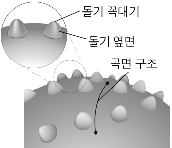

- 배치 / 역할 / 풀이 필수: `PASSAGE` / `INFORMATIONAL` / 아니요
- 종류 / MIME: `DIAGRAM` / `image/png`
- 크기: 347 × 298
- 원본 URL: [열기](https://d1c00yjit06b00.cloudfront.net/dev/exams/6a2291c165dc3dbe848cb467/1780650433879-1vw89w-img0.png)
- 콘텐츠 해시: `sha256:a399f8d1038ac5229ba2e2b419847a37aa6c9c9dc1285a1d003bd086ee220825`

**MEDIA2 — 고체 표면 위 액체의 접촉각이 90도 이상인 경우와 90도 미만인 경우를 비교한 그림.**

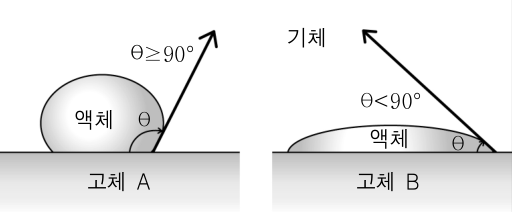

- 배치 / 역할 / 풀이 필수: `PASSAGE` / `ILLUSTRATIVE` / 아니요
- 종류 / MIME: `DIAGRAM` / `image/png`
- 크기: 512 × 212
- 원본 URL: [열기](https://d1c00yjit06b00.cloudfront.net/dev/exams/6a2291c165dc3dbe848cb467/1780650433923-3s7whv-img1.png)
- 콘텐츠 해시: `sha256:d46546dc235a818177aa89b9cb6bdfbaf144619afe1908fa5acf7d89b04b2613`

### 문제

- 문항 제목: 보기의 내용을 이해한 것으로 적절하지 않은 것 고르기
- 배점: 3점
- 태그: `보기 적용`, `3점`

**발문**: 윗글을 바탕으로 <보기>의 내용을 이해한 것으로 적절하지 않은 것은?

#### 보기

안개 속 수분의 포집과 이동을 위해 나미브 사막 딱정벌레의 등판을 모방한 패널에 재료 A ~ D를 코팅하고자 한다. 재료 간의 젖음성 차이가 클수록 효율이 높아진다는 점에 주목하여, 접촉각이 10° 미만인 상태를 '초친수성', 150° 이상인 상태를 '초소수성'으로 정의하고 해당 재료들을 분류하였다. 이 재료들 중에서 돌기 꼭대기, 돌기의 옆면에 코팅할 재료를 선정하고자 한다.

(단, 제시되지 않은 모든 조건은 동일하다고 가정함.)

재료 A B C D

재료를 코팅한 패널과 물의 접촉각 7° 40° 105° 160°

#### 선지

1. 물입자와의 부착력이 강한 물질인 A는 표면 에너지가 가장 높겠군.

2. 접촉각이 90°보다 낮은 친수성 물질인 B는 부착력이 응집력보다 크겠군.

3. 돌기의 꼭대기에 A를, 돌기의 옆면에 D를 코팅하면 수분 포집과 이동에 가장 효율적이겠군.

4. 돌기의 옆면에 C를 코팅하는 것보다 A를 코팅하는 것이 유도로의 역할을 하는 데에 더 적합하겠군.

5. 돌기의 꼭대기에 C를, 돌기의 옆면에 B를 코팅하는 것은 서로 위치를 바꾸어 바르는 경우보다 물입자의 이동 효율이 떨어지겠군.

**공식 정답: 4번 (`C4`) — 돌기의 옆면에 C를 코팅하는 것보다 A를 코팅하는 것이 유도로의 역할을 하는 데에 더 적합하겠군.**

### 골드 후보 전체

- 스키마: `problem-solving-gold-v2`
- 골드 상태: `candidate`
- 골드 원천: `6a2294f386fd308968e10e95` / 고1 2026년 6월 - 교육청 모의평가 / 19번
- question / passage ID: `6a2294f386fd308968e10e95-q19` / `6a2294f386fd308968e10e95-passage`
- 골드 발문: 윗글을 바탕으로 <보기>의 내용을 이해한 것으로 적절하지 않은 것은?
- 발문 극성: `SELECT_INCORRECT`
- 정답 choice ID: `C4`

#### 시나리오와 사실

안개 속 수분의 포집과 이동을 위해 나미브 사막 딱정벌레의 등판을 모방한 패널에 재료 A~D를 코팅하고자 한다. 재료 간 젖음성 차이가 클수록 효율이 높다. 접촉각 10° 미만은 초친수성, 150° 이상은 초소수성으로 정의한다. 제시되지 않은 모든 조건은 동일하다. 재료 A, B, C, D를 코팅한 패널과 물의 접촉각은 각각 7°, 40°, 105°, 160°이다.

- `SF1` 재료 간 젖음성 차이가 클수록 수분 포집과 이동의 효율이 높다.
- `SF2` 접촉각이 10° 미만인 상태는 초친수성으로 정의된다.
- `SF3` 접촉각이 150° 이상인 상태는 초소수성으로 정의된다.
- `SF4` 재료 A를 코팅한 패널과 물의 접촉각은 7°이다.
- `SF5` 재료 B를 코팅한 패널과 물의 접촉각은 40°이다.
- `SF6` 재료 C를 코팅한 패널과 물의 접촉각은 105°이다.
- `SF7` 재료 D를 코팅한 패널과 물의 접촉각은 160°이다.
- `SF8` 제시되지 않은 모든 조건은 동일하다고 가정한다.

#### 원문 근거 명제

- passage detail ID: `6a2294f386fd308968e10e95-passage`

##### MP1 · P1

딱정벌레 등판의 미세 돔형 돌기 꼭대기는 물과 결합하기 쉬운 친수성을 띤다.

- 원문 증거: “이 돌기의 꼭대기 부분은 물과 결합하기 쉬운 친수성을 띤다.”
- 범위: 딱정벌레 등판의 돌기 꼭대기
- 극성 / 근거 유형: `positive` / `PASSAGE_EXPLICIT`
- 조건: 없음
- 예외: 없음

##### MP2 · P1

딱정벌레 등판에서 돌기 옆면과 돌기들 사이의 바닥면은 물을 배척하는 소수성을 띤다.

- 원문 증거: “돌기 옆면과 돌기들 사이의 바닥면은 왁스와 유사한 성분으로 되어 있어 물을 배척하는 소수성을 띤다.”
- 범위: 딱정벌레 등판의 돌기 옆면과 바닥면
- 극성 / 근거 유형: `positive` / `PASSAGE_EXPLICIT`
- 조건: 없음
- 예외: 없음

##### MP3 · P1

젖음성이 크면 친수성이고, 젖음성이 작으면 소수성이다.

- 원문 증거: “젖음성이 크면 친수성, 작으면 소수성이라고 한다.”
- 범위: 고체 표면의 젖음성
- 극성 / 근거 유형: `positive` / `PASSAGE_EXPLICIT`
- 조건: 없음
- 예외: 없음

##### MP4 · P3

고체의 표면 에너지가 높을수록 부착력이 강해져 액체가 넓게 퍼지고, 접촉각은 90°보다 작아져 친수성을 띤다.

- 원문 증거: “고체의 표면 에너지가 높을수록 부착력이 강해져 액체가 넓게 퍼지며, 접촉각이 90°보다 작아져 친수성을 띤다.”
- 범위: 고체 표면의 표면 에너지·접촉각·친수성 관계
- 극성 / 근거 유형: `positive` / `PASSAGE_EXPLICIT`
- 조건: 없음
- 예외: 없음

##### MP5 · P3

고체의 표면 에너지가 낮을수록 응집력이 우세해져 액체가 구형에 가깝게 맺히고, 접촉각은 90° 이상이 되어 소수성을 띤다.

- 원문 증거: “고체의 표면 에너지가 낮을수록 응집력이 우세해져 액체가 구형에 가깝게 맺히며, 접촉각은 90° 이상이 되어 소수성을 띤다.”
- 범위: 고체 표면의 표면 에너지·접촉각·소수성 관계
- 극성 / 근거 유형: `positive` / `PASSAGE_EXPLICIT`
- 조건: 없음
- 예외: 없음

##### MP6 · P3

표면 에너지가 높을수록 접촉각은 작아진다.

- 원문 증거: “다시 말해 표면 에너지가 높을수록 접촉각은 작아진다.”
- 범위: 고체 표면의 표면 에너지와 접촉각
- 극성 / 근거 유형: `positive` / `PASSAGE_EXPLICIT`
- 조건: 없음
- 예외: 없음

##### MP7 · P4

친수성인 돌기 꼭대기는 표면 에너지가 높아 미세 물입자가 즉시 흡착되어 응축핵을 형성한다.

- 원문 증거: “친수성 부분은 표면 에너지가 높아 물입자가 즉시 흡착되어 응축핵을 형성한다.”
- 범위: 딱정벌레 등판의 돌기 꼭대기
- 극성 / 근거 유형: `positive` / `PASSAGE_EXPLICIT`
- 조건: 안개 속 미세 물입자가 돌기 꼭대기에 충돌할 때
- 예외: 없음

##### MP8 · P4

돌기 꼭대기를 제외한 소수성 부분은 높은 접촉각을 유지하여 물방울이 표면에 퍼지지 않고 구형을 유지하게 돕는다.

- 원문 증거: “돌기 꼭대기를 제외한 소수성 부분은 낮은 표면 에너지로 인해 물방울과의 높은 접촉각을 유지하므로 물방울이 표면에 퍼지지 않고 구형을 유지하게 돕는다.”
- 범위: 딱정벌레 등판의 소수성 부분
- 극성 / 근거 유형: `positive` / `PASSAGE_EXPLICIT`
- 조건: 없음
- 예외: 없음

##### MP9 · P4

소수성 부분이 물방울의 구형을 유지하게 하는 것은 물방울과 표면 사이의 마찰 저항을 극소화하여, 미세한 경사의 유도로만 있어도 물방울이 입까지 쉽게 흘러내릴 조건이 된다.

- 원문 증거: “이는 물방울과 표면 사이의 마찰 저항을 극소화하여 미세한 경사의 유도로만 있어도 입까지 쉽게 흘러내릴 수 있는 조건이 된다.”
- 범위: 딱정벌레 등판에서 물방울의 이동
- 극성 / 근거 유형: `positive` / `PASSAGE_EXPLICIT`
- 조건: 없음
- 예외: 없음

#### 시각 자료 주장

- `VA1` (`MEDIA1`, `LABEL`): 그림은 등판의 돌기 꼭대기와 돌기 옆면, 그리고 등판의 곡면 구조를 구분해 표시한다.
- `VA2` (`MEDIA2`, `COMPARISON`): 그림은 접촉각 90° 이상인 경우와 90° 미만인 경우의 액체 형태를 대비해 보인다.

#### 문항 추론

##### I1 · COMPARE

모든 다른 조건이 동일할 때 A의 접촉각 7°는 네 재료 중 가장 작으므로, 표면 에너지는 A가 가장 높고 그에 따라 물입자와의 부착력도 가장 강하다.

- 결론: 모든 다른 조건이 동일할 때 A의 접촉각 7°는 네 재료 중 가장 작으므로, 표면 에너지는 A가 가장 높고 그에 따라 물입자와의 부착력도 가장 강하다.
- 대상 주장 / 효과: `OC1-1` / `SUPPORTS`
- 직접 전제 refs: `MP6`, `SF4`, `SF5`, `SF6`, `SF7`, `SF8`
- 원문 참조: 문단 `P3` / 명제 `MP6`
- 시나리오 사실: `SF4`, `SF5`, `SF6`, `SF7`, `SF8`
- 시각 주장: 없음
- grounding / necessity: `SOURCE_ENTAILED` / `REQUIRED`

##### I2 · CLASSIFY

B의 접촉각은 40°로 90°보다 작으므로 B는 친수성이고, 친수성의 이 경우 부착력이 강해 액체가 퍼지는 방향이므로 부착력이 응집력보다 크다.

- 결론: B의 접촉각은 40°로 90°보다 작으므로 B는 친수성이고, 친수성의 이 경우 부착력이 강해 액체가 퍼지는 방향이므로 부착력이 응집력보다 크다.
- 대상 주장 / 효과: `OC2-1` / `SUPPORTS`
- 직접 전제 refs: `MP4`, `SF5`
- 원문 참조: 문단 `P3` / 명제 `MP4`
- 시나리오 사실: `SF5`
- 시각 주장: 없음
- grounding / necessity: `SOURCE_ENTAILED` / `REQUIRED`

##### I3 · APPLY_RULE

A는 접촉각 7°로 친수성인 돌기 꼭대기에서 물입자 포집에 적합하고, D는 접촉각 160°로 소수성인 돌기 옆면에서 물방울 이동에 적합하며, A와 D의 젖음성 차이가 가장 커 이 조합이 수분 포집과 이동에 가장 효율적이다.

- 결론: A는 접촉각 7°로 친수성인 돌기 꼭대기에서 물입자 포집에 적합하고, D는 접촉각 160°로 소수성인 돌기 옆면에서 물방울 이동에 적합하며, A와 D의 젖음성 차이가 가장 커 이 조합이 수분 포집과 이동에 가장 효율적이다.
- 대상 주장 / 효과: `OC3-1` / `SUPPORTS`
- 직접 전제 refs: `MP1`, `MP2`, `MP7`, `MP9`, `SF1`, `SF4`, `SF7`
- 원문 참조: 문단 `P1` / 명제 `MP1`, `MP2`; 문단 `P4` / 명제 `MP7`, `MP9`
- 시나리오 사실: `SF1`, `SF4`, `SF7`
- 시각 주장: 없음
- grounding / necessity: `SOURCE_ENTAILED` / `REQUIRED`

##### I4 · APPLY_RULE

돌기 옆면은 소수성이어야 물방울의 퍼짐과 마찰을 줄여 유도로 역할을 할 수 있는데, C는 접촉각 105°의 소수성인 반면 A는 접촉각 7°의 친수성이므로 A를 코팅하는 것이 C보다 유도로 역할에 더 적합하다는 결론은 성립하지 않는다.

- 결론: 돌기 옆면은 소수성이어야 물방울의 퍼짐과 마찰을 줄여 유도로 역할을 할 수 있는데, C는 접촉각 105°의 소수성인 반면 A는 접촉각 7°의 친수성이므로 A를 코팅하는 것이 C보다 유도로 역할에 더 적합하다는 결론은 성립하지 않는다.
- 대상 주장 / 효과: `OC4-1` / `CONTRADICTS`
- 직접 전제 refs: `MP2`, `MP4`, `MP5`, `MP8`, `MP9`, `SF4`, `SF6`
- 원문 참조: 문단 `P1` / 명제 `MP2`; 문단 `P3` / 명제 `MP4`, `MP5`; 문단 `P4` / 명제 `MP8`, `MP9`
- 시나리오 사실: `SF4`, `SF6`
- 시각 주장: 없음
- grounding / necessity: `SOURCE_ENTAILED` / `REQUIRED`

##### I5 · COMPARE

C는 접촉각 105°의 소수성이어서 꼭대기의 물입자 포집에 부적합하고, B는 접촉각 40°의 친수성이어서 옆면의 물방울 이동에 부적합하므로, 꼭대기에 C·옆면에 B를 코팅하는 조합은 꼭대기에 B·옆면에 C를 코팅하는 조합보다 물입자 이동 효율이 떨어진다.

- 결론: C는 접촉각 105°의 소수성이어서 꼭대기의 물입자 포집에 부적합하고, B는 접촉각 40°의 친수성이어서 옆면의 물방울 이동에 부적합하므로, 꼭대기에 C·옆면에 B를 코팅하는 조합은 꼭대기에 B·옆면에 C를 코팅하는 조합보다 물입자 이동 효율이 떨어진다.
- 대상 주장 / 효과: `OC5-1` / `SUPPORTS`
- 직접 전제 refs: `MP1`, `MP2`, `MP7`, `MP9`, `SF5`, `SF6`
- 원문 참조: 문단 `P1` / 명제 `MP1`, `MP2`; 문단 `P4` / 명제 `MP7`, `MP9`
- 시나리오 사실: `SF5`, `SF6`
- 시각 주장: 없음
- grounding / necessity: `SOURCE_ENTAILED` / `REQUIRED`

#### 보충 설명 추론

없음

#### 선지별 골드 판정

##### C1 · 물입자와의 부착력이 강한 물질인 A는 표면 에너지가 가장 높겠군.

- 위치 / 판정: 1 / `TRUE`
- 판정 근거: A의 접촉각이 네 재료 중 가장 작고, 표면 에너지가 높을수록 접촉각이 작으므로 A의 표면 에너지와 부착력이 가장 높다.
- 주장 IDs: `OC1-1`
- 필수 원문 참조: 문단 `P3` / 명제 `MP6`
- 필수 시나리오 사실: `SF4`, `SF5`, `SF6`, `SF7`, `SF8`
- 필수 시각 주장: 없음

**주장 OC1-1 (1순위)**

물입자와의 부착력이 강한 물질인 A는 표면 에너지가 가장 높다.

- assessment / support: `SUPPORTED` / `ENTAILED`
- decision / basis: `ACCEPTED` / `SOURCE_GROUNDED`
- 결정 핵심: 예
- 의존 주장: 없음
- 문항 추론: `I1`
- 원문 참조: 문단 `P3` / 명제 `MP6`
- 시나리오 사실: `SF4`, `SF5`, `SF6`, `SF7`, `SF8`
- 시각 주장: 없음
- 보충 추론: 없음
- 보충 사용 정책: 없음

##### C2 · 접촉각이 90°보다 낮은 친수성 물질인 B는 부착력이 응집력보다 크겠군.

- 위치 / 판정: 2 / `TRUE`
- 판정 근거: B의 접촉각은 40°이고, 접촉각이 90°보다 작은 친수성 표면에서는 부착력이 강하여 액체가 퍼진다.
- 주장 IDs: `OC2-1`
- 필수 원문 참조: 문단 `P3` / 명제 `MP4`
- 필수 시나리오 사실: `SF5`
- 필수 시각 주장: 없음

**주장 OC2-1 (1순위)**

접촉각이 90°보다 낮은 친수성 물질인 B는 부착력이 응집력보다 크다.

- assessment / support: `SUPPORTED` / `ENTAILED`
- decision / basis: `ACCEPTED` / `SOURCE_GROUNDED`
- 결정 핵심: 예
- 의존 주장: 없음
- 문항 추론: `I2`
- 원문 참조: 문단 `P3` / 명제 `MP4`
- 시나리오 사실: `SF5`
- 시각 주장: 없음
- 보충 추론: 없음
- 보충 사용 정책: 없음

##### C3 · 돌기의 꼭대기에 A를, 돌기의 옆면에 D를 코팅하면 수분 포집과 이동에 가장 효율적이겠군.

- 위치 / 판정: 3 / `TRUE`
- 판정 근거: A는 꼭대기에 요구되는 친수성에, D는 옆면에 요구되는 소수성에 부합하며 두 재료의 젖음성 차이도 가장 크다.
- 주장 IDs: `OC3-1`
- 필수 원문 참조: 문단 `P1` / 명제 `MP1`, `MP2`; 문단 `P4` / 명제 `MP7`, `MP9`
- 필수 시나리오 사실: `SF1`, `SF4`, `SF7`
- 필수 시각 주장: 없음

**주장 OC3-1 (1순위)**

돌기 꼭대기에 A를, 돌기 옆면에 D를 코팅하면 수분 포집과 이동에 가장 효율적이다.

- assessment / support: `SUPPORTED` / `ENTAILED`
- decision / basis: `ACCEPTED` / `SOURCE_GROUNDED`
- 결정 핵심: 예
- 의존 주장: 없음
- 문항 추론: `I3`
- 원문 참조: 문단 `P1` / 명제 `MP1`, `MP2`; 문단 `P4` / 명제 `MP7`, `MP9`
- 시나리오 사실: `SF1`, `SF4`, `SF7`
- 시각 주장: 없음
- 보충 추론: 없음
- 보충 사용 정책: 없음

##### C4 · 돌기의 옆면에 C를 코팅하는 것보다 A를 코팅하는 것이 유도로의 역할을 하는 데에 더 적합하겠군.

- 위치 / 판정: 4 / `FALSE`
- 판정 근거: 옆면은 물방울을 퍼지지 않게 하여 마찰을 줄이는 소수성 부분이어야 한다. C는 소수성이고 A는 친수성이므로 A가 더 적합하다는 내용은 지문과 반대이다.
- 주장 IDs: `OC4-1`
- 필수 원문 참조: 문단 `P1` / 명제 `MP2`; 문단 `P3` / 명제 `MP4`, `MP5`; 문단 `P4` / 명제 `MP8`, `MP9`
- 필수 시나리오 사실: `SF4`, `SF6`
- 필수 시각 주장: 없음

**주장 OC4-1 (1순위)**

돌기 옆면에 C를 코팅하는 것보다 A를 코팅하는 것이 유도로 역할에 더 적합하다.

- assessment / support: `CONTRADICTED` / `NONE`
- decision / basis: `REJECTED` / `SOURCE_GROUNDED`
- 결정 핵심: 예
- 의존 주장: 없음
- 문항 추론: `I4`
- 원문 참조: 문단 `P1` / 명제 `MP2`; 문단 `P3` / 명제 `MP4`, `MP5`; 문단 `P4` / 명제 `MP8`, `MP9`
- 시나리오 사실: `SF4`, `SF6`
- 시각 주장: 없음
- 보충 추론: 없음
- 보충 사용 정책: 없음

##### C5 · 돌기의 꼭대기에 C를, 돌기의 옆면에 B를 코팅하는 것은 서로 위치를 바꾸어 바르는 경우보다 물입자의 이동 효율이 떨어지겠군.

- 위치 / 판정: 5 / `TRUE`
- 판정 근거: 꼭대기에는 친수성 B가, 옆면에는 소수성 C가 배치되어야 각각 포집과 이동에 적합하다. 따라서 C와 B를 반대로 배치하면 효율이 떨어진다.
- 주장 IDs: `OC5-1`
- 필수 원문 참조: 문단 `P1` / 명제 `MP1`, `MP2`; 문단 `P4` / 명제 `MP7`, `MP9`
- 필수 시나리오 사실: `SF5`, `SF6`
- 필수 시각 주장: 없음

**주장 OC5-1 (1순위)**

돌기 꼭대기에 C를, 돌기 옆면에 B를 코팅하는 것은 서로 위치를 바꾸어 코팅하는 경우보다 물입자 이동 효율이 떨어진다.

- assessment / support: `SUPPORTED` / `ENTAILED`
- decision / basis: `ACCEPTED` / `SOURCE_GROUNDED`
- 결정 핵심: 예
- 의존 주장: 없음
- 문항 추론: `I5`
- 원문 참조: 문단 `P1` / 명제 `MP1`, `MP2`; 문단 `P4` / 명제 `MP7`, `MP9`
- 시나리오 사실: `SF5`, `SF6`
- 시각 주장: 없음
- 보충 추론: 없음
- 보충 사용 정책: 없음

#### 정답 도출 경로

##### S1

돌기 옆면은 소수성 부분이며, 이 소수성은 물방울의 퍼짐과 마찰 저항을 줄여 입 쪽으로의 이동 조건을 만든다.

- 원문 참조: 문단 `P1` / 명제 `MP2`; 문단 `P4` / 명제 `MP8`, `MP9`
- 시나리오 사실: 없음
- 시각 주장: 없음
- 문항 추론: 없음
- 선지 주장: 없음

##### S2

C의 접촉각 105°는 소수성에 해당하고 A의 접촉각 7°는 친수성에 해당한다.

- 원문 참조: 문단 `P3` / 명제 `MP4`, `MP5`
- 시나리오 사실: `SF4`, `SF6`
- 시각 주장: 없음
- 문항 추론: 없음
- 선지 주장: 없음

##### S3

따라서 유도로 역할을 하는 돌기 옆면에는 C가 A보다 적합하므로, A가 C보다 더 적합하다는 ④의 주장은 성립하지 않는다.

- 원문 참조: 문단 `P1` / 명제 `MP2`; 문단 `P3` / 명제 `MP4`, `MP5`; 문단 `P4` / 명제 `MP8`, `MP9`
- 시나리오 사실: `SF4`, `SF6`
- 시각 주장: 없음
- 문항 추론: `I4`
- 선지 주장: `OC4-1`

- 필수 단계: `S1`, `S2`, `S3`
- 결정 단계: `S2`
- 결론 단계: `S3`
- 최종 답: `C4`
- 최종 설명: 돌기 옆면은 소수성이어야 물방울이 퍼지지 않고 마찰이 줄어 유도로 역할을 한다. C는 소수성(105°)이고 A는 친수성(7°)이므로, A가 C보다 옆면에 더 적합하다는 ④가 적절하지 않다.
- 최종 설명 참조 단계: `S1`, `S2`, `S3`

#### 대표 오답 경로

- `WP1` 접촉각의 절대값 차이만 고려하거나 꼭대기의 친수성 및 옆면의 소수성이라는 서로 다른 기능을 구분하지 않아 ③을 부적절한 선택지로 판단하는 경로.
  - scope: `SELECTED_WRONG_CHOICE`
  - 선택 선지: `C3`
  - 놓친 정답: `없음`
  - 분기 층위 후보: `CONCEPT_BOUNDARY`, `CONCEPT_SCENARIO_MAPPING`, `CONDITION_APPLICATION`, `SELECTION_EXECUTION`
- `WP2` 꼭대기에서는 친수성이 포집에, 옆면에서는 소수성이 이동에 적합하다는 위치별 기능을 뒤바꾸어 ⑤의 비교를 잘못 판단하는 경로.
  - scope: `SELECTED_WRONG_CHOICE`
  - 선택 선지: `C5`
  - 놓친 정답: `없음`
  - 분기 층위 후보: `PASSAGE_REPRESENTATION`, `CONCEPT_SCENARIO_MAPPING`, `CHOICE_INTERPRETATION`, `SELECTION_EXECUTION`

#### 골드 자체 검수 메모

없음

### 충분 근거 조합 후보

#### 6a2294f386fd308968e10e95-q19-C1-SGC1

- 선지 / 대상 주장: `C1` / `OC1-1`
- 제안 경로 / 연산자: `APPROVED_SUFFICIENT_GROUND_SET` / `ALL_OF`
- 필수 근거: `MP6`, `SF4`, `SF5`, `SF6`, `SF7`, `SF8`
- 생략 허용 근거: 없음
- 결론: 모든 다른 조건이 동일할 때 A의 접촉각 7°는 네 재료 중 가장 작으므로, 표면 에너지는 A가 가장 높고 그에 따라 물입자와의 부착력도 가장 강하다.
- 원천 추론: `I1`
- 생성 방식 / 상태: `AI_INFERENCE_GRAPH_DERIVED` / `candidate`
- 위험 표지: 없음

#### 6a2294f386fd308968e10e95-q19-C2-SGC1

- 선지 / 대상 주장: `C2` / `OC2-1`
- 제안 경로 / 연산자: `APPROVED_SUFFICIENT_GROUND_SET` / `ALL_OF`
- 필수 근거: `MP4`, `SF5`
- 생략 허용 근거: 없음
- 결론: B의 접촉각은 40°로 90°보다 작으므로 B는 친수성이고, 친수성의 이 경우 부착력이 강해 액체가 퍼지는 방향이므로 부착력이 응집력보다 크다.
- 원천 추론: `I2`
- 생성 방식 / 상태: `AI_INFERENCE_GRAPH_DERIVED` / `candidate`
- 위험 표지: 없음

#### 6a2294f386fd308968e10e95-q19-C3-SGC1

- 선지 / 대상 주장: `C3` / `OC3-1`
- 제안 경로 / 연산자: `APPROVED_SUFFICIENT_GROUND_SET` / `ALL_OF`
- 필수 근거: `MP1`, `MP2`, `MP7`, `MP9`, `SF1`, `SF4`, `SF7`
- 생략 허용 근거: 없음
- 결론: A는 접촉각 7°로 친수성인 돌기 꼭대기에서 물입자 포집에 적합하고, D는 접촉각 160°로 소수성인 돌기 옆면에서 물방울 이동에 적합하며, A와 D의 젖음성 차이가 가장 커 이 조합이 수분 포집과 이동에 가장 효율적이다.
- 원천 추론: `I3`
- 생성 방식 / 상태: `AI_INFERENCE_GRAPH_DERIVED` / `candidate`
- 위험 표지: 없음

#### 6a2294f386fd308968e10e95-q19-C4-SGC1

- 선지 / 대상 주장: `C4` / `OC4-1`
- 제안 경로 / 연산자: `APPROVED_SUFFICIENT_GROUND_SET` / `ALL_OF`
- 필수 근거: `MP2`, `MP4`, `MP5`, `MP8`, `MP9`, `SF4`, `SF6`
- 생략 허용 근거: 없음
- 결론: 돌기 옆면은 소수성이어야 물방울의 퍼짐과 마찰을 줄여 유도로 역할을 할 수 있는데, C는 접촉각 105°의 소수성인 반면 A는 접촉각 7°의 친수성이므로 A를 코팅하는 것이 C보다 유도로 역할에 더 적합하다는 결론은 성립하지 않는다.
- 원천 추론: `I4`
- 생성 방식 / 상태: `AI_INFERENCE_GRAPH_DERIVED` / `candidate`
- 위험 표지: 없음

#### 6a2294f386fd308968e10e95-q19-C5-SGC1

- 선지 / 대상 주장: `C5` / `OC5-1`
- 제안 경로 / 연산자: `APPROVED_SUFFICIENT_GROUND_SET` / `ALL_OF`
- 필수 근거: `MP1`, `MP2`, `MP7`, `MP9`, `SF5`, `SF6`
- 생략 허용 근거: 없음
- 결론: C는 접촉각 105°의 소수성이어서 꼭대기의 물입자 포집에 부적합하고, B는 접촉각 40°의 친수성이어서 옆면의 물방울 이동에 부적합하므로, 꼭대기에 C·옆면에 B를 코팅하는 조합은 꼭대기에 B·옆면에 C를 코팅하는 조합보다 물입자 이동 효율이 떨어진다.
- 원천 추론: `I5`
- 생성 방식 / 상태: `AI_INFERENCE_GRAPH_DERIVED` / `candidate`
- 위험 표지: 없음

### 생성·검증 기록

- 원시 스키마 통과: 아니요
- 원시 오류: decisivePathStepIds: 결정적 분기와 결론 단계는 분리해야 한다.; representativeWrongPaths.0.missedAnswerChoiceId: 선택 선지 경로에는 놓친 정답을 지정하지 않는다.; representativeWrongPaths.1.missedAnswerChoiceId: 선택 선지 경로에는 놓친 정답을 지정하지 않는다.
- 자동 정규화: `SEPARATE_DECISIVE_AND_CONCLUSION_STEPS`, `ALIGN_WRONG_PATH_MISSED_ANSWER`, `ALIGN_WRONG_PATH_MISSED_ANSWER`
- 최종 스키마 통과: 예
- 최종 오류: 없음
- 생성 모델 / effort: `gpt-5.6-terra` / `medium`
- 프롬프트 버전: `problem-gold-generation-prompt-v2`
- 생성 시간: 55742ms

- 검수 파일 상태: `PENDING`
- 검수자 / 시각: 없음 / 없음
- 승인된 충분 근거 후보: 없음
- 검수 메모: 없음

**사람 검수 메모:**

- 판정:
- 수정 필요 사항:
- 승인할 충분 근거 후보:

[목차로 돌아가기](#빠른-목차)

---

## 2. 고2 2025년 10월 - 교육청 모의평가 · 수치예보와 수치예보 모델의 원리 25번

### 검수 상태

- case ID: `prospective-69c0186c78128b2a9bede0c8-q25`
- 분야: `SCIENCE`
- 표본 범위: `NEGATIVE_STEM`, `SCIENCE`, `SCENARIO_APPLICATION`, `CALCULATION`, `VISUAL`, `MULTI_CONDITION`
- 생산 상태: `PENDING_HUMAN_REVIEW`
- 후보 종류: 정적 검증을 통과한 후보
- 사람 검수 상태: `PENDING`
- 검수 위험도: `MEDIUM`
- 위험 사유: VISUAL_REQUIRED; MULTIPLE_INFERENCES
- 원천 해시: `sha256:5272463c39ad3956980484ee1798015b43dbe411f1a34dcb4738d885c592dcca`

검수 체크: [ ] 공식 정답과 선지 판정 일치 · [ ] 원문 근거 정확 · [ ] 추론 비약 없음 · [ ] 충분 근거가 최소 조합 · [ ] 시각 자료 해석 정확

### 원문

대기는 연속적인 유체로, 사방으로 운동한다. 대기의 상태는 기압, 기온, 습도, 바람 등의 변수로 나타내는데, 이들 간의 상호 작용으로 인해 대기의 상태가 변한다. 이러한 변화를 예측하기 위해 수치예보가 활용되는데, 수치예보는 대기의 운동과 변화를 설명하는 복잡하고 방대한 방정식들을 슈퍼컴퓨터로 계산하여 미래의 대기 상태를 모의하고 기상 현상을 예측하는 일련의 과정이다. 이때 모의한다는 것은 방정식들의 근사해를 구하여 미래의 대기 상태를 도출하는 것을 의미한다. 수치예보를 위해서는 슈퍼컴퓨터로 수치예보 모델을 가동하는데, 수치예보 모델을 가동하는 목적에 따라 모의할 대기의 영역을 정한 후 그 영역을 격자 단위로 세분화한다.

모의 영역은 지표면에 수직인 연직 방향으로 여러 층으로 나누어지고, 각 층은 위도와 경도의 수평 방향으로 일정하게 나누어진 격자로 구성된다. 이에 따라 대기는 육면체의 공기 덩이들의 집합체가 되며, 각 공기 덩이에서는 변수의 값이 일정한 시간 간격마다 계산된다. 수평 방향의 해상도는 격자점 간 거리가 좁을수록 높고, 연직 방향의 해상도는 연직 방향의 층수가 많을수록 높다. 그리고 시간 간격이 좁을수록 대기 상태의 변화 양상을 연속적으로 모의할 수 있다. 대기를 모의하는 정도는 분해능으로 나타내는데, 분해능은 시공간적으로 대기 상태를 얼마나 세밀하게 모의할 수 있는지를 나타내는 척도이다. 따라서 공간분해능과 시간분해능이 높을수록 대기를 세밀하게 모의할 수 있다. 공간분해능은 격자점 간 거리로, 시간분해능은 시간 간격으로 나타내며, 각각의 값이 작을수록 분해능이 높다.

공간분해능과 시간분해능은 서로 관련이 있다. 일반적으로 수평 방향의 공간분해능을 대기의 최대 속도로 나눈 값을 시간분해능의 상한선으로 둔다. 이는 대기가 정해진 시간 간격 동안 격자점 간 거리보다 더 멀리 이동하게 되면 변수의 값을 구할 수 없는 격자점이 생기기 때문이다. 또한, 일반적으로 모델에 이미 설정된 수평 방향의 공간분해능을 두 배로 높이면 계산의 안정성을 위해 연직 방향의 공간분해능과 시간분해능도 각각 두 배로 높인다. 그러면 3차원 공간의 세 축과 시간 차원에서 각각 계산량이 두 배로 증가하게 되어, 전체 계산량은 24배가 된다.

모의 영역의 대기를 격자 단위로 세분화한 뒤에는 방정식들을 계산하기 위한 조건을 설정한다. 시간에 대한 초기 조건 설정은 모의를 시작하는 시점에서의 대기 상태를 설정하는 것으로, 격자점마다 대기 상태를 나타내는 변수의 값을 개별적으로 부여한다. 공간에 대한 경계 조건 설정은 모의 영역의 하단, 상단, 측면 경계에서의 대기 상태를 설정하는 것으로, 여기에는 대기와 에너지의 상호작용 및 대기의 이동 등이 반영된다. 먼저, 하단 경계에서는 대기가 지표면을 통과할 수 없기 때문에 대기의 연직 운동이 없다고 가정한다. 그러나 지표면 부근에서는 대기와 지표면 간에 복잡한 에너지 교환이 발생하는데, 특히 지표면이 흡수한 태양 에너지가 열과 수증기의 형태로 대기에 전달되면서 대기 상태를 나타내는 변수의 값에 직접적인 영향을 끼친다. 따라서 하단 경계의 조건을 설정할 때는 이러한 에너지의 흐름을 반영하여 계산한다.

상단 경계에서는 고도가 높아질수록 대기의 연직 운동이 약해지고 상향 전파되는 에너지가 점차 줄어드는 특성을 고려한다. 이에 따라 최상층 고도에서 대기의 연직 운동이 없다고 가정하고 연직 속도를 0으로 설정하는데, 이렇게 하면 영역 외부로 빠져나가야 할 에너지가 최상층에서 반사되어 영역 내부로 되돌아오는 것으로 모의된다. 그 결과 영역 내부에서 에너지가 비현실적으로 증가한 것으로 모의되어 대기 상태를 나타내는 변수의 값이 왜곡될 수 있다. 이를 완화하기 위해 일반적으로 영역 내부에 감쇠층을 두어 에너지가 감쇠층에서 흡수되도록 계산하는 방법과 상향 전파되는 에너지가 자연스럽게 흩어지도록 계산하는 방법을 함께 적용한다. 이때 최상층 고도가 약 80km 이상으로 충분히 높으면 후자가, 최상층 고도가 그보다 낮으면 전자가 주요하게 작용한다.

측면 경계에 대한 조건은 제한된 영역의 대기 현상을 모의하는 모델인 지역 모델에서 설정한다. 측면 경계에서는 영역의 모든 층에서 대기의 유출입이 계속 발생하므로 영역 외부의 대기 상태를 나타내는 변수의 값을 영역 내부에 반영하는 작업이 필요하다. 이 때문에 지역 모델은 지구 전체의 대기 현상을 모의하는 모델인 전지구 모델에서 자료를 제공받아 측면 경계 조건으로 활용한다. 이는 지역 모델과 상위 모델인 전지구 모델 간에, 대기 상태를 나타내는 변수의 값이 불일치하는 정도를 최소화하기 위한 것이다.

#### 원문·문제 시각 자료

**MEDIA1 — 수치예보의 의미와 수치예보 모델 준비 과정의 빈칸을 제시한 학습용 도식**

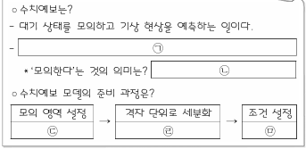

- 배치 / 역할 / 풀이 필수: `PASSAGE` / `ILLUSTRATIVE` / 아니요
- 종류 / MIME: `DIAGRAM` / `image/png`
- 크기: 343 × 167
- 원본 URL: [열기](https://d1c00yjit06b00.cloudfront.net/dev/exams/69bbe329a9ac92778edc507a/1774339497234-l2iylz-img0.png)
- 콘텐츠 해시: `sha256:dd41408a31a7b046040013eb34394309b57667becc9b8ac9afd8dee4ee8a0405`

**MEDIA2 — 모델 A~D의 수평 공간분해능, 최상층 고도, 연직 층수, 시간분해능을 비교한 표**

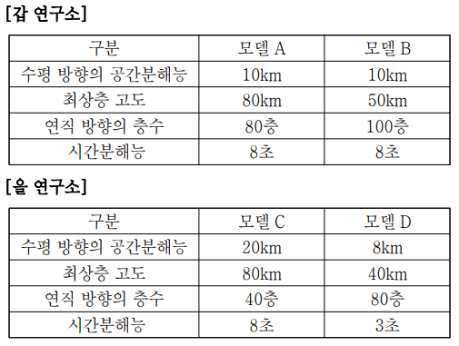

- 배치 / 역할 / 풀이 필수: `SCENARIO` / `INFORMATIONAL` / 예
- 종류 / MIME: `TABLE` / `image/png`
- 크기: 505 × 381
- 원본 URL: [열기](https://d1c00yjit06b00.cloudfront.net/exams/69bbe329a9ac92778edc507a/1774196548580-image-0.png)
- 콘텐츠 해시: `sha256:5c920832f7fc21d7d687a322446ceb333c9384b905388cbf09d3c0c617e6e20e`

### 문제

- 문항 제목: 없음
- 배점: 3점
- 태그: 없음

**발문**: 윗글을 참고하여 <보기>를 이해한 반응으로 적절하지 않은 것은?

#### 보기

다음은 기상 연구소 갑과 을이 사용하는 수치예보 모델의 주요 특성을 정리해 놓은 것이다. A와 C는 전지구 모델이며, B와 D는 모의 영역이 동일한 지역 모델이다. 현재 A ~ D에 적용된 대기의 최대 속도는 1km/s이다. (단, 각 모델 내에서는 연직 방향의 각 층 사이의 간격이 동일하다고 가정한다. 표에 제시된 내용 이외의 요인은 고려하지 않는다.)

[보기 이미지 원본 열기](https://d1c00yjit06b00.cloudfront.net/exams/69bbe329a9ac92778edc507a/1774196548580-image-0.png)

#### 선지

1. A는 C보다 수평 방향과 연직 방향의 해상도가 높으므로 대기 상태를 더 세밀하게 모의할 수 있겠군.

2. B와 D에 적용된 대기의 최대 속도가 현재의 2배가 된다면, D는 B와 달리 시간분해능을 다시 설정하지는 않아도 되겠군.

3. B와 D는 모두, 상단 경계 조건을 설정할 때 영역 내부에 감쇠층을 두어 에너지가 감쇠층에서 흡수되도록 계산하는 방법이 주요하게 작용하겠군.

4. C에 설정된 현재의 수평 방향의 공간분해능을 A와 같아지도록 높이면, C의 전체 계산량은 현재의 4배가 되겠군.

5. B와 D는 대기 상태를 나타내는 변수의 값이 상위 모델과 불일치하는 정도를 최소화하기 위해 A나 C로부터 제공받은 자료를 측면 경계 조건으로 활용하겠군.

**공식 정답: 4번 (`C4`) — C에 설정된 현재의 수평 방향의 공간분해능을 A와 같아지도록 높이면, C의 전체 계산량은 현재의 4배가 되겠군.**

### 골드 후보 전체

- 스키마: `problem-solving-gold-v2`
- 골드 상태: `candidate`
- 골드 원천: `69c0186c78128b2a9bede0c8` / 고2 2025년 10월 - 교육청 모의평가 / 25번
- question / passage ID: `69c0186c78128b2a9bede0c8-q25` / `69c0186c78128b2a9bede0c8-passage`
- 골드 발문: 윗글을 참고하여 <보기>를 이해한 반응으로 적절하지 않은 것은?
- 발문 극성: `SELECT_INCORRECT`
- 정답 choice ID: `C4`

#### 시나리오와 사실

기상 연구소 갑과 을이 사용하는 수치예보 모델의 주요 특성 표이다. A와 C는 전지구 모델이고 B와 D는 모의 영역이 동일한 지역 모델이다. A~D에 적용된 대기의 최대 속도는 현재 1km/s이다. 각 모델 내 연직 방향 각 층 사이 간격은 동일하며, 표에 제시된 내용 이외의 요인은 고려하지 않는다.

- `SF1` 모델 A와 C는 전지구 모델이며, 모델 B와 D는 모의 영역이 동일한 지역 모델이다.
- `SF2` 현재 모델 A~D에 적용된 대기의 최대 속도는 모두 1km/s이다.
- `SF3` 각 모델 내 연직 방향의 각 층 사이 간격은 동일하다고 가정하며, 표에 제시된 내용 이외의 요인은 고려하지 않는다.

#### 원문 근거 명제

- passage detail ID: `69c0186c78128b2a9bede0c8-passage`

##### MP1 · P1

수치예보는 대기 운동과 변화를 설명하는 방정식들의 근사해를 슈퍼컴퓨터로 계산하여 미래 대기 상태를 모의하고 기상 현상을 예측하는 과정이다.

- 원문 증거: “수치예보는 … 미래의 대기 상태를 모의하고 기상 현상을 예측하는 일련의 과정이다. 이때 모의한다는 것은 방정식들의 근사해를 구하여 미래의 대기 상태를 도출하는 것을 의미한다.”
- 범위: 수치예보의 의미
- 극성 / 근거 유형: `positive` / `PASSAGE_EXPLICIT`
- 조건: 없음
- 예외: 없음

##### MP2 · P1

수치예보 모델을 가동할 때에는 목적에 따라 모의할 대기 영역을 정하고 그 영역을 격자 단위로 세분화한다.

- 원문 증거: “수치예보 모델을 가동하는 목적에 따라 모의할 대기의 영역을 정한 후 그 영역을 격자 단위로 세분화한다.”
- 범위: 수치예보 모델의 준비
- 극성 / 근거 유형: `positive` / `PASSAGE_EXPLICIT`
- 조건: 없음
- 예외: 없음

##### MP3 · P2

수평 방향에서는 격자점 간 거리가 좁을수록 해상도가 높고, 연직 방향에서는 층수가 많을수록 해상도가 높다.

- 원문 증거: “수평 방향의 해상도는 격자점 간 거리가 좁을수록 높고, 연직 방향의 해상도는 연직 방향의 층수가 많을수록 높다.”
- 범위: 공간 해상도
- 극성 / 근거 유형: `positive` / `PASSAGE_EXPLICIT`
- 조건: 없음
- 예외: 없음

##### MP4 · P2

시간 간격이 좁을수록 시간분해능이 높으며, 공간분해능과 시간분해능이 높을수록 대기를 더 세밀하게 모의할 수 있다.

- 원문 증거: “시간 간격이 좁을수록 … 연속적으로 모의할 수 있다. 따라서 공간분해능과 시간분해능이 높을수록 대기를 세밀하게 모의할 수 있다.”
- 범위: 분해능과 모의의 세밀함
- 극성 / 근거 유형: `positive` / `PASSAGE_EXPLICIT`
- 조건: 없음
- 예외: 없음

##### MP5 · P3

일반적으로 수평 방향 공간분해능을 대기의 최대 속도로 나눈 값이 시간분해능의 상한선이며, 정해진 시간 간격 동안 대기가 격자점 간 거리보다 멀리 이동하면 변수값을 구할 수 없는 격자점이 생긴다.

- 원문 증거: “일반적으로 수평 방향의 공간분해능을 대기의 최대 속도로 나눈 값을 시간분해능의 상한선으로 둔다. 이는 … 변수의 값을 구할 수 없는 격자점이 생기기 때문이다.”
- 범위: 수평 공간분해능과 시간분해능의 관계
- 극성 / 근거 유형: `positive` / `PASSAGE_EXPLICIT`
- 조건: 없음
- 예외: 없음

##### MP6 · P3

일반적으로 수평 방향 공간분해능을 두 배로 높이면 계산 안정성을 위해 연직 방향 공간분해능과 시간분해능도 각각 두 배로 높이며, 이 경우 세 공간축과 시간 차원에서 계산량이 각각 두 배가 되어 전체 계산량은 16배가 된다.

- 원문 증거: “수평 방향의 공간분해능을 두 배로 높이면 … 연직 방향의 공간분해능과 시간분해능도 각각 두 배로 높인다. 그러면 3차원 공간의 세 축과 시간 차원에서 각각 계산량이 두 배로 증가하게 되어, 전체 계산량은 2⁴배가 된다.”
- 범위: 분해능 향상과 계산량
- 극성 / 근거 유형: `positive` / `PASSAGE_EXPLICIT`
- 조건: 없음
- 예외: 없음

##### MP7 · P4

하단 경계에서는 대기가 지표면을 통과할 수 없으므로 연직 운동이 없다고 가정하지만, 지표면과 대기 사이의 열과 수증기 형태 에너지 교환은 하단 경계 조건 계산에 반영한다.

- 원문 증거: “하단 경계에서는 … 대기의 연직 운동이 없다고 가정한다. 그러나 … 에너지의 흐름을 반영하여 계산한다.”
- 범위: 하단 경계 조건
- 극성 / 근거 유형: `positive` / `PASSAGE_EXPLICIT`
- 조건: 없음
- 예외: 없음

##### MP8 · P5

최상층 고도를 약 80km 이상으로 충분히 높게 설정하면 상향 전파 에너지가 자연스럽게 흩어지도록 계산하는 방법이 주요하게 작용하고, 최상층 고도가 그보다 낮으면 감쇠층에서 에너지를 흡수하도록 계산하는 방법이 주요하게 작용한다.

- 원문 증거: “최상층 고도가 약 80km 이상으로 충분히 높으면 후자가, 최상층 고도가 그보다 낮으면 전자가 주요하게 작용한다.”
- 범위: 상단 경계 조건
- 극성 / 근거 유형: `positive` / `PASSAGE_EXPLICIT`
- 조건: 최상층 고도 약 80km 이상 또는 그 미만
- 예외: 없음

##### MP9 · P6

지역 모델은 측면 경계에서 전지구 모델의 자료를 제공받아 측면 경계 조건으로 활용하며, 이는 지역 모델과 전지구 모델 간 변수값 불일치 정도를 최소화하기 위한 것이다.

- 원문 증거: “지역 모델은 … 전지구 모델에서 자료를 제공받아 측면 경계 조건으로 활용한다. 이는 … 변수의 값이 불일치하는 정도를 최소화하기 위한 것이다.”
- 범위: 지역 모델의 측면 경계 조건
- 극성 / 근거 유형: `positive` / `PASSAGE_EXPLICIT`
- 조건: 지역 모델의 측면 경계 조건 설정
- 예외: 없음

#### 시각 자료 주장

- `VA1` (`MEDIA2`, `VALUE`): 모델 A의 수평 방향 공간분해능은 10km, 최상층 고도는 80km, 연직 방향 층수는 80층, 시간분해능은 8초이다.
- `VA2` (`MEDIA2`, `VALUE`): 모델 B의 수평 방향 공간분해능은 10km, 최상층 고도는 50km, 연직 방향 층수는 100층, 시간분해능은 8초이다.
- `VA3` (`MEDIA2`, `VALUE`): 모델 C의 수평 방향 공간분해능은 20km, 최상층 고도는 80km, 연직 방향 층수는 40층, 시간분해능은 8초이다.
- `VA4` (`MEDIA2`, `VALUE`): 모델 D의 수평 방향 공간분해능은 8km, 최상층 고도는 40km, 연직 방향 층수는 80층, 시간분해능은 3초이다.

#### 문항 추론

##### INF1 · COMPARE

모델 A의 수평 격자점 간 거리는 10km이고 모델 C의 것은 20km이므로, 수평 방향 해상도는 A가 C보다 높다.

- 결론: 모델 A의 수평 격자점 간 거리는 10km이고 모델 C의 것은 20km이므로, 수평 방향 해상도는 A가 C보다 높다.
- 대상 주장 / 효과: `OC1-1` / `SUPPORTS`
- 직접 전제 refs: `MP3`, `VA1`, `VA3`
- 원문 참조: 문단 `P2` / 명제 `MP3`
- 시나리오 사실: 없음
- 시각 주장: `VA1`, `VA3`
- grounding / necessity: `SOURCE_ENTAILED` / `REQUIRED`

##### INF2 · COMPARE

모델 A는 연직 80층이고 모델 C는 40층이므로, 연직 방향 해상도는 A가 C보다 높다.

- 결론: 모델 A는 연직 80층이고 모델 C는 40층이므로, 연직 방향 해상도는 A가 C보다 높다.
- 대상 주장 / 효과: `OC1-2` / `SUPPORTS`
- 직접 전제 refs: `MP3`, `VA1`, `VA3`
- 원문 참조: 문단 `P2` / 명제 `MP3`
- 시나리오 사실: 없음
- 시각 주장: `VA1`, `VA3`
- grounding / necessity: `SOURCE_ENTAILED` / `REQUIRED`

##### INF3 · APPLY_RULE

수평 방향과 연직 방향의 공간 해상도가 모두 더 높은 모델은 대기 상태를 더 세밀하게 모의할 수 있다.

- 결론: 수평 방향과 연직 방향의 공간 해상도가 모두 더 높은 모델은 대기 상태를 더 세밀하게 모의할 수 있다.
- 대상 주장 / 효과: `OC1-3` / `SUPPORTS`
- 직접 전제 refs: `MP4`
- 원문 참조: 문단 `P2` / 명제 `MP4`
- 시나리오 사실: 없음
- 시각 주장: 없음
- grounding / necessity: `SOURCE_EXPLICIT` / `REQUIRED`

##### INF4 · CALCULATE

최대 속도가 2km/s가 되면 B의 시간분해능 상한선은 5초가 되어 현재 8초를 다시 설정해야 하지만, D의 상한선은 4초이고 현재 3초이므로 D는 다시 설정할 필요가 없다.

- 결론: 최대 속도가 2km/s가 되면 B의 시간분해능 상한선은 5초가 되어 현재 8초를 다시 설정해야 하지만, D의 상한선은 4초이고 현재 3초이므로 D는 다시 설정할 필요가 없다.
- 대상 주장 / 효과: `OC2-1` / `SUPPORTS`
- 직접 전제 refs: `MP5`, `SF2`, `VA2`, `VA4`
- 원문 참조: 문단 `P3` / 명제 `MP5`
- 시나리오 사실: `SF2`
- 시각 주장: `VA2`, `VA4`
- grounding / necessity: `SOURCE_ENTAILED` / `REQUIRED`

##### INF5 · CHECK_CONDITION

모델 B의 최상층 고도는 50km이고 D의 것은 40km로 모두 약 80km보다 낮으므로, 두 모델에서는 감쇠층에서 에너지를 흡수하도록 계산하는 방법이 주요하게 작용한다.

- 결론: 모델 B의 최상층 고도는 50km이고 D의 것은 40km로 모두 약 80km보다 낮으므로, 두 모델에서는 감쇠층에서 에너지를 흡수하도록 계산하는 방법이 주요하게 작용한다.
- 대상 주장 / 효과: `OC3-1` / `SUPPORTS`
- 직접 전제 refs: `MP8`, `VA2`, `VA4`
- 원문 참조: 문단 `P5` / 명제 `MP8`
- 시나리오 사실: 없음
- 시각 주장: `VA2`, `VA4`
- grounding / necessity: `SOURCE_ENTAILED` / `REQUIRED`

##### INF6 · CALCULATE

모델 C의 수평 공간분해능을 20km에서 A와 같은 10km로 두 배 높이면, 연직 공간분해능과 시간분해능도 각각 두 배 높이는 경우 전체 계산량은 4배가 아니라 16배가 된다.

- 결론: 모델 C의 수평 공간분해능을 20km에서 A와 같은 10km로 두 배 높이면, 연직 공간분해능과 시간분해능도 각각 두 배 높이는 경우 전체 계산량은 4배가 아니라 16배가 된다.
- 대상 주장 / 효과: `OC4-1` / `CONTRADICTS`
- 직접 전제 refs: `MP6`, `VA1`, `VA3`
- 원문 참조: 문단 `P3` / 명제 `MP6`
- 시나리오 사실: 없음
- 시각 주장: `VA1`, `VA3`
- grounding / necessity: `SOURCE_ENTAILED` / `REQUIRED`

##### INF7 · APPLY_RULE

지역 모델인 B와 D는 전지구 모델인 A 또는 C가 제공하는 자료를 측면 경계 조건으로 활용하여 상위 전지구 모델과의 변수값 불일치 정도를 최소화한다.

- 결론: 지역 모델인 B와 D는 전지구 모델인 A 또는 C가 제공하는 자료를 측면 경계 조건으로 활용하여 상위 전지구 모델과의 변수값 불일치 정도를 최소화한다.
- 대상 주장 / 효과: `OC5-1` / `SUPPORTS`
- 직접 전제 refs: `MP9`, `SF1`
- 원문 참조: 문단 `P6` / 명제 `MP9`
- 시나리오 사실: `SF1`
- 시각 주장: 없음
- grounding / necessity: `SOURCE_ENTAILED` / `REQUIRED`

#### 보충 설명 추론

없음

#### 선지별 골드 판정

##### C1 · A는 C보다 수평 방향과 연직 방향의 해상도가 높으므로 대기 상태를 더 세밀하게 모의할 수 있겠군.

- 위치 / 판정: 1 / `TRUE`
- 판정 근거: A는 C보다 수평 격자 간 거리가 짧고 연직 층수가 많으므로 두 방향의 해상도가 높다.
- 주장 IDs: `OC1-1`, `OC1-2`, `OC1-3`
- 필수 원문 참조: 문단 `P2` / 명제 `MP3`, `MP4`
- 필수 시나리오 사실: 없음
- 필수 시각 주장: `VA1`, `VA3`

**주장 OC1-1 (1순위)**

모델 A의 수평 방향 해상도는 모델 C보다 높다.

- assessment / support: `SUPPORTED` / `ENTAILED`
- decision / basis: `ACCEPTED` / `SOURCE_GROUNDED`
- 결정 핵심: 예
- 의존 주장: 없음
- 문항 추론: `INF1`
- 원문 참조: 문단 `P2` / 명제 `MP3`
- 시나리오 사실: 없음
- 시각 주장: `VA1`, `VA3`
- 보충 추론: 없음
- 보충 사용 정책: 없음

**주장 OC1-2 (2순위)**

모델 A의 연직 방향 해상도는 모델 C보다 높다.

- assessment / support: `SUPPORTED` / `ENTAILED`
- decision / basis: `ACCEPTED` / `SOURCE_GROUNDED`
- 결정 핵심: 예
- 의존 주장: 없음
- 문항 추론: `INF2`
- 원문 참조: 문단 `P2` / 명제 `MP3`
- 시나리오 사실: 없음
- 시각 주장: `VA1`, `VA3`
- 보충 추론: 없음
- 보충 사용 정책: 없음

**주장 OC1-3 (3순위)**

수평 방향과 연직 방향 해상도가 모두 더 높은 A는 C보다 대기 상태를 더 세밀하게 모의할 수 있다.

- assessment / support: `SUPPORTED` / `DIRECT`
- decision / basis: `ACCEPTED` / `SOURCE_GROUNDED`
- 결정 핵심: 예
- 의존 주장: `OC1-1`, `OC1-2`
- 문항 추론: `INF3`
- 원문 참조: 문단 `P2` / 명제 `MP4`
- 시나리오 사실: 없음
- 시각 주장: 없음
- 보충 추론: 없음
- 보충 사용 정책: 없음

##### C2 · B와 D에 적용된 대기의 최대 속도가 현재의 2배가 된다면, D는 B와 달리 시간분해능을 다시 설정하지는 않아도 되겠군.

- 위치 / 판정: 2 / `TRUE`
- 판정 근거: 속도가 2km/s일 때 B의 상한은 5초라 현재 8초를 조정해야 하지만, D의 상한은 4초이고 현재 값은 3초이다.
- 주장 IDs: `OC2-1`
- 필수 원문 참조: 문단 `P3` / 명제 `MP5`
- 필수 시나리오 사실: `SF2`
- 필수 시각 주장: `VA2`, `VA4`

**주장 OC2-1 (1순위)**

B와 D에 적용된 최대 속도가 현재의 두 배가 되면, B와 달리 D는 시간분해능을 다시 설정할 필요가 없다.

- assessment / support: `SUPPORTED` / `ENTAILED`
- decision / basis: `ACCEPTED` / `SOURCE_GROUNDED`
- 결정 핵심: 예
- 의존 주장: 없음
- 문항 추론: `INF4`
- 원문 참조: 문단 `P3` / 명제 `MP5`
- 시나리오 사실: `SF2`
- 시각 주장: `VA2`, `VA4`
- 보충 추론: 없음
- 보충 사용 정책: 없음

##### C3 · B와 D는 모두, 상단 경계 조건을 설정할 때 영역 내부에 감쇠층을 두어 에너지가 감쇠층에서 흡수되도록 계산하는 방법이 주요하게 작용하겠군.

- 위치 / 판정: 3 / `TRUE`
- 판정 근거: B와 D의 최상층 고도는 각각 50km와 40km로 약 80km보다 낮다.
- 주장 IDs: `OC3-1`
- 필수 원문 참조: 문단 `P5` / 명제 `MP8`
- 필수 시나리오 사실: 없음
- 필수 시각 주장: `VA2`, `VA4`

**주장 OC3-1 (1순위)**

B와 D 모두에서 감쇠층을 두어 에너지를 흡수하도록 계산하는 방법이 상단 경계 조건 설정에서 주요하게 작용한다.

- assessment / support: `SUPPORTED` / `ENTAILED`
- decision / basis: `ACCEPTED` / `SOURCE_GROUNDED`
- 결정 핵심: 예
- 의존 주장: 없음
- 문항 추론: `INF5`
- 원문 참조: 문단 `P5` / 명제 `MP8`
- 시나리오 사실: 없음
- 시각 주장: `VA2`, `VA4`
- 보충 추론: 없음
- 보충 사용 정책: 없음

##### C4 · C에 설정된 현재의 수평 방향의 공간분해능을 A와 같아지도록 높이면, C의 전체 계산량은 현재의 4배가 되겠군.

- 위치 / 판정: 4 / `FALSE`
- 판정 근거: C의 수평 공간분해능을 20km에서 10km로 두 배 높이는 경우, 지문의 일반 규칙에 따르면 전체 계산량은 16배이다.
- 주장 IDs: `OC4-1`
- 필수 원문 참조: 문단 `P3` / 명제 `MP6`
- 필수 시나리오 사실: 없음
- 필수 시각 주장: `VA1`, `VA3`

**주장 OC4-1 (1순위)**

C의 수평 방향 공간분해능을 A와 같아지도록 높이면 C의 전체 계산량은 현재의 4배가 된다.

- assessment / support: `CONTRADICTED` / `ENTAILED`
- decision / basis: `REJECTED` / `SOURCE_GROUNDED`
- 결정 핵심: 예
- 의존 주장: 없음
- 문항 추론: `INF6`
- 원문 참조: 문단 `P3` / 명제 `MP6`
- 시나리오 사실: 없음
- 시각 주장: `VA1`, `VA3`
- 보충 추론: 없음
- 보충 사용 정책: 없음

##### C5 · B와 D는 대기 상태를 나타내는 변수의 값이 상위 모델과 불일치하는 정도를 최소화하기 위해 A나 C로부터 제공받은 자료를 측면 경계 조건으로 활용하겠군.

- 위치 / 판정: 5 / `TRUE`
- 판정 근거: B와 D는 지역 모델이고 A와 C는 전지구 모델이므로, 지역 모델은 전지구 모델 자료를 측면 경계 조건에 활용한다.
- 주장 IDs: `OC5-1`
- 필수 원문 참조: 문단 `P6` / 명제 `MP9`
- 필수 시나리오 사실: `SF1`
- 필수 시각 주장: 없음

**주장 OC5-1 (1순위)**

지역 모델 B와 D는 상위 모델과의 변수값 불일치 정도를 최소화하기 위해 A나 C가 제공한 자료를 측면 경계 조건으로 활용한다.

- assessment / support: `SUPPORTED` / `ENTAILED`
- decision / basis: `ACCEPTED` / `SOURCE_GROUNDED`
- 결정 핵심: 예
- 의존 주장: 없음
- 문항 추론: `INF7`
- 원문 참조: 문단 `P6` / 명제 `MP9`
- 시나리오 사실: `SF1`
- 시각 주장: 없음
- 보충 추론: 없음
- 보충 사용 정책: 없음

#### 정답 도출 경로

##### STEP1

표에서 C의 수평 방향 공간분해능은 20km, A의 것은 10km임을 확인한다.

- 원문 참조: 없음
- 시나리오 사실: 없음
- 시각 주장: `VA1`, `VA3`
- 문항 추론: 없음
- 선지 주장: 없음

##### STEP2

C의 수평 공간분해능을 A와 같게 높이는 것은 수평 방향 공간분해능을 두 배로 높이는 경우에 해당한다.

- 원문 참조: 없음
- 시나리오 사실: 없음
- 시각 주장: `VA1`, `VA3`
- 문항 추론: 없음
- 선지 주장: 없음

##### STEP3

수평 공간분해능을 두 배로 높이면 연직 공간분해능과 시간분해능도 각각 두 배 높여 전체 계산량이 16배가 된다는 규칙을 적용한다.

- 원문 참조: 문단 `P3` / 명제 `MP6`
- 시나리오 사실: 없음
- 시각 주장: 없음
- 문항 추론: `INF6`
- 선지 주장: `OC4-1`

##### STEP4

따라서 C의 전체 계산량이 4배라는 선지 ④의 반응은 지문과 표에 비추어 적절하지 않다.

- 원문 참조: 없음
- 시나리오 사실: 없음
- 시각 주장: 없음
- 문항 추론: `INF6`
- 선지 주장: `OC4-1`

- 필수 단계: `STEP1`, `STEP2`, `STEP3`, `STEP4`
- 결정 단계: `STEP3`
- 결론 단계: `STEP4`
- 최종 답: `C4`
- 최종 설명: C의 수평 공간분해능을 20km에서 10km로 높이는 것은 두 배 향상이다. 지문에 따르면 이때 연직 방향 및 시간분해능도 각각 두 배 높여 전체 계산량은 16배가 되므로, 4배라고 한 ④가 적절하지 않다.
- 최종 설명 참조 단계: `STEP1`, `STEP2`, `STEP3`, `STEP4`

#### 대표 오답 경로

- `WP1` 수평 격자 간 거리가 작을수록, 연직 층수가 많을수록 해상도가 높다는 기준을 적용하지 않아 A와 C의 모의 세밀함 비교를 잘못 판단한 경우이다.
  - scope: `SELECTED_WRONG_CHOICE`
  - 선택 선지: `C1`
  - 놓친 정답: `없음`
  - 분기 층위 후보: `CONCEPT_SCENARIO_MAPPING`, `CONDITION_APPLICATION`
- `WP2` 시간분해능 상한선 또는 최상층 고도에 따른 상단 경계 방법은 올바르게 계산하지 못하면서, 계산량이 네 차원에서 모두 증가한다는 규칙을 놓친 경우이다.
  - scope: `COMBINED`
  - 선택 선지: `C2`, `C3`
  - 놓친 정답: `C4`
  - 분기 층위 후보: `CONDITION_APPLICATION`, `INFERENCE_TRANSFORMATION`, `CHOICE_INTERPRETATION`

#### 골드 자체 검수 메모

없음

### 충분 근거 조합 후보

#### 69c0186c78128b2a9bede0c8-q25-C1-SGC1

- 선지 / 대상 주장: `C1` / `OC1-1`, `OC1-2`, `OC1-3`
- 제안 경로 / 연산자: `APPROVED_SUFFICIENT_GROUND_SET` / `ALL_OF`
- 필수 근거: `MP3`, `VA1`, `VA3`, `MP4`
- 생략 허용 근거: 없음
- 결론: 모델 A의 수평 격자점 간 거리는 10km이고 모델 C의 것은 20km이므로, 수평 방향 해상도는 A가 C보다 높다. 모델 A는 연직 80층이고 모델 C는 40층이므로, 연직 방향 해상도는 A가 C보다 높다. 수평 방향과 연직 방향의 공간 해상도가 모두 더 높은 모델은 대기 상태를 더 세밀하게 모의할 수 있다.
- 원천 추론: `INF1`, `INF2`, `INF3`
- 생성 방식 / 상태: `AI_INFERENCE_GRAPH_DERIVED` / `candidate`
- 위험 표지: `VISUAL_REQUIRED`, `MULTIPLE_INFERENCES`

#### 69c0186c78128b2a9bede0c8-q25-C2-SGC1

- 선지 / 대상 주장: `C2` / `OC2-1`
- 제안 경로 / 연산자: `APPROVED_SUFFICIENT_GROUND_SET` / `ALL_OF`
- 필수 근거: `MP5`, `SF2`, `VA2`, `VA4`
- 생략 허용 근거: 없음
- 결론: 최대 속도가 2km/s가 되면 B의 시간분해능 상한선은 5초가 되어 현재 8초를 다시 설정해야 하지만, D의 상한선은 4초이고 현재 3초이므로 D는 다시 설정할 필요가 없다.
- 원천 추론: `INF4`
- 생성 방식 / 상태: `AI_INFERENCE_GRAPH_DERIVED` / `candidate`
- 위험 표지: `VISUAL_REQUIRED`

#### 69c0186c78128b2a9bede0c8-q25-C3-SGC1

- 선지 / 대상 주장: `C3` / `OC3-1`
- 제안 경로 / 연산자: `APPROVED_SUFFICIENT_GROUND_SET` / `ALL_OF`
- 필수 근거: `MP8`, `VA2`, `VA4`
- 생략 허용 근거: 없음
- 결론: 모델 B의 최상층 고도는 50km이고 D의 것은 40km로 모두 약 80km보다 낮으므로, 두 모델에서는 감쇠층에서 에너지를 흡수하도록 계산하는 방법이 주요하게 작용한다.
- 원천 추론: `INF5`
- 생성 방식 / 상태: `AI_INFERENCE_GRAPH_DERIVED` / `candidate`
- 위험 표지: `VISUAL_REQUIRED`

#### 69c0186c78128b2a9bede0c8-q25-C4-SGC1

- 선지 / 대상 주장: `C4` / `OC4-1`
- 제안 경로 / 연산자: `APPROVED_SUFFICIENT_GROUND_SET` / `ALL_OF`
- 필수 근거: `MP6`, `VA1`, `VA3`
- 생략 허용 근거: 없음
- 결론: 모델 C의 수평 공간분해능을 20km에서 A와 같은 10km로 두 배 높이면, 연직 공간분해능과 시간분해능도 각각 두 배 높이는 경우 전체 계산량은 4배가 아니라 16배가 된다.
- 원천 추론: `INF6`
- 생성 방식 / 상태: `AI_INFERENCE_GRAPH_DERIVED` / `candidate`
- 위험 표지: `VISUAL_REQUIRED`

#### 69c0186c78128b2a9bede0c8-q25-C5-SGC1

- 선지 / 대상 주장: `C5` / `OC5-1`
- 제안 경로 / 연산자: `APPROVED_SUFFICIENT_GROUND_SET` / `ALL_OF`
- 필수 근거: `MP9`, `SF1`
- 생략 허용 근거: 없음
- 결론: 지역 모델인 B와 D는 전지구 모델인 A 또는 C가 제공하는 자료를 측면 경계 조건으로 활용하여 상위 전지구 모델과의 변수값 불일치 정도를 최소화한다.
- 원천 추론: `INF7`
- 생성 방식 / 상태: `AI_INFERENCE_GRAPH_DERIVED` / `candidate`
- 위험 표지: 없음

### 생성·검증 기록

- 원시 스키마 통과: 아니요
- 원시 오류: representativeWrongPaths.0.missedAnswerChoiceId: 선택 선지 경로에는 놓친 정답을 지정하지 않는다.
- 자동 정규화: `ALIGN_WRONG_PATH_MISSED_ANSWER`
- 최종 스키마 통과: 예
- 최종 오류: 없음
- 생성 모델 / effort: `gpt-5.6-terra` / `medium`
- 프롬프트 버전: `problem-gold-generation-prompt-v2`
- 생성 시간: 64103ms

- 검수 파일 상태: `PENDING`
- 검수자 / 시각: 없음 / 없음
- 승인된 충분 근거 후보: 없음
- 검수 메모: 없음

**사람 검수 메모:**

- 판정:
- 수정 필요 사항:
- 승인할 충분 근거 후보:

[목차로 돌아가기](#빠른-목차)

---

## 3. 고1 2024년 10월 - 교육청 모의평가 · 구조물의 하중과 허용응력 30번

### 검수 상태

- case ID: `prospective-69c0994b78128b2a9bee0922-q30`
- 분야: `SCIENCE`
- 표본 범위: `NEGATIVE_STEM`, `SCIENCE`, `SCENARIO_APPLICATION`, `CALCULATION`, `VISUAL`, `MULTI_CONDITION`
- 생산 상태: `PENDING_HUMAN_REVIEW`
- 후보 종류: 정적 검증을 통과한 후보
- 사람 검수 상태: `PENDING`
- 검수 위험도: `MEDIUM`
- 위험 사유: VISUAL_REQUIRED
- 원천 해시: `sha256:e95f0b54cddfc98f74564b0b716165cddd7aeb01cf509b705645aaa5fe88f686`

검수 체크: [ ] 공식 정답과 선지 판정 일치 · [ ] 원문 근거 정확 · [ ] 추론 비약 없음 · [ ] 충분 근거가 최소 조합 · [ ] 시각 자료 해석 정확

### 원문

구조물은 부재를 바탕으로 구성되는데, 외부에서 작용하는 힘인 하중을 받는다. 구조물은 하중에 의해 파손되어 영구적으로 변형될 수 있으므로, 구조물을 설계할 때는 부재에 가해질 하중과 부재의 허용하중을 계산해야 한다. 허용하중은 구조물의 안전을 위해 부재에 허용되는 하중의 최댓값인데, 구조물의 안전을 위해서는 부재에 가해질 하중보다 부재의 허용하중을 더 크게 설계해야 한다.

하중에는 부재의 단면에 수직 방향으로 작용하는 수직하중이 있다. 수직하중은 부재를 수축시키는 방향으로 작용하는 힘과 부재를 늘리는 방향으로 작용하는 힘을 말하며, 이를 각각 압축하중과 인장하중이라고 한다. 일반적으로 부재는 압축하중보다 인장하중에 더 취약한 경우가 많다. 따라서 구조물을 설계할 때 인장하중에 대한 허용하중은 중요한 요소로 다뤄진다. 인장하중에 대한 허용하중을 계산하기 위해서는 부재의 단면에 작용하는 허용응력을 먼저 계산해야 한다. 응력은 하중에 의해 부재의 단면에 나타나는 힘으로, 하중을 단면의 면적으로 나누어 구한다. 허용응력은 부재의 안전을 위해 부재에 허용되는 응력의 최댓값으로, 인장하중에 대한 허용응력을 구할 때는 부재를 구성하는 재료의 다양한 물리적 성질을 파악해야 한다. 이를 위해 인장 시험을 시행한다. 인장 시험은 시편*에 가하는 인장하중을 일정 크기만큼 점진적으로 늘리는 방식으로 진행하는데, 인장하중의 변화에 따라 시편의 늘어난 길이를 측정한다.

구조물에 널리 사용되는 금속인 연강을 대상으로 인장 시험을 한다고 해 보자. 시편에 인장하중이 점진적으로 가해지면 시편의 단면에는 인장하중에 의한 응력이 나타나고, 시편의 최초 길이에 대해 늘어난 길이의 비율인 변형률을 구할 수 있다. 연강의 응력과 변형률의 관계에서는 크게 탄성 구간, 소성변형 구간, 변형경화 구간, 네킹 구간이 나타나는 것이 일반적이다. 먼저 탄성 구간에서는 인장하중을 점진적으로 증가시킬 때 응력이 증가함에 따라 시편의 변형률이 증가하며, 응력과 시편의 변형률은 비례 관계이다. 이 구간은 재료의 탄성이 작용하는 구간이므로, 만약 이 구간에서 시편에 가해진 인장하중을 제거한다고 가정하면, 시편은 탄성에 의해 원래의 길이로 되돌아가게 된다. 탄성의 정도는 탄성계수로 나타낸다. 탄성계수는 재료마다 다른 고유한 값으로 탄성계수가 작은 재료일수록 탄성이 크다. 이후 탄성 구간을 넘어서는 인장하중이 가해지면 소성변형 구간이 시작된다. 소성변형 구간이 시작되는 지점에서 시편은 탄성을 잃는다. 이는 소성변형 구간에서 시편의 결정 구조 및 원자의 결합 상태에 변형이 일어나, 시편에 영구적인 변형이 생겼음을 의미한다. 소성변형 구간이 시작되는 지점의 응력을 항복응력이라고 하며, 소성변형 구간에서는 시편의 변형률이 급격하게 증가한다. 소성변형 구간이 끝나면 변형경화 구간이 나타난다. 이 구간에서는 응력이 증가함에 따라 시편의 변형률이 증가하고, 응력이 계속 증가하여 극한응력을 넘으면 네킹 구간에 진입한다. 네킹 구간에서는 시편의 변형률이 계속 증가하다가 시편이 완전히 끊어지는 파단 현상이 발생한다.

이처럼 연강의 인장 시험에서는 네 개의 구간과 항복응력 및 극한응력이 뚜렷하게 나타난다. 이는 인장하중이 가해졌을 때, 연강이 가늘고 길게 늘어나는 성질을 가진 재료인 연성 재료이기 때문이다. 반면에, 취성 재료는 가늘고 길게 늘어나는 성질이 거의 없어, 탄성 구간을 넘어서는 인장하중이 가해졌을 때 거의 늘어나지 않고 끊어지는 재료이다. 취성 재료는 항복응력과 소성변형 구간이 뚜렷하지 않고 대체로 극한응력이 뚜렷하다. 유리는 대표적인 취성 재료로, 연성이 거의 없어서 탄성 구간을 넘어서는 인장하중이 가해졌을 때 거의 늘어나지 않고 파단되어 영구적 변형이 일어난다.

부재가 하중에 의해 파손되어 영구적으로 변형되는 것을 예방하기 위해, 재료의 특성에 따라 먼저 허용응력을 산출해야 한다. 일반적으로 연성 재료는 항복응력을, 취성 재료는 극한응력을 각각 안전계수로 나누어 허용응력을 구한다. 이때 안전계수는 부재가 하중에 의해 파손되어 영구적으로 변형되지 않도록 하는 역할을 한다. 안전계수는 허용응력을 항복응력이나 극한응력보다 낮추기 위해 1을 초과하는 값으로 결정되며 안전계수가 클수록 허용응력은 낮아진다. 허용응력을 구한 후에는 허용응력에 부재의 단면의 면적을 곱하여 허용하중을 산출할 수 있다. 이는 부재의 단면의 면적에 따라 허용하중이 달라질 수 있음을 의미한다.

* 시편: 역학적 시험을 하기 위하여 만든 일정한 형상과 치수의 재료.

#### 원문·문제 시각 자료

**MEDIA1 — 연강 인장 시험의 탄성 구간, 소성변형 구간, 변형경화 구간, 네킹 구간을 정리하는 학습 자료 도식**

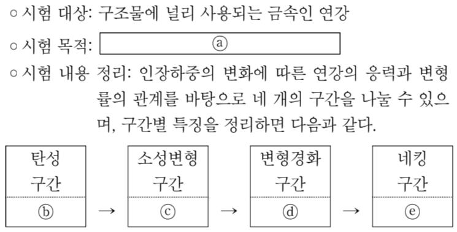

- 배치 / 역할 / 풀이 필수: `PASSAGE` / `ILLUSTRATIVE` / 아니요
- 종류 / MIME: `DIAGRAM` / `image/jpeg`
- 크기: 745 × 379
- 원본 URL: [열기](https://d1c00yjit06b00.cloudfront.net/dev/exams/69bbe31da9ac92778edc4f9e/1774339495482-91v7rw-img0.jpg)
- 콘텐츠 해시: `sha256:423a17ce9068ccafb9bc0bca7c55f50422a539fcb7e5f1c3b711e8334f0308ef`

**MEDIA2 — 재료 A와 B의 응력 특성, 부재 ㄱ과 ㄴ의 예상 인장하중 및 안전계수, 허용응력·단면적·허용하중 표**

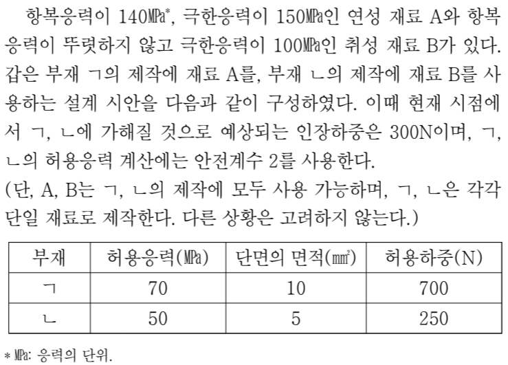

- 배치 / 역할 / 풀이 필수: `SCENARIO` / `INFORMATIONAL` / 예
- 종류 / MIME: `TABLE` / `image/jpeg`
- 크기: 739 × 531
- 원본 URL: [열기](https://d1c00yjit06b00.cloudfront.net/dev/exams/69bbe31da9ac92778edc4f9e/1774339495528-6y8x5r-img1.jpg)
- 콘텐츠 해시: `sha256:1b9edff6799cef86ce8215c5a0c2adc6af6b3e31507e7b05ca15d0dae6c22db1`

### 문제

- 문항 제목: 없음
- 배점: 3점
- 태그: 없음

**발문**: <보기>는 윗글의 내용을 이해하기 위한 학습 자료의 일부이다. 학생의 반응으로 적절하지 않은 것은?

#### 보기

[보기 이미지 원본 열기](https://d1c00yjit06b00.cloudfront.net/dev/exams/69bbe31da9ac92778edc4f9e/1774339495528-6y8x5r-img1.jpg)

#### 선지

1. ㄱ은 ㄴ보다 부재에 허용되는 하중의 최댓값이 크게 설계되어 있군.

2. ㄱ과 ㄴ의 허용응력을 구하기 위해 A는 항복응력을, B는 극한응력을 안전계수로 나누었군.

3. ㄱ은 예상되는 인장하중에 의한 응력이 A의 항복응력보다 작으므로, ㄱ의 결정 구조 및 원자의 결합 상태에 변형이 생기지 않겠군.

4. ㄴ은 단면의 면적을 변경하지 않고 재료를 A로 교체하면, 허용하중이 인장하중보다 작아지므로 안전을 담보할 수 없겠군.

5. ㄱ과 ㄴ에 가해질 인장하중이 예상보다 2배로 커질 경우, ㄱ은 ㄴ과 달리 단면의 면적을 늘리지 않더라도 영구적 변형이 일어나지 않겠군.

**공식 정답: 4번 (`C4`) — ㄴ은 단면의 면적을 변경하지 않고 재료를 A로 교체하면, 허용하중이 인장하중보다 작아지므로 안전을 담보할 수 없겠군.**

### 골드 후보 전체

- 스키마: `problem-solving-gold-v2`
- 골드 상태: `candidate`
- 골드 원천: `69c0994b78128b2a9bee0922` / 고1 2024년 10월 - 교육청 모의평가 / 30번
- question / passage ID: `69c0994b78128b2a9bee0922-q30` / `69c0994b78128b2a9bee0922-passage`
- 골드 발문: <보기>는 윗글의 내용을 이해하기 위한 학습 자료의 일부이다. 학생의 반응으로 적절하지 않은 것은?
- 발문 극성: `SELECT_INCORRECT`
- 정답 choice ID: `C4`

#### 시나리오와 사실

연성 재료 A의 항복응력은 140MPa, 극한응력은 150MPa이고, 취성 재료 B는 항복응력이 뚜렷하지 않으며 극한응력은 100MPa이다. 부재 ㄱ에는 A, 부재 ㄴ에는 B를 사용하며, 두 부재에 예상되는 인장하중은 각각 300N이고 허용응력 계산의 안전계수는 2이다. 표에는 ㄱ의 허용응력·단면적·허용하중이 각각 70MPa·10mm²·700N, ㄴ의 값이 각각 50MPa·5mm²·250N으로 제시되어 있다.

- 없음

#### 원문 근거 명제

- passage detail ID: `69c0994b78128b2a9bee0922-passage`

##### MP1 · P1

구조물의 안전을 위해 부재의 허용하중은 부재에 가해질 하중보다 더 크게 설계해야 한다.

- 원문 증거: “구조물의 안전을 위해서는 부재에 가해질 하중보다 부재의 허용하중을 더 크게 설계해야 한다.”
- 범위: 구조물 설계
- 극성 / 근거 유형: `positive` / `PASSAGE_EXPLICIT`
- 조건: 없음
- 예외: 없음

##### MP2 · P2

응력은 하중을 부재 단면의 면적으로 나누어 구한다.

- 원문 증거: “응력은 하중에 의해 부재의 단면에 나타나는 힘으로, 하중을 단면의 면적으로 나누어 구한다.”
- 범위: 응력 계산
- 극성 / 근거 유형: `positive` / `PASSAGE_EXPLICIT`
- 조건: 없음
- 예외: 없음

##### MP3 · P3

연강에서 소성변형 구간이 시작되는 지점의 응력은 항복응력이며, 그 지점에서 시편은 탄성을 잃고 결정 구조 및 원자의 결합 상태에 변형이 일어나 영구적 변형이 생긴다.

- 원문 증거: “소성변형 구간이 시작되는 지점에서 시편은 탄성을 잃는다. 이는 소성변형 구간에서 시편의 결정 구조 및 원자의 결합 상태에 변형이 일어나, 시편에 영구적인 변형이 생겼음을 의미한다. 소성변형 구간이 시작되는 지점의 응력을 항복응력이라고 한다.”
- 범위: 연강의 인장 시험
- 극성 / 근거 유형: `positive` / `PASSAGE_EXPLICIT`
- 조건: 없음
- 예외: 없음

##### MP4 · P4

연성 재료는 항복응력과 소성변형 구간이 뚜렷하게 나타나며, 취성 재료는 항복응력과 소성변형 구간이 뚜렷하지 않고 대체로 극한응력이 뚜렷하다.

- 원문 증거: “취성 재료는 항복응력과 소성변형 구간이 뚜렷하지 않고 대체로 극한응력이 뚜렷하다.”
- 범위: 재료 특성
- 극성 / 근거 유형: `positive` / `PASSAGE_EXPLICIT`
- 조건: 없음
- 예외: 없음

##### MP5 · P5

일반적으로 연성 재료의 허용응력은 항복응력을 안전계수로 나누어, 취성 재료의 허용응력은 극한응력을 안전계수로 나누어 구한다.

- 원문 증거: “일반적으로 연성 재료는 항복응력을, 취성 재료는 극한응력을 각각 안전계수로 나누어 허용응력을 구한다.”
- 범위: 허용응력 산출
- 극성 / 근거 유형: `positive` / `PASSAGE_EXPLICIT`
- 조건: 없음
- 예외: 없음

##### MP6 · P5

허용하중은 허용응력에 부재 단면의 면적을 곱하여 산출한다.

- 원문 증거: “허용응력을 구한 후에는 허용응력에 부재의 단면의 면적을 곱하여 허용하중을 산출할 수 있다.”
- 범위: 허용하중 산출
- 극성 / 근거 유형: `positive` / `PASSAGE_EXPLICIT`
- 조건: 없음
- 예외: 없음

#### 시각 자료 주장

- `VA1` (`MEDIA2`, `VALUE`): 연성 재료 A의 항복응력은 140MPa, 극한응력은 150MPa이며, 취성 재료 B는 항복응력이 뚜렷하지 않고 극한응력은 100MPa이다.
- `VA2` (`MEDIA2`, `GROUPING`): 부재 ㄱ은 재료 A, 부재 ㄴ은 재료 B로 제작하며, 두 부재에 예상되는 인장하중은 각각 300N이고 허용응력 계산에 사용하는 안전계수는 2이다.
- `VA3` (`MEDIA2`, `VALUE`): 부재 ㄱ의 허용응력·단면적·허용하중은 각각 70MPa·10mm²·700N이고, 부재 ㄴ의 값은 각각 50MPa·5mm²·250N이다.

#### 문항 추론

##### INF1 · APPLY_RULE

ㄱ은 연성 재료 A의 항복응력 140MPa를 안전계수 2로 나눈 허용응력 70MPa를, ㄴ은 취성 재료 B의 극한응력 100MPa를 안전계수 2로 나눈 허용응력 50MPa를 사용하므로, 두 부재의 허용응력 산출 방식에 관한 주장은 성립한다.

- 결론: ㄱ은 연성 재료 A의 항복응력 140MPa를 안전계수 2로 나눈 허용응력 70MPa를, ㄴ은 취성 재료 B의 극한응력 100MPa를 안전계수 2로 나눈 허용응력 50MPa를 사용하므로, 두 부재의 허용응력 산출 방식에 관한 주장은 성립한다.
- 대상 주장 / 효과: `OC2-1` / `SUPPORTS`
- 직접 전제 refs: `MP5`, `VA1`, `VA2`, `VA3`
- 원문 참조: 문단 `P5` / 명제 `MP5`
- 시나리오 사실: 없음
- 시각 주장: `VA1`, `VA2`, `VA3`
- grounding / necessity: `SOURCE_ENTAILED` / `REQUIRED`

##### INF2 · COMPARE

ㄱ의 허용하중은 700N이고 ㄴ의 허용하중은 250N이므로, ㄱ이 ㄴ보다 부재에 허용되는 하중의 최댓값이 크게 설계되었다는 주장은 성립한다.

- 결론: ㄱ의 허용하중은 700N이고 ㄴ의 허용하중은 250N이므로, ㄱ이 ㄴ보다 부재에 허용되는 하중의 최댓값이 크게 설계되었다는 주장은 성립한다.
- 대상 주장 / 효과: `OC1-1` / `SUPPORTS`
- 직접 전제 refs: `VA3`
- 원문 참조: 없음
- 시나리오 사실: 없음
- 시각 주장: `VA3`
- grounding / necessity: `SOURCE_EXPLICIT` / `REQUIRED`

##### INF3 · CALCULATE

ㄱ에 예상되는 인장하중 300N을 단면적 10mm²로 나눈 응력은 30MPa이고, 이는 A의 항복응력 140MPa보다 작으므로, ㄱ은 소성변형이 시작되는 항복응력에 이르지 않아 결정 구조 및 원자의 결합 상태의 변형이 생기지 않는다.

- 결론: ㄱ에 예상되는 인장하중 300N을 단면적 10mm²로 나눈 응력은 30MPa이고, 이는 A의 항복응력 140MPa보다 작으므로, ㄱ은 소성변형이 시작되는 항복응력에 이르지 않아 결정 구조 및 원자의 결합 상태의 변형이 생기지 않는다.
- 대상 주장 / 효과: `OC3-1` / `SUPPORTS`
- 직접 전제 refs: `MP2`, `MP3`, `VA1`, `VA2`
- 원문 참조: 문단 `P2` / 명제 `MP2`; 문단 `P3` / 명제 `MP3`
- 시나리오 사실: 없음
- 시각 주장: `VA1`, `VA2`
- grounding / necessity: `SOURCE_ENTAILED` / `REQUIRED`

##### INF4 · CALCULATE

ㄴ의 단면적 5mm²를 유지한 채 재료를 A로 교체하면 A의 허용응력은 140÷2=70MPa이고 허용하중은 70×5=350N이므로, 예상 인장하중 300N보다 허용하중이 크며 안전을 담보할 수 있다.

- 결론: ㄴ의 단면적 5mm²를 유지한 채 재료를 A로 교체하면 A의 허용응력은 140÷2=70MPa이고 허용하중은 70×5=350N이므로, 예상 인장하중 300N보다 허용하중이 크며 안전을 담보할 수 있다.
- 대상 주장 / 효과: `OC4-1` / `CONTRADICTS`
- 직접 전제 refs: `MP1`, `MP5`, `MP6`, `VA1`, `VA2`, `VA3`
- 원문 참조: 문단 `P1` / 명제 `MP1`; 문단 `P5` / 명제 `MP5`, `MP6`
- 시나리오 사실: 없음
- 시각 주장: `VA1`, `VA2`, `VA3`
- grounding / necessity: `SOURCE_ENTAILED` / `REQUIRED`

##### INF5 · COMPARE

인장하중이 2배가 되면 ㄱ의 인장하중은 600N으로 허용하중 700N보다 작으므로 ㄱ은 안전 조건을 충족하지만, ㄴ의 인장하중은 600N으로 허용하중 250N보다 커서 ㄴ은 안전 조건을 충족하지 못한다.

- 결론: 인장하중이 2배가 되면 ㄱ의 인장하중은 600N으로 허용하중 700N보다 작으므로 ㄱ은 안전 조건을 충족하지만, ㄴ의 인장하중은 600N으로 허용하중 250N보다 커서 ㄴ은 안전 조건을 충족하지 못한다.
- 대상 주장 / 효과: `OC5-1`, `OC5-2` / `SUPPORTS`
- 직접 전제 refs: `MP1`, `VA3`
- 원문 참조: 문단 `P1` / 명제 `MP1`
- 시나리오 사실: 없음
- 시각 주장: `VA3`
- grounding / necessity: `SOURCE_ENTAILED` / `REQUIRED`

#### 보충 설명 추론

없음

#### 선지별 골드 판정

##### C1 · ㄱ은 ㄴ보다 부재에 허용되는 하중의 최댓값이 크게 설계되어 있군.

- 위치 / 판정: 1 / `TRUE`
- 판정 근거: 표에서 ㄱ의 허용하중은 700N, ㄴ의 허용하중은 250N이다.
- 주장 IDs: `OC1-1`
- 필수 원문 참조: 없음
- 필수 시나리오 사실: 없음
- 필수 시각 주장: `VA3`

**주장 OC1-1 (1순위)**

ㄱ은 ㄴ보다 부재에 허용되는 하중의 최댓값이 크게 설계되어 있다.

- assessment / support: `SUPPORTED` / `DIRECT`
- decision / basis: `ACCEPTED` / `SOURCE_GROUNDED`
- 결정 핵심: 예
- 의존 주장: 없음
- 문항 추론: `INF2`
- 원문 참조: 없음
- 시나리오 사실: 없음
- 시각 주장: `VA3`
- 보충 추론: 없음
- 보충 사용 정책: 없음

##### C2 · ㄱ과 ㄴ의 허용응력을 구하기 위해 A는 항복응력을, B는 극한응력을 안전계수로 나누었군.

- 위치 / 판정: 2 / `TRUE`
- 판정 근거: 연성 재료 A에는 항복응력, 취성 재료 B에는 극한응력을 안전계수로 나누는 규칙이 적용된다.
- 주장 IDs: `OC2-1`
- 필수 원문 참조: 문단 `P5` / 명제 `MP5`
- 필수 시나리오 사실: 없음
- 필수 시각 주장: `VA1`, `VA2`, `VA3`

**주장 OC2-1 (1순위)**

ㄱ과 ㄴ의 허용응력을 구하기 위해 A는 항복응력을, B는 극한응력을 각각 안전계수로 나누었다.

- assessment / support: `SUPPORTED` / `ENTAILED`
- decision / basis: `ACCEPTED` / `SOURCE_GROUNDED`
- 결정 핵심: 예
- 의존 주장: 없음
- 문항 추론: `INF1`
- 원문 참조: 문단 `P5` / 명제 `MP5`
- 시나리오 사실: 없음
- 시각 주장: `VA1`, `VA2`, `VA3`
- 보충 추론: 없음
- 보충 사용 정책: 없음

##### C3 · ㄱ은 예상되는 인장하중에 의한 응력이 A의 항복응력보다 작으므로, ㄱ의 결정 구조 및 원자의 결합 상태에 변형이 생기지 않겠군.

- 위치 / 판정: 3 / `TRUE`
- 판정 근거: ㄱ의 예상 응력은 300÷10=30MPa로 A의 항복응력 140MPa보다 작다.
- 주장 IDs: `OC3-1`
- 필수 원문 참조: 문단 `P2` / 명제 `MP2`; 문단 `P3` / 명제 `MP3`
- 필수 시나리오 사실: 없음
- 필수 시각 주장: `VA1`, `VA2`

**주장 OC3-1 (1순위)**

ㄱ에서 예상되는 인장하중에 의한 응력은 A의 항복응력보다 작으므로 ㄱ의 결정 구조 및 원자의 결합 상태에는 변형이 생기지 않는다.

- assessment / support: `SUPPORTED` / `ENTAILED`
- decision / basis: `ACCEPTED` / `SOURCE_GROUNDED`
- 결정 핵심: 예
- 의존 주장: 없음
- 문항 추론: `INF3`
- 원문 참조: 문단 `P2` / 명제 `MP2`; 문단 `P3` / 명제 `MP3`
- 시나리오 사실: 없음
- 시각 주장: `VA1`, `VA2`
- 보충 추론: 없음
- 보충 사용 정책: 없음

##### C4 · ㄴ은 단면의 면적을 변경하지 않고 재료를 A로 교체하면, 허용하중이 인장하중보다 작아지므로 안전을 담보할 수 없겠군.

- 위치 / 판정: 4 / `FALSE`
- 판정 근거: A로 교체 시 허용응력은 70MPa이고, 면적 5mm²에서 허용하중은 350N이므로 예상 인장하중 300N보다 크다.
- 주장 IDs: `OC4-1`, `OC4-2`
- 필수 원문 참조: 문단 `P1` / 명제 `MP1`; 문단 `P5` / 명제 `MP5`, `MP6`
- 필수 시나리오 사실: 없음
- 필수 시각 주장: `VA1`, `VA2`, `VA3`

**주장 OC4-1 (1순위)**

ㄴ의 단면적을 변경하지 않고 재료를 A로 교체하면 허용하중이 인장하중보다 작다.

- assessment / support: `CONTRADICTED` / `NONE`
- decision / basis: `REJECTED` / `SOURCE_GROUNDED`
- 결정 핵심: 예
- 의존 주장: 없음
- 문항 추론: `INF4`
- 원문 참조: 문단 `P1` / 명제 `MP1`; 문단 `P5` / 명제 `MP5`, `MP6`
- 시나리오 사실: 없음
- 시각 주장: `VA1`, `VA2`, `VA3`
- 보충 추론: 없음
- 보충 사용 정책: 없음

**주장 OC4-2 (2순위)**

재료를 A로 교체한 ㄴ은 안전을 담보할 수 없다.

- assessment / support: `DEPENDS_ON_REJECTED_CLAIM` / `NONE`
- decision / basis: `REJECTED` / `DEPENDENCY`
- 결정 핵심: 예
- 의존 주장: `OC4-1`
- 문항 추론: 없음
- 원문 참조: 없음
- 시나리오 사실: 없음
- 시각 주장: 없음
- 보충 추론: 없음
- 보충 사용 정책: 없음

##### C5 · ㄱ과 ㄴ에 가해질 인장하중이 예상보다 2배로 커질 경우, ㄱ은 ㄴ과 달리 단면의 면적을 늘리지 않더라도 영구적 변형이 일어나지 않겠군.

- 위치 / 판정: 5 / `TRUE`
- 판정 근거: 2배 하중은 600N이다. ㄱ의 허용하중은 700N으로 이를 넘지만, ㄴ의 허용하중은 250N으로 이에 미치지 못한다.
- 주장 IDs: `OC5-1`, `OC5-2`
- 필수 원문 참조: 문단 `P1` / 명제 `MP1`
- 필수 시나리오 사실: 없음
- 필수 시각 주장: `VA3`

**주장 OC5-1 (1순위)**

인장하중이 예상보다 2배로 커져도 ㄱ은 단면적을 늘리지 않고 안전 조건을 충족한다.

- assessment / support: `SUPPORTED` / `ENTAILED`
- decision / basis: `ACCEPTED` / `SOURCE_GROUNDED`
- 결정 핵심: 예
- 의존 주장: 없음
- 문항 추론: `INF5`
- 원문 참조: 문단 `P1` / 명제 `MP1`
- 시나리오 사실: 없음
- 시각 주장: `VA3`
- 보충 추론: 없음
- 보충 사용 정책: 없음

**주장 OC5-2 (2순위)**

인장하중이 예상보다 2배로 커지면 ㄴ은 단면적을 늘리지 않고 안전 조건을 충족하지 못한다.

- assessment / support: `SUPPORTED` / `ENTAILED`
- decision / basis: `ACCEPTED` / `SOURCE_GROUNDED`
- 결정 핵심: 예
- 의존 주장: 없음
- 문항 추론: `INF5`
- 원문 참조: 문단 `P1` / 명제 `MP1`
- 시나리오 사실: 없음
- 시각 주장: `VA3`
- 보충 추론: 없음
- 보충 사용 정책: 없음

#### 정답 도출 경로

##### S1

연성 재료의 허용응력은 항복응력을 안전계수로 나누어 구하고, 허용하중은 허용응력과 단면적의 곱으로 구한다.

- 원문 참조: 문단 `P5` / 명제 `MP5`, `MP6`
- 시나리오 사실: 없음
- 시각 주장: 없음
- 문항 추론: 없음
- 선지 주장: 없음

##### S2

ㄴ의 재료를 A로 교체하고 단면적 5mm²를 유지하면, A의 허용응력은 140÷2=70MPa이고 허용하중은 70×5=350N이다.

- 원문 참조: 문단 `P5` / 명제 `MP5`, `MP6`
- 시나리오 사실: 없음
- 시각 주장: `VA1`, `VA2`, `VA3`
- 문항 추론: `INF4`
- 선지 주장: `OC4-1`

##### S3

교체 후 ㄴ의 허용하중 350N은 예상 인장하중 300N보다 크므로, 허용하중이 인장하중보다 작아 안전을 담보할 수 없다는 C4의 반응은 부적절하다.

- 원문 참조: 문단 `P1` / 명제 `MP1`
- 시나리오 사실: 없음
- 시각 주장: `VA2`
- 문항 추론: `INF4`
- 선지 주장: `OC4-1`, `OC4-2`

- 필수 단계: `S1`, `S2`, `S3`
- 결정 단계: `S2`
- 결론 단계: `S3`
- 최종 답: `C4`
- 최종 설명: ㄴ을 A로 바꾸고 단면적 5mm²를 유지하면 허용응력은 70MPa, 허용하중은 350N이다. 이는 예상 인장하중 300N보다 크므로 안전을 담보할 수 없다는 ④의 반응은 적절하지 않다.
- 최종 설명 참조 단계: `S1`, `S2`, `S3`

#### 대표 오답 경로

- `WP1` 2배 하중 600N을 ㄴ의 허용하중 250N과 비교하지 않고, ㄴ도 단면적 증가 없이 안전할 수 있다고 판단한 경우이다.
  - scope: `SELECTED_WRONG_CHOICE`
  - 선택 선지: `C5`
  - 놓친 정답: `없음`
  - 분기 층위 후보: `CONDITION_APPLICATION`, `CHOICE_INTERPRETATION`
- `WP2` 재료 A로 교체한 뒤에도 ㄴ의 기존 허용하중 250N을 그대로 사용하여, 교체 후 허용하중을 새로 계산하지 않은 경우이다.
  - scope: `MISSED_ANSWER`
  - 선택 선지: `C1`, `C2`, `C3`, `C5`
  - 놓친 정답: `C4`
  - 분기 층위 후보: `CONCEPT_SCENARIO_MAPPING`, `INFERENCE_TRANSFORMATION`

#### 골드 자체 검수 메모

없음

### 충분 근거 조합 후보

#### 69c0994b78128b2a9bee0922-q30-C2-SGC1

- 선지 / 대상 주장: `C2` / `OC2-1`
- 제안 경로 / 연산자: `APPROVED_SUFFICIENT_GROUND_SET` / `ALL_OF`
- 필수 근거: `MP5`, `VA1`, `VA2`, `VA3`
- 생략 허용 근거: 없음
- 결론: ㄱ은 연성 재료 A의 항복응력 140MPa를 안전계수 2로 나눈 허용응력 70MPa를, ㄴ은 취성 재료 B의 극한응력 100MPa를 안전계수 2로 나눈 허용응력 50MPa를 사용하므로, 두 부재의 허용응력 산출 방식에 관한 주장은 성립한다.
- 원천 추론: `INF1`
- 생성 방식 / 상태: `AI_INFERENCE_GRAPH_DERIVED` / `candidate`
- 위험 표지: `VISUAL_REQUIRED`

#### 69c0994b78128b2a9bee0922-q30-C1-SGC1

- 선지 / 대상 주장: `C1` / `OC1-1`
- 제안 경로 / 연산자: `APPROVED_SUFFICIENT_GROUND_SET` / `ALL_OF`
- 필수 근거: `VA3`
- 생략 허용 근거: 없음
- 결론: ㄱ의 허용하중은 700N이고 ㄴ의 허용하중은 250N이므로, ㄱ이 ㄴ보다 부재에 허용되는 하중의 최댓값이 크게 설계되었다는 주장은 성립한다.
- 원천 추론: `INF2`
- 생성 방식 / 상태: `AI_INFERENCE_GRAPH_DERIVED` / `candidate`
- 위험 표지: `VISUAL_REQUIRED`

#### 69c0994b78128b2a9bee0922-q30-C3-SGC1

- 선지 / 대상 주장: `C3` / `OC3-1`
- 제안 경로 / 연산자: `APPROVED_SUFFICIENT_GROUND_SET` / `ALL_OF`
- 필수 근거: `MP2`, `MP3`, `VA1`, `VA2`
- 생략 허용 근거: 없음
- 결론: ㄱ에 예상되는 인장하중 300N을 단면적 10mm²로 나눈 응력은 30MPa이고, 이는 A의 항복응력 140MPa보다 작으므로, ㄱ은 소성변형이 시작되는 항복응력에 이르지 않아 결정 구조 및 원자의 결합 상태의 변형이 생기지 않는다.
- 원천 추론: `INF3`
- 생성 방식 / 상태: `AI_INFERENCE_GRAPH_DERIVED` / `candidate`
- 위험 표지: `VISUAL_REQUIRED`

#### 69c0994b78128b2a9bee0922-q30-C4-SGC1

- 선지 / 대상 주장: `C4` / `OC4-1`
- 제안 경로 / 연산자: `APPROVED_SUFFICIENT_GROUND_SET` / `ALL_OF`
- 필수 근거: `MP1`, `MP5`, `MP6`, `VA1`, `VA2`, `VA3`
- 생략 허용 근거: 없음
- 결론: ㄴ의 단면적 5mm²를 유지한 채 재료를 A로 교체하면 A의 허용응력은 140÷2=70MPa이고 허용하중은 70×5=350N이므로, 예상 인장하중 300N보다 허용하중이 크며 안전을 담보할 수 있다.
- 원천 추론: `INF4`
- 생성 방식 / 상태: `AI_INFERENCE_GRAPH_DERIVED` / `candidate`
- 위험 표지: `VISUAL_REQUIRED`

#### 69c0994b78128b2a9bee0922-q30-C5-SGC1

- 선지 / 대상 주장: `C5` / `OC5-1`, `OC5-2`
- 제안 경로 / 연산자: `APPROVED_SUFFICIENT_GROUND_SET` / `ALL_OF`
- 필수 근거: `MP1`, `VA3`
- 생략 허용 근거: 없음
- 결론: 인장하중이 2배가 되면 ㄱ의 인장하중은 600N으로 허용하중 700N보다 작으므로 ㄱ은 안전 조건을 충족하지만, ㄴ의 인장하중은 600N으로 허용하중 250N보다 커서 ㄴ은 안전 조건을 충족하지 못한다.
- 원천 추론: `INF5`
- 생성 방식 / 상태: `AI_INFERENCE_GRAPH_DERIVED` / `candidate`
- 위험 표지: `VISUAL_REQUIRED`

### 생성·검증 기록

- 원시 스키마 통과: 아니요
- 원시 오류: decisivePathStepIds: 결정적 분기와 결론 단계는 분리해야 한다.; representativeWrongPaths.0.missedAnswerChoiceId: 선택 선지 경로에는 놓친 정답을 지정하지 않는다.
- 자동 정규화: `SEPARATE_DECISIVE_AND_CONCLUSION_STEPS`, `ALIGN_WRONG_PATH_MISSED_ANSWER`
- 최종 스키마 통과: 예
- 최종 오류: 없음
- 생성 모델 / effort: `gpt-5.6-terra` / `medium`
- 프롬프트 버전: `problem-gold-generation-prompt-v2`
- 생성 시간: 64095ms

- 검수 파일 상태: `PENDING`
- 검수자 / 시각: 없음 / 없음
- 승인된 충분 근거 후보: 없음
- 검수 메모: 없음

**사람 검수 메모:**

- 판정:
- 수정 필요 사항:
- 승인할 충분 근거 후보:

[목차로 돌아가기](#빠른-목차)

---

## 4. 고3 2026년 5월 - 교육청 모의평가 · 볼록 렌즈와 비점 수차 11번

### 검수 상태

- case ID: `prospective-69fd388386fd308968e0b9f4-q11`
- 분야: `SCIENCE`
- 표본 범위: `NEGATIVE_STEM`, `SCIENCE`, `SCENARIO_APPLICATION`, `CALCULATION`, `VISUAL`, `MULTI_CONDITION`
- 생산 상태: `REQUIRES_HUMAN_CORRECTION`
- 후보 종류: 검증 실패 원시 생성본(후보 골드 아님)
- 사람 검수 상태: `사람 교정 필요`
- 검수 위험도: `후보 미생성`
- 원천 해시: `sha256:2a605b623fe6691976b66ac3d5c0f03e5a236c7b78049113cf28471dc6de68a3`

검수 체크: [ ] 공식 정답과 선지 판정 일치 · [ ] 원문 근거 정확 · [ ] 추론 비약 없음 · [ ] 충분 근거가 최소 조합 · [ ] 시각 자료 해석 정확

### 원문

카메라 등의 광학 기기에 쓰이는 볼록 렌즈는, 물체에서 반사되어 렌즈로 입사한 광선들을 수렴시킨다. 물체 표면의 한 점인 물체점에서 렌즈로 입사한 여러 광선이 굴절하여 수렴하는 점을 상점이라고 한다. 렌즈로 입사한 모든 광선이 하나의 상점에 수렴한다면 상은 뚜렷한 점의 형태로 맺히지만, 하나의 상점에 수렴하지 않으면 상이 흐려지거나 일그러져 보이는 수차 현상이 발생한다. 특히 물체점이 광축에서 멀리 떨어지면 렌즈에서 굴절된 광선들은 서로 다른 두 상점에 수렴하게 되어 흐릿한 상을 맺는 경우가 있는데, 이러한 현상은 비점 수차에 해당한다.

광축은 렌즈의 중심을 지나면서 렌즈 면에 수직인 가상의 직선이다. 물체점이 광축 위에 있고, 렌즈가 회전 대칭성을 지니며, 광선들이 하나의 상점에 수렴할 경우 뚜렷한 상이 맺힌다. 이때 회전 대칭성이란 광축을 중심으로 회전시켜도 항상 원래의 형태와 겹쳐지는 성질이다. 물체점으로부터 렌즈로 입사한 광선들의 집합인 광선 다발은 물체점을 꼭짓점으로 하는 원뿔 형상을 띤다. 렌즈 중심으로 향하는 광선인 주광선은 광선 다발을 대표하는데, 주광선은 광축을 따라 렌즈 중심으로 입사하고 광선 다발의 형상은 광축을 중심으로 회전 대칭성을 지니게 된다. 이에 따라 주광선을 포함하는 평면들로 광선 다발을 나누었을 때, 광선들의 입사 양상이 어떤 평면에서든 동일해진다. 이때 각 평면에서의 광선의 굴절 양상 또한 서로 동일해져, 전체 광선 다발은 광축 위에 있는 하나의 상점에 수렴하게 된다.

반면 물체점이 광축에서 멀리 벗어나면 주광선은 광축을 따라 입사하지 않게 되며, 광선 다발의 형상은 광축을 기준으로 회전 대칭성을 보이지 않게 되어 비점 수차가 발생한다. 이때 광선 다발의 수렴 양상을 살필 수 있게 하는 평면이 자오면과 구결면이다. 자오면은 광축과 주광선을 포함하는 단 하나의 평면이며, 광축을 중심으로 물체점이 어느 방향에 있는지를 드러낸다. 구결면은 자오면과 수직인 평면으로, 광축을 포함하지 않으며 주광선을 포함하는 평면이다. 자오면 위에 있는 광선들인 자오 광선과 구결면 위에 있는 광선들인 구결 광선은 입사 양상이 다르며, 이에 따라 굴절 양상도 다르다. 이 때문에 광선들이 서로 다른 위치에 수렴하게 되는데, 자오 광선이 수렴하는 점을 자오 상점, 구결 광선이 수렴하는 점을 구결 상점이라고 한다. 이때 자오 상점이 구결 상점보다 렌즈의 중심까지의 거리가 더 가깝다.

자오 상점과 구결 상점 사이의 거리인 비점 격차가 커질수록 비점 수차는 심해진다. 비점 격차는 물체점에서 광축까지의 거리의 제곱, 즉 물체점에서 광축까지 수직으로 그은 선의 길이의 제곱에 비례한다. 자오 상점부터 구결 상점까지의 임의의 지점에서 맺히는 상의 형상은, 같은 지점에서 광선 다발을 광축에 수직인 면으로 잘랐을 때 그 단면의 형상과 동일하다. 자오 상점에서 맺히는 상을 일차상이라고 하고, 구결 상점에서 맺히는 상을 이차상이라고 한다. 일차상과 이차상은 모두 선분의 형상인데, 일차상은 구결면 위에 놓여 주광선과 수직 관계를 이루고, 이차상은 자오면 위에 놓여 주광선과 수직 관계를 이룬다. 이때 일차상과 이차상은 서로 수직이다. 비점 격차가 커질수록 일차상의 길이와 이차상의 길이는 길어진다. 일차상과 이차상 사이에 맺히는 상의 대부분은 타원의 형상을 띠지만, 중간 부근에 원형을 띠는 유일한 지점이 있는데 이 지점에서의 상을 최소 착란원이라고 한다. 최소 착란원은 광선들이 하나의 상점에 수렴할 때 형성되는 상과 형태가 가장 유사하며, 일차상과 이차상 사이에 맺히는 상 중 가장 뚜렷하다. 비점 격차가 클수록 최소 착란원은 크기가 커지면서 흐려진다.

#### 원문·문제 시각 자료

**MEDIA1 — 광축, 물체점 P0~P4, 볼록 렌즈, 주광선, 평면 A·B, 선분상 C·D 및 원형상 E가 표시된 비점 수차 도식.**

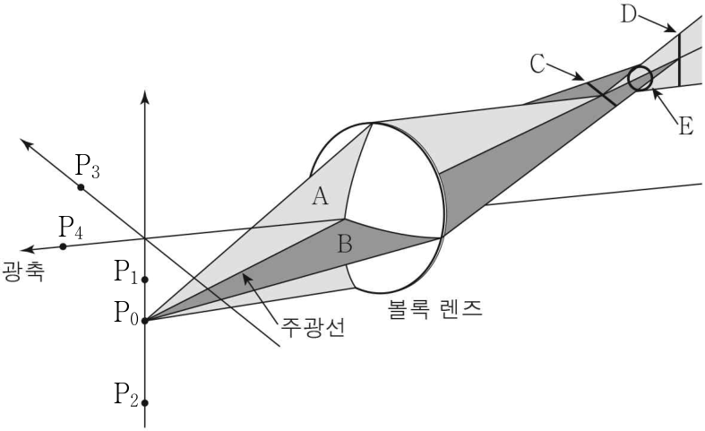

- 배치 / 역할 / 풀이 필수: `SCENARIO` / `INFORMATIONAL` / 예
- 종류 / MIME: `DIAGRAM` / `image/png`
- 크기: 787 × 481
- 원본 URL: [열기](https://d1c00yjit06b00.cloudfront.net/dev/exams/69fc5fb312d6210742ffff6a/1778147251987-boq304-img0.png)
- 콘텐츠 해시: `sha256:bde6652b5ce39329297ddcdcf5d5f5b26824bef027483fe3ed12b5e2a8d1fd1b`

### 문제

- 문항 제목: 보기 학습 자료를 통한 비점 수차 이해 (3점)
- 배점: 3점
- 태그: `보기적용`, `추론`, `3점`

**발문**: <보기>는 윗글을 이해하기 위한 학습 자료의 일부이다. 학생의 반응으로 적절하지 않은 것은?

#### 보기

다음은 비점 수차가 발생한 상황을 나타낸 그림이다. A는 광축과 주광선을 포함하는 평면, B는 A와 수직이며 주광선을 포함하는 평면이다. C, D는 각각, A와 B 중 한 평면 위에 놓여 선분의 형상으로 맺히는 상을, E는 원형을 띠는 상을 가리킨다. P0, P1, P2, P3는 모두 광축과 수직인 축 위에 있으며, P4는 광축 위에 있다. P0에서 광축까지의 거리는 P1에서 광축까지의 거리의 두 배이고, P2에서 광축까지의 거리의 절반이다. 현재 물체점은 P0에 놓여 있다.

(단, 렌즈는 회전 대칭성을 지니며 그 외 요인은 고려하지 않는다.)

[보기 이미지 원본 열기](https://d1c00yjit06b00.cloudfront.net/dev/exams/69fc5fb312d6210742ffff6a/1778147251987-boq304-img0.png)

#### 선지

1. 물체점을 P1으로 옮긴다면, E는 물체점이 P0에 있었을 때보다 더 뚜렷하겠군.

2. 물체점을 P2로 옮긴다면, C에서 D까지의 거리는 물체점이 P0에 있었을 때의 4배가 되겠군.

3. 물체점을 P3로 옮겼을 때 C의 길이가 길어졌다면, P0에서 광축까지의 거리가 P3에서 광축까지의 거리보다 길겠군.

4. P3에서 광축까지의 거리가 P0에서 광축까지의 거리와 같다면, 물체점을 P3로 옮겼을 때 E의 크기는 변하지 않겠군.

5. 물체점이 P0에 있을 때와 달리 P4에 있다면, 주광선을 포함하는 평면 위에 있는 광선들의 입사 양상은 어떤 평면에서든 동일하겠군.

**공식 정답: 3번 (`C3`) — 물체점을 P3로 옮겼을 때 C의 길이가 길어졌다면, P0에서 광축까지의 거리가 P3에서 광축까지의 거리보다 길겠군.**

### 검증 실패 원시 생성본 전체

> 이 생성본은 최종 스키마 검증에 실패했으므로 `candidate-gold.json`으로 승격되지 않았습니다. 아래 내용은 사람 교정을 위한 참고 자료이며 승인 가능한 골드가 아닙니다.

- 스키마: `problem-solving-gold-v2`
- 골드 상태: `candidate`
- 골드 원천: `69fd388386fd308968e0b9f4` / 고3 2026년 5월 - 교육청 모의평가 / 11번
- question / passage ID: `69fd388386fd308968e0b9f4-q11` / `69fd388386fd308968e0b9f4-passage`
- 골드 발문: <보기>는 윗글을 이해하기 위한 학습 자료의 일부이다. 학생의 반응으로 적절하지 않은 것은?
- 발문 극성: `SELECT_INCORRECT`
- 정답 choice ID: `C3`

#### 시나리오와 사실

다음은 비점 수차가 발생한 상황을 나타낸 그림이다. A는 광축과 주광선을 포함하는 평면, B는 A와 수직이며 주광선을 포함하는 평면이다. C, D는 각각, A와 B 중 한 평면 위에 놓여 선분의 형상으로 맺히는 상을, E는 원형을 띠는 상을 가리킨다. P0, P1, P2, P3는 모두 광축과 수직인 축 위에 있으며, P4는 광축 위에 있다. P0에서 광축까지의 거리는 P1에서 광축까지의 거리의 두 배이고, P2에서 광축까지의 거리의 절반이다. 현재 물체점은 P0에 놓여 있다. (단, 렌즈는 회전 대칭성을 지니며 그 외 요인은 고려하지 않는다.)

- `SF1` A는 광축과 주광선을 포함하는 평면이다.
- `SF2` B는 A와 수직이고 주광선을 포함하는 평면이다.
- `SF3` C와 D는 A 또는 B 위에 놓인 선분 형상의 상들이다.
- `SF4` E는 원형을 띠는 상이다.
- `SF5` P0, P1, P2, P3는 모두 광축에 수직인 축 위에 있고, P4는 광축 위에 있다.
- `SF6` P0에서 광축까지의 거리는 P1에서 광축까지 거리의 두 배이다.
- `SF7` P2에서 광축까지의 거리는 P0에서 광축까지 거리의 절반이다.
- `SF8` 현재 물체점은 P0에 놓여 있다.
- `SF9` 렌즈는 회전 대칭성을 지니며 그 밖의 요인은 고려하지 않는다.

#### 원문 근거 명제

- passage detail ID: `69fd388386fd308968e0b9f4-passage`

##### MP1 · P1

물체점에서 렌즈로 입사한 여러 광선이 굴절하여 수렴하는 점을 상점이라고 한다.

- 원문 증거: “물체 표면의 한 점인 물체점에서 렌즈로 입사한 여러 광선이 굴절하여 수렴하는 점을 상점이라고 한다.”
- 범위: 상점의 정의
- 극성 / 근거 유형: `positive` / `PASSAGE_EXPLICIT`
- 조건: 없음
- 예외: 없음

##### MP2 · P1

물체점이 광축에서 멀리 떨어지면 렌즈에서 굴절된 광선들이 서로 다른 두 상점에 수렴하여 흐릿한 상을 맺는 비점 수차가 발생할 수 있다.

- 원문 증거: “특히 물체점이 광축에서 멀리 떨어지면 렌즈에서 굴절된 광선들은 서로 다른 두 상점에 수렴하게 되어 흐릿한 상을 맺는 경우가 있는데, 이러한 현상은 비점 수차에 해당한다.”
- 범위: 비점 수차의 발생
- 극성 / 근거 유형: `positive` / `PASSAGE_EXPLICIT`
- 조건: 물체점이 광축에서 멀리 떨어짐
- 예외: 없음

##### MP3 · P2

광축은 렌즈의 중심을 지나면서 렌즈 면에 수직인 가상의 직선이다.

- 원문 증거: “광축은 렌즈의 중심을 지나면서 렌즈 면에 수직인 가상의 직선이다.”
- 범위: 광축의 정의
- 극성 / 근거 유형: `positive` / `PASSAGE_EXPLICIT`
- 조건: 없음
- 예외: 없음

##### MP4 · P2

물체점이 광축 위에 있고 렌즈가 회전 대칭성을 지니며 광선들이 하나의 상점에 수렴하면 뚜렷한 상이 맺힌다.

- 원문 증거: “물체점이 광축 위에 있고, 렌즈가 회전 대칭성을 지니며, 광선들이 하나의 상점에 수렴할 경우 뚜렷한 상이 맺힌다.”
- 범위: 광축 위 물체점의 상
- 극성 / 근거 유형: `positive` / `PASSAGE_EXPLICIT`
- 조건: 물체점이 광축 위; 렌즈가 회전 대칭; 광선들이 하나의 상점에 수렴
- 예외: 없음

##### MP5 · P2

물체점이 광축 위에 있으면 주광선은 광축을 따라 렌즈 중심으로 입사하고, 광선 다발은 광축을 중심으로 회전 대칭성을 지닌다.

- 원문 증거: “주광선은 광축을 따라 렌즈 중심으로 입사하고 광선 다발의 형상은 광축을 중심으로 회전 대칭성을 지니게 된다.”
- 범위: 광축 위 입사의 대칭성
- 극성 / 근거 유형: `positive` / `PASSAGE_EXPLICIT`
- 조건: 물체점이 광축 위
- 예외: 없음

##### MP6 · P2

주광선을 포함하는 평면들로 광선 다발을 나누었을 때 광선 다발이 광축 중심의 회전 대칭성을 지니면 광선들의 입사 양상은 어느 평면에서든 동일하다.

- 원문 증거: “이에 따라 주광선을 포함하는 평면들로 광선 다발을 나누었을 때, 광선들의 입사 양상이 어떤 평면에서든 동일해진다.”
- 범위: 회전 대칭성과 입사 양상
- 극성 / 근거 유형: `positive` / `PASSAGE_EXPLICIT`
- 조건: 광선 다발이 광축 중심의 회전 대칭성을 지님
- 예외: 없음

##### MP7 · P3

물체점이 광축에서 벗어나면 주광선은 광축을 따라 입사하지 않고 광선 다발은 광축 기준의 회전 대칭성을 보이지 않아 비점 수차가 발생한다.

- 원문 증거: “물체점이 광축에서 멀리 벗어나면 주광선은 광축을 따라 입사하지 않게 되며, 광선 다발의 형상은 광축을 기준으로 회전 대칭성을 보이지 않게 되어 비점 수차가 발생한다.”
- 범위: 광축 밖 물체점의 비점 수차
- 극성 / 근거 유형: `positive` / `PASSAGE_EXPLICIT`
- 조건: 물체점이 광축에서 벗어남
- 예외: 없음

##### MP8 · P3

자오면은 광축과 주광선을 포함하는 단 하나의 평면이다.

- 원문 증거: “자오면은 광축과 주광선을 포함하는 단 하나의 평면이다.”
- 범위: 자오면의 정의
- 극성 / 근거 유형: `positive` / `PASSAGE_EXPLICIT`
- 조건: 없음
- 예외: 없음

##### MP9 · P3

구결면은 자오면과 수직이고 광축은 포함하지 않으며 주광선을 포함하는 평면이다.

- 원문 증거: “구결면은 자오면과 수직인 평면으로, 광축을 포함하지 않으며 주광선을 포함하는 평면이다.”
- 범위: 구결면의 정의
- 극성 / 근거 유형: `positive` / `PASSAGE_EXPLICIT`
- 조건: 없음
- 예외: 없음

##### MP10 · P3

자오 광선과 구결 광선은 입사 양상과 굴절 양상이 달라 서로 다른 위치에 수렴하며, 자오 상점은 구결 상점보다 렌즈 중심에 가깝다.

- 원문 증거: “자오 광선과 구결 광선은 입사 양상이 다르며, 이에 따라 굴절 양상도 다르다. 이 때문에 광선들이 서로 다른 위치에 수렴하게 되며... 자오 상점이 구결 상점보다 렌즈의 중심까지의 거리가 더 가깝다.”
- 범위: 자오·구결 광선의 수렴
- 극성 / 근거 유형: `positive` / `PASSAGE_EXPLICIT`
- 조건: 비점 수차가 발생한 경우
- 예외: 없음

##### MP11 · P4

비점 격차는 자오 상점과 구결 상점 사이의 거리이며, 물체점에서 광축까지 거리의 제곱에 비례한다.

- 원문 증거: “자오 상점과 구결 상점 사이의 거리인 비점 격차가 커질수록 비점 수차는 심해진다. 비점 격차는 물체점에서 광축까지의 거리의 제곱...에 비례한다.”
- 범위: 비점 격차의 크기
- 극성 / 근거 유형: `positive` / `PASSAGE_EXPLICIT`
- 조건: 없음
- 예외: 없음

##### MP12 · P4

자오 상점의 상인 일차상과 구결 상점의 상인 이차상은 모두 선분 형상이다.

- 원문 증거: “자오 상점에서 맺히는 상을 일차상이라고 하고, 구결 상점에서 맺히는 상을 이차상이라고 한다. 일차상과 이차상은 모두 선분의 형상인데”
- 범위: 일차상·이차상의 형상
- 극성 / 근거 유형: `positive` / `PASSAGE_EXPLICIT`
- 조건: 없음
- 예외: 없음

##### MP13 · P4

비점 격차가 커질수록 일차상의 길이와 이차상의 길이는 길어진다.

- 원문 증거: “비점 격차가 커질수록 일차상의 길이와 이차상의 길이는 길어진다.”
- 범위: 선분상의 길이
- 극성 / 근거 유형: `positive` / `PASSAGE_EXPLICIT`
- 조건: 비점 격차가 커짐
- 예외: 없음

##### MP14 · P4

일차상과 이차상 사이에는 원형을 띠는 유일한 지점인 최소 착란원이 있으며, 이것은 그 사이의 상 중 가장 뚜렷하다.

- 원문 증거: “일차상과 이차상 사이에 맺히는 상의 대부분은 타원의 형상을 띠지만, 중간 부근에 원형을 띠는 유일한 지점이 있는데 이 지점에서의 상을 최소 착란원이라고 한다. ... 일차상과 이차상 사이에 맺히는 상 중 가장 뚜렷하다.”
- 범위: 최소 착란원
- 극성 / 근거 유형: `positive` / `PASSAGE_EXPLICIT`
- 조건: 없음
- 예외: 없음

##### MP15 · P4

비점 격차가 클수록 최소 착란원은 크기가 커지면서 흐려진다.

- 원문 증거: “비점 격차가 클수록 최소 착란원은 크기가 커지면서 흐려진다.”
- 범위: 최소 착란원의 크기와 선명도
- 극성 / 근거 유형: `positive` / `PASSAGE_EXPLICIT`
- 조건: 비점 격차가 커짐
- 예외: 없음

#### 시각 자료 주장

- `VA1` (`MEDIA1`, `FLOW`): 그림에서 광선 다발은 물체점 P0에서 렌즈를 지나 C, E, D가 표시된 상 형성 영역으로 진행한다.
- `VA2` (`MEDIA1`, `GROUPING`): 그림에서 C와 D는 서로 다른 위치의 선분상으로, E는 그 사이의 원형상으로 표시되어 있다.

#### 문항 추론

##### INF1 · CALCULATE

P1의 광축 이탈 거리는 P0의 절반이므로 P1에서의 비점 격차와 최소 착란원의 크기는 P0보다 작고, E는 P0에 있을 때보다 더 뚜렷하다.

- 결론: P1의 광축 이탈 거리는 P0의 절반이므로 P1에서의 비점 격차와 최소 착란원의 크기는 P0보다 작고, E는 P0에 있을 때보다 더 뚜렷하다.
- 대상 주장 / 효과: `OC1-1` / `SUPPORTS`
- 직접 전제 refs: `MP11`, `MP15`, `SF4`, `SF6`
- 원문 참조: 문단 `P4` / 명제 `MP11`, `MP15`
- 시나리오 사실: `SF4`, `SF6`
- 시각 주장: 없음
- grounding / necessity: `SOURCE_ENTAILED` / `REQUIRED`

##### INF2 · CALCULATE

P2의 광축 이탈 거리는 P0의 절반이므로 P2에서의 비점 격차, 즉 선분상 C와 D 사이 거리는 P0에서의 4분의 1이다.

- 결론: P2의 광축 이탈 거리는 P0의 절반이므로 P2에서의 비점 격차, 즉 선분상 C와 D 사이 거리는 P0에서의 4분의 1이다.
- 대상 주장 / 효과: `OC2-1` / `CONTRADICTS`
- 직접 전제 refs: `MP11`, `SF3`, `SF7`, `VA2`
- 원문 참조: 문단 `P4` / 명제 `MP11`
- 시나리오 사실: `SF3`, `SF7`
- 시각 주장: `VA2`
- grounding / necessity: `SOURCE_ENTAILED` / `REQUIRED`

##### INF3 · FOLLOW_CAUSAL_CHAIN

P3로 옮겼을 때 선분상 C의 길이가 P0 때보다 길어졌다면 비점 격차가 커진 것이므로, P3에서 광축까지의 거리는 P0에서 광축까지의 거리보다 길다.

- 결론: P3로 옮겼을 때 선분상 C의 길이가 P0 때보다 길어졌다면 비점 격차가 커진 것이므로, P3에서 광축까지의 거리는 P0에서 광축까지의 거리보다 길다.
- 대상 주장 / 효과: `OC3-1` / `CONTRADICTS`
- 직접 전제 refs: `MP11`, `MP13`, `SF3`
- 원문 참조: 문단 `P4` / 명제 `MP11`, `MP13`
- 시나리오 사실: `SF3`
- 시각 주장: 없음
- grounding / necessity: `SOURCE_ENTAILED` / `REQUIRED`

##### INF4 · COMPARE

P3와 P0의 광축 이탈 거리가 같으면 두 경우의 비점 격차와 최소 착란원 E의 크기가 같으므로, P3로 옮겨도 E의 크기는 변하지 않는다.

- 결론: P3와 P0의 광축 이탈 거리가 같으면 두 경우의 비점 격차와 최소 착란원 E의 크기가 같으므로, P3로 옮겨도 E의 크기는 변하지 않는다.
- 대상 주장 / 효과: `OC4-1` / `SUPPORTS`
- 직접 전제 refs: `MP11`, `MP15`, `SF4`
- 원문 참조: 문단 `P4` / 명제 `MP11`, `MP15`
- 시나리오 사실: `SF4`
- 시각 주장: 없음
- grounding / necessity: `SOURCE_ENTAILED` / `REQUIRED`

##### INF5 · APPLY_RULE

물체점이 광축 위의 P4에 있으면 주광선이 광축을 따라 입사하고 광선 다발이 회전 대칭성을 지니므로, 주광선을 포함하는 어느 평면에서든 그 평면 위 광선들의 입사 양상은 동일하다.

- 결론: 물체점이 광축 위의 P4에 있으면 주광선이 광축을 따라 입사하고 광선 다발이 회전 대칭성을 지니므로, 주광선을 포함하는 어느 평면에서든 그 평면 위 광선들의 입사 양상은 동일하다.
- 대상 주장 / 효과: `OC5-1` / `SUPPORTS`
- 직접 전제 refs: `MP5`, `MP6`, `SF5`, `SF9`
- 원문 참조: 문단 `P2` / 명제 `MP5`, `MP6`
- 시나리오 사실: `SF5`, `SF9`
- 시각 주장: 없음
- grounding / necessity: `SOURCE_ENTAILED` / `REQUIRED`

#### 보충 설명 추론

없음

#### 선지별 골드 판정

##### C1 · 물체점을 P1으로 옮긴다면, E는 물체점이 P0에 있었을 때보다 더 뚜렷하겠군.

- 위치 / 판정: 1 / `TRUE`
- 판정 근거: P1의 광축 이탈 거리는 P0의 절반이므로 비점 격차와 최소 착란원의 크기가 작아져 E가 더 뚜렷하다.
- 주장 IDs: `OC1-1`
- 필수 원문 참조: 문단 `P4` / 명제 `MP11`, `MP15`
- 필수 시나리오 사실: `SF4`, `SF6`
- 필수 시각 주장: 없음

**주장 OC1-1 (1순위)**

물체점을 P1으로 옮기면 원형상 E는 물체점이 P0에 있을 때보다 더 뚜렷하다.

- assessment / support: `SUPPORTED` / `ENTAILED`
- decision / basis: `ACCEPTED` / `SOURCE_GROUNDED`
- 결정 핵심: 예
- 의존 주장: 없음
- 문항 추론: `INF1`
- 원문 참조: 문단 `P4` / 명제 `MP11`, `MP15`
- 시나리오 사실: `SF4`, `SF6`
- 시각 주장: 없음
- 보충 추론: 없음
- 보충 사용 정책: 없음

##### C2 · 물체점을 P2로 옮긴다면, C에서 D까지의 거리는 물체점이 P0에 있었을 때의 4배가 되겠군.

- 위치 / 판정: 2 / `FALSE`
- 판정 근거: P2의 광축 이탈 거리는 P0의 절반이므로 비점 격차는 4배가 아니라 4분의 1이다.
- 주장 IDs: `OC2-1`
- 필수 원문 참조: 문단 `P4` / 명제 `MP11`
- 필수 시나리오 사실: `SF3`, `SF7`
- 필수 시각 주장: `VA2`

**주장 OC2-1 (1순위)**

물체점을 P2로 옮기면 C에서 D까지의 거리는 물체점이 P0에 있을 때의 4배이다.

- assessment / support: `CONTRADICTED` / `DIRECT`
- decision / basis: `REJECTED` / `SOURCE_GROUNDED`
- 결정 핵심: 예
- 의존 주장: 없음
- 문항 추론: `INF2`
- 원문 참조: 문단 `P4` / 명제 `MP11`
- 시나리오 사실: `SF3`, `SF7`
- 시각 주장: `VA2`
- 보충 추론: 없음
- 보충 사용 정책: 없음

##### C3 · 물체점을 P3로 옮겼을 때 C의 길이가 길어졌다면, P0에서 광축까지의 거리가 P3에서 광축까지의 거리보다 길겠군.

- 위치 / 판정: 3 / `FALSE`
- 판정 근거: C가 길어졌다면 비점 격차가 커진 것이고, 이는 P3의 광축 이탈 거리가 P0보다 길다는 뜻이다. 선지는 비교 방향을 반대로 말한다.
- 주장 IDs: `OC3-1`
- 필수 원문 참조: 문단 `P4` / 명제 `MP11`, `MP13`
- 필수 시나리오 사실: `SF3`
- 필수 시각 주장: 없음

**주장 OC3-1 (1순위)**

물체점을 P3로 옮겼을 때 C의 길이가 길어졌다면, P0에서 광축까지의 거리가 P3에서 광축까지의 거리보다 길다.

- assessment / support: `CONTRADICTED` / `ENTAILED`
- decision / basis: `REJECTED` / `SOURCE_GROUNDED`
- 결정 핵심: 예
- 의존 주장: 없음
- 문항 추론: `INF3`
- 원문 참조: 문단 `P4` / 명제 `MP11`, `MP13`
- 시나리오 사실: `SF3`
- 시각 주장: 없음
- 보충 추론: 없음
- 보충 사용 정책: 없음

##### C4 · P3에서 광축까지의 거리가 P0에서 광축까지의 거리와 같다면, 물체점을 P3로 옮겼을 때 E의 크기는 변하지 않겠군.

- 위치 / 판정: 4 / `TRUE`
- 판정 근거: 광축 이탈 거리가 같으면 비점 격차가 같고, 최소 착란원 E의 크기도 같다.
- 주장 IDs: `OC4-1`
- 필수 원문 참조: 문단 `P4` / 명제 `MP11`, `MP15`
- 필수 시나리오 사실: `SF4`
- 필수 시각 주장: 없음

**주장 OC4-1 (1순위)**

P3에서 광축까지의 거리가 P0에서 광축까지의 거리와 같다면, 물체점을 P3로 옮겼을 때 E의 크기는 변하지 않는다.

- assessment / support: `SUPPORTED` / `ENTAILED`
- decision / basis: `ACCEPTED` / `SOURCE_GROUNDED`
- 결정 핵심: 예
- 의존 주장: 없음
- 문항 추론: `INF4`
- 원문 참조: 문단 `P4` / 명제 `MP11`, `MP15`
- 시나리오 사실: `SF4`
- 시각 주장: 없음
- 보충 추론: 없음
- 보충 사용 정책: 없음

##### C5 · 물체점이 P0에 있을 때와 달리 P4에 있다면, 주광선을 포함하는 평면 위에 있는 광선들의 입사 양상은 어떤 평면에서든 동일하겠군.

- 위치 / 판정: 5 / `TRUE`
- 판정 근거: P4는 광축 위에 있으므로 주광선과 광선 다발의 회전 대칭성에 따라 각 평면의 입사 양상이 동일하다.
- 주장 IDs: `OC5-1`
- 필수 원문 참조: 문단 `P2` / 명제 `MP5`, `MP6`
- 필수 시나리오 사실: `SF5`, `SF9`
- 필수 시각 주장: 없음

**주장 OC5-1 (1순위)**

물체점이 P4에 있으면 주광선을 포함하는 평면 위 광선들의 입사 양상은 어떤 평면에서든 동일하다.

- assessment / support: `SUPPORTED` / `ENTAILED`
- decision / basis: `ACCEPTED` / `SOURCE_GROUNDED`
- 결정 핵심: 예
- 의존 주장: 없음
- 문항 추론: `INF5`
- 원문 참조: 문단 `P2` / 명제 `MP5`, `MP6`
- 시나리오 사실: `SF5`, `SF9`
- 시각 주장: 없음
- 보충 추론: 없음
- 보충 사용 정책: 없음

#### 정답 도출 경로

##### RP1

비점 격차는 물체점의 광축 이탈 거리의 제곱에 비례하고, 비점 격차가 커질수록 두 선분상의 길이는 길어진다.

- 원문 참조: 문단 `P4` / 명제 `MP11`, `MP13`
- 시나리오 사실: 없음
- 시각 주장: 없음
- 문항 추론: 없음
- 선지 주장: 없음

##### RP2

C는 보기에서 선분 형상으로 맺힌 상이므로, P3에서 C가 P0 때보다 길어졌다는 조건은 P3에서의 비점 격차가 더 커졌음을 뜻한다.

- 원문 참조: 문단 `P4` / 명제 `MP13`
- 시나리오 사실: `SF3`
- 시각 주장: 없음
- 문항 추론: `INF3`
- 선지 주장: 없음

##### RP3

P3에서의 비점 격차가 더 크면 P3의 광축 이탈 거리가 P0보다 더 길며, 이는 P0의 거리가 더 길다는 C3의 주장과 반대이다.

- 원문 참조: 문단 `P4` / 명제 `MP11`, `MP13`
- 시나리오 사실: `SF3`
- 시각 주장: 없음
- 문항 추론: `INF3`
- 선지 주장: `OC3-1`

- 필수 단계: `RP1`, `RP2`, `RP3`
- 결정 단계: `RP3`
- 결론 단계: `RP3`
- 최종 답: `C3`
- 최종 설명: C의 길이가 길어졌다면 비점 격차가 커진 것이며, 비점 격차는 광축까지 거리의 제곱에 비례한다. 따라서 P3의 광축까지 거리가 P0보다 길어야 하므로, 비교 방향을 반대로 제시한 ③이 적절하지 않다.
- 최종 설명 참조 단계: `RP1`, `RP2`, `RP3`

#### 대표 오답 경로

- `WP1` 광축까지 거리가 절반이면 비점 격차가 거리와 같은 비율로 변한다고 오인하여, 제곱 비례 관계를 적용하지 못한 경우이다.
  - scope: `SELECTED_WRONG_CHOICE`
  - 선택 선지: `C2`
  - 놓친 정답: `C3`
  - 분기 층위 후보: `CONCEPT_BOUNDARY`, `INFERENCE_TRANSFORMATION`
- `WP2` C의 길이 증가가 비점 격차 증가 및 P3의 더 큰 광축 이탈 거리를 뜻한다는 비교 방향을 반대로 해석한 경우이다.
  - scope: `SELECTED_WRONG_CHOICE`
  - 선택 선지: `C3`
  - 놓친 정답: `없음`
  - 분기 층위 후보: `CONDITION_APPLICATION`, `INFERENCE_TRANSFORMATION`, `CHOICE_INTERPRETATION`

#### 골드 자체 검수 메모

없음

### 충분 근거 조합 후보

없음 — 유효한 후보 골드가 생성되지 않았습니다.

### 생성·검증 기록

- 원시 스키마 통과: 아니요
- 원시 오류: choices: 발문에 맞는 정답 선지가 정확히 하나여야 한다.; decisivePathStepIds: 결정적 분기와 결론 단계는 분리해야 한다.; representativeWrongPaths.0.missedAnswerChoiceId: 선택 선지 경로에는 놓친 정답을 지정하지 않는다.; representativeWrongPaths.1.selectedChoiceIds: 대표 오답 경로는 실제 오답 선지만 참조해야 한다.
- 자동 정규화: `SEPARATE_DECISIVE_AND_CONCLUSION_STEPS`, `ALIGN_WRONG_PATH_MISSED_ANSWER`, `REMOVE_ANSWER_FROM_WRONG_PATH_SELECTIONS`
- 최종 스키마 통과: 아니요
- 최종 오류: choices: 발문에 맞는 정답 선지가 정확히 하나여야 한다.
- 생성 모델 / effort: `gpt-5.6-terra` / `medium`
- 프롬프트 버전: `problem-gold-generation-prompt-v2`
- 생성 시간: 59870ms

**사람 검수 메모:**

- 판정:
- 수정 필요 사항:
- 승인할 충분 근거 후보:

[목차로 돌아가기](#빠른-목차)

---

## 5. 고2 2026년 6월 - 교육청 모의평가 · 옥신의 기능과 식물 생장 조절 19번

### 검수 상태

- case ID: `prospective-6a22950f86fd308968e11320-q19`
- 분야: `SCIENCE`
- 표본 범위: `POSITIVE_STEM`, `SCIENCE`, `SCENARIO_APPLICATION`, `VISUAL`, `MULTI_CONDITION`
- 생산 상태: `PENDING_HUMAN_REVIEW`
- 후보 종류: 정적 검증을 통과한 후보
- 사람 검수 상태: `PENDING`
- 검수 위험도: `LOW`
- 원천 해시: `sha256:ea682a49de4cfbb926dbd113392e4ab60f11fd5a86e5d0893d50d9904be8c470`

검수 체크: [ ] 공식 정답과 선지 판정 일치 · [ ] 원문 근거 정확 · [ ] 추론 비약 없음 · [ ] 충분 근거가 최소 조합 · [ ] 시각 자료 해석 정확

### 원문

사람의 일생에 성장과 발달, 노화의 과정이 있듯이 식물도 생장과 발달, 노화의 변화를 겪는다. 이러한 변화는 외부 환경뿐 아니라, 식물체 내부에서 생성되는 여러 호르몬의 정교한 조절에 의해 이루어진다. 그 호르몬 가운데 '옥신'은 주로 식물의 생장과 발달을 조절하는 역할을 한다. 대표적 옥신인 '인돌아세트산(IAA)'은 주로 줄기 상단부에서 생성되어 하단부로 수송된다. 식물 세포막의 한쪽에 치우쳐 위치한 옥신 수송체 단백질을 통해, 옥신이 한쪽 방향으로만 이동하는 '극성 수송'이 일어나는 것이다. 이는 중력과는 무관한 수송 방식으로, 식물체 내 옥신 이동의 기본 원리가 된다.

이러한 이동 방식은 옥신이 특정 부위에 분포하게끔 하여 세포 생장을 유도하는 기반이 된다. 옥신은 세포벽의 산성화를 유발하는데, 이때 활성화된 '익스팬신'이라는 단백질은 세포벽을 구성하는 셀룰로오스 섬유 사이의 결합을 약하게 한다. 이로 인해 세포벽의 유연성이 높아지고, 삼투현상에 의해 세포 내부로 물이 유입되면, 그 결과 내부 팽압*을 견디는 범위 내에서 세포의 생장이 이루어진다.

옥신은 농도에 따라 식물 기관의 생장 반응을 다르게 유도한다. 생장 반응이 시작되는 옥신의 농도는 기관별로 다르며, 옥신의 농도가 일정 범위까지 증가할 때는 생장 촉진의 정도가 높아지지만, 최고 생장점을 지난 이후에는 생장 촉진의 정도가 낮아지다가 일정 농도에 이르면 생장이 억제된다. 가령 뿌리는 줄기보다 옥신의 감수성*이 높아 줄기의 생장이 촉진되는 농도에서도 이미 억제가 나타날 수 있다. 또한 식물의 눈은 생장 반응이 시작되는 옥신의 농도가 뿌리보다 높고, 줄기보다 낮다. 따라서 동일한 옥신 농도라도 기관별로 다른 생장 반응을 보일 수 있다.

또한 옥신은 빛이나 중력과 같은 환경 자극에 따라 방향성 생장을 유도한다. 줄기가 빛 쪽으로 굽는 '굴광성'은 옥신이 빛이 닿지 않는 쪽으로 분포하면서 나타나는 비대칭적 생장 반응의 결과이다. 줄기에 빛에 의한 방향성 자극이 주어지면, 극성 수송을 따르던 옥신의 일부가 재분포된다. 빛을 감지하는 광수용체인 '포토트로핀'은 빛을 받은 쪽에서 활성화되어, 그늘진 쪽으로 옥신 수송을 유발한다. 따라서 그늘진 쪽의 옥신 농도가 높아져 생장이 촉진되면, 줄기가 빛을 향해 굽게 된다.

중력에 의한 방향성 생장인 '굴지성' 역시 옥신의 비대칭적 분포에서 비롯된다. 줄기와 뿌리를 수평으로 눕히면, 중력 자극을 감지하는 세포 내 녹말체가 아래쪽으로 이동하고, 옥신도 그쪽에 더 많이 분포하게 된다. 따라서 아래쪽 세포가 더 생장하여 줄기가 중력 반대 방향으로 굽는 '음의 굴지성'이 나타난다. 반면에 뿌리는 옥신에 대한 감수성 차이로 인해 뿌리 아래쪽 세포의 생장이 억제된다. 그 결과 뿌리가 중력 방향으로 굽는 '양의 굴지성'이 나타난다.

한편 옥신은 식물의 잎이 떨어지는 탈리 과정에도 영향을 미친다. 이 과정은 두 호르몬의 상호 관계 속에서 나타난다. 옥신은 세포 사이의 조직 결합 상태를 유지하는 데 관여하고, 에틸렌이라는 기체 호르몬은 세포벽 분해 효소의 합성을 촉진한다. 잎이 떨어지는 부위인 탈리층에서는 세포벽 분해 효소의 합성이 증가할수록 세포 사이의 조직 결합력이 약해진다. 이러한 상태에서 잎의 무게나 바람에 의해 탈리층에서 세포 간 분리가 일어나고, 이때 탈리층에서는 코르크층이 형성되어 병원균이 식물체에 침입하는 것을 방지한다. 어린잎에서는 옥신의 농도가 높아 탈리층 세포의 에틸렌 반응성이 낮게 유지된다. 그러나 잎의 노화가 진행되면서 옥신의 생산과 수송이 감소하면, 탈리층은 상대적으로 에틸렌에 더 민감해져 탈리 현상이 강화된다.

* 팽압: 세포벽을 긴장시키고 식물체 모양을 유지하는 힘.

* 감수성: 외부 자극이 일정한 역치에 도달했을 때 생리적 반응이 유발되는 성질.

#### 원문·문제 시각 자료

**MEDIA1 — 옥신 농도에 따른 a, b, c 기관의 생장 반응 정도를 나타낸 그래프.**

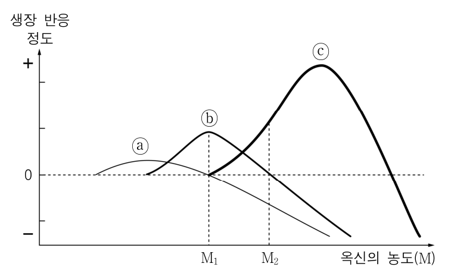

- 배치 / 역할 / 풀이 필수: `PASSAGE` / `INFORMATIONAL` / 아니요
- 종류 / MIME: `CHART` / `image/png`
- 크기: 757 × 454
- 원본 URL: [열기](https://d1c00yjit06b00.cloudfront.net/dev/exams/6a2291c465dc3dbe848cb479/1780650436816-0t4q24-img0.png)
- 콘텐츠 해시: `sha256:6b0139644321fb83dd21a9cdb5b9cf7ad675206a92698304347251ffaf4d6378`

**MEDIA2 — (가) 오른쪽에서 오는 빛을 향해 굽은 줄기와, (나) 수평으로 눕힌 화분에서 위로 굽은 줄기 및 아래로 굽은 뿌리를 보인 식물 관찰 일지.**

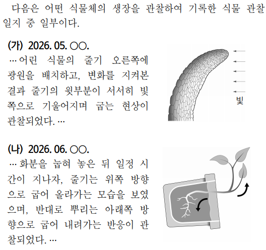

- 배치 / 역할 / 풀이 필수: `SCENARIO` / `INFORMATIONAL` / 예
- 종류 / MIME: `DIAGRAM` / `image/png`
- 크기: 528 × 497
- 원본 URL: [열기](https://d1c00yjit06b00.cloudfront.net/exams/6a2291c465dc3dbe848cb479/1780650985204-image-0.png)
- 콘텐츠 해시: `sha256:764afea8b5c5e0e6b9648117801abf9b0de3958e335743016127c376b97998a5`

### 문제

- 문항 제목: 없음
- 배점: 3점
- 태그: 없음

**발문**: 윗글을 바탕으로 <보기>의 (가), (나)를 이해한 내용으로 가장 적절한 것은?

#### 보기

[보기 이미지 원본 열기](https://d1c00yjit06b00.cloudfront.net/exams/6a2291c465dc3dbe848cb479/1780650985204-image-0.png)

#### 선지

1. (가)에서는 옥신이 환경 자극에 따라 광원 반대 방향에 있는 포토트로핀을 활성화시켰기 때문에, 줄기의 윗부분에 방향성 생장이 나타난 것으로 볼 수 있겠군.

2. (가)에서는 옥신의 극성 수송 자체는 변하지 않았지만, 광원에 따라 옥신의 분포가 증가한 쪽으로 줄기의 굽는 방향이 결정된 것으로 볼 수 있겠군.

3. (나)에서는 줄기가 위쪽으로 굽는 음의 굴지성과 뿌리가 아래쪽으로 굽는 양의 굴지성이 모두 중력 자극의 방향 차이에 의해 나타난 것으로 볼 수 있겠군.

4. (가)에서는 줄기의 그늘진 부분의 생장이, (나)에서는 눕힌 줄기의 아래쪽 부분의 생장이 더 크게 일어나 굽는 현상이 발생한 것으로 볼 수 있겠군.

5. (가)에서는 옥신의 극성 수송이 줄기의 굽는 방향을 결정하고, (나)에서는 중력에 따른 녹말체의 위치 차이가 줄기와 뿌리의 굽는 방향을 결정한 것으로 볼 수 있겠군.

**공식 정답: 4번 (`C4`) — (가)에서는 줄기의 그늘진 부분의 생장이, (나)에서는 눕힌 줄기의 아래쪽 부분의 생장이 더 크게 일어나 굽는 현상이 발생한 것으로 볼 수 있겠군.**

### 골드 후보 전체

- 스키마: `problem-solving-gold-v2`
- 골드 상태: `candidate`
- 골드 원천: `6a22950f86fd308968e11320` / 고2 2026년 6월 - 교육청 모의평가 / 19번
- question / passage ID: `6a22950f86fd308968e11320-q19` / `6a22950f86fd308968e11320-passage`
- 골드 발문: 윗글을 바탕으로 <보기>의 (가), (나)를 이해한 내용으로 가장 적절한 것은?
- 발문 극성: `SELECT_CORRECT`
- 정답 choice ID: `C4`

#### 시나리오와 사실

(가) 어린 식물의 줄기 오른쪽에 광원을 배치하자 줄기의 윗부분이 서서히 빛 쪽으로 기울어지며 굽는 현상이 관찰되었다. (나) 화분을 눕혀 둔 뒤 시간이 지나자 줄기는 위쪽 방향으로 굽어 올라가고, 뿌리는 아래쪽 방향으로 굽어 내려갔다.

- `SF1` (가)에서 줄기 오른쪽에 광원이 있고, 줄기의 윗부분은 빛이 있는 방향으로 굽었다.
- `SF2` (나)에서 화분을 수평으로 눕힌 뒤 줄기는 위쪽으로, 뿌리는 아래쪽으로 굽었다.

#### 원문 근거 명제

- passage detail ID: `6a22950f86fd308968e11320-passage`

##### MP1 · P1

대표적 옥신인 IAA는 주로 줄기 상단부에서 생성되어 하단부로 수송된다.

- 원문 증거: “"인돌아세트산(IAA)은 주로 줄기 상단부에서 생성되어 하단부로 수송된다."”
- 범위: IAA의 기본 수송
- 극성 / 근거 유형: `positive` / `PASSAGE_EXPLICIT`
- 조건: 없음
- 예외: 없음

##### MP2 · P1

세포막 한쪽에 치우친 옥신 수송체 단백질을 통해 옥신의 한 방향 이동인 극성 수송이 일어나며, 이는 중력과 무관하다.

- 원문 증거: “"옥신이 한쪽 방향으로만 이동하는 '극성 수송'이 일어난다. 이는 중력과는 무관한 수송 방식"”
- 범위: 옥신의 극성 수송
- 극성 / 근거 유형: `positive` / `PASSAGE_EXPLICIT`
- 조건: 없음
- 예외: 없음

##### MP3 · P2

옥신은 세포벽을 산성화하고, 활성화된 익스팬신은 셀룰로오스 섬유 사이 결합을 약화시켜 세포벽 유연성을 높인다.

- 원문 증거: “"옥신은 세포벽의 산성화를 유발"하며 "익스팬신...은 ... 결합을 약하게 한다."”
- 범위: 옥신의 세포 생장 작용
- 극성 / 근거 유형: `positive` / `PASSAGE_EXPLICIT`
- 조건: 없음
- 예외: 없음

##### MP4 · P2

세포벽 유연성이 높아진 상태에서 물이 세포 안으로 유입되면 팽압을 견디는 범위에서 세포 생장이 이루어진다.

- 원문 증거: “"세포 내부로 물이 유입되면 ... 세포의 생장이 이루어진다."”
- 범위: 세포 생장 조건
- 극성 / 근거 유형: `positive` / `PASSAGE_EXPLICIT`
- 조건: 세포벽 유연성 증가; 세포 내부로의 물 유입
- 예외: 없음

##### MP5 · P3

옥신 농도가 일정 범위까지 증가하면 생장 촉진 정도가 높아지지만, 최고 생장점 이후에는 낮아지고 일정 농도에서는 생장이 억제된다.

- 원문 증거: “"최고 생장점을 지난 이후에는 ... 일정 농도에 이르면 생장이 억제된다."”
- 범위: 옥신 농도와 생장 반응
- 극성 / 근거 유형: `positive` / `PASSAGE_EXPLICIT`
- 조건: 없음
- 예외: 없음

##### MP6 · P3

뿌리는 줄기보다 옥신 감수성이 높아서 줄기 생장이 촉진되는 농도에서도 뿌리에는 생장 억제가 나타날 수 있다.

- 원문 증거: “"뿌리는 줄기보다 옥신의 감수성이 높아 줄기의 생장이 촉진되는 농도에서도 이미 억제가 나타날 수 있다."”
- 범위: 뿌리와 줄기의 옥신 반응 차이
- 극성 / 근거 유형: `positive` / `PASSAGE_EXPLICIT`
- 조건: 줄기 생장을 촉진하는 옥신 농도
- 예외: 없음

##### MP7 · P4

줄기의 굴광성은 옥신이 빛이 닿지 않는 쪽에 분포하여 일어나는 비대칭적 생장 반응의 결과이다.

- 원문 증거: “"굴광성은 옥신이 빛이 닿지 않는 쪽으로 분포하면서 나타나는 비대칭적 생장 반응의 결과"”
- 범위: 줄기의 굴광성
- 극성 / 근거 유형: `positive` / `PASSAGE_EXPLICIT`
- 조건: 줄기에 빛에 의한 방향성 자극이 주어짐
- 예외: 없음

##### MP8 · P4

줄기에 빛 자극이 주어지면 극성 수송을 따르던 옥신의 일부가 재분포된다.

- 원문 증거: “"극성 수송을 따르던 옥신의 일부가 재분포된다."”
- 범위: 빛 자극 이후 옥신 이동
- 극성 / 근거 유형: `positive` / `PASSAGE_EXPLICIT`
- 조건: 줄기에 빛에 의한 방향성 자극이 주어짐
- 예외: 없음

##### MP9 · P4

포토트로핀은 빛을 받은 쪽에서 활성화되어 그늘진 쪽으로 옥신 수송을 유발한다.

- 원문 증거: “"포토트로핀은 빛을 받은 쪽에서 활성화되어, 그늘진 쪽으로 옥신 수송을 유발한다."”
- 범위: 포토트로핀과 옥신 재분포
- 극성 / 근거 유형: `positive` / `PASSAGE_EXPLICIT`
- 조건: 빛을 받음
- 예외: 없음

##### MP10 · P4

그늘진 쪽의 옥신 농도가 높아져 생장이 촉진되면 줄기는 빛을 향해 굽는다.

- 원문 증거: “"그늘진 쪽의 옥신 농도가 높아져 생장이 촉진되면, 줄기가 빛을 향해 굽게 된다."”
- 범위: 굴광성의 생장 방향
- 극성 / 근거 유형: `positive` / `PASSAGE_EXPLICIT`
- 조건: 그늘진 쪽 옥신 농도 증가
- 예외: 없음

##### MP11 · P5

줄기와 뿌리를 수평으로 눕히면 녹말체와 옥신이 모두 아래쪽에 더 많이 분포한다.

- 원문 증거: “"녹말체가 아래쪽으로 이동하고, 옥신도 그쪽에 더 많이 분포하게 된다."”
- 범위: 중력 자극에 따른 분포
- 극성 / 근거 유형: `positive` / `PASSAGE_EXPLICIT`
- 조건: 줄기와 뿌리를 수평으로 눕힘
- 예외: 없음

##### MP12 · P5

수평으로 눕힌 줄기에서는 아래쪽 세포가 더 생장하여 줄기가 중력 반대 방향으로 굽는 음의 굴지성이 나타난다.

- 원문 증거: “"아래쪽 세포가 더 생장하여 줄기가 중력 반대 방향으로 굽는 '음의 굴지성'"”
- 범위: 줄기의 음의 굴지성
- 극성 / 근거 유형: `positive` / `PASSAGE_EXPLICIT`
- 조건: 줄기를 수평으로 눕힘
- 예외: 없음

##### MP13 · P5

수평으로 눕힌 뿌리에서는 옥신 감수성 차이 때문에 아래쪽 세포의 생장이 억제되어 뿌리가 중력 방향으로 굽는 양의 굴지성이 나타난다.

- 원문 증거: “"뿌리는 옥신에 대한 감수성 차이로 인해 뿌리 아래쪽 세포의 생장이 억제된다. 그 결과 뿌리가 중력 방향으로 굽는다."”
- 범위: 뿌리의 양의 굴지성
- 극성 / 근거 유형: `positive` / `PASSAGE_EXPLICIT`
- 조건: 뿌리를 수평으로 눕힘
- 예외: 없음

##### MP14 · P6

어린잎에서는 옥신 농도가 높아 탈리층 세포의 에틸렌 반응성이 낮게 유지되지만, 노화로 옥신 생산과 수송이 감소하면 탈리층의 에틸렌 민감성이 높아져 탈리가 강화된다.

- 원문 증거: “"옥신의 생산과 수송이 감소하면, 탈리층은 상대적으로 에틸렌에 더 민감해져 탈리 현상이 강화된다."”
- 범위: 옥신과 잎 탈리
- 극성 / 근거 유형: `positive` / `PASSAGE_EXPLICIT`
- 조건: 없음
- 예외: 없음

#### 시각 자료 주장

- `VA1` (`MEDIA2`, `FLOW`): (가)의 줄기는 오른쪽에 표시된 빛의 방향으로 굽어 있다.
- `VA2` (`MEDIA2`, `COMPARISON`): (나)에서 수평으로 놓인 화분의 줄기는 위쪽으로 굽고 뿌리는 아래쪽으로 굽어 있다.

#### 문항 추론

##### I1 · FOLLOW_CAUSAL_CHAIN

포토트로핀은 광원 반대쪽이 아니라 빛을 받은 쪽에서 활성화되므로, 옥신이 광원 반대쪽 포토트로핀을 활성화했다는 주장은 성립하지 않는다.

- 결론: 포토트로핀은 광원 반대쪽이 아니라 빛을 받은 쪽에서 활성화되므로, 옥신이 광원 반대쪽 포토트로핀을 활성화했다는 주장은 성립하지 않는다.
- 대상 주장 / 효과: `OC1-1` / `CONTRADICTS`
- 직접 전제 refs: `MP9`
- 원문 참조: 문단 `P4` / 명제 `MP9`
- 시나리오 사실: 없음
- 시각 주장: 없음
- grounding / necessity: `SOURCE_EXPLICIT` / `REQUIRED`

##### I2 · FOLLOW_CAUSAL_CHAIN

빛 자극을 받으면 극성 수송을 따르던 옥신의 일부가 재분포되고, 옥신 농도가 높아진 그늘진 쪽의 생장으로 줄기는 빛 쪽으로 굽으므로 옥신 분포가 증가한 쪽으로 줄기가 굽는 것은 아니다.

- 결론: 빛 자극을 받으면 극성 수송을 따르던 옥신의 일부가 재분포되고, 옥신 농도가 높아진 그늘진 쪽의 생장으로 줄기는 빛 쪽으로 굽으므로 옥신 분포가 증가한 쪽으로 줄기가 굽는 것은 아니다.
- 대상 주장 / 효과: `OC2-1`, `OC2-2` / `CONTRADICTS`
- 직접 전제 refs: `MP8`, `MP10`, `SF1`
- 원문 참조: 문단 `P4` / 명제 `MP8`, `MP10`
- 시나리오 사실: `SF1`
- 시각 주장: 없음
- grounding / necessity: `SOURCE_EXPLICIT` / `REQUIRED`

##### I3 · COMPARE

수평으로 놓인 동일한 중력 조건에서 줄기는 아래쪽 세포의 더 큰 생장으로 위로 굽고, 뿌리는 아래쪽 세포 생장 억제로 아래로 굽으므로 두 굴지성이 중력 자극 방향의 차이 때문에 나타난 것은 아니다.

- 결론: 수평으로 놓인 동일한 중력 조건에서 줄기는 아래쪽 세포의 더 큰 생장으로 위로 굽고, 뿌리는 아래쪽 세포 생장 억제로 아래로 굽으므로 두 굴지성이 중력 자극 방향의 차이 때문에 나타난 것은 아니다.
- 대상 주장 / 효과: `OC3-1` / `CONTRADICTS`
- 직접 전제 refs: `MP12`, `MP13`, `SF2`
- 원문 참조: 문단 `P5` / 명제 `MP12`, `MP13`
- 시나리오 사실: `SF2`
- 시각 주장: 없음
- grounding / necessity: `SOURCE_ENTAILED` / `REQUIRED`

##### I4 · FOLLOW_CAUSAL_CHAIN

(가)에서는 그늘진 쪽의 옥신 농도 증가가 그 부분의 생장을 촉진하여 줄기를 빛 쪽으로 굽히고, (나)에서는 눕힌 줄기의 아래쪽 세포가 더 생장하여 줄기를 위로 굽힌다.

- 결론: (가)에서는 그늘진 쪽의 옥신 농도 증가가 그 부분의 생장을 촉진하여 줄기를 빛 쪽으로 굽히고, (나)에서는 눕힌 줄기의 아래쪽 세포가 더 생장하여 줄기를 위로 굽힌다.
- 대상 주장 / 효과: `OC4-1`, `OC4-2` / `SUPPORTS`
- 직접 전제 refs: `MP10`, `MP12`, `SF1`, `SF2`
- 원문 참조: 문단 `P4` / 명제 `MP10`; 문단 `P5` / 명제 `MP12`
- 시나리오 사실: `SF1`, `SF2`
- 시각 주장: 없음
- grounding / necessity: `SOURCE_EXPLICIT` / `REQUIRED`

##### I5 · FOLLOW_CAUSAL_CHAIN

(가)에서 줄기의 굽는 방향은 빛을 받은 쪽 포토트로핀이 유발한 옥신의 그늘진 쪽 재분포와 그쪽의 촉진 생장에 의해 설명되므로, 극성 수송 자체가 굽는 방향을 결정한다는 주장은 성립하지 않는다.

- 결론: (가)에서 줄기의 굽는 방향은 빛을 받은 쪽 포토트로핀이 유발한 옥신의 그늘진 쪽 재분포와 그쪽의 촉진 생장에 의해 설명되므로, 극성 수송 자체가 굽는 방향을 결정한다는 주장은 성립하지 않는다.
- 대상 주장 / 효과: `OC5-1` / `CONTRADICTS`
- 직접 전제 refs: `MP8`, `MP9`, `MP10`
- 원문 참조: 문단 `P4` / 명제 `MP8`, `MP9`, `MP10`
- 시나리오 사실: 없음
- 시각 주장: 없음
- grounding / necessity: `SOURCE_ENTAILED` / `REQUIRED`

##### I6 · CHECK_JUSTIFICATION

(나)에서 녹말체와 옥신이 아래쪽에 분포한 뒤 줄기와 뿌리의 굽는 방향이 달라지는 것은 뿌리의 옥신 감수성 차이와 각 기관의 서로 다른 생장 반응까지 고려해야 하므로, 녹말체 위치 차이만으로 두 기관의 굽는 방향이 결정된다는 주장은 기본 골드에서 정당화되지 않는다.

- 결론: (나)에서 녹말체와 옥신이 아래쪽에 분포한 뒤 줄기와 뿌리의 굽는 방향이 달라지는 것은 뿌리의 옥신 감수성 차이와 각 기관의 서로 다른 생장 반응까지 고려해야 하므로, 녹말체 위치 차이만으로 두 기관의 굽는 방향이 결정된다는 주장은 기본 골드에서 정당화되지 않는다.
- 대상 주장 / 효과: `OC5-2` / `DOES_NOT_JUSTIFY`
- 직접 전제 refs: `MP11`, `MP12`, `MP13`, `ANSWER_KEY`
- 원문 참조: 문단 `P5` / 명제 `MP11`, `MP12`, `MP13`
- 시나리오 사실: 없음
- 시각 주장: 없음
- grounding / necessity: `ANSWER_KEY_CONSTRAINED` / `SUPPORTING`

#### 보충 설명 추론

없음

#### 선지별 골드 판정

##### C1 · (가)에서는 옥신이 환경 자극에 따라 광원 반대 방향에 있는 포토트로핀을 활성화시켰기 때문에, 줄기의 윗부분에 방향성 생장이 나타난 것으로 볼 수 있겠군.

- 위치 / 판정: 1 / `FALSE`
- 판정 근거: 포토트로핀은 광원 반대쪽이 아니라 빛을 받은 쪽에서 활성화된다.
- 주장 IDs: `OC1-1`, `OC1-2`
- 필수 원문 참조: 문단 `P4` / 명제 `MP9`
- 필수 시나리오 사실: 없음
- 필수 시각 주장: 없음

**주장 OC1-1 (1순위)**

(가)에서 옥신이 환경 자극에 따라 광원 반대 방향에 있는 포토트로핀을 활성화시켰다.

- assessment / support: `CONTRADICTED` / `DIRECT`
- decision / basis: `REJECTED` / `SOURCE_GROUNDED`
- 결정 핵심: 예
- 의존 주장: 없음
- 문항 추론: `I1`
- 원문 참조: 문단 `P4` / 명제 `MP9`
- 시나리오 사실: 없음
- 시각 주장: 없음
- 보충 추론: 없음
- 보충 사용 정책: 없음

**주장 OC1-2 (2순위)**

(가)의 줄기 윗부분에는 방향성 생장이 나타났다.

- assessment / support: `SUPPORTED` / `DIRECT`
- decision / basis: `ACCEPTED` / `SOURCE_GROUNDED`
- 결정 핵심: 아니요
- 의존 주장: 없음
- 문항 추론: 없음
- 원문 참조: 없음
- 시나리오 사실: `SF1`
- 시각 주장: 없음
- 보충 추론: 없음
- 보충 사용 정책: 없음

##### C2 · (가)에서는 옥신의 극성 수송 자체는 변하지 않았지만, 광원에 따라 옥신의 분포가 증가한 쪽으로 줄기의 굽는 방향이 결정된 것으로 볼 수 있겠군.

- 위치 / 판정: 2 / `FALSE`
- 판정 근거: 빛 자극 시 옥신 일부는 재분포하며, 옥신 농도가 높아진 그늘진 쪽의 생장으로 줄기는 반대인 빛 쪽으로 굽는다.
- 주장 IDs: `OC2-1`, `OC2-2`
- 필수 원문 참조: 문단 `P4` / 명제 `MP8`, `MP10`
- 필수 시나리오 사실: `SF1`
- 필수 시각 주장: 없음

**주장 OC2-1 (1순위)**

(가)에서 빛 자극에도 옥신의 극성 수송 자체는 변하지 않았다.

- assessment / support: `CONTRADICTED` / `DIRECT`
- decision / basis: `REJECTED` / `SOURCE_GROUNDED`
- 결정 핵심: 예
- 의존 주장: 없음
- 문항 추론: `I2`
- 원문 참조: 문단 `P4` / 명제 `MP8`
- 시나리오 사실: 없음
- 시각 주장: 없음
- 보충 추론: 없음
- 보충 사용 정책: 없음

**주장 OC2-2 (2순위)**

(가)에서 줄기는 옥신 분포가 증가한 쪽으로 굽는다.

- assessment / support: `CONTRADICTED` / `DIRECT`
- decision / basis: `REJECTED` / `SOURCE_GROUNDED`
- 결정 핵심: 예
- 의존 주장: 없음
- 문항 추론: `I2`
- 원문 참조: 문단 `P4` / 명제 `MP10`
- 시나리오 사실: `SF1`
- 시각 주장: 없음
- 보충 추론: 없음
- 보충 사용 정책: 없음

##### C3 · (나)에서는 줄기가 위쪽으로 굽는 음의 굴지성과 뿌리가 아래쪽으로 굽는 양의 굴지성이 모두 중력 자극의 방향 차이에 의해 나타난 것으로 볼 수 있겠군.

- 위치 / 판정: 3 / `FALSE`
- 판정 근거: 같은 중력 조건에서 줄기와 뿌리의 옥신 반응 및 생장 반응이 달라 서로 반대 방향으로 굽는다.
- 주장 IDs: `OC3-1`
- 필수 원문 참조: 문단 `P5` / 명제 `MP12`, `MP13`
- 필수 시나리오 사실: `SF2`
- 필수 시각 주장: 없음

**주장 OC3-1 (1순위)**

(나)의 줄기 음의 굴지성과 뿌리 양의 굴지성은 중력 자극 방향의 차이 때문에 나타난다.

- assessment / support: `CONTRADICTED` / `ENTAILED`
- decision / basis: `REJECTED` / `SOURCE_GROUNDED`
- 결정 핵심: 예
- 의존 주장: 없음
- 문항 추론: `I3`
- 원문 참조: 문단 `P5` / 명제 `MP12`, `MP13`
- 시나리오 사실: `SF2`
- 시각 주장: 없음
- 보충 추론: 없음
- 보충 사용 정책: 없음

##### C4 · (가)에서는 줄기의 그늘진 부분의 생장이, (나)에서는 눕힌 줄기의 아래쪽 부분의 생장이 더 크게 일어나 굽는 현상이 발생한 것으로 볼 수 있겠군.

- 위치 / 판정: 4 / `TRUE`
- 판정 근거: (가)는 그늘진 쪽의 옥신 농도 증가로, (나)의 줄기는 아래쪽 세포의 더 큰 생장으로 각각 굽는다.
- 주장 IDs: `OC4-1`, `OC4-2`
- 필수 원문 참조: 문단 `P4` / 명제 `MP10`; 문단 `P5` / 명제 `MP12`
- 필수 시나리오 사실: `SF1`, `SF2`
- 필수 시각 주장: 없음

**주장 OC4-1 (1순위)**

(가)에서 줄기의 그늘진 부분은 더 크게 생장하여 줄기가 빛 쪽으로 굽는다.

- assessment / support: `SUPPORTED` / `DIRECT`
- decision / basis: `ACCEPTED` / `SOURCE_GROUNDED`
- 결정 핵심: 예
- 의존 주장: 없음
- 문항 추론: `I4`
- 원문 참조: 문단 `P4` / 명제 `MP10`
- 시나리오 사실: `SF1`
- 시각 주장: 없음
- 보충 추론: 없음
- 보충 사용 정책: 없음

**주장 OC4-2 (2순위)**

(나)에서 눕힌 줄기의 아래쪽 부분은 더 크게 생장하여 줄기가 위로 굽는다.

- assessment / support: `SUPPORTED` / `DIRECT`
- decision / basis: `ACCEPTED` / `SOURCE_GROUNDED`
- 결정 핵심: 예
- 의존 주장: 없음
- 문항 추론: `I4`
- 원문 참조: 문단 `P5` / 명제 `MP12`
- 시나리오 사실: `SF2`
- 시각 주장: 없음
- 보충 추론: 없음
- 보충 사용 정책: 없음

##### C5 · (가)에서는 옥신의 극성 수송이 줄기의 굽는 방향을 결정하고, (나)에서는 중력에 따른 녹말체의 위치 차이가 줄기와 뿌리의 굽는 방향을 결정한 것으로 볼 수 있겠군.

- 위치 / 판정: 5 / `FALSE`
- 판정 근거: (가)의 방향은 빛 자극에 따른 옥신 재분포와 그늘진 쪽 생장으로 설명되며, (나)의 기관별 방향 차이에는 뿌리의 옥신 감수성 차이도 필요하다.
- 주장 IDs: `OC5-1`, `OC5-2`
- 필수 원문 참조: 문단 `P4` / 명제 `MP8`, `MP9`, `MP10`; 문단 `P5` / 명제 `MP11`, `MP12`, `MP13`
- 필수 시나리오 사실: 없음
- 필수 시각 주장: 없음

**주장 OC5-1 (1순위)**

(가)에서 옥신의 극성 수송이 줄기의 굽는 방향을 결정한다.

- assessment / support: `CONTRADICTED` / `ENTAILED`
- decision / basis: `REJECTED` / `SOURCE_GROUNDED`
- 결정 핵심: 예
- 의존 주장: 없음
- 문항 추론: `I5`
- 원문 참조: 문단 `P4` / 명제 `MP8`, `MP9`, `MP10`
- 시나리오 사실: 없음
- 시각 주장: 없음
- 보충 추론: 없음
- 보충 사용 정책: 없음

**주장 OC5-2 (2순위)**

(나)에서 중력에 따른 녹말체의 위치 차이가 줄기와 뿌리의 굽는 방향을 결정한다.

- assessment / support: `NOT_JUSTIFIED` / `KEY_CONSTRAINED`
- decision / basis: `REJECTED` / `ANSWER_KEY_CONSTRAINED`
- 결정 핵심: 아니요
- 의존 주장: 없음
- 문항 추론: `I6`
- 원문 참조: 문단 `P5` / 명제 `MP11`, `MP12`, `MP13`
- 시나리오 사실: 없음
- 시각 주장: 없음
- 보충 추론: 없음
- 보충 사용 정책: 없음

#### 정답 도출 경로

##### S1

(가)에서 빛을 받은 쪽의 포토트로핀이 옥신을 그늘진 쪽으로 수송하게 하며, 그늘진 쪽의 옥신 농도 증가와 생장 촉진으로 줄기가 빛 쪽으로 굽는다.

- 원문 참조: 문단 `P4` / 명제 `MP9`, `MP10`
- 시나리오 사실: `SF1`
- 시각 주장: 없음
- 문항 추론: `I4`
- 선지 주장: `OC4-1`

##### S2

(나)에서 수평으로 눕힌 줄기는 아래쪽 세포가 더 생장하므로 중력 반대인 위쪽으로 굽는다.

- 원문 참조: 문단 `P5` / 명제 `MP12`
- 시나리오 사실: `SF2`
- 시각 주장: 없음
- 문항 추론: `I4`
- 선지 주장: `OC4-2`

##### S3

따라서 (가)의 그늘진 부분과 (나)의 눕힌 줄기 아래쪽 부분이 더 크게 생장하여 굽는다고 한 선지는 C4이다.

- 원문 참조: 없음
- 시나리오 사실: 없음
- 시각 주장: 없음
- 문항 추론: `I4`
- 선지 주장: `OC4-1`, `OC4-2`

- 필수 단계: `S1`, `S2`, `S3`
- 결정 단계: `S1`, `S2`
- 결론 단계: `S3`
- 최종 답: `C4`
- 최종 설명: (가)는 그늘진 쪽의 옥신 농도 증가로 그 부분의 생장이 촉진되어 빛 쪽으로 굽고, (나)의 줄기는 아래쪽 세포가 더 생장하여 위로 굽는다. 따라서 C4가 가장 적절하다.
- 최종 설명 참조 단계: `S1`, `S2`, `S3`

#### 대표 오답 경로

- `WP1` 옥신 농도가 높아진 그늘진 쪽에서 생장이 더 크다는 사실을 줄기 전체가 그늘진 쪽으로 굽는다는 뜻으로 잘못 해석한 경우이다.
  - scope: `SELECTED_WRONG_CHOICE`
  - 선택 선지: `C2`
  - 놓친 정답: `없음`
  - 분기 층위 후보: `INFERENCE_TRANSFORMATION`, `CHOICE_INTERPRETATION`
- `WP2` 줄기와 뿌리의 굴지성 방향 차이를 중력 자극 방향의 차이로 오인하고, 기관별 옥신 감수성 및 생장 반응 차이를 놓친 경우이다.
  - scope: `SELECTED_WRONG_CHOICE`
  - 선택 선지: `C3`
  - 놓친 정답: `없음`
  - 분기 층위 후보: `CONCEPT_BOUNDARY`, `CONDITION_APPLICATION`

#### 골드 자체 검수 메모

없음

### 충분 근거 조합 후보

#### 6a22950f86fd308968e11320-q19-C1-SGC1

- 선지 / 대상 주장: `C1` / `OC1-1`
- 제안 경로 / 연산자: `APPROVED_SUFFICIENT_GROUND_SET` / `ALL_OF`
- 필수 근거: `MP9`
- 생략 허용 근거: 없음
- 결론: 포토트로핀은 광원 반대쪽이 아니라 빛을 받은 쪽에서 활성화되므로, 옥신이 광원 반대쪽 포토트로핀을 활성화했다는 주장은 성립하지 않는다.
- 원천 추론: `I1`
- 생성 방식 / 상태: `AI_INFERENCE_GRAPH_DERIVED` / `candidate`
- 위험 표지: 없음

#### 6a22950f86fd308968e11320-q19-C2-SGC1

- 선지 / 대상 주장: `C2` / `OC2-1`, `OC2-2`
- 제안 경로 / 연산자: `APPROVED_SUFFICIENT_GROUND_SET` / `ALL_OF`
- 필수 근거: `MP8`, `MP10`, `SF1`
- 생략 허용 근거: 없음
- 결론: 빛 자극을 받으면 극성 수송을 따르던 옥신의 일부가 재분포되고, 옥신 농도가 높아진 그늘진 쪽의 생장으로 줄기는 빛 쪽으로 굽으므로 옥신 분포가 증가한 쪽으로 줄기가 굽는 것은 아니다.
- 원천 추론: `I2`
- 생성 방식 / 상태: `AI_INFERENCE_GRAPH_DERIVED` / `candidate`
- 위험 표지: 없음

#### 6a22950f86fd308968e11320-q19-C3-SGC1

- 선지 / 대상 주장: `C3` / `OC3-1`
- 제안 경로 / 연산자: `APPROVED_SUFFICIENT_GROUND_SET` / `ALL_OF`
- 필수 근거: `MP12`, `MP13`, `SF2`
- 생략 허용 근거: 없음
- 결론: 수평으로 놓인 동일한 중력 조건에서 줄기는 아래쪽 세포의 더 큰 생장으로 위로 굽고, 뿌리는 아래쪽 세포 생장 억제로 아래로 굽으므로 두 굴지성이 중력 자극 방향의 차이 때문에 나타난 것은 아니다.
- 원천 추론: `I3`
- 생성 방식 / 상태: `AI_INFERENCE_GRAPH_DERIVED` / `candidate`
- 위험 표지: 없음

#### 6a22950f86fd308968e11320-q19-C4-SGC1

- 선지 / 대상 주장: `C4` / `OC4-1`, `OC4-2`
- 제안 경로 / 연산자: `APPROVED_SUFFICIENT_GROUND_SET` / `ALL_OF`
- 필수 근거: `MP10`, `MP12`, `SF1`, `SF2`
- 생략 허용 근거: 없음
- 결론: (가)에서는 그늘진 쪽의 옥신 농도 증가가 그 부분의 생장을 촉진하여 줄기를 빛 쪽으로 굽히고, (나)에서는 눕힌 줄기의 아래쪽 세포가 더 생장하여 줄기를 위로 굽힌다.
- 원천 추론: `I4`
- 생성 방식 / 상태: `AI_INFERENCE_GRAPH_DERIVED` / `candidate`
- 위험 표지: 없음

#### 6a22950f86fd308968e11320-q19-C5-SGC1

- 선지 / 대상 주장: `C5` / `OC5-1`
- 제안 경로 / 연산자: `APPROVED_SUFFICIENT_GROUND_SET` / `ALL_OF`
- 필수 근거: `MP8`, `MP9`, `MP10`
- 생략 허용 근거: 없음
- 결론: (가)에서 줄기의 굽는 방향은 빛을 받은 쪽 포토트로핀이 유발한 옥신의 그늘진 쪽 재분포와 그쪽의 촉진 생장에 의해 설명되므로, 극성 수송 자체가 굽는 방향을 결정한다는 주장은 성립하지 않는다.
- 원천 추론: `I5`
- 생성 방식 / 상태: `AI_INFERENCE_GRAPH_DERIVED` / `candidate`
- 위험 표지: 없음

### 생성·검증 기록

- 원시 스키마 통과: 아니요
- 원시 오류: representativeWrongPaths.0.missedAnswerChoiceId: 선택 선지 경로에는 놓친 정답을 지정하지 않는다.; representativeWrongPaths.1.missedAnswerChoiceId: 선택 선지 경로에는 놓친 정답을 지정하지 않는다.
- 자동 정규화: `REBUILD_INFERENCE_PREMISE_REFS`, `ALIGN_WRONG_PATH_MISSED_ANSWER`, `ALIGN_WRONG_PATH_MISSED_ANSWER`
- 최종 스키마 통과: 예
- 최종 오류: 없음
- 생성 모델 / effort: `gpt-5.6-terra` / `medium`
- 프롬프트 버전: `problem-gold-generation-prompt-v2`
- 생성 시간: 66670ms

- 검수 파일 상태: `PENDING`
- 검수자 / 시각: 없음 / 없음
- 승인된 충분 근거 후보: 없음
- 검수 메모: 없음

**사람 검수 메모:**

- 판정:
- 수정 필요 사항:
- 승인할 충분 근거 후보:

[목차로 돌아가기](#빠른-목차)

---

## 6. 고3 2024년(2025학년도) 9월 - 평가원 모의평가 · 블록체인 기술의 특성 11번

### 검수 상태

- case ID: `prospective-69bcae308095df3b8c53d9a2-q11`
- 분야: `SCIENCE`
- 표본 범위: `POSITIVE_STEM`, `SCIENCE`, `SCENARIO_APPLICATION`, `VISUAL`, `MULTI_CONDITION`
- 생산 상태: `PENDING_HUMAN_REVIEW`
- 후보 종류: 정적 검증을 통과한 후보
- 사람 검수 상태: `PENDING`
- 검수 위험도: `HIGH`
- 위험 사유: ANSWER_KEY_CONSTRAINED; DOES_NOT_JUSTIFY; MULTIPLE_INFERENCES
- 원천 해시: `sha256:ba1b9a4a46990dfea9d04c8b6143a5797d73cd21697597610d4f700d11cd5749`

검수 체크: [ ] 공식 정답과 선지 판정 일치 · [ ] 원문 근거 정확 · [ ] 추론 비약 없음 · [ ] 충분 근거가 최소 조합 · [ ] 시각 자료 해석 정확

### 원문

블록체인 기술은 데이터를 블록이라는 단위로 묶어 체인 형태로 연결한 것을 여러 대의 컴퓨터에 중복 저장하는 기술이다. 체인 형태로 연결된 블록의 집합을 블록체인이라 하고, 블록체인을 저장하는 컴퓨터를 노드라고 한다. 새로 생성된 블록은 노드들에 전파된다. 노드들은 블록에 포함된 내용이 블록체인의 다른 블록에 있는 내용과 상충되지 않는지, 동일한 내용이 블록체인의 다른 블록에 이중으로 포함되어 있지 않은지 검증한다. 검증이 끝난 블록을 블록체인에 연결할지 여부는 모든 노드들이 참여하는 승인 과정을 통해 정해진다. 승인이 완료된 블록은 블록체인에 연결되고, 이 블록체인은 노드들에 저장된다. 승인 과정에는 합의 알고리즘이 사용되고, 합의 알고리즘의 예로 ‘작업증명’이 있다.

블록체인 기술의 성능은 블록체인에 데이터가 저장되는 속도로 정의되며, 단위 시간당 블록체인에 저장되는 데이터의 양으로 계산될 수 있다. 블록체인 기술은 공개형과 비공개형으로 구분된다. 비공개형은 공개형과 달리 노드 수에 제한을 두고, 일반적으로 공개형에 비해 합의 알고리즘의 속도가 빠르다. 따라서 비공개형은 승인 과정에 걸리는 시간이 짧기 때문에 성능이 높다.

데이터가 무단으로 변경되기 어렵다는 성질을 무결성이라 하는데 무결성은 블록체인 기술의 대표적인 장점이다. 특정 노드에 저장되어 있는 일부 데이터가 변경되면 변경된 블록과 그 이후의 블록들은 블록체인과의 연결이 끊어진다. 끊어진 모든 블록을 다시 연결하는 것은 승인 과정을 필요로 하기 때문에 연결을 복구하는 것은 어렵다. 즉 블록과 블록체인의 연결을 유지하면서 블록체인에 포함된 데이터를 변경하는 것이 어려우므로 블록체인 데이터는 무결성이 높다. 무단 변경과 달리, 일부 데이터가 지워져도 승인된 원래의 데이터로 복원할 때는 승인 과정이 필요하지 않다. 따라서 블록체인에 포함된 데이터는 일부가 지워지더라도 복원이 용이하다.

블록체인 기술에서 고려해야 할 세 가지 특성이 있다. 보안성은 데이터의 무단 변경이 어려울 뿐 아니라 동일한 내용의 데이터가 블록체인의 서로 다른 블록에 또는 단일 블록에 이중으로 포함되는 것이 어렵다는 성질이다. 승인 과정에 걸리는 시간이 줄거나 노드 수가 감소하면 보안성은 낮아진다. 탈중앙성은 승인 과정에 다수의 노드들이 참여하고, 특정 노드가 승인 과정을 주도하지 않는다는 성질이다. 노드 수가 감소하면 탈중앙성은 낮아진다. 확장성은 블록체인 기술이 목표로 하는 응용 분야에 적용 가능할 만큼 성능이 높고, 노드 수가 증가해도 서비스 유지가 가능하다는 성질이다. 노드 수가 증가하면 성능이 저하되므로, 확장성이 높다는 것은 노드 수가 증가하더라도 성능 저하가 크지 않다는 것을 의미한다. 그래서 기술 변화 없이 확장성을 높이고자 할 때 노드 수를 제한하는 방법이 사용되기도 한다. 노드 수를 제한하면 성능 저하를 막을 수 있기 때문이다. 아직까지 블록체인 기술은 보안성, 탈중앙성, 확장성을 함께 높일 수 있는 방법이 없어 대규모로 채택되지 못하고 있다.

#### 원문·문제 시각 자료

**MEDIA1 — 블록체인 기술 관련 진술의 참·거짓 판단 결과를 표시한 학습지 예시**

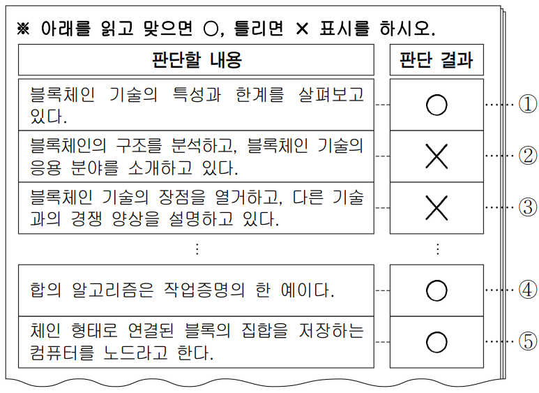

- 배치 / 역할 / 풀이 필수: `PASSAGE` / `ILLUSTRATIVE` / 아니요
- 종류 / MIME: `IMAGE` / `image/png`
- 크기: 773 × 563
- 원본 URL: [열기](https://d1c00yjit06b00.cloudfront.net/dev/exams/69bbe333a9ac92778edc513a/1774339498248-6fp4vd-img0.png)
- 콘텐츠 해시: `sha256:ad4e9eff15af70ea4ed38e274fddfb629fea51a9c9af071624d59baeb381e40c`

### 문제

- 문항 제목: 구체적 상황에의 적용
- 배점: 3점
- 태그: `사례 적용`

**발문**: 윗글을 바탕으로 <보기>를 이해한 내용으로 가장 적절한 것은?

#### 보기

노드 수가 10개로 고정된 블록체인 기술을 사용하고 있는 A 업체는 이전에 사용하던 작업증명 대신 속도가 더 빠른 합의 알고리즘을 개발해, 유통 분야에서 요구되는 성능을 초과 달성했다. 한편 B 업체는 최근 A 업체보다 데이터의 위조 불가능성을 향상시킨 블록체인 기술을 개발했다. 이 기술은 노드 수에 제한이 없지만 현재는 200개의 노드가 참여하고 있다. 승인 과정에는 작업증명을 사용한다.

#### 선지

1. A 업체의 블록체인 기술은 이전보다 확장성과 보안성이 모두 높아졌겠군.

2. B 업체의 블록체인 기술은 노드 수가 증가할수록 보안성과 확장성이 모두 높아지겠군.

3. B 업체의 블록체인 기술은 노드 수가 감소하면 성능은 높아지고 탈중앙성이 낮아지겠군.

4. A 업체의 블록체인 기술은 B 업체와 달리 공개형이고, B 업체보다 탈중앙성이 낮겠군.

5. A 업체의 블록체인 기술은 B 업체와 승인 과정이 다르고, B 업체보다 무결성이 높겠군.

**공식 정답: 3번 (`C3`) — B 업체의 블록체인 기술은 노드 수가 감소하면 성능은 높아지고 탈중앙성이 낮아지겠군.**

### 골드 후보 전체

- 스키마: `problem-solving-gold-v2`
- 골드 상태: `candidate`
- 골드 원천: `69bcae308095df3b8c53d9a2` / 고3 2024년(2025학년도) 9월 - 평가원 모의평가 / 11번
- question / passage ID: `69bcae308095df3b8c53d9a2-q11` / `69bcae308095df3b8c53d9a2-passage`
- 골드 발문: 윗글을 바탕으로 <보기>를 이해한 내용으로 가장 적절한 것은?
- 발문 극성: `SELECT_CORRECT`
- 정답 choice ID: `C3`

#### 시나리오와 사실

노드 수가 10개로 고정된 블록체인 기술을 사용하고 있는 A 업체는 이전에 사용하던 작업증명 대신 속도가 더 빠른 합의 알고리즘을 개발해, 유통 분야에서 요구되는 성능을 초과 달성했다. 한편 B 업체는 최근 A 업체보다 데이터의 위조 불가능성을 향상시킨 블록체인 기술을 개발했다. 이 기술은 노드 수에 제한이 없지만 현재는 200개의 노드가 참여하고 있다. 승인 과정에는 작업증명을 사용한다.

- `SF1` A 업체 블록체인 기술의 노드 수는 10개로 고정되어 있다.
- `SF2` A 업체는 이전에 사용하던 작업증명보다 속도가 더 빠른 합의 알고리즘을 개발하여 사용한다.
- `SF3` A 업체의 블록체인 기술은 유통 분야에서 요구되는 성능을 초과 달성했다.
- `SF4` B 업체의 블록체인 기술은 A 업체보다 데이터의 위조 불가능성이 향상되어 있다.
- `SF5` B 업체의 블록체인 기술은 노드 수에 제한이 없고, 현재 200개의 노드가 참여한다.
- `SF6` B 업체의 승인 과정에는 작업증명이 사용된다.

#### 원문 근거 명제

- passage detail ID: `69bcae308095df3b8c53d9a2-passage`

##### MP1 · P1

새로 생성된 블록은 노드들에 전파되고, 노드들은 그 내용이 다른 블록의 내용과 상충하거나 동일한 내용이 다른 블록에 이중으로 포함되는지를 검증한다.

- 원문 증거: “노드들은 블록에 포함된 내용이 블록체인의 다른 블록에 있는 내용과 상충되지 않는지, 동일한 내용이 블록체인의 다른 블록에 이중으로 포함되어 있지 않은지 검증한다.”
- 범위: 블록 생성 및 검증 과정
- 극성 / 근거 유형: `positive` / `PASSAGE_EXPLICIT`
- 조건: 없음
- 예외: 없음

##### MP2 · P1

검증이 끝난 블록의 연결 여부는 모든 노드가 참여하는 승인 과정으로 정해지며, 승인 과정에는 합의 알고리즘이 사용되고 작업증명은 그 예이다.

- 원문 증거: “검증이 끝난 블록을 블록체인에 연결할지 여부는 모든 노드들이 참여하는 승인 과정을 통해 정해진다. 승인 과정에는 합의 알고리즘이 사용되고, 합의 알고리즘의 예로 ‘작업증명’이 있다.”
- 범위: 승인 과정과 합의 알고리즘
- 극성 / 근거 유형: `positive` / `PASSAGE_EXPLICIT`
- 조건: 없음
- 예외: 없음

##### MP3 · P2

블록체인 기술의 성능은 단위 시간당 블록체인에 저장되는 데이터의 양으로 계산될 수 있다.

- 원문 증거: “블록체인 기술의 성능은 블록체인에 데이터가 저장되는 속도로 정의되며, 단위 시간당 블록체인에 저장되는 데이터의 양으로 계산될 수 있다.”
- 범위: 성능의 정의
- 극성 / 근거 유형: `positive` / `PASSAGE_EXPLICIT`
- 조건: 없음
- 예외: 없음

##### MP4 · P2

비공개형 블록체인은 노드 수에 제한을 두며, 일반적으로 공개형보다 합의 알고리즘의 속도가 빠르다.

- 원문 증거: “비공개형은 공개형과 달리 노드 수에 제한을 두고, 일반적으로 공개형에 비해 합의 알고리즘의 속도가 빠르다.”
- 범위: 비공개형 블록체인의 특성
- 극성 / 근거 유형: `positive` / `PASSAGE_EXPLICIT`
- 조건: 없음
- 예외: 없음

##### MP5 · P2

비공개형은 승인 과정에 걸리는 시간이 짧기 때문에 성능이 높다.

- 원문 증거: “따라서 비공개형은 승인 과정에 걸리는 시간이 짧기 때문에 성능이 높다.”
- 범위: 비공개형의 성능
- 극성 / 근거 유형: `positive` / `PASSAGE_EXPLICIT`
- 조건: 없음
- 예외: 없음

##### MP6 · P3

블록체인 데이터의 무결성은 데이터를 무단으로 변경하기 어려운 성질이다.

- 원문 증거: “데이터가 무단으로 변경되기 어렵다는 성질을 무결성이라 하는데”
- 범위: 무결성의 의미
- 극성 / 근거 유형: `positive` / `PASSAGE_EXPLICIT`
- 조건: 없음
- 예외: 없음

##### MP7 · P3

특정 노드의 일부 데이터가 변경되면 변경된 블록과 그 이후 블록들은 블록체인과의 연결이 끊어지고, 이 연결을 복구하려면 승인 과정이 필요하므로 복구가 어렵다.

- 원문 증거: “특정 노드에 저장되어 있는 일부 데이터가 변경되면 변경된 블록과 그 이후의 블록들은 블록체인과의 연결이 끊어진다. 끊어진 모든 블록을 다시 연결하는 것은 승인 과정을 필요로 하기 때문에 연결을 복구하는 것은 어렵다.”
- 범위: 무단 변경의 결과
- 극성 / 근거 유형: `positive` / `PASSAGE_EXPLICIT`
- 조건: 특정 노드에 저장된 일부 데이터가 변경됨
- 예외: 없음

##### MP8 · P3

블록체인에 포함된 일부 데이터가 지워져도 승인된 원래 데이터로 복원할 때는 승인 과정이 필요하지 않아 복원이 용이하다.

- 원문 증거: “일부 데이터가 지워져도 승인된 원래의 데이터로 복원할 때는 승인 과정이 필요하지 않다. 따라서 블록체인에 포함된 데이터는 일부가 지워지더라도 복원이 용이하다.”
- 범위: 삭제 데이터의 복원
- 극성 / 근거 유형: `positive` / `PASSAGE_EXPLICIT`
- 조건: 일부 데이터가 지워짐
- 예외: 무단 변경의 복구와는 구별됨

##### MP9 · P4

보안성은 데이터의 무단 변경과 동일 내용 데이터의 이중 포함이 어려운 성질이다.

- 원문 증거: “보안성은 데이터의 무단 변경이 어려울 뿐 아니라 동일한 내용의 데이터가 블록체인의 서로 다른 블록에 또는 단일 블록에 이중으로 포함되는 것이 어렵다는 성질이다.”
- 범위: 보안성의 의미
- 극성 / 근거 유형: `positive` / `PASSAGE_EXPLICIT`
- 조건: 없음
- 예외: 없음

##### MP10 · P4

승인 과정에 걸리는 시간이 줄거나 노드 수가 감소하면 보안성은 낮아진다.

- 원문 증거: “승인 과정에 걸리는 시간이 줄거나 노드 수가 감소하면 보안성은 낮아진다.”
- 범위: 보안성 변화 조건
- 극성 / 근거 유형: `positive` / `PASSAGE_EXPLICIT`
- 조건: 승인 과정 시간 감소 또는 노드 수 감소
- 예외: 없음

##### MP11 · P4

탈중앙성은 다수 노드가 승인 과정에 참여하고 특정 노드가 승인 과정을 주도하지 않는 성질이며, 노드 수가 감소하면 낮아진다.

- 원문 증거: “탈중앙성은 승인 과정에 다수의 노드들이 참여하고, 특정 노드가 승인 과정을 주도하지 않는다는 성질이다. 노드 수가 감소하면 탈중앙성은 낮아진다.”
- 범위: 탈중앙성의 의미와 변화
- 극성 / 근거 유형: `positive` / `PASSAGE_EXPLICIT`
- 조건: 노드 수 감소 시 탈중앙성 저하
- 예외: 없음

##### MP12 · P4

확장성은 응용 분야에 적용 가능할 만큼 성능이 높고 노드 수가 증가해도 서비스 유지가 가능한 성질이다.

- 원문 증거: “확장성은 블록체인 기술이 목표로 하는 응용 분야에 적용 가능할 만큼 성능이 높고, 노드 수가 증가해도 서비스 유지가 가능하다는 성질이다.”
- 범위: 확장성의 의미
- 극성 / 근거 유형: `positive` / `PASSAGE_EXPLICIT`
- 조건: 없음
- 예외: 없음

##### MP13 · P4

노드 수가 증가하면 성능이 저하되며, 노드 수를 제한하면 성능 저하를 막을 수 있다.

- 원문 증거: “노드 수가 증가하면 성능이 저하되므로, 확장성이 높다는 것은 노드 수가 증가하더라도 성능 저하가 크지 않다는 것을 의미한다. ... 노드 수를 제한하면 성능 저하를 막을 수 있기 때문이다.”
- 범위: 노드 수와 성능
- 극성 / 근거 유형: `positive` / `PASSAGE_EXPLICIT`
- 조건: 없음
- 예외: 없음

##### MP14 · P4

블록체인 기술은 보안성, 탈중앙성, 확장성을 함께 높일 수 있는 방법이 아직 없어 대규모로 채택되지 못하고 있다.

- 원문 증거: “아직까지 블록체인 기술은 보안성, 탈중앙성, 확장성을 함께 높일 수 있는 방법이 없어 대규모로 채택되지 못하고 있다.”
- 범위: 블록체인 기술의 한계
- 극성 / 근거 유형: `negative` / `PASSAGE_EXPLICIT`
- 조건: 없음
- 예외: 없음

#### 시각 자료 주장

없음

#### 문항 추론

##### IF1 · FOLLOW_CAUSAL_CHAIN

A 업체가 이전보다 더 빠른 합의 알고리즘을 사용하면 승인 과정에 걸리는 시간이 줄어들고, 이에 따라 A 업체의 보안성은 이전보다 낮아진다.

- 결론: A 업체가 이전보다 더 빠른 합의 알고리즘을 사용하면 승인 과정에 걸리는 시간이 줄어들고, 이에 따라 A 업체의 보안성은 이전보다 낮아진다.
- 대상 주장 / 효과: `OC1-2` / `CONTRADICTS`
- 직접 전제 refs: `MP10`, `SF2`
- 원문 참조: 문단 `P4` / 명제 `MP10`
- 시나리오 사실: `SF2`
- 시각 주장: 없음
- grounding / necessity: `SOURCE_ENTAILED` / `REQUIRED`

##### IF2 · CHECK_JUSTIFICATION

A 업체가 현재 유통 분야 요구 성능을 초과한다는 사실과 노드 수가 10개로 고정되어 있다는 사실만으로는 이전보다 확장성이 높아졌다는 결론이나 그 부정을 도출할 수 없으므로, 그 비교 주장은 기본 골드에서 정당화되지 않는다.

- 결론: A 업체가 현재 유통 분야 요구 성능을 초과한다는 사실과 노드 수가 10개로 고정되어 있다는 사실만으로는 이전보다 확장성이 높아졌다는 결론이나 그 부정을 도출할 수 없으므로, 그 비교 주장은 기본 골드에서 정당화되지 않는다.
- 대상 주장 / 효과: `OC1-1` / `DOES_NOT_JUSTIFY`
- 직접 전제 refs: `MP12`, `SF1`, `SF3`, `ANSWER_KEY`
- 원문 참조: 문단 `P4` / 명제 `MP12`
- 시나리오 사실: `SF1`, `SF3`
- 시각 주장: 없음
- grounding / necessity: `ANSWER_KEY_CONSTRAINED` / `SUPPORTING`

##### IF3 · CHECK_JUSTIFICATION

B 업체의 노드 수가 증가한다는 사실만으로 보안성이 높아진다는 결론이나 그 부정을 도출할 수 없으므로, 보안성이 높아진다는 주장은 기본 골드에서 정당화되지 않는다.

- 결론: B 업체의 노드 수가 증가한다는 사실만으로 보안성이 높아진다는 결론이나 그 부정을 도출할 수 없으므로, 보안성이 높아진다는 주장은 기본 골드에서 정당화되지 않는다.
- 대상 주장 / 효과: `OC2-1` / `DOES_NOT_JUSTIFY`
- 직접 전제 refs: `MP10`, `SF5`, `ANSWER_KEY`
- 원문 참조: 문단 `P4` / 명제 `MP10`
- 시나리오 사실: `SF5`
- 시각 주장: 없음
- grounding / necessity: `ANSWER_KEY_CONSTRAINED` / `SUPPORTING`

##### IF4 · CHECK_JUSTIFICATION

B 업체의 노드 수가 증가하면 성능은 저하하지만, 이 사실만으로 확장성이 높아진다는 주장이나 그 부정을 도출할 수 없으므로, 확장성이 높아진다는 주장은 기본 골드에서 정당화되지 않는다.

- 결론: B 업체의 노드 수가 증가하면 성능은 저하하지만, 이 사실만으로 확장성이 높아진다는 주장이나 그 부정을 도출할 수 없으므로, 확장성이 높아진다는 주장은 기본 골드에서 정당화되지 않는다.
- 대상 주장 / 효과: `OC2-2` / `DOES_NOT_JUSTIFY`
- 직접 전제 refs: `MP12`, `MP13`, `SF5`, `ANSWER_KEY`
- 원문 참조: 문단 `P4` / 명제 `MP12`, `MP13`
- 시나리오 사실: `SF5`
- 시각 주장: 없음
- grounding / necessity: `ANSWER_KEY_CONSTRAINED` / `SUPPORTING`

##### IF5 · FOLLOW_CAUSAL_CHAIN

현재 200개인 B 업체의 노드 수가 감소하면 성능 저하가 줄어 성능은 높아지고, 노드 수 감소에 따라 탈중앙성은 낮아진다.

- 결론: 현재 200개인 B 업체의 노드 수가 감소하면 성능 저하가 줄어 성능은 높아지고, 노드 수 감소에 따라 탈중앙성은 낮아진다.
- 대상 주장 / 효과: `OC3-1`, `OC3-2` / `SUPPORTS`
- 직접 전제 refs: `MP11`, `MP13`, `SF5`
- 원문 참조: 문단 `P4` / 명제 `MP11`, `MP13`
- 시나리오 사실: `SF5`
- 시각 주장: 없음
- grounding / necessity: `SOURCE_ENTAILED` / `REQUIRED`

##### IF6 · CLASSIFY

A 업체의 노드 수가 고정되어 있고 B 업체의 노드 수에 제한이 없다는 사실만으로 A 업체가 공개형이라는 결론이나 그 부정을 도출할 수 없으므로, A 업체가 공개형이라는 주장은 기본 골드에서 정당화되지 않는다.

- 결론: A 업체의 노드 수가 고정되어 있고 B 업체의 노드 수에 제한이 없다는 사실만으로 A 업체가 공개형이라는 결론이나 그 부정을 도출할 수 없으므로, A 업체가 공개형이라는 주장은 기본 골드에서 정당화되지 않는다.
- 대상 주장 / 효과: `OC4-1` / `DOES_NOT_JUSTIFY`
- 직접 전제 refs: `MP4`, `SF1`, `SF5`, `ANSWER_KEY`
- 원문 참조: 문단 `P2` / 명제 `MP4`
- 시나리오 사실: `SF1`, `SF5`
- 시각 주장: 없음
- grounding / necessity: `ANSWER_KEY_CONSTRAINED` / `REQUIRED`

##### IF7 · COMPARE

A 업체의 노드 수가 10개이고 B 업체에는 현재 200개의 노드가 참여하므로, 더 적은 노드가 참여하는 A 업체의 탈중앙성은 B 업체보다 낮다.

- 결론: A 업체의 노드 수가 10개이고 B 업체에는 현재 200개의 노드가 참여하므로, 더 적은 노드가 참여하는 A 업체의 탈중앙성은 B 업체보다 낮다.
- 대상 주장 / 효과: `OC4-2` / `SUPPORTS`
- 직접 전제 refs: `MP11`, `SF1`, `SF5`
- 원문 참조: 문단 `P4` / 명제 `MP11`
- 시나리오 사실: `SF1`, `SF5`
- 시각 주장: 없음
- grounding / necessity: `SOURCE_ENTAILED` / `SUPPORTING`

##### IF8 · COMPARE

A 업체는 작업증명보다 더 빠른 별도의 합의 알고리즘을 사용하고 B 업체는 작업증명을 사용하므로, 두 업체의 승인 과정에 사용되는 합의 알고리즘은 다르다.

- 결론: A 업체는 작업증명보다 더 빠른 별도의 합의 알고리즘을 사용하고 B 업체는 작업증명을 사용하므로, 두 업체의 승인 과정에 사용되는 합의 알고리즘은 다르다.
- 대상 주장 / 효과: `OC5-1` / `SUPPORTS`
- 직접 전제 refs: `MP2`, `SF2`, `SF6`
- 원문 참조: 문단 `P1` / 명제 `MP2`
- 시나리오 사실: `SF2`, `SF6`
- 시각 주장: 없음
- grounding / necessity: `SOURCE_EXPLICIT` / `SUPPORTING`

##### IF9 · MAP_CONCEPT

무결성은 데이터의 무단 변경이 어려운 성질이고, B 업체는 A 업체보다 데이터의 위조 불가능성을 향상시켰으므로 A 업체의 무결성이 B 업체보다 높다는 결론은 성립하지 않는다.

- 결론: 무결성은 데이터의 무단 변경이 어려운 성질이고, B 업체는 A 업체보다 데이터의 위조 불가능성을 향상시켰으므로 A 업체의 무결성이 B 업체보다 높다는 결론은 성립하지 않는다.
- 대상 주장 / 효과: `OC5-2` / `CONTRADICTS`
- 직접 전제 refs: `MP6`, `SF4`
- 원문 참조: 문단 `P3` / 명제 `MP6`
- 시나리오 사실: `SF4`
- 시각 주장: 없음
- grounding / necessity: `SOURCE_ENTAILED` / `REQUIRED`

#### 보충 설명 추론

없음

#### 선지별 골드 판정

##### C1 · A 업체의 블록체인 기술은 이전보다 확장성과 보안성이 모두 높아졌겠군.

- 위치 / 판정: 1 / `FALSE`
- 판정 근거: 더 빠른 합의 알고리즘으로 승인 시간이 줄어들면 보안성은 낮아지므로, 보안성이 높아졌다는 부분이 지문과 모순된다.
- 주장 IDs: `OC1-1`, `OC1-2`
- 필수 원문 참조: 문단 `P4` / 명제 `MP10`
- 필수 시나리오 사실: `SF2`
- 필수 시각 주장: 없음

**주장 OC1-1 (1순위)**

A 업체의 블록체인 기술은 이전보다 확장성이 높아졌다.

- assessment / support: `NOT_JUSTIFIED` / `NONE`
- decision / basis: `REJECTED` / `ANSWER_KEY_CONSTRAINED`
- 결정 핵심: 아니요
- 의존 주장: 없음
- 문항 추론: `IF2`
- 원문 참조: 문단 `P4` / 명제 `MP12`
- 시나리오 사실: `SF1`, `SF3`
- 시각 주장: 없음
- 보충 추론: 없음
- 보충 사용 정책: 없음

**주장 OC1-2 (2순위)**

A 업체의 블록체인 기술은 이전보다 보안성이 높아졌다.

- assessment / support: `CONTRADICTED` / `NONE`
- decision / basis: `REJECTED` / `SOURCE_GROUNDED`
- 결정 핵심: 예
- 의존 주장: 없음
- 문항 추론: `IF1`
- 원문 참조: 문단 `P4` / 명제 `MP10`
- 시나리오 사실: `SF2`
- 시각 주장: 없음
- 보충 추론: 없음
- 보충 사용 정책: 없음

##### C2 · B 업체의 블록체인 기술은 노드 수가 증가할수록 보안성과 확장성이 모두 높아지겠군.

- 위치 / 판정: 2 / `FALSE`
- 판정 근거: 노드 수 증가만으로 보안성이 높아진다고 할 수 없고, 성능 저하 사실만으로 확장성이 높아진다고도 할 수 없다.
- 주장 IDs: `OC2-1`, `OC2-2`
- 필수 원문 참조: 문단 `P4` / 명제 `MP10`, `MP12`, `MP13`
- 필수 시나리오 사실: `SF5`
- 필수 시각 주장: 없음

**주장 OC2-1 (1순위)**

B 업체의 블록체인 기술은 노드 수가 증가할수록 보안성이 높아진다.

- assessment / support: `NOT_JUSTIFIED` / `NONE`
- decision / basis: `REJECTED` / `ANSWER_KEY_CONSTRAINED`
- 결정 핵심: 아니요
- 의존 주장: 없음
- 문항 추론: `IF3`
- 원문 참조: 문단 `P4` / 명제 `MP10`
- 시나리오 사실: `SF5`
- 시각 주장: 없음
- 보충 추론: 없음
- 보충 사용 정책: 없음

**주장 OC2-2 (2순위)**

B 업체의 블록체인 기술은 노드 수가 증가할수록 확장성이 높아진다.

- assessment / support: `NOT_JUSTIFIED` / `NONE`
- decision / basis: `REJECTED` / `ANSWER_KEY_CONSTRAINED`
- 결정 핵심: 예
- 의존 주장: 없음
- 문항 추론: `IF4`
- 원문 참조: 문단 `P4` / 명제 `MP12`, `MP13`
- 시나리오 사실: `SF5`
- 시각 주장: 없음
- 보충 추론: 없음
- 보충 사용 정책: 없음

##### C3 · B 업체의 블록체인 기술은 노드 수가 감소하면 성능은 높아지고 탈중앙성이 낮아지겠군.

- 위치 / 판정: 3 / `TRUE`
- 판정 근거: 노드 수를 줄이면 성능 저하를 막을 수 있어 성능이 높아지며, 노드 수 감소는 탈중앙성을 낮춘다.
- 주장 IDs: `OC3-1`, `OC3-2`
- 필수 원문 참조: 문단 `P4` / 명제 `MP11`, `MP13`
- 필수 시나리오 사실: `SF5`
- 필수 시각 주장: 없음

**주장 OC3-1 (1순위)**

B 업체의 블록체인 기술은 노드 수가 감소하면 성능이 높아진다.

- assessment / support: `SUPPORTED` / `ENTAILED`
- decision / basis: `ACCEPTED` / `SOURCE_GROUNDED`
- 결정 핵심: 예
- 의존 주장: 없음
- 문항 추론: `IF5`
- 원문 참조: 문단 `P4` / 명제 `MP13`
- 시나리오 사실: `SF5`
- 시각 주장: 없음
- 보충 추론: 없음
- 보충 사용 정책: 없음

**주장 OC3-2 (2순위)**

B 업체의 블록체인 기술은 노드 수가 감소하면 탈중앙성이 낮아진다.

- assessment / support: `SUPPORTED` / `ENTAILED`
- decision / basis: `ACCEPTED` / `SOURCE_GROUNDED`
- 결정 핵심: 예
- 의존 주장: 없음
- 문항 추론: `IF5`
- 원문 참조: 문단 `P4` / 명제 `MP11`
- 시나리오 사실: `SF5`
- 시각 주장: 없음
- 보충 추론: 없음
- 보충 사용 정책: 없음

##### C4 · A 업체의 블록체인 기술은 B 업체와 달리 공개형이고, B 업체보다 탈중앙성이 낮겠군.

- 위치 / 판정: 4 / `FALSE`
- 판정 근거: A 업체의 노드 수가 고정되었다는 사실만으로 A 업체가 공개형이라고 분류할 수 없다.
- 주장 IDs: `OC4-1`, `OC4-2`
- 필수 원문 참조: 문단 `P2` / 명제 `MP4`
- 필수 시나리오 사실: `SF1`, `SF5`
- 필수 시각 주장: 없음

**주장 OC4-1 (1순위)**

A 업체의 블록체인 기술은 B 업체와 달리 공개형이다.

- assessment / support: `NOT_JUSTIFIED` / `NONE`
- decision / basis: `REJECTED` / `ANSWER_KEY_CONSTRAINED`
- 결정 핵심: 예
- 의존 주장: 없음
- 문항 추론: `IF6`
- 원문 참조: 문단 `P2` / 명제 `MP4`
- 시나리오 사실: `SF1`, `SF5`
- 시각 주장: 없음
- 보충 추론: 없음
- 보충 사용 정책: 없음

**주장 OC4-2 (2순위)**

A 업체의 블록체인 기술은 B 업체보다 탈중앙성이 낮다.

- assessment / support: `SUPPORTED` / `ENTAILED`
- decision / basis: `ACCEPTED` / `SOURCE_GROUNDED`
- 결정 핵심: 아니요
- 의존 주장: 없음
- 문항 추론: `IF7`
- 원문 참조: 문단 `P4` / 명제 `MP11`
- 시나리오 사실: `SF1`, `SF5`
- 시각 주장: 없음
- 보충 추론: 없음
- 보충 사용 정책: 없음

##### C5 · A 업체의 블록체인 기술은 B 업체와 승인 과정이 다르고, B 업체보다 무결성이 높겠군.

- 위치 / 판정: 5 / `FALSE`
- 판정 근거: 두 업체의 합의 알고리즘은 다르지만, B 업체가 A 업체보다 데이터의 위조 불가능성을 향상시켰으므로 A 업체의 무결성이 더 높다고 할 수 없다.
- 주장 IDs: `OC5-1`, `OC5-2`
- 필수 원문 참조: 문단 `P1` / 명제 `MP2`; 문단 `P3` / 명제 `MP6`
- 필수 시나리오 사실: `SF2`, `SF4`, `SF6`
- 필수 시각 주장: 없음

**주장 OC5-1 (1순위)**

A 업체의 블록체인 기술은 B 업체와 승인 과정에 사용되는 합의 알고리즘이 다르다.

- assessment / support: `SUPPORTED` / `DIRECT`
- decision / basis: `ACCEPTED` / `SOURCE_GROUNDED`
- 결정 핵심: 아니요
- 의존 주장: 없음
- 문항 추론: `IF8`
- 원문 참조: 문단 `P1` / 명제 `MP2`
- 시나리오 사실: `SF2`, `SF6`
- 시각 주장: 없음
- 보충 추론: 없음
- 보충 사용 정책: 없음

**주장 OC5-2 (2순위)**

A 업체의 블록체인 기술은 B 업체보다 무결성이 높다.

- assessment / support: `CONTRADICTED` / `NONE`
- decision / basis: `REJECTED` / `SOURCE_GROUNDED`
- 결정 핵심: 예
- 의존 주장: 없음
- 문항 추론: `IF9`
- 원문 참조: 문단 `P3` / 명제 `MP6`
- 시나리오 사실: `SF4`
- 시각 주장: 없음
- 보충 추론: 없음
- 보충 사용 정책: 없음

#### 정답 도출 경로

##### RP1

B 업체에는 현재 200개의 노드가 참여하므로, 노드 수가 감소하는 상황을 적용할 수 있다.

- 원문 참조: 없음
- 시나리오 사실: `SF5`
- 시각 주장: 없음
- 문항 추론: 없음
- 선지 주장: 없음

##### RP2

노드 수가 감소하면 성능 저하가 줄어 성능은 높아지고, 탈중앙성은 낮아진다.

- 원문 참조: 문단 `P4` / 명제 `MP11`, `MP13`
- 시나리오 사실: `SF5`
- 시각 주장: 없음
- 문항 추론: `IF5`
- 선지 주장: `OC3-1`, `OC3-2`

##### RP3

따라서 B 업체에 관해 노드 수 감소 시 성능 상승과 탈중앙성 하락을 함께 진술한 C3가 적절하다.

- 원문 참조: 없음
- 시나리오 사실: 없음
- 시각 주장: 없음
- 문항 추론: `IF5`
- 선지 주장: `OC3-1`, `OC3-2`

- 필수 단계: `RP1`, `RP2`, `RP3`
- 결정 단계: `RP2`
- 결론 단계: `RP3`
- 최종 답: `C3`
- 최종 설명: 노드 수가 감소하면 성능 저하를 막을 수 있어 성능은 높아지고, 탈중앙성은 낮아진다. 따라서 정답은 C3이다.
- 최종 설명 참조 단계: `RP2`, `RP3`

#### 대표 오답 경로

- `WP1` 더 빠른 합의 알고리즘으로 성능이 높아진 점만 보고 보안성도 높아진다고 판단한 경우이다. 지문은 승인 시간이 줄면 보안성이 낮아진다고 제시한다.
  - scope: `SELECTED_WRONG_CHOICE`
  - 선택 선지: `C1`
  - 놓친 정답: `없음`
  - 분기 층위 후보: `CONDITION_APPLICATION`, `INFERENCE_TRANSFORMATION`
- `WP2` 두 업체의 합의 알고리즘이 다르다는 참인 부분만으로 선지 전체를 수용하고, B 업체의 데이터 위조 불가능성 향상이 A 업체의 무결성 우위 주장과 충돌함을 놓친 경우이다.
  - scope: `SELECTED_WRONG_CHOICE`
  - 선택 선지: `C5`
  - 놓친 정답: `없음`
  - 분기 층위 후보: `CONCEPT_SCENARIO_MAPPING`, `CHOICE_INTERPRETATION`

#### 골드 자체 검수 메모

없음

### 충분 근거 조합 후보

#### 69bcae308095df3b8c53d9a2-q11-C1-SGC1

- 선지 / 대상 주장: `C1` / `OC1-2`
- 제안 경로 / 연산자: `APPROVED_SUFFICIENT_GROUND_SET` / `ALL_OF`
- 필수 근거: `MP10`, `SF2`
- 생략 허용 근거: 없음
- 결론: A 업체가 이전보다 더 빠른 합의 알고리즘을 사용하면 승인 과정에 걸리는 시간이 줄어들고, 이에 따라 A 업체의 보안성은 이전보다 낮아진다.
- 원천 추론: `IF1`
- 생성 방식 / 상태: `AI_INFERENCE_GRAPH_DERIVED` / `candidate`
- 위험 표지: 없음

#### 69bcae308095df3b8c53d9a2-q11-C2-SGC1

- 선지 / 대상 주장: `C2` / `OC2-1`, `OC2-2`
- 제안 경로 / 연산자: `APPROVED_SUFFICIENT_GROUND_SET` / `ALL_OF`
- 필수 근거: `MP10`, `SF5`, `ANSWER_KEY`, `MP12`, `MP13`
- 생략 허용 근거: 없음
- 결론: B 업체의 노드 수가 증가한다는 사실만으로 보안성이 높아진다는 결론이나 그 부정을 도출할 수 없으므로, 보안성이 높아진다는 주장은 기본 골드에서 정당화되지 않는다. B 업체의 노드 수가 증가하면 성능은 저하하지만, 이 사실만으로 확장성이 높아진다는 주장이나 그 부정을 도출할 수 없으므로, 확장성이 높아진다는 주장은 기본 골드에서 정당화되지 않는다.
- 원천 추론: `IF3`, `IF4`
- 생성 방식 / 상태: `AI_INFERENCE_GRAPH_DERIVED` / `candidate`
- 위험 표지: `ANSWER_KEY_CONSTRAINED`, `DOES_NOT_JUSTIFY`, `MULTIPLE_INFERENCES`

#### 69bcae308095df3b8c53d9a2-q11-C3-SGC1

- 선지 / 대상 주장: `C3` / `OC3-1`, `OC3-2`
- 제안 경로 / 연산자: `APPROVED_SUFFICIENT_GROUND_SET` / `ALL_OF`
- 필수 근거: `MP11`, `MP13`, `SF5`
- 생략 허용 근거: 없음
- 결론: 현재 200개인 B 업체의 노드 수가 감소하면 성능 저하가 줄어 성능은 높아지고, 노드 수 감소에 따라 탈중앙성은 낮아진다.
- 원천 추론: `IF5`
- 생성 방식 / 상태: `AI_INFERENCE_GRAPH_DERIVED` / `candidate`
- 위험 표지: 없음

#### 69bcae308095df3b8c53d9a2-q11-C4-SGC1

- 선지 / 대상 주장: `C4` / `OC4-1`
- 제안 경로 / 연산자: `APPROVED_SUFFICIENT_GROUND_SET` / `ALL_OF`
- 필수 근거: `MP4`, `SF1`, `SF5`, `ANSWER_KEY`
- 생략 허용 근거: 없음
- 결론: A 업체의 노드 수가 고정되어 있고 B 업체의 노드 수에 제한이 없다는 사실만으로 A 업체가 공개형이라는 결론이나 그 부정을 도출할 수 없으므로, A 업체가 공개형이라는 주장은 기본 골드에서 정당화되지 않는다.
- 원천 추론: `IF6`
- 생성 방식 / 상태: `AI_INFERENCE_GRAPH_DERIVED` / `candidate`
- 위험 표지: `ANSWER_KEY_CONSTRAINED`, `DOES_NOT_JUSTIFY`

#### 69bcae308095df3b8c53d9a2-q11-C5-SGC1

- 선지 / 대상 주장: `C5` / `OC5-2`
- 제안 경로 / 연산자: `APPROVED_SUFFICIENT_GROUND_SET` / `ALL_OF`
- 필수 근거: `MP6`, `SF4`
- 생략 허용 근거: 없음
- 결론: 무결성은 데이터의 무단 변경이 어려운 성질이고, B 업체는 A 업체보다 데이터의 위조 불가능성을 향상시켰으므로 A 업체의 무결성이 B 업체보다 높다는 결론은 성립하지 않는다.
- 원천 추론: `IF9`
- 생성 방식 / 상태: `AI_INFERENCE_GRAPH_DERIVED` / `candidate`
- 위험 표지: 없음

### 생성·검증 기록

- 원시 스키마 통과: 아니요
- 원시 오류: representativeWrongPaths.0.missedAnswerChoiceId: 선택 선지 경로에는 놓친 정답을 지정하지 않는다.; representativeWrongPaths.1.missedAnswerChoiceId: 선택 선지 경로에는 놓친 정답을 지정하지 않는다.
- 자동 정규화: `REBUILD_INFERENCE_PREMISE_REFS`, `REBUILD_INFERENCE_PREMISE_REFS`, `REBUILD_INFERENCE_PREMISE_REFS`, `REBUILD_INFERENCE_PREMISE_REFS`, `ALIGN_WRONG_PATH_MISSED_ANSWER`, `ALIGN_WRONG_PATH_MISSED_ANSWER`
- 최종 스키마 통과: 예
- 최종 오류: 없음
- 생성 모델 / effort: `gpt-5.6-terra` / `medium`
- 프롬프트 버전: `problem-gold-generation-prompt-v2`
- 생성 시간: 71849ms

- 검수 파일 상태: `PENDING`
- 검수자 / 시각: 없음 / 없음
- 승인된 충분 근거 후보: 없음
- 검수 메모: 없음

**사람 검수 메모:**

- 판정:
- 수정 필요 사항:
- 승인할 충분 근거 후보:

[목차로 돌아가기](#빠른-목차)

---

## 7. 고1 2025년 6월 - 교육청 모의평가 · 지진파의 특성과 내진설계 32번

### 검수 상태

- case ID: `prospective-69c0961c78128b2a9bee0717-q32`
- 분야: `SCIENCE`
- 표본 범위: `POSITIVE_STEM`, `SCIENCE`, `SCENARIO_APPLICATION`, `VISUAL`, `MULTI_CONDITION`
- 생산 상태: `PENDING_HUMAN_REVIEW`
- 후보 종류: 정적 검증을 통과한 후보
- 사람 검수 상태: `PENDING`
- 검수 위험도: `MEDIUM`
- 위험 사유: VISUAL_REQUIRED; MULTIPLE_INFERENCES
- 원천 해시: `sha256:967269eef6fb12b5bcc50e6f1a7e5263f173299edac1e0b9762ab13150743d93`

검수 체크: [ ] 공식 정답과 선지 판정 일치 · [ ] 원문 근거 정확 · [ ] 추론 비약 없음 · [ ] 충분 근거가 최소 조합 · [ ] 시각 자료 해석 정확

### 원문

지진은 지구 내부에서 일어나는 지각 변동으로 인해 땅이 흔들리는 현상이다. 이때 지각 부분에서 방출된 에너지는 파동의 형태로 전달되는데, 이를 지진파라고 한다. 대표적인 지진파로는 P파와 S파가 있다.

P파는 에너지가 전달되는 파동의 진행 방향이 매질*의 진동 방향과 같은 지진파로, 매질이 압축과 팽창을 반복하면서 전달되며 관측소에 가장 먼저 도착한다. P파의 전파 속도는 초속 약 6~8㎞이지만, 진폭은 작아 지진 피해는 비교적 작은 편이다. 반면에 S파는 파동의 진행 방향이 매질의 진동 방향과 수직인 지진파로, 전파 속도는 초속 약 3~4㎞로 P파보다 느리지만 진폭이 비교적 커서 지진 피해 정도는 훨씬 크게 나타난다. 두 지진파가 관측소에 도착하는 시간의 차이를 PS시라고 하는데 진원에서 멀어질수록 PS시는 커진다. PS시를 활용하면 지진 발생 시 다른 지역의 지진 피해를 조금이나마 줄일 수 있다.

P파와 S파가 통과할 수 있는 매질에는 차이가 있다. P파는 고체, 액체, 기체를 모두 통과하는 반면, S파는 고체만 통과할 수 있다. 따라서 액체 상태인 외핵을 통과할 수 없으므로, S파가 도착하지 못하는 S파 암영대가 생긴다. P파는 맨틀과 외핵, 외핵과 내핵과 같이 상태가 다르거나 같은 상태라도 밀도가 다른 매질의 경계면을 지날 때 굴절이 일어나는데, 이로 인해 P파 역시 암영대가 생긴다. 또 지진파의 전달 속도는 매질의 밀도가 높아지면 빨라지고 밀도가 낮아지면 느려진다.

한편 지진 발생 시 건물 붕괴로 인한 피해를 줄이기 위해 지진에 저항할 수 있도록 건물을 설계하는 것을 내진설계라고 하는데, 내진구조, 제진구조, 면진구조의 세 유형이 있다. 내진구조는 강한 지진파에도 건축물이 붕괴되지 않게 철근 콘크리트 등을 보강하여 기둥과 벽 자체를 튼튼하게 짓는 것이다. 내진벽과 같은 부자재를 설치하여 강한 흔들림에도 무너지지 않고 버티는 내구성이 높아지도록 건물을 짓는 것이다. 이는 단순히 건물의 내구력만을 높인 것이라 지진 발생 시 건물이 무너지지 않더라도 건물 구조에 심각한 손상이 생길 수 있다.

이에 비해 제진구조는 제진 장치가 땅으로부터 건물에 전달되는 진동을 감지하고, 건물의 흔들림 방향과 반대 방향으로 건물을 지지하여 건물의 붕괴를 막는 구조이다. 철제 빔과 같은 장치로 건물에 X자 등의 제진 장치를 보강하여 건물 전체를 보호하는 것이다. 현재 대부분의 고층 건물은 이러한 방식을 사용하여, 내진구조에 비해 상대적으로 더 안전하다고 볼 수 있다.

앞선 두 구조가 건물이 지진력을 버티는 데 초점을 두었다면, 면진구조는 건물에 전달되는 지진력 자체를 줄이는 데 중점을 둔다. 파동의 에너지는 주기가 짧을수록 크기 때문에 면진구조는 지진파의 파장을 길게 바꾸어 충격을 감소시킨다. 보통 지면 위에 바로 건물을 세우는 것과 달리 면진구조는 건물과 땅 사이에 고무 스프링과 댐퍼, 베어링 등을 설치해 흔들림이 건물로 전해지는 것을 막는 방식이다. 건물 자체와 지면을 떨어뜨리면 진동이 줄어들어 전달되기 때문에 아주 강한 지진이 일어나더라도 건물 내부에 있는 구조물이 쓰러지지 않기 때문에 지진에 대비할 수 있는 효과적인 공법으로 평가받고 있다.

* 매질: 어떤 물리적 작용을 한 곳에서 다른 곳으로 전하여 주는 매개물로, 고체, 액체, 기체 등이 있음.

#### 원문·문제 시각 자료

**MEDIA1 — 지구 내부 층과 진원에서 관측소로 전달되는 P파와 S파의 경로를 나타낸 그림.**

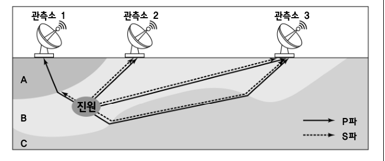

- 배치 / 역할 / 풀이 필수: `PASSAGE` / `INFORMATIONAL` / 아니요
- 종류 / MIME: `DIAGRAM` / `image/png`
- 크기: 650 × 273
- 원본 URL: [열기](https://d1c00yjit06b00.cloudfront.net/dev/exams/69bbe31ea9ac92778edc4fba/1774339495772-qa26mc-img0.png)
- 콘텐츠 해시: `sha256:24ce5ac6162fc911c5d8a01c15c0278124eaf2b0083e9bfea140093cf3a967c7`

**MEDIA2 — (가)는 건물 내부에 X자 장치가 설치된 구조, (나)는 건물 하부에 받침 장치가 설치된 구조, (다)는 양쪽 벽체가 보강된 구조를 나타낸 내진설계 도식.**

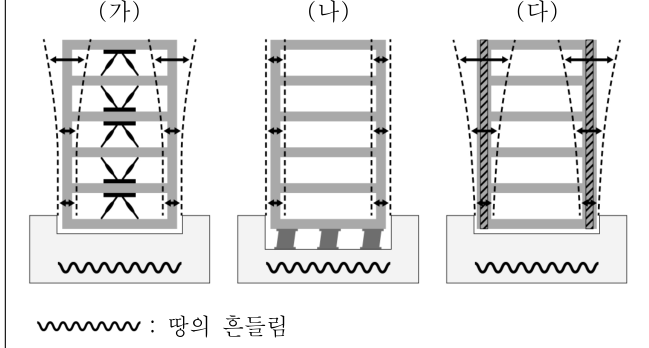

- 배치 / 역할 / 풀이 필수: `SCENARIO` / `INFORMATIONAL` / 예
- 종류 / MIME: `DIAGRAM` / `image/png`
- 크기: 649 × 348
- 원본 URL: [열기](https://d1c00yjit06b00.cloudfront.net/dev/exams/69bbe31ea9ac92778edc4fba/1774339495812-iv826l-img1.png)
- 콘텐츠 해시: `sha256:310db629dce6899bf644cae5c6d275a7083e966d1af0da57670e850746f97c36`

### 문제

- 문항 제목: 내진설계 구조의 도식화된 이해
- 배점: 2점
- 태그: `시각-자료-활용`

**발문**: <보기>의 (가) ～(다)는 내진설계의 각 구조를 도식화한 것이다. 윗글을 바탕으로 <보기>를 이해한 내용으로 가장 적절한 것은?

#### 보기

(가) (나) (다)

: 땅의 흔들림

[보기 이미지 원본 열기](https://d1c00yjit06b00.cloudfront.net/dev/exams/69bbe31ea9ac92778edc4fba/1774339495812-iv826l-img1.png)

#### 선지

1. (가)는 (나)보다 건물에 전달되는 지진력을 더 줄일 수 있다.

2. (나)는 (다)와 달리 지진파의 파장을 짧게 바꾸어 지진력을 줄인다.

3. (다)는 (나)보다 지진 발생 시 건물 구조가 받는 손상이 상대적으로 적다.

4. (가)는 건물의 진동 방향과 같은 방향으로, (나)는 건물의 진동 방향과 반대 방향으로 건물을 지지한다.

5. (나)는 건물 아래에 설치된 구조물에 의해, (다)는 건물 자체의 내구력에 의해 건물이 보호된다.

**공식 정답: 5번 (`C5`) — (나)는 건물 아래에 설치된 구조물에 의해, (다)는 건물 자체의 내구력에 의해 건물이 보호된다.**

### 골드 후보 전체

- 스키마: `problem-solving-gold-v2`
- 골드 상태: `candidate`
- 골드 원천: `69c0961c78128b2a9bee0717` / 고1 2025년 6월 - 교육청 모의평가 / 32번
- question / passage ID: `69c0961c78128b2a9bee0717-q32` / `69c0961c78128b2a9bee0717-passage`
- 골드 발문: <보기>의 (가) ～(다)는 내진설계의 각 구조를 도식화한 것이다. 윗글을 바탕으로 <보기>를 이해한 내용으로 가장 적절한 것은?
- 발문 극성: `SELECT_CORRECT`
- 정답 choice ID: `C5`

#### 시나리오와 사실

<보기>의 (가)~(다)는 각각 서로 다른 내진설계 구조를 도식화한 것이며, 물결선은 땅의 흔들림을 나타낸다.

- `SF1` (가)~(다)는 내진설계의 각 구조를 도식화한 것이다.
- `SF2` 도식의 물결선은 땅의 흔들림을 나타낸다.

#### 원문 근거 명제

- passage detail ID: `69c0961c78128b2a9bee0717-passage`

##### MP1 · P1

지진은 지구 내부의 지각 변동으로 땅이 흔들리는 현상이며, 지각에서 방출된 에너지가 파동 형태로 전달되는 것을 지진파라고 한다.

- 원문 증거: “지진은 지구 내부에서 일어나는 지각 변동으로 인해 땅이 흔들리는 현상이다. 이때 지각 부분에서 방출된 에너지는 파동의 형태로 전달되는데, 이를 지진파라고 한다.”
- 범위: 지진과 지진파
- 극성 / 근거 유형: `positive` / `PASSAGE_EXPLICIT`
- 조건: 없음
- 예외: 없음

##### MP2 · P2

P파는 매질의 진동 방향과 진행 방향이 같고 가장 먼저 도착하며, S파는 두 방향이 수직이고 P파보다 느리지만 진폭이 커 지진 피해 정도가 더 크게 나타난다.

- 원문 증거: “P파는 ... 관측소에 가장 먼저 도착한다. ... S파는 ... P파보다 느리지만 진폭이 비교적 커서 지진 피해 정도는 훨씬 크게 나타난다.”
- 범위: P파와 S파의 특성
- 극성 / 근거 유형: `positive` / `PASSAGE_EXPLICIT`
- 조건: 없음
- 예외: 없음

##### MP3 · P3

P파는 고체·액체·기체를 모두 통과하지만 S파는 고체만 통과하며, P파는 서로 다른 상태 또는 밀도가 다른 매질의 경계에서 굴절된다.

- 원문 증거: “P파는 고체, 액체, 기체를 모두 통과하는 반면, S파는 고체만 통과할 수 있다. P파는 ... 경계면을 지날 때 굴절이 일어난다.”
- 범위: 지진파와 매질
- 극성 / 근거 유형: `positive` / `PASSAGE_EXPLICIT`
- 조건: 없음
- 예외: 없음

##### MP4 · P4

내진구조는 철근 콘크리트나 내진벽 등을 보강하여 기둥과 벽 자체를 튼튼하게 만들어 강한 흔들림에도 건물이 붕괴되지 않게 하는 구조이다.

- 원문 증거: “내진구조는 ... 철근 콘크리트 등을 보강하여 기둥과 벽 자체를 튼튼하게 짓는 것이다. 내진벽과 같은 부자재를 설치하여 ... 내구성이 높아지도록 건물을 짓는 것이다.”
- 범위: 내진구조
- 극성 / 근거 유형: `positive` / `PASSAGE_EXPLICIT`
- 조건: 없음
- 예외: 없음

##### MP5 · P4

내진구조는 건물의 내구력만 높인 것이므로, 지진 때 건물이 무너지지 않아도 건물 구조에 심각한 손상이 생길 수 있다.

- 원문 증거: “이는 단순히 건물의 내구력만을 높인 것이라 지진 발생 시 건물이 무너지지 않더라도 건물 구조에 심각한 손상이 생길 수 있다.”
- 범위: 내진구조의 한계
- 극성 / 근거 유형: `positive` / `PASSAGE_EXPLICIT`
- 조건: 없음
- 예외: 없음

##### MP6 · P5

제진구조는 제진 장치가 건물에 전달되는 진동을 감지하고 건물 흔들림 방향의 반대 방향으로 건물을 지지하여 붕괴를 막는 구조이다.

- 원문 증거: “제진구조는 제진 장치가 땅으로부터 건물에 전달되는 진동을 감지하고, 건물의 흔들림 방향과 반대 방향으로 건물을 지지하여 건물의 붕괴를 막는 구조이다.”
- 범위: 제진구조
- 극성 / 근거 유형: `positive` / `PASSAGE_EXPLICIT`
- 조건: 없음
- 예외: 없음

##### MP7 · P5

제진구조는 철제 빔과 같은 장치로 건물에 X자 등의 제진 장치를 보강하여 건물 전체를 보호하는 방식이다.

- 원문 증거: “철제 빔과 같은 장치로 건물에 X자 등의 제진 장치를 보강하여 건물 전체를 보호하는 것이다.”
- 범위: 제진구조의 장치
- 극성 / 근거 유형: `positive` / `PASSAGE_EXPLICIT`
- 조건: 없음
- 예외: 없음

##### MP8 · P6

면진구조는 건물에 전달되는 지진력 자체를 줄이는 데 중점을 둔다.

- 원문 증거: “면진구조는 건물에 전달되는 지진력 자체를 줄이는 데 중점을 둔다.”
- 범위: 면진구조
- 극성 / 근거 유형: `positive` / `PASSAGE_EXPLICIT`
- 조건: 없음
- 예외: 없음

##### MP9 · P6

면진구조는 지진파의 파장을 길게 바꾸어 충격을 감소시킨다.

- 원문 증거: “면진구조는 지진파의 파장을 길게 바꾸어 충격을 감소시킨다.”
- 범위: 면진구조의 원리
- 극성 / 근거 유형: `positive` / `PASSAGE_EXPLICIT`
- 조건: 없음
- 예외: 없음

##### MP10 · P6

면진구조는 건물과 땅 사이에 고무 스프링, 댐퍼, 베어링 등을 설치하여 흔들림이 건물로 전해지는 것을 막는 방식이다.

- 원문 증거: “면진구조는 건물과 땅 사이에 고무 스프링과 댐퍼, 베어링 등을 설치해 흔들림이 건물로 전해지는 것을 막는 방식이다.”
- 범위: 면진구조의 장치
- 극성 / 근거 유형: `positive` / `PASSAGE_EXPLICIT`
- 조건: 없음
- 예외: 없음

#### 시각 자료 주장

- `VA1` (`MEDIA2`, `LABEL`): (가)에는 건물 내부에 X자 형태의 장치가 설치되어 있다.
- `VA2` (`MEDIA2`, `LABEL`): (나)에는 건물과 지면 사이, 건물 하부에 받침 구조물이 설치되어 있다.
- `VA3` (`MEDIA2`, `LABEL`): (다)에는 건물 양측의 벽체가 보강되어 있다.

#### 문항 추론

##### INF1 · COMPARE

(가)는 X자 제진 장치가 설치된 제진구조이고 (나)는 건물 하부 장치로 건물에 전달되는 지진력 자체를 줄이는 면진구조이므로, (가)가 (나)보다 건물에 전달되는 지진력을 더 줄인다고 할 수 없다.

- 결론: (가)는 X자 제진 장치가 설치된 제진구조이고 (나)는 건물 하부 장치로 건물에 전달되는 지진력 자체를 줄이는 면진구조이므로, (가)가 (나)보다 건물에 전달되는 지진력을 더 줄인다고 할 수 없다.
- 대상 주장 / 효과: `OC1-1` / `CONTRADICTS`
- 직접 전제 refs: `MP7`, `MP8`, `MP10`, `VA1`, `VA2`
- 원문 참조: 문단 `P5` / 명제 `MP7`; 문단 `P6` / 명제 `MP8`, `MP10`
- 시나리오 사실: 없음
- 시각 주장: `VA1`, `VA2`
- grounding / necessity: `SOURCE_ENTAILED` / `REQUIRED`

##### INF2 · APPLY_RULE

(나)는 면진구조로서 지진파의 파장을 짧게가 아니라 길게 바꾸어 충격을 감소시키므로, (나)가 지진파의 파장을 짧게 바꾼다는 주장은 성립하지 않는다.

- 결론: (나)는 면진구조로서 지진파의 파장을 짧게가 아니라 길게 바꾸어 충격을 감소시키므로, (나)가 지진파의 파장을 짧게 바꾼다는 주장은 성립하지 않는다.
- 대상 주장 / 효과: `OC2-1` / `CONTRADICTS`
- 직접 전제 refs: `MP9`, `VA2`
- 원문 참조: 문단 `P6` / 명제 `MP9`
- 시나리오 사실: 없음
- 시각 주장: `VA2`
- grounding / necessity: `SOURCE_ENTAILED` / `REQUIRED`

##### INF3 · COMPARE

(다)는 내구력만 높인 내진구조여서 심각한 구조 손상이 생길 수 있는 반면, (나)는 지진력 전달 자체를 줄이는 면진구조이므로, (다)의 건물 구조 손상이 (나)보다 상대적으로 적다는 주장은 성립하지 않는다.

- 결론: (다)는 내구력만 높인 내진구조여서 심각한 구조 손상이 생길 수 있는 반면, (나)는 지진력 전달 자체를 줄이는 면진구조이므로, (다)의 건물 구조 손상이 (나)보다 상대적으로 적다는 주장은 성립하지 않는다.
- 대상 주장 / 효과: `OC3-1` / `CONTRADICTS`
- 직접 전제 refs: `MP5`, `MP8`, `MP10`, `VA2`, `VA3`
- 원문 참조: 문단 `P4` / 명제 `MP5`; 문단 `P6` / 명제 `MP8`, `MP10`
- 시나리오 사실: 없음
- 시각 주장: `VA2`, `VA3`
- grounding / necessity: `SOURCE_ENTAILED` / `REQUIRED`

##### INF4 · APPLY_RULE

(가)는 제진구조이므로 제진 장치는 건물의 진동 방향과 같은 방향이 아니라 반대 방향으로 건물을 지지한다.

- 결론: (가)는 제진구조이므로 제진 장치는 건물의 진동 방향과 같은 방향이 아니라 반대 방향으로 건물을 지지한다.
- 대상 주장 / 효과: `OC4-1` / `CONTRADICTS`
- 직접 전제 refs: `MP6`, `VA1`
- 원문 참조: 문단 `P5` / 명제 `MP6`
- 시나리오 사실: 없음
- 시각 주장: `VA1`
- grounding / necessity: `SOURCE_ENTAILED` / `REQUIRED`

##### INF5 · MAP_CONCEPT

(나)는 건물과 땅 사이에 설치된 구조물로 흔들림의 전달을 막는 면진구조이므로, (나)는 건물 아래에 설치된 구조물에 의해 보호된다.

- 결론: (나)는 건물과 땅 사이에 설치된 구조물로 흔들림의 전달을 막는 면진구조이므로, (나)는 건물 아래에 설치된 구조물에 의해 보호된다.
- 대상 주장 / 효과: `OC5-1` / `SUPPORTS`
- 직접 전제 refs: `MP10`, `VA2`
- 원문 참조: 문단 `P6` / 명제 `MP10`
- 시나리오 사실: 없음
- 시각 주장: `VA2`
- grounding / necessity: `SOURCE_ENTAILED` / `REQUIRED`

##### INF6 · MAP_CONCEPT

(다)는 기둥과 벽 자체를 보강하여 내구력을 높이는 내진구조이므로, (다)는 건물 자체의 내구력에 의해 보호된다.

- 결론: (다)는 기둥과 벽 자체를 보강하여 내구력을 높이는 내진구조이므로, (다)는 건물 자체의 내구력에 의해 보호된다.
- 대상 주장 / 효과: `OC5-2` / `SUPPORTS`
- 직접 전제 refs: `MP4`, `VA3`
- 원문 참조: 문단 `P4` / 명제 `MP4`
- 시나리오 사실: 없음
- 시각 주장: `VA3`
- grounding / necessity: `SOURCE_ENTAILED` / `REQUIRED`

#### 보충 설명 추론

없음

#### 선지별 골드 판정

##### C1 · (가)는 (나)보다 건물에 전달되는 지진력을 더 줄일 수 있다.

- 위치 / 판정: 1 / `FALSE`
- 판정 근거: (가)는 제진구조이고, 건물에 전달되는 지진력 자체를 줄이는 구조는 (나)에 해당하는 면진구조이다.
- 주장 IDs: `OC1-1`
- 필수 원문 참조: 문단 `P5` / 명제 `MP7`; 문단 `P6` / 명제 `MP8`, `MP10`
- 필수 시나리오 사실: 없음
- 필수 시각 주장: `VA1`, `VA2`

**주장 OC1-1 (1순위)**

(가)는 (나)보다 건물에 전달되는 지진력을 더 줄일 수 있다.

- assessment / support: `CONTRADICTED` / `ENTAILED`
- decision / basis: `REJECTED` / `SOURCE_GROUNDED`
- 결정 핵심: 예
- 의존 주장: 없음
- 문항 추론: `INF1`
- 원문 참조: 문단 `P5` / 명제 `MP7`; 문단 `P6` / 명제 `MP8`, `MP10`
- 시나리오 사실: 없음
- 시각 주장: `VA1`, `VA2`
- 보충 추론: 없음
- 보충 사용 정책: 없음

##### C2 · (나)는 (다)와 달리 지진파의 파장을 짧게 바꾸어 지진력을 줄인다.

- 위치 / 판정: 2 / `FALSE`
- 판정 근거: (나)는 면진구조로, 지진파의 파장을 길게 바꾸어 충격을 감소시킨다.
- 주장 IDs: `OC2-1`
- 필수 원문 참조: 문단 `P6` / 명제 `MP9`
- 필수 시나리오 사실: 없음
- 필수 시각 주장: `VA2`

**주장 OC2-1 (1순위)**

(나)는 지진파의 파장을 짧게 바꾸어 지진력을 줄인다.

- assessment / support: `CONTRADICTED` / `DIRECT`
- decision / basis: `REJECTED` / `SOURCE_GROUNDED`
- 결정 핵심: 예
- 의존 주장: 없음
- 문항 추론: `INF2`
- 원문 참조: 문단 `P6` / 명제 `MP9`
- 시나리오 사실: 없음
- 시각 주장: `VA2`
- 보충 추론: 없음
- 보충 사용 정책: 없음

##### C3 · (다)는 (나)보다 지진 발생 시 건물 구조가 받는 손상이 상대적으로 적다.

- 위치 / 판정: 3 / `FALSE`
- 판정 근거: (다)의 내진구조는 건물 구조에 심각한 손상이 생길 수 있는 반면, (나)의 면진구조는 건물에 전달되는 지진력 자체를 줄인다.
- 주장 IDs: `OC3-1`
- 필수 원문 참조: 문단 `P4` / 명제 `MP5`; 문단 `P6` / 명제 `MP8`, `MP10`
- 필수 시나리오 사실: 없음
- 필수 시각 주장: `VA2`, `VA3`

**주장 OC3-1 (1순위)**

(다)는 (나)보다 지진 발생 시 건물 구조가 받는 손상이 상대적으로 적다.

- assessment / support: `CONTRADICTED` / `ENTAILED`
- decision / basis: `REJECTED` / `SOURCE_GROUNDED`
- 결정 핵심: 예
- 의존 주장: 없음
- 문항 추론: `INF3`
- 원문 참조: 문단 `P4` / 명제 `MP5`; 문단 `P6` / 명제 `MP8`, `MP10`
- 시나리오 사실: 없음
- 시각 주장: `VA2`, `VA3`
- 보충 추론: 없음
- 보충 사용 정책: 없음

##### C4 · (가)는 건물의 진동 방향과 같은 방향으로, (나)는 건물의 진동 방향과 반대 방향으로 건물을 지지한다.

- 위치 / 판정: 4 / `FALSE`
- 판정 근거: (가)는 제진구조이므로 건물의 흔들림 방향과 반대 방향으로 건물을 지지한다.
- 주장 IDs: `OC4-1`, `OC4-2`
- 필수 원문 참조: 문단 `P5` / 명제 `MP6`
- 필수 시나리오 사실: 없음
- 필수 시각 주장: `VA1`

**주장 OC4-1 (1순위)**

(가)는 건물의 진동 방향과 같은 방향으로 건물을 지지한다.

- assessment / support: `CONTRADICTED` / `DIRECT`
- decision / basis: `REJECTED` / `SOURCE_GROUNDED`
- 결정 핵심: 예
- 의존 주장: 없음
- 문항 추론: `INF4`
- 원문 참조: 문단 `P5` / 명제 `MP6`
- 시나리오 사실: 없음
- 시각 주장: `VA1`
- 보충 추론: 없음
- 보충 사용 정책: 없음

**주장 OC4-2 (2순위)**

(나)는 건물의 진동 방향과 반대 방향으로 건물을 지지한다.

- assessment / support: `NOT_ESTABLISHED` / `NONE`
- decision / basis: `UNRESOLVED` / `UNRESOLVED`
- 결정 핵심: 아니요
- 의존 주장: 없음
- 문항 추론: 없음
- 원문 참조: 없음
- 시나리오 사실: 없음
- 시각 주장: `VA2`
- 보충 추론: 없음
- 보충 사용 정책: 없음

##### C5 · (나)는 건물 아래에 설치된 구조물에 의해, (다)는 건물 자체의 내구력에 의해 건물이 보호된다.

- 위치 / 판정: 5 / `TRUE`
- 판정 근거: (나)는 건물과 땅 사이의 장치로 흔들림 전달을 막는 면진구조이고, (다)는 벽체 등을 보강해 건물 자체의 내구력을 높이는 내진구조이다.
- 주장 IDs: `OC5-1`, `OC5-2`
- 필수 원문 참조: 문단 `P4` / 명제 `MP4`; 문단 `P6` / 명제 `MP10`
- 필수 시나리오 사실: 없음
- 필수 시각 주장: `VA2`, `VA3`

**주장 OC5-1 (1순위)**

(나)는 건물 아래에 설치된 구조물에 의해 보호된다.

- assessment / support: `SUPPORTED` / `ENTAILED`
- decision / basis: `ACCEPTED` / `SOURCE_GROUNDED`
- 결정 핵심: 예
- 의존 주장: 없음
- 문항 추론: `INF5`
- 원문 참조: 문단 `P6` / 명제 `MP10`
- 시나리오 사실: 없음
- 시각 주장: `VA2`
- 보충 추론: 없음
- 보충 사용 정책: 없음

**주장 OC5-2 (2순위)**

(다)는 건물 자체의 내구력에 의해 보호된다.

- assessment / support: `SUPPORTED` / `ENTAILED`
- decision / basis: `ACCEPTED` / `SOURCE_GROUNDED`
- 결정 핵심: 예
- 의존 주장: 없음
- 문항 추론: `INF6`
- 원문 참조: 문단 `P4` / 명제 `MP4`
- 시나리오 사실: 없음
- 시각 주장: `VA3`
- 보충 추론: 없음
- 보충 사용 정책: 없음

#### 정답 도출 경로

##### STEP1

도식에서 (나)는 건물 하부에 구조물이 설치된 모습이므로 면진구조에, (다)는 양쪽 벽체가 보강된 모습이므로 내진구조에 대응한다.

- 원문 참조: 문단 `P4` / 명제 `MP4`; 문단 `P6` / 명제 `MP10`
- 시나리오 사실: 없음
- 시각 주장: `VA2`, `VA3`
- 문항 추론: `INF5`, `INF6`
- 선지 주장: 없음

##### STEP2

면진구조는 건물과 땅 사이에 설치한 장치로 흔들림 전달을 막고, 내진구조는 기둥과 벽 자체의 내구력을 높여 건물을 보호한다.

- 원문 참조: 문단 `P4` / 명제 `MP4`; 문단 `P6` / 명제 `MP10`
- 시나리오 사실: 없음
- 시각 주장: `VA2`, `VA3`
- 문항 추론: `INF5`, `INF6`
- 선지 주장: `OC5-1`, `OC5-2`

- 필수 단계: `STEP1`, `STEP2`
- 결정 단계: `STEP1`
- 결론 단계: `STEP2`
- 최종 답: `C5`
- 최종 설명: (나)는 건물과 땅 사이의 구조물로 흔들림 전달을 막는 면진구조이고, (다)는 기둥과 벽 자체를 보강하여 내구력을 높이는 내진구조이다. 따라서 ⑤가 가장 적절하다.
- 최종 설명 참조 단계: `STEP1`, `STEP2`

#### 대표 오답 경로

- `WP1` 면진구조가 파장을 바꾼다는 사실은 파악했지만, 지문이 제시한 변화 방향인 '길게'를 '짧게'로 반대로 해석한 경로이다.
  - scope: `SELECTED_WRONG_CHOICE`
  - 선택 선지: `C2`
  - 놓친 정답: `없음`
  - 분기 층위 후보: `PASSAGE_REPRESENTATION`, `CHOICE_INTERPRETATION`
- `WP2` (가)의 X자 장치를 제진장치로 식별하지 못하여, 제진구조가 진동의 반대 방향으로 건물을 지지한다는 조건을 적용하지 못한 경로이다.
  - scope: `SELECTED_WRONG_CHOICE`
  - 선택 선지: `C4`
  - 놓친 정답: `없음`
  - 분기 층위 후보: `VISUAL_REPRESENTATION`, `CONCEPT_SCENARIO_MAPPING`, `CONDITION_APPLICATION`

#### 골드 자체 검수 메모

없음

### 충분 근거 조합 후보

#### 69c0961c78128b2a9bee0717-q32-C1-SGC1

- 선지 / 대상 주장: `C1` / `OC1-1`
- 제안 경로 / 연산자: `APPROVED_SUFFICIENT_GROUND_SET` / `ALL_OF`
- 필수 근거: `MP7`, `MP8`, `MP10`, `VA1`, `VA2`
- 생략 허용 근거: 없음
- 결론: (가)는 X자 제진 장치가 설치된 제진구조이고 (나)는 건물 하부 장치로 건물에 전달되는 지진력 자체를 줄이는 면진구조이므로, (가)가 (나)보다 건물에 전달되는 지진력을 더 줄인다고 할 수 없다.
- 원천 추론: `INF1`
- 생성 방식 / 상태: `AI_INFERENCE_GRAPH_DERIVED` / `candidate`
- 위험 표지: `VISUAL_REQUIRED`

#### 69c0961c78128b2a9bee0717-q32-C2-SGC1

- 선지 / 대상 주장: `C2` / `OC2-1`
- 제안 경로 / 연산자: `APPROVED_SUFFICIENT_GROUND_SET` / `ALL_OF`
- 필수 근거: `MP9`, `VA2`
- 생략 허용 근거: 없음
- 결론: (나)는 면진구조로서 지진파의 파장을 짧게가 아니라 길게 바꾸어 충격을 감소시키므로, (나)가 지진파의 파장을 짧게 바꾼다는 주장은 성립하지 않는다.
- 원천 추론: `INF2`
- 생성 방식 / 상태: `AI_INFERENCE_GRAPH_DERIVED` / `candidate`
- 위험 표지: `VISUAL_REQUIRED`

#### 69c0961c78128b2a9bee0717-q32-C3-SGC1

- 선지 / 대상 주장: `C3` / `OC3-1`
- 제안 경로 / 연산자: `APPROVED_SUFFICIENT_GROUND_SET` / `ALL_OF`
- 필수 근거: `MP5`, `MP8`, `MP10`, `VA2`, `VA3`
- 생략 허용 근거: 없음
- 결론: (다)는 내구력만 높인 내진구조여서 심각한 구조 손상이 생길 수 있는 반면, (나)는 지진력 전달 자체를 줄이는 면진구조이므로, (다)의 건물 구조 손상이 (나)보다 상대적으로 적다는 주장은 성립하지 않는다.
- 원천 추론: `INF3`
- 생성 방식 / 상태: `AI_INFERENCE_GRAPH_DERIVED` / `candidate`
- 위험 표지: `VISUAL_REQUIRED`

#### 69c0961c78128b2a9bee0717-q32-C4-SGC1

- 선지 / 대상 주장: `C4` / `OC4-1`
- 제안 경로 / 연산자: `APPROVED_SUFFICIENT_GROUND_SET` / `ALL_OF`
- 필수 근거: `MP6`, `VA1`
- 생략 허용 근거: 없음
- 결론: (가)는 제진구조이므로 제진 장치는 건물의 진동 방향과 같은 방향이 아니라 반대 방향으로 건물을 지지한다.
- 원천 추론: `INF4`
- 생성 방식 / 상태: `AI_INFERENCE_GRAPH_DERIVED` / `candidate`
- 위험 표지: `VISUAL_REQUIRED`

#### 69c0961c78128b2a9bee0717-q32-C5-SGC1

- 선지 / 대상 주장: `C5` / `OC5-1`, `OC5-2`
- 제안 경로 / 연산자: `APPROVED_SUFFICIENT_GROUND_SET` / `ALL_OF`
- 필수 근거: `MP10`, `VA2`, `MP4`, `VA3`
- 생략 허용 근거: 없음
- 결론: (나)는 건물과 땅 사이에 설치된 구조물로 흔들림의 전달을 막는 면진구조이므로, (나)는 건물 아래에 설치된 구조물에 의해 보호된다. (다)는 기둥과 벽 자체를 보강하여 내구력을 높이는 내진구조이므로, (다)는 건물 자체의 내구력에 의해 보호된다.
- 원천 추론: `INF5`, `INF6`
- 생성 방식 / 상태: `AI_INFERENCE_GRAPH_DERIVED` / `candidate`
- 위험 표지: `VISUAL_REQUIRED`, `MULTIPLE_INFERENCES`

### 생성·검증 기록

- 원시 스키마 통과: 아니요
- 원시 오류: decisivePathStepIds: 결정적 분기와 결론 단계는 분리해야 한다.; representativeWrongPaths.0.missedAnswerChoiceId: 선택 선지 경로에는 놓친 정답을 지정하지 않는다.; representativeWrongPaths.1.missedAnswerChoiceId: 선택 선지 경로에는 놓친 정답을 지정하지 않는다.
- 자동 정규화: `SEPARATE_DECISIVE_AND_CONCLUSION_STEPS`, `ALIGN_WRONG_PATH_MISSED_ANSWER`, `ALIGN_WRONG_PATH_MISSED_ANSWER`
- 최종 스키마 통과: 예
- 최종 오류: 없음
- 생성 모델 / effort: `gpt-5.6-terra` / `medium`
- 프롬프트 버전: `problem-gold-generation-prompt-v2`
- 생성 시간: 55125ms

- 검수 파일 상태: `PENDING`
- 검수자 / 시각: 없음 / 없음
- 승인된 충분 근거 후보: 없음
- 검수 메모: 없음

**사람 검수 메모:**

- 판정:
- 수정 필요 사항:
- 승인할 충분 근거 후보:

[목차로 돌아가기](#빠른-목차)

---

## 8. 고3 2023년(2024학년도) 11월 - 수능 · 데이터의 결측치와 이상치 처리 10번

### 검수 상태

- case ID: `prospective-69c006f178128b2a9bedd2f3-q10`
- 분야: `SCIENCE`
- 표본 범위: `POSITIVE_STEM`, `SCIENCE`, `SCENARIO_APPLICATION`, `MULTI_CONDITION`
- 생산 상태: `PENDING_HUMAN_REVIEW`
- 후보 종류: 정적 검증을 통과한 후보
- 사람 검수 상태: `PENDING`
- 검수 위험도: `HIGH`
- 위험 사유: ANSWER_KEY_CONSTRAINED; DOES_NOT_JUSTIFY; MULTIPLE_INFERENCES
- 원천 해시: `sha256:1143eb8f6a6db5eae37653878e23ef59c5380305a2fc1f2c21cd1c8066543bca`

검수 체크: [ ] 공식 정답과 선지 판정 일치 · [ ] 원문 근거 정확 · [ ] 추론 비약 없음 · [ ] 충분 근거가 최소 조합 · [ ] 시각 자료 해석 정확

### 원문

데이터를 처리할 때 데이터의 정확성은 매우 중요하다. 그런데 데이터에 결측치와 이상치가 포함되면 데이터의 특징을 제대로 나타내기 어렵다.

결측치는 데이터 값이 빠져 있는 것이다. 결측치를 처리하는 방법 중 하나인 대체는 다른 값으로 결측치를 채우는 것인데, 대체하는 값으로는 평균, 중앙값, 최빈값을 많이 사용한다. 중앙값은 데이터를 크기순으로 정렬했을 때 중앙에 위치한 값이다. 크기가 같은 값이 복수일 경우에도 순위를 매겨 중앙값을 찾고, 데이터의 개수가 짝수이면 중앙에 있는 두 값의 평균이 중앙값이다. 또 최빈값은 데이터에 가장 많이 나타나는 값을 이른다. 일반적으로 데이터 값이 연속적인 수치이면 평균으로, 석차처럼 순위가 있는 값에는 중앙값으로, 직업과 같이 문자인 경우에는 최빈값으로 결측치를 대체한다.

이상치는 데이터의 다른 값에 비해 유달리 크거나 작은 값으로, 데이터를 수집할 때 측정 오류 등에 의해 주로 생긴다. 그러나 정상적인 데이터라도 데이터의 특징을 왜곡하는 데이터 값이 있을 수 있다. 예를 들어, 데이터가 어떤 프로 선수들의 연봉이고 그중 한 명의 연봉이 유달리 많다면, 이상치가 포함된 데이터에 해당한다. 이런 데이터의 특징을 하나의 수치로 나타내려는 경우 대푯값으로 평균보다 중앙값을 주로 사용한다.

평면상에 있는 점들의 위치를 나타내는 데이터에서도 이상치를 발견할 수 있다. 대부분의 점들이 가상의 직선 주위에 모여 있다면 이 직선은 데이터의 특징을 잘 나타낸다고 할 수 있다. 이 직선을 직선 L이라고 하자. 그런데 직선 L로부터 멀리 떨어진 위치에도 몇 개의 점이 있다. 이 점들이 이상치이다.

이상치를 포함하는 데이터에서 직선 L을 찾는다고 하자. 이때 사용할 수 있는 기법의 하나인 A 기법은 두 점을 무작위로 골라 정상치 집합으로 가정하고, 이 두 점을 지나는 후보 직선을 그어 나머지 점들과 후보 직선 사이의 거리를 구한다. 이 거리가 허용 범위 이내인 점들을 정상치 집합에 추가한다. 정상치 집합의 점의 개수가 미리 정해 둔 기준, 즉 문턱값보다 많으면 후보 직선을 최종 후보군에 넣는다. 반대로 점의 개수가 문턱값보다 적으면 후보 직선을 버린다. 만약 처음에 고른 점이 이상치이면, 대부분의 점들은 해당 후보 직선과의 거리가 너무 멀어 이 직선은 최종 후보군에서 제외되는 것이다. 이 과정을 반복하여 최종 후보군을 구하고, 최종 후보군에 포함된 직선 중에서 정상치 집합의 데이터 개수가 최대인 직선을 직선 L로 선택한다. 이 기법은 이상치가 있어도 직선 L을 찾을 가능성이 높다.

### 문제

- 문항 제목: A 기법과 B 기법의 비교
- 배점: 3점
- 태그: `보기 적용`, `기법 비교`

**발문**: ㉡과 관련하여 윗글의 A 기법과 <보기>의 B 기법을 설명한 내용으로 가장 적절한 것은?

#### 보기

다음과 같은 방법으로 직선 L을 찾는 B 기법을 가정해 보자. 후보 직선을 임의로 여러 개 가정한 뒤에 모든 점에서 각 후보 직선들과의 거리를 구하여 점들과 가장 가까운 직선을 선택한다. 그러나 이렇게 찾은 직선은 직선 L로 적합한 직선이 아니다. 이상치를 포함해서 찾다 보니 대부분 최적의 직선과 이상치 사이에 위치한 직선을 선택하게 된다.

#### 선지

1. A 기법과 B 기법 모두 최적의 직선을 찾기 위해 최대한 많은 점을 지나는 후보 직선을 가정한다.

2. A 기법은 이상치를 제외하고 후보 직선을 가정하지만 B 기법은 이상치를 제외하는 과정이 없다.

3. A 기법에서 최종적으로 선택한 직선은 이상치를 지나지 않지만 B 기법에서 선택한 직선은 이상치를 지난다.

4. A 기법은 이상치의 개수가 문턱값보다 적으면 후보 직선을 버리지만 B 기법은 선택한 직선이 이상치를 포함할 수 있다.

5. A 기법에서 후보 직선의 정상치 집합에는 이상치가 포함될 수 있고 B 기법에서 후보 직선은 이상치를 지날 수 있다.

**공식 정답: 5번 (`C5`) — A 기법에서 후보 직선의 정상치 집합에는 이상치가 포함될 수 있고 B 기법에서 후보 직선은 이상치를 지날 수 있다.**

### 골드 후보 전체

- 스키마: `problem-solving-gold-v2`
- 골드 상태: `candidate`
- 골드 원천: `69c006f178128b2a9bedd2f3` / 고3 2023년(2024학년도) 11월 - 수능 / 10번
- question / passage ID: `69c006f178128b2a9bedd2f3-q10` / `69c006f178128b2a9bedd2f3-passage`
- 골드 발문: ㉡과 관련하여 윗글의 A 기법과 <보기>의 B 기법을 설명한 내용으로 가장 적절한 것은?
- 발문 극성: `SELECT_CORRECT`
- 정답 choice ID: `C5`

#### 시나리오와 사실

다음과 같은 방법으로 직선 L을 찾는 B 기법을 가정해 보자. 후보 직선을 임의로 여러 개 가정한 뒤에 모든 점에서 각 후보 직선들과의 거리를 구하여 점들과 가장 가까운 직선을 선택한다. 그러나 이렇게 찾은 직선은 직선 L로 적합한 직선이 아니다. 이상치를 포함해서 찾다 보니 대부분 최적의 직선과 이상치 사이에 위치한 직선을 선택하게 된다.

- `SF1` B 기법은 후보 직선을 임의로 여러 개 가정한다.
- `SF2` B 기법은 모든 점에서 각 후보 직선까지의 거리를 구하고 점들과 가장 가까운 후보 직선을 선택한다.
- `SF3` B 기법은 이상치를 포함하여 직선을 찾으므로, 대부분 최적의 직선과 이상치 사이에 위치한 직선을 선택하게 된다.

#### 원문 근거 명제

- passage detail ID: `69c006f178128b2a9bedd2f3-passage`

##### MP1 · P4

대부분의 점들이 가상의 직선 주위에 모여 있을 때 그 직선은 데이터의 특징을 잘 나타내며, 이를 직선 L이라고 한다.

- 원문 증거: “대부분의 점들이 가상의 직선 주위에 모여 있다면 이 직선은 데이터의 특징을 잘 나타낸다고 할 수 있다. 이 직선을 직선 L이라고 하자.”
- 범위: 평면상 점들의 위치 데이터
- 극성 / 근거 유형: `positive` / `PASSAGE_EXPLICIT`
- 조건: 없음
- 예외: 없음

##### MP2 · P4

직선 L에서 멀리 떨어진 위치에 있는 몇 개의 점들은 이상치이다.

- 원문 증거: “그런데 직선 L로부터 멀리 떨어진 위치에도 몇 개의 점이 있다. 이 점들이 이상치이다.”
- 범위: 평면상 점들의 위치 데이터
- 극성 / 근거 유형: `positive` / `PASSAGE_EXPLICIT`
- 조건: 없음
- 예외: 없음

##### MP3 · P5

A 기법은 두 점을 무작위로 골라 정상치 집합으로 가정하고, 그 두 점을 지나는 후보 직선을 그린다.

- 원문 증거: “A 기법은 두 점을 무작위로 골라 정상치 집합으로 가정하고, 이 두 점을 지나는 후보 직선을 그어”
- 범위: A 기법의 후보 직선 생성
- 극성 / 근거 유형: `positive` / `PASSAGE_EXPLICIT`
- 조건: 없음
- 예외: 없음

##### MP4 · P5

A 기법은 나머지 점과 후보 직선 사이의 거리가 허용 범위 이내이면 그 점을 정상치 집합에 추가한다.

- 원문 증거: “이 거리가 허용 범위 이내인 점들을 정상치 집합에 추가한다.”
- 범위: A 기법의 정상치 집합 구성
- 극성 / 근거 유형: `positive` / `PASSAGE_EXPLICIT`
- 조건: 점과 후보 직선 사이의 거리가 허용 범위 이내임
- 예외: 없음

##### MP5 · P5

A 기법은 정상치 집합의 점 개수가 문턱값보다 많으면 후보 직선을 최종 후보군에 넣고, 문턱값보다 적으면 후보 직선을 버린다.

- 원문 증거: “정상치 집합의 점의 개수가 미리 정해 둔 기준, 즉 문턱값보다 많으면 후보 직선을 최종 후보군에 넣는다. 반대로 점의 개수가 문턱값보다 적으면 후보 직선을 버린다.”
- 범위: A 기법의 후보 직선 채택 기준
- 극성 / 근거 유형: `positive` / `PASSAGE_EXPLICIT`
- 조건: 없음
- 예외: 없음

##### MP6 · P5

A 기법에서 처음 고른 점이 이상치이면 대부분의 점은 해당 후보 직선에서 너무 멀어 그 직선은 최종 후보군에서 제외된다.

- 원문 증거: “만약 처음에 고른 점이 이상치이면, 대부분의 점들은 해당 후보 직선과의 거리가 너무 멀어 이 직선은 최종 후보군에서 제외되는 것이다.”
- 범위: A 기법의 이상치를 포함한 초기 후보 처리
- 극성 / 근거 유형: `positive` / `PASSAGE_EXPLICIT`
- 조건: 처음 고른 점이 이상치임
- 예외: 없음

##### MP7 · P5

A 기법은 최종 후보군의 직선들 중 정상치 집합의 데이터 개수가 최대인 직선을 직선 L로 선택한다.

- 원문 증거: “최종 후보군에 포함된 직선 중에서 정상치 집합의 데이터 개수가 최대인 직선을 직선 L로 선택한다.”
- 범위: A 기법의 최종 직선 선택
- 극성 / 근거 유형: `positive` / `PASSAGE_EXPLICIT`
- 조건: 없음
- 예외: 없음

#### 시각 자료 주장

없음

#### 문항 추론

##### INF1 · CHECK_CONDITION

A 기법은 두 점을 무작위로 뽑아 그 두 점을 지나는 후보 직선을 만들므로, 최대한 많은 점을 지나는 후보 직선을 미리 가정하는 방식이 아니다.

- 결론: A 기법은 두 점을 무작위로 뽑아 그 두 점을 지나는 후보 직선을 만들므로, 최대한 많은 점을 지나는 후보 직선을 미리 가정하는 방식이 아니다.
- 대상 주장 / 효과: `OC1-1` / `CONTRADICTS`
- 직접 전제 refs: `MP3`
- 원문 참조: 문단 `P5` / 명제 `MP3`
- 시나리오 사실: 없음
- 시각 주장: 없음
- grounding / necessity: `SOURCE_EXPLICIT` / `REQUIRED`

##### INF2 · APPLY_RULE

A 기법은 후보 직선을 만들기 전에 이상치를 제외하지 않고 무작위로 고른 두 점을 정상치 집합으로 가정하므로, 이상치를 제외한 뒤 후보 직선을 가정한다는 주장은 성립하지 않는다.

- 결론: A 기법은 후보 직선을 만들기 전에 이상치를 제외하지 않고 무작위로 고른 두 점을 정상치 집합으로 가정하므로, 이상치를 제외한 뒤 후보 직선을 가정한다는 주장은 성립하지 않는다.
- 대상 주장 / 효과: `OC2-1` / `CONTRADICTS`
- 직접 전제 refs: `MP3`
- 원문 참조: 문단 `P5` / 명제 `MP3`
- 시나리오 사실: 없음
- 시각 주장: 없음
- grounding / necessity: `SOURCE_EXPLICIT` / `REQUIRED`

##### INF3 · CLASSIFY

직선 L로부터 멀리 떨어진 점이 이상치이므로, A 기법이 최종적으로 직선 L을 선택할 때 그 이상치는 직선 L 위를 지나지 않는다.

- 결론: 직선 L로부터 멀리 떨어진 점이 이상치이므로, A 기법이 최종적으로 직선 L을 선택할 때 그 이상치는 직선 L 위를 지나지 않는다.
- 대상 주장 / 효과: `OC3-1` / `SUPPORTS`
- 직접 전제 refs: `MP2`
- 원문 참조: 문단 `P4` / 명제 `MP2`
- 시나리오 사실: 없음
- 시각 주장: 없음
- grounding / necessity: `SOURCE_ENTAILED` / `SUPPORTING`

##### INF4 · CHECK_JUSTIFICATION

B 기법이 선택한 직선이 대부분 최적의 직선과 이상치 사이에 위치한다는 사실만으로 그 직선이 이상치를 지난다는 주장이나 그 부정을 도출할 수 없으므로, 그 주장은 기본 근거만으로 정당화되지 않는다.

- 결론: B 기법이 선택한 직선이 대부분 최적의 직선과 이상치 사이에 위치한다는 사실만으로 그 직선이 이상치를 지난다는 주장이나 그 부정을 도출할 수 없으므로, 그 주장은 기본 근거만으로 정당화되지 않는다.
- 대상 주장 / 효과: `OC3-2` / `DOES_NOT_JUSTIFY`
- 직접 전제 refs: `SF3`, `ANSWER_KEY`
- 원문 참조: 없음
- 시나리오 사실: `SF3`
- 시각 주장: 없음
- grounding / necessity: `ANSWER_KEY_CONSTRAINED` / `REQUIRED`

##### INF5 · CHECK_CONDITION

A 기법이 후보 직선을 버리는 기준은 이상치의 개수가 아니라 후보 직선의 정상치 집합에 들어간 점의 개수가 문턱값보다 적은지 여부이다.

- 결론: A 기법이 후보 직선을 버리는 기준은 이상치의 개수가 아니라 후보 직선의 정상치 집합에 들어간 점의 개수가 문턱값보다 적은지 여부이다.
- 대상 주장 / 효과: `OC4-1` / `CONTRADICTS`
- 직접 전제 refs: `MP5`
- 원문 참조: 문단 `P5` / 명제 `MP5`
- 시나리오 사실: 없음
- 시각 주장: 없음
- grounding / necessity: `SOURCE_EXPLICIT` / `REQUIRED`

##### INF6 · APPLY_RULE

A 기법에서는 직선 L을 기준으로 한 이상치라도 어떤 후보 직선과의 거리가 허용 범위 이내이면 그 후보 직선의 정상치 집합에 추가될 수 있다.

- 결론: A 기법에서는 직선 L을 기준으로 한 이상치라도 어떤 후보 직선과의 거리가 허용 범위 이내이면 그 후보 직선의 정상치 집합에 추가될 수 있다.
- 대상 주장 / 효과: `OC5-1` / `SUPPORTS`
- 직접 전제 refs: `MP4`, `MP2`
- 원문 참조: 문단 `P5` / 명제 `MP4`; 문단 `P4` / 명제 `MP2`
- 시나리오 사실: 없음
- 시각 주장: 없음
- grounding / necessity: `SOURCE_ENTAILED` / `REQUIRED`

##### INF7 · CHECK_CONDITION

B 기법은 이상치를 포함한 모든 점과 임의의 후보 직선들을 함께 비교하여 선택하므로, 선택되는 후보 직선이 이상치를 지나는 경우도 가능하다.

- 결론: B 기법은 이상치를 포함한 모든 점과 임의의 후보 직선들을 함께 비교하여 선택하므로, 선택되는 후보 직선이 이상치를 지나는 경우도 가능하다.
- 대상 주장 / 효과: `OC5-2` / `SUPPORTS`
- 직접 전제 refs: `SF1`, `SF2`, `SF3`, `ANSWER_KEY`
- 원문 참조: 없음
- 시나리오 사실: `SF1`, `SF2`, `SF3`
- 시각 주장: 없음
- grounding / necessity: `ANSWER_KEY_CONSTRAINED` / `REQUIRED`

#### 보충 설명 추론

없음

#### 선지별 골드 판정

##### C1 · A 기법과 B 기법 모두 최적의 직선을 찾기 위해 최대한 많은 점을 지나는 후보 직선을 가정한다.

- 위치 / 판정: 1 / `FALSE`
- 판정 근거: A 기법은 무작위로 뽑은 두 점을 지나는 후보 직선을 만들며, 최대한 많은 점을 지나는 직선을 미리 가정하지 않는다.
- 주장 IDs: `OC1-1`, `OC1-2`
- 필수 원문 참조: 문단 `P5` / 명제 `MP3`
- 필수 시나리오 사실: 없음
- 필수 시각 주장: 없음

**주장 OC1-1 (1순위)**

A 기법은 최적의 직선을 찾기 위해 최대한 많은 점을 지나는 후보 직선을 가정한다.

- assessment / support: `CONTRADICTED` / `NONE`
- decision / basis: `REJECTED` / `SOURCE_GROUNDED`
- 결정 핵심: 예
- 의존 주장: 없음
- 문항 추론: `INF1`
- 원문 참조: 문단 `P5` / 명제 `MP3`
- 시나리오 사실: 없음
- 시각 주장: 없음
- 보충 추론: 없음
- 보충 사용 정책: 없음

**주장 OC1-2 (2순위)**

B 기법은 최적의 직선을 찾기 위해 최대한 많은 점을 지나는 후보 직선을 가정한다.

- assessment / support: `NOT_ESTABLISHED` / `NONE`
- decision / basis: `UNRESOLVED` / `UNRESOLVED`
- 결정 핵심: 아니요
- 의존 주장: 없음
- 문항 추론: 없음
- 원문 참조: 없음
- 시나리오 사실: `SF1`
- 시각 주장: 없음
- 보충 추론: 없음
- 보충 사용 정책: 없음

##### C2 · A 기법은 이상치를 제외하고 후보 직선을 가정하지만 B 기법은 이상치를 제외하는 과정이 없다.

- 위치 / 판정: 2 / `FALSE`
- 판정 근거: A 기법도 후보 직선을 만들 때 두 점을 무작위로 고르므로, 이상치를 사전에 제외한 뒤 후보를 가정하는 방식이 아니다.
- 주장 IDs: `OC2-1`, `OC2-2`
- 필수 원문 참조: 문단 `P5` / 명제 `MP3`
- 필수 시나리오 사실: 없음
- 필수 시각 주장: 없음

**주장 OC2-1 (1순위)**

A 기법은 이상치를 제외하고 후보 직선을 가정한다.

- assessment / support: `CONTRADICTED` / `DIRECT`
- decision / basis: `REJECTED` / `SOURCE_GROUNDED`
- 결정 핵심: 예
- 의존 주장: 없음
- 문항 추론: `INF2`
- 원문 참조: 문단 `P5` / 명제 `MP3`
- 시나리오 사실: 없음
- 시각 주장: 없음
- 보충 추론: 없음
- 보충 사용 정책: 없음

**주장 OC2-2 (2순위)**

B 기법에는 이상치를 제외하는 과정이 없다.

- assessment / support: `SUPPORTED` / `DIRECT`
- decision / basis: `ACCEPTED` / `SOURCE_GROUNDED`
- 결정 핵심: 아니요
- 의존 주장: 없음
- 문항 추론: 없음
- 원문 참조: 없음
- 시나리오 사실: `SF2`
- 시각 주장: 없음
- 보충 추론: 없음
- 보충 사용 정책: 없음

##### C3 · A 기법에서 최종적으로 선택한 직선은 이상치를 지나지 않지만 B 기법에서 선택한 직선은 이상치를 지난다.

- 위치 / 판정: 3 / `FALSE`
- 판정 근거: 이상치는 L에서 멀리 떨어진 점이지만, B 기법의 선택 직선이 이상치를 실제로 지난다고 단정할 근거는 없다.
- 주장 IDs: `OC3-1`, `OC3-2`
- 필수 원문 참조: 문단 `P4` / 명제 `MP2`
- 필수 시나리오 사실: `SF3`
- 필수 시각 주장: 없음

**주장 OC3-1 (1순위)**

A 기법에서 최종적으로 선택한 직선은 이상치를 지나지 않는다.

- assessment / support: `SUPPORTED` / `ENTAILED`
- decision / basis: `ACCEPTED` / `SOURCE_GROUNDED`
- 결정 핵심: 아니요
- 의존 주장: 없음
- 문항 추론: `INF3`
- 원문 참조: 문단 `P4` / 명제 `MP2`
- 시나리오 사실: 없음
- 시각 주장: 없음
- 보충 추론: 없음
- 보충 사용 정책: 없음

**주장 OC3-2 (2순위)**

B 기법에서 선택한 직선은 이상치를 지난다.

- assessment / support: `NOT_JUSTIFIED` / `NONE`
- decision / basis: `REJECTED` / `ANSWER_KEY_CONSTRAINED`
- 결정 핵심: 예
- 의존 주장: 없음
- 문항 추론: `INF4`
- 원문 참조: 없음
- 시나리오 사실: `SF3`
- 시각 주장: 없음
- 보충 추론: 없음
- 보충 사용 정책: 없음

##### C4 · A 기법은 이상치의 개수가 문턱값보다 적으면 후보 직선을 버리지만 B 기법은 선택한 직선이 이상치를 포함할 수 있다.

- 위치 / 판정: 4 / `FALSE`
- 판정 근거: A 기법의 폐기 기준은 이상치 개수가 아니라 후보 직선의 정상치 집합에 포함된 점의 개수가 문턱값보다 적은지 여부이다.
- 주장 IDs: `OC4-1`, `OC4-2`
- 필수 원문 참조: 문단 `P5` / 명제 `MP5`
- 필수 시나리오 사실: 없음
- 필수 시각 주장: 없음

**주장 OC4-1 (1순위)**

A 기법은 이상치의 개수가 문턱값보다 적으면 후보 직선을 버린다.

- assessment / support: `CONTRADICTED` / `DIRECT`
- decision / basis: `REJECTED` / `SOURCE_GROUNDED`
- 결정 핵심: 예
- 의존 주장: 없음
- 문항 추론: `INF5`
- 원문 참조: 문단 `P5` / 명제 `MP5`
- 시나리오 사실: 없음
- 시각 주장: 없음
- 보충 추론: 없음
- 보충 사용 정책: 없음

**주장 OC4-2 (2순위)**

B 기법은 선택한 직선이 이상치를 포함할 수 있다.

- assessment / support: `SUPPORTED` / `KEY_CONSTRAINED`
- decision / basis: `ACCEPTED` / `ANSWER_KEY_CONSTRAINED`
- 결정 핵심: 아니요
- 의존 주장: 없음
- 문항 추론: 없음
- 원문 참조: 없음
- 시나리오 사실: `SF3`
- 시각 주장: 없음
- 보충 추론: 없음
- 보충 사용 정책: 없음

##### C5 · A 기법에서 후보 직선의 정상치 집합에는 이상치가 포함될 수 있고 B 기법에서 후보 직선은 이상치를 지날 수 있다.

- 위치 / 판정: 5 / `TRUE`
- 판정 근거: A 기법은 후보 직선과의 거리가 허용 범위 안이면 그 점을 정상치 집합에 넣으므로 이상치가 포함될 수 있다. B 기법은 이상치를 포함한 모든 점을 기준으로 후보를 선택하므로 이상치를 지나는 후보 직선이 선택될 가능성이 있다.
- 주장 IDs: `OC5-1`, `OC5-2`
- 필수 원문 참조: 문단 `P4` / 명제 `MP2`; 문단 `P5` / 명제 `MP4`
- 필수 시나리오 사실: `SF1`, `SF2`, `SF3`
- 필수 시각 주장: 없음

**주장 OC5-1 (1순위)**

A 기법에서 후보 직선의 정상치 집합에는 이상치가 포함될 수 있다.

- assessment / support: `SUPPORTED` / `ENTAILED`
- decision / basis: `ACCEPTED` / `SOURCE_GROUNDED`
- 결정 핵심: 예
- 의존 주장: 없음
- 문항 추론: `INF6`
- 원문 참조: 문단 `P4` / 명제 `MP2`; 문단 `P5` / 명제 `MP4`
- 시나리오 사실: 없음
- 시각 주장: 없음
- 보충 추론: 없음
- 보충 사용 정책: 없음

**주장 OC5-2 (2순위)**

B 기법에서 후보 직선은 이상치를 지날 수 있다.

- assessment / support: `SUPPORTED` / `KEY_CONSTRAINED`
- decision / basis: `ACCEPTED` / `ANSWER_KEY_CONSTRAINED`
- 결정 핵심: 예
- 의존 주장: 없음
- 문항 추론: `INF7`
- 원문 참조: 없음
- 시나리오 사실: `SF1`, `SF2`, `SF3`
- 시각 주장: 없음
- 보충 추론: 없음
- 보충 사용 정책: 없음

#### 정답 도출 경로

##### STEP1

A 기법에서는 직선 L 기준의 이상치도 특정 후보 직선과의 거리가 허용 범위 이내이면 그 후보 직선의 정상치 집합에 들어갈 수 있다.

- 원문 참조: 문단 `P4` / 명제 `MP2`; 문단 `P5` / 명제 `MP4`
- 시나리오 사실: 없음
- 시각 주장: 없음
- 문항 추론: `INF6`
- 선지 주장: `OC5-1`

##### STEP2

B 기법은 이상치를 포함한 모든 점을 사용하여 임의 후보 직선들을 비교하므로, 선택 후보 직선이 이상치를 지나는 경우가 가능하다.

- 원문 참조: 없음
- 시나리오 사실: `SF1`, `SF2`, `SF3`
- 시각 주장: 없음
- 문항 추론: `INF7`
- 선지 주장: `OC5-2`

##### STEP3

두 주장이 모두 성립하는 선지는 C5이다.

- 원문 참조: 없음
- 시나리오 사실: 없음
- 시각 주장: 없음
- 문항 추론: 없음
- 선지 주장: `OC5-1`, `OC5-2`

- 필수 단계: `STEP1`, `STEP2`, `STEP3`
- 결정 단계: `STEP1`, `STEP2`
- 결론 단계: `STEP3`
- 최종 답: `C5`
- 최종 설명: A 기법의 정상치 집합은 후보 직선을 기준으로 구성되므로 이상치가 포함될 수 있고, B 기법은 이상치를 포함해 후보 직선을 선택하므로 이상치를 지나는 후보도 가능하다. 따라서 ⑤이다.
- 최종 설명 참조 단계: `STEP1`, `STEP2`, `STEP3`

#### 대표 오답 경로

- `WP1` A 기법이 결과적으로 이상치의 영향을 줄인다는 점을, 후보 직선을 만들기 전에 이상치를 제외한다는 절차로 오해한 경우이다.
  - scope: `SELECTED_WRONG_CHOICE`
  - 선택 선지: `C2`
  - 놓친 정답: `없음`
  - 분기 층위 후보: `PASSAGE_REPRESENTATION`, `CONDITION_APPLICATION`, `CHOICE_INTERPRETATION`
- `WP2` 문턱값을 이상치의 개수에 관한 기준으로 잘못 해석하고, 실제로는 정상치 집합의 점 개수에 적용되는 기준임을 놓친 경우이다.
  - scope: `SELECTED_WRONG_CHOICE`
  - 선택 선지: `C4`
  - 놓친 정답: `없음`
  - 분기 층위 후보: `PASSAGE_REPRESENTATION`, `CONCEPT_BOUNDARY`, `CONDITION_APPLICATION`

#### 골드 자체 검수 메모

없음

### 충분 근거 조합 후보

#### 69c006f178128b2a9bedd2f3-q10-C1-SGC1

- 선지 / 대상 주장: `C1` / `OC1-1`
- 제안 경로 / 연산자: `APPROVED_SUFFICIENT_GROUND_SET` / `ALL_OF`
- 필수 근거: `MP3`
- 생략 허용 근거: 없음
- 결론: A 기법은 두 점을 무작위로 뽑아 그 두 점을 지나는 후보 직선을 만들므로, 최대한 많은 점을 지나는 후보 직선을 미리 가정하는 방식이 아니다.
- 원천 추론: `INF1`
- 생성 방식 / 상태: `AI_INFERENCE_GRAPH_DERIVED` / `candidate`
- 위험 표지: 없음

#### 69c006f178128b2a9bedd2f3-q10-C2-SGC1

- 선지 / 대상 주장: `C2` / `OC2-1`
- 제안 경로 / 연산자: `APPROVED_SUFFICIENT_GROUND_SET` / `ALL_OF`
- 필수 근거: `MP3`
- 생략 허용 근거: 없음
- 결론: A 기법은 후보 직선을 만들기 전에 이상치를 제외하지 않고 무작위로 고른 두 점을 정상치 집합으로 가정하므로, 이상치를 제외한 뒤 후보 직선을 가정한다는 주장은 성립하지 않는다.
- 원천 추론: `INF2`
- 생성 방식 / 상태: `AI_INFERENCE_GRAPH_DERIVED` / `candidate`
- 위험 표지: 없음

#### 69c006f178128b2a9bedd2f3-q10-C3-SGC1

- 선지 / 대상 주장: `C3` / `OC3-2`
- 제안 경로 / 연산자: `APPROVED_SUFFICIENT_GROUND_SET` / `ALL_OF`
- 필수 근거: `SF3`, `ANSWER_KEY`
- 생략 허용 근거: 없음
- 결론: B 기법이 선택한 직선이 대부분 최적의 직선과 이상치 사이에 위치한다는 사실만으로 그 직선이 이상치를 지난다는 주장이나 그 부정을 도출할 수 없으므로, 그 주장은 기본 근거만으로 정당화되지 않는다.
- 원천 추론: `INF4`
- 생성 방식 / 상태: `AI_INFERENCE_GRAPH_DERIVED` / `candidate`
- 위험 표지: `ANSWER_KEY_CONSTRAINED`, `DOES_NOT_JUSTIFY`

#### 69c006f178128b2a9bedd2f3-q10-C4-SGC1

- 선지 / 대상 주장: `C4` / `OC4-1`
- 제안 경로 / 연산자: `APPROVED_SUFFICIENT_GROUND_SET` / `ALL_OF`
- 필수 근거: `MP5`
- 생략 허용 근거: 없음
- 결론: A 기법이 후보 직선을 버리는 기준은 이상치의 개수가 아니라 후보 직선의 정상치 집합에 들어간 점의 개수가 문턱값보다 적은지 여부이다.
- 원천 추론: `INF5`
- 생성 방식 / 상태: `AI_INFERENCE_GRAPH_DERIVED` / `candidate`
- 위험 표지: 없음

#### 69c006f178128b2a9bedd2f3-q10-C5-SGC1

- 선지 / 대상 주장: `C5` / `OC5-1`, `OC5-2`
- 제안 경로 / 연산자: `APPROVED_SUFFICIENT_GROUND_SET` / `ALL_OF`
- 필수 근거: `MP4`, `MP2`, `SF1`, `SF2`, `SF3`, `ANSWER_KEY`
- 생략 허용 근거: 없음
- 결론: A 기법에서는 직선 L을 기준으로 한 이상치라도 어떤 후보 직선과의 거리가 허용 범위 이내이면 그 후보 직선의 정상치 집합에 추가될 수 있다. B 기법은 이상치를 포함한 모든 점과 임의의 후보 직선들을 함께 비교하여 선택하므로, 선택되는 후보 직선이 이상치를 지나는 경우도 가능하다.
- 원천 추론: `INF6`, `INF7`
- 생성 방식 / 상태: `AI_INFERENCE_GRAPH_DERIVED` / `candidate`
- 위험 표지: `ANSWER_KEY_CONSTRAINED`, `MULTIPLE_INFERENCES`

### 생성·검증 기록

- 원시 스키마 통과: 아니요
- 원시 오류: representativeWrongPaths.0.missedAnswerChoiceId: 선택 선지 경로에는 놓친 정답을 지정하지 않는다.; representativeWrongPaths.1.missedAnswerChoiceId: 선택 선지 경로에는 놓친 정답을 지정하지 않는다.
- 자동 정규화: `REBUILD_INFERENCE_PREMISE_REFS`, `REBUILD_INFERENCE_PREMISE_REFS`, `ALIGN_WRONG_PATH_MISSED_ANSWER`, `ALIGN_WRONG_PATH_MISSED_ANSWER`
- 최종 스키마 통과: 예
- 최종 오류: 없음
- 생성 모델 / effort: `gpt-5.6-terra` / `medium`
- 프롬프트 버전: `problem-gold-generation-prompt-v2`
- 생성 시간: 58080ms

- 검수 파일 상태: `PENDING`
- 검수자 / 시각: 없음 / 없음
- 승인된 충분 근거 후보: 없음
- 검수 메모: 없음

**사람 검수 메모:**

- 판정:
- 수정 필요 사항:
- 승인할 충분 근거 후보:

[목차로 돌아가기](#빠른-목차)

---

## 9. 고1 2023년 3월 - 교육청 모의평가 · 유동성과 금리의 관계 22번

### 검수 상태

- case ID: `prospective-69c0ad79fa5063deffe1e90b-q22`
- 분야: `SOCIAL`
- 표본 범위: `NEGATIVE_STEM`, `SOCIAL`, `SCENARIO_APPLICATION`
- 생산 상태: `PENDING_HUMAN_REVIEW`
- 후보 종류: 정적 검증을 통과한 후보
- 사람 검수 상태: `PENDING`
- 검수 위험도: `LOW`
- 원천 해시: `sha256:63a63b7a36235ffcf111df5f756ac5826331e0b830515c3c81c690a2960aadf8`

검수 체크: [ ] 공식 정답과 선지 판정 일치 · [ ] 원문 근거 정확 · [ ] 추론 비약 없음 · [ ] 충분 근거가 최소 조합 · [ ] 시각 자료 해석 정확

### 원문

경기가 침체되어 가계의 소비가 줄어들면 시중의 제품이 팔리지 않아 기업은 생산 규모를 축소하게 된다. 그 결과 실업률이 증가하고 가계의 수입이 감소하면서 소비는 더욱 위축된다. 이와 같은 악순환으로 경기 침체가 심화되면 국가는 이에서 벗어나기 위해 유동성을 늘리는 통화 정책을 시행한다.

유동성이란 자산 또는 채권을 손실 없이 현금화할 수 있는 정도로, 현금과 같은 화폐는 유동성이 높은 자산인 반면 토지나 건물과 같은 부동산은 유동성이 낮은 자산이다. 이처럼 유동성은 자산의 성격을 나타내는 용어이지만, 흔히 시중에 유통되는 화폐의 양, 즉 통화량을 나타내는 말로도 사용된다. 가령 시중에 통화량이 지나치게 많을 때 ‘유동성이 넘쳐 난다’고 표현하고, 반대로 통화량이 줄어들 때 ‘유동성이 감소한다’고 표현한다. 유동성이 넘쳐 날 경우 시중에 화폐가 흔해지는 상황이므로 화폐의 가치는 떨어지게 된다.

유동성은 금리와 밀접한 관련이 있기 때문에 국가는 정책적으로 금리를 올리고 내림으로써 유동성을 조절할 수 있다. 이때 금리는 예금이나 빌려준 돈에 붙는 이자율로, 이는 기준 금리와 시중 금리 등으로 구분된다. 기준 금리는 국가가 정책적인 차원에서 결정하는 금리로, 한 나라의 금융 및 통화 정책의 주체인 중앙은행에 의해 결정된다. 반면 시중 금리는 기준 금리의 영향을 받아 중앙은행 이외의 시중 은행이 세우는 표준적인 금리로, 가계나 기업의 금융 거래에 영향을 미친다. 가령 시중 금리가 내려가면 예금을 통한 이자 수익과 대출에 따른 이자 부담이 줄어 가계나 기업에서는 예금을 인출하거나 대출을 받으려는 경향성이 늘어난다. 그 결과 시중의 유동성이 증가하게 된다. 반대로 시중 금리가 올라가면 이자 수익과 대출 이자 부담이 모두 늘어나기 때문에 유동성이 감소하게 된다.

이와 같은 금리와 유동성의 관계를 고려하여, 중앙은행은 기준 금리를 조절하는 통화 정책을 통해 경기를 안정시키려고 한다. 만일 경기가 침체되면 중앙은행은 기준 금리를 인하하는 정책을 도입하여 시중 금리를 낮추도록 유도한다. 그 결과 유동성이 증가하여 가계의 소비가 늘고 주식이나 부동산에 대한 투자가 확대된다. 또한 기업의 생산과 고용이 늘고 다양한 분야에 대한 투자가 확대되어 물가가 상승하고 경기가 전반적으로 활성화된다. 반대로 경기가 과열되어 자산 가격이나 물가가 지나치게 오르면 중앙은행은 기준 금리를 인상하는 정책을 통해 유동성을 감소시킨다. 그 결과 기준 금리를 인하할 때와 반대의 현상이 나타나 자산 가격이 하락하고 물가가 안정되어 과열된 경기가 진정된다.

그러나 중앙은행이 경기 활성화를 위해 통화 정책을 시행했음에도 불구하고 애초에 의도한 결과가 나타나지 않기도 한다. 즉, 기준 금리를 인하하여 시중에 유동성을 충분히 공급하더라도, 증가한 유동성이 기대만큼 소비나 투자로 이어지지 않으면 경기가 활성화되지 않는다. 특히 심각한 경기 침체로 인해 경기 회복에 대한 전망이 불투명할 경우, 경제 주체들은 쉽게 소비를 늘리지 못하거나 투자를 결정하지 못해 돈을 손에 쥐고만 있게 된다. 이 경우 충분한 유동성이 경기 회복으로 이어지지 못해 경기 침체가 지속되는데, 마치 유동성이 함정에 빠진 것 같다고 하여 케인스는 이를 유동성 함정이라 불렀다. 그는 이러한 유동성 함정을 통해 통화 정책의 한계를 설명하면서, 정부가 재정 지출을 확대하여 소비와 투자를 유도하는 정책을 시행하는 것이 중요하다고 역설하였다.

### 문제

- 문항 제목: 구체적 상황에의 적용
- 배점: 3점
- 태그: `비판적 사고`

**발문**: 윗글을 바탕으로 경제 주체들이 <보기>의 신문 기사를 읽고 보일 수 있는 반응으로 적절하지 않은 것은?

#### 보기

금융 당국 ‘빅스텝’ 단행

금융 당국은 오늘 ‘빅스텝’을 단행하였다. 빅스텝이란 기준 금리를 한 번에 0.5%p 인상하는 것을 의미한다. 이처럼 금리를 큰 폭으로 인상한 것은 과도하게 증가한 유동성으로 인해 물가가 지나치게 상승하고 부동산, 주식 등의 자산 가격이 폭등했기 때문이다.

#### 선지

1. 투자자: 부동산의 가격이 하락할 수 있으니, 당분간 부동산 투자를 미루고 시장 상황을 지켜봐야겠군.

2. 소비자: 위축된 소비 심리가 회복되어 지금보다 물가가 오를 수 있으니, 자동차 구매 시기를 앞당겨야겠군.

3. 기업인: 대출을 통해 자금을 확보하는 것이 부담스러워질 수 있으니, 공장을 확장하려던 계획을 보류해야겠군.

4. 공장장: 당분간 우리 공장에서 생산한 부품에 대한 수요가 줄 수 있으니, 재고가 늘어날 것에 대비해야겠군.

5. 은행원: 시중 은행에 저축하려는 사람들이 늘어날 수 있으니, 다양한 상품을 개발하여 고객을 유치해야겠군.

**공식 정답: 2번 (`C2`) — 소비자: 위축된 소비 심리가 회복되어 지금보다 물가가 오를 수 있으니, 자동차 구매 시기를 앞당겨야겠군.**

### 골드 후보 전체

- 스키마: `problem-solving-gold-v2`
- 골드 상태: `candidate`
- 골드 원천: `69c0ad79fa5063deffe1e90b` / 고1 2023년 3월 - 교육청 모의평가 / 22번
- question / passage ID: `69c0ad79fa5063deffe1e90b-q22` / `69c0ad79fa5063deffe1e90b-passage`
- 골드 발문: 윗글을 바탕으로 경제 주체들이 <보기>의 신문 기사를 읽고 보일 수 있는 반응으로 적절하지 않은 것은?
- 발문 극성: `SELECT_INCORRECT`
- 정답 choice ID: `C2`

#### 시나리오와 사실

금융 당국은 기준 금리를 한 번에 0.5%p 인상하는 ‘빅스텝’을 단행하였다. 이는 과도하게 증가한 유동성으로 물가가 지나치게 상승하고 부동산·주식 등의 자산 가격이 폭등했기 때문이다.

- `SF1` 금융 당국은 기준 금리를 한 번에 0.5%p 인상하는 빅스텝을 단행하였다.
- `SF2` 빅스텝은 과도하게 증가한 유동성 때문에 물가가 지나치게 상승하고 부동산·주식 등의 자산 가격이 폭등한 상황에서 단행되었다.

#### 원문 근거 명제

- passage detail ID: `69c0ad79fa5063deffe1e90b-passage`

##### MP1 · P1

경기 침체로 가계 소비가 줄면 제품이 팔리지 않아 기업이 생산 규모를 축소하고, 실업률 증가와 가계 수입 감소가 다시 소비 위축을 심화시키는 악순환이 발생한다.

- 원문 증거: “경기가 침체되어 가계의 소비가 줄어들면 ... 기업은 생산 규모를 축소하게 된다. 그 결과 실업률이 증가하고 가계의 수입이 감소하면서 소비는 더욱 위축된다.”
- 범위: 경기 침체의 악순환
- 극성 / 근거 유형: `positive` / `PASSAGE_EXPLICIT`
- 조건: 경기 침체로 소비가 감소함
- 예외: 없음

##### MP2 · P2

시중에 유통되는 화폐의 양인 통화량이 지나치게 많으면 유동성이 넘쳐 난다고 표현하며, 이 경우 화폐의 가치는 떨어진다.

- 원문 증거: “시중에 통화량이 지나치게 많을 때 ‘유동성이 넘쳐 난다’고 표현하고 ... 유동성이 넘쳐 날 경우 ... 화폐의 가치는 떨어지게 된다.”
- 범위: 통화량 의미의 유동성
- 극성 / 근거 유형: `positive` / `PASSAGE_EXPLICIT`
- 조건: 시중 통화량이 지나치게 많음
- 예외: 없음

##### MP3 · P3

기준 금리는 중앙은행이 정책적으로 결정하는 금리이고, 시중 금리는 기준 금리의 영향을 받아 시중 은행이 정하는 표준 금리이다.

- 원문 증거: “기준 금리는 ... 중앙은행에 의해 결정된다. 반면 시중 금리는 기준 금리의 영향을 받아 ... 시중 은행이 세우는 표준적인 금리이다.”
- 범위: 기준 금리와 시중 금리의 관계
- 극성 / 근거 유형: `positive` / `PASSAGE_EXPLICIT`
- 조건: 없음
- 예외: 없음

##### MP4 · P3

시중 금리가 내려가면 예금 이자 수익과 대출 이자 부담이 줄어 예금 인출이나 대출의 경향성이 늘고, 시중 유동성이 증가한다.

- 원문 증거: “시중 금리가 내려가면 예금을 통한 이자 수익과 대출에 따른 이자 부담이 줄어 ... 예금을 인출하거나 대출을 받으려는 경향성이 늘어난다. 그 결과 시중의 유동성이 증가하게 된다.”
- 범위: 시중 금리 하락의 효과
- 극성 / 근거 유형: `positive` / `PASSAGE_EXPLICIT`
- 조건: 시중 금리 하락
- 예외: 없음

##### MP5 · P3

시중 금리가 올라가면 이자 수익과 대출 이자 부담이 모두 늘어나 유동성이 감소한다.

- 원문 증거: “시중 금리가 올라가면 이자 수익과 대출 이자 부담이 모두 늘어나기 때문에 유동성이 감소하게 된다.”
- 범위: 시중 금리 상승의 효과
- 극성 / 근거 유형: `positive` / `PASSAGE_EXPLICIT`
- 조건: 시중 금리 상승
- 예외: 없음

##### MP6 · P4

경기가 침체되면 중앙은행은 기준 금리를 인하하여 시중 금리를 낮추도록 유도하고, 유동성 증가를 통해 소비·투자·생산·고용을 늘려 경기를 활성화하려 한다.

- 원문 증거: “만일 경기가 침체되면 중앙은행은 기준 금리를 인하하는 정책을 도입하여 시중 금리를 낮추도록 유도한다. 그 결과 유동성이 증가하여 가계의 소비가 늘고 ... 기업의 생산과 고용이 늘고 ... 경기가 전반적으로 활성화된다.”
- 범위: 침체기에 기준 금리를 인하하는 통화 정책
- 극성 / 근거 유형: `positive` / `PASSAGE_EXPLICIT`
- 조건: 경기 침체; 중앙은행의 기준 금리 인하
- 예외: 없음

##### MP7 · P4

경기가 과열되어 자산 가격이나 물가가 지나치게 오르면 중앙은행은 기준 금리를 인상하여 유동성을 감소시키며, 그 결과 자산 가격은 하락하고 물가는 안정되어 과열 경기가 진정된다.

- 원문 증거: “경기가 과열되어 자산 가격이나 물가가 지나치게 오르면 중앙은행은 기준 금리를 인상하는 정책을 통해 유동성을 감소시킨다. 그 결과 ... 자산 가격이 하락하고 물가가 안정되어 과열된 경기가 진정된다.”
- 범위: 과열기에 기준 금리를 인상하는 통화 정책
- 극성 / 근거 유형: `positive` / `PASSAGE_EXPLICIT`
- 조건: 경기 과열; 자산 가격 또는 물가의 지나친 상승; 중앙은행의 기준 금리 인상
- 예외: 없음

##### MP8 · P4

기준 금리를 인상할 때에는 기준 금리를 인하할 때와 반대의 현상이 나타난다.

- 원문 증거: “그 결과 기준 금리를 인하할 때와 반대의 현상이 나타나 ...”
- 범위: 기준 금리 인상 효과의 방향
- 극성 / 근거 유형: `positive` / `PASSAGE_EXPLICIT`
- 조건: 중앙은행의 기준 금리 인상
- 예외: 없음

##### MP9 · P5

심각한 경기 침체로 경기 회복 전망이 불투명하면 경제 주체들은 소비를 쉽게 늘리지 못하고 투자를 결정하지 못하여, 충분한 유동성이 소비·투자로 이어지지 않을 수 있다.

- 원문 증거: “특히 심각한 경기 침체로 인해 경기 회복에 대한 전망이 불투명할 경우, 경제 주체들은 쉽게 소비를 늘리지 못하거나 투자를 결정하지 못해 돈을 손에 쥐고만 있게 된다.”
- 범위: 유동성 함정의 조건과 양상
- 극성 / 근거 유형: `positive` / `PASSAGE_EXPLICIT`
- 조건: 심각한 경기 침체; 경기 회복 전망 불투명
- 예외: 없음

#### 시각 자료 주장

없음

#### 문항 추론

##### INF1 · FOLLOW_CAUSAL_CHAIN

과도한 유동성에 따른 물가 및 자산 가격 폭등 상황에서 기준 금리가 인상되면 자산 가격이 하락할 수 있으므로, 부동산 투자를 미루고 시장 상황을 지켜보려는 반응은 적절하다.

- 결론: 과도한 유동성에 따른 물가 및 자산 가격 폭등 상황에서 기준 금리가 인상되면 자산 가격이 하락할 수 있으므로, 부동산 투자를 미루고 시장 상황을 지켜보려는 반응은 적절하다.
- 대상 주장 / 효과: `OC1-1` / `SUPPORTS`
- 직접 전제 refs: `MP7`, `SF1`, `SF2`
- 원문 참조: 문단 `P4` / 명제 `MP7`
- 시나리오 사실: `SF1`, `SF2`
- 시각 주장: 없음
- grounding / necessity: `SOURCE_ENTAILED` / `REQUIRED`

##### INF2 · FOLLOW_CAUSAL_CHAIN

과도한 유동성으로 물가와 자산 가격이 폭등한 상황에서 기준 금리를 인상하면 물가는 안정되고, 기준 금리 인하 때 늘어나는 소비와는 반대 현상이 나타나므로 소비 심리가 회복되어 물가가 더 오른다는 전망은 성립하지 않는다.

- 결론: 과도한 유동성으로 물가와 자산 가격이 폭등한 상황에서 기준 금리를 인상하면 물가는 안정되고, 기준 금리 인하 때 늘어나는 소비와는 반대 현상이 나타나므로 소비 심리가 회복되어 물가가 더 오른다는 전망은 성립하지 않는다.
- 대상 주장 / 효과: `OC2-1`, `OC2-2` / `CONTRADICTS`
- 직접 전제 refs: `MP7`, `MP8`, `SF1`, `SF2`
- 원문 참조: 문단 `P4` / 명제 `MP7`, `MP8`
- 시나리오 사실: `SF1`, `SF2`
- 시각 주장: 없음
- grounding / necessity: `SOURCE_ENTAILED` / `REQUIRED`

##### INF3 · CHECK_JUSTIFICATION

기준 금리 인상 뒤 소비 심리 회복과 추가 물가 상승이라는 자동차 구매 시기 앞당김의 근거가 성립하지 않으므로, 그 근거에 따른 자동차 구매 시기 앞당김은 적절한 반응으로 정당화되지 않는다.

- 결론: 기준 금리 인상 뒤 소비 심리 회복과 추가 물가 상승이라는 자동차 구매 시기 앞당김의 근거가 성립하지 않으므로, 그 근거에 따른 자동차 구매 시기 앞당김은 적절한 반응으로 정당화되지 않는다.
- 대상 주장 / 효과: `OC2-3` / `DOES_NOT_JUSTIFY`
- 직접 전제 refs: `MP7`, `MP8`, `SF1`, `SF2`
- 원문 참조: 문단 `P4` / 명제 `MP7`, `MP8`
- 시나리오 사실: `SF1`, `SF2`
- 시각 주장: 없음
- grounding / necessity: `SOURCE_ENTAILED` / `SUPPORTING`

##### INF4 · FOLLOW_CAUSAL_CHAIN

기준 금리 인상은 시중 금리에 영향을 주며, 시중 금리가 올라가면 대출 이자 부담이 늘어나므로 대출로 자금을 확보하는 부담을 우려하여 공장 확장 계획을 보류하는 반응은 적절하다.

- 결론: 기준 금리 인상은 시중 금리에 영향을 주며, 시중 금리가 올라가면 대출 이자 부담이 늘어나므로 대출로 자금을 확보하는 부담을 우려하여 공장 확장 계획을 보류하는 반응은 적절하다.
- 대상 주장 / 효과: `OC3-1` / `SUPPORTS`
- 직접 전제 refs: `MP3`, `MP5`, `SF1`
- 원문 참조: 문단 `P3` / 명제 `MP3`, `MP5`
- 시나리오 사실: `SF1`
- 시각 주장: 없음
- grounding / necessity: `SOURCE_ENTAILED` / `REQUIRED`

##### INF5 · FOLLOW_CAUSAL_CHAIN

기준 금리 인상 시에는 기준 금리 인하로 생산이 늘어나는 경우와 반대 현상이 나타나고, 소비 위축은 기업 생산 축소로 이어질 수 있으므로 생산 부품 수요 감소와 재고 증가에 대비하려는 반응은 적절하다.

- 결론: 기준 금리 인상 시에는 기준 금리 인하로 생산이 늘어나는 경우와 반대 현상이 나타나고, 소비 위축은 기업 생산 축소로 이어질 수 있으므로 생산 부품 수요 감소와 재고 증가에 대비하려는 반응은 적절하다.
- 대상 주장 / 효과: `OC4-1` / `SUPPORTS`
- 직접 전제 refs: `MP1`, `MP8`, `SF1`
- 원문 참조: 문단 `P1` / 명제 `MP1`; 문단 `P4` / 명제 `MP8`
- 시나리오 사실: `SF1`
- 시각 주장: 없음
- grounding / necessity: `SOURCE_ENTAILED` / `REQUIRED`

##### INF6 · FOLLOW_CAUSAL_CHAIN

기준 금리 인상은 시중 금리에 영향을 주고 시중 금리 상승은 예금 이자 수익을 늘리므로, 시중 은행에 저축하려는 사람이 늘어날 수 있다고 보고 예금 상품으로 고객을 유치하려는 반응은 적절하다.

- 결론: 기준 금리 인상은 시중 금리에 영향을 주고 시중 금리 상승은 예금 이자 수익을 늘리므로, 시중 은행에 저축하려는 사람이 늘어날 수 있다고 보고 예금 상품으로 고객을 유치하려는 반응은 적절하다.
- 대상 주장 / 효과: `OC5-1` / `SUPPORTS`
- 직접 전제 refs: `MP3`, `MP5`, `SF1`
- 원문 참조: 문단 `P3` / 명제 `MP3`, `MP5`
- 시나리오 사실: `SF1`
- 시각 주장: 없음
- grounding / necessity: `SOURCE_ENTAILED` / `REQUIRED`

#### 보충 설명 추론

없음

#### 선지별 골드 판정

##### C1 · 투자자: 부동산의 가격이 하락할 수 있으니, 당분간 부동산 투자를 미루고 시장 상황을 지켜봐야겠군.

- 위치 / 판정: 1 / `TRUE`
- 판정 근거: 기준 금리 인상은 과열된 자산 가격을 하락시키는 방향으로 작용한다.
- 주장 IDs: `OC1-1`
- 필수 원문 참조: 문단 `P4` / 명제 `MP7`
- 필수 시나리오 사실: `SF1`, `SF2`
- 필수 시각 주장: 없음

**주장 OC1-1 (1순위)**

기준 금리 인상 후 부동산 가격이 하락할 수 있으므로 당분간 부동산 투자를 미루고 시장 상황을 지켜보아야 한다.

- assessment / support: `SUPPORTED` / `ENTAILED`
- decision / basis: `ACCEPTED` / `SOURCE_GROUNDED`
- 결정 핵심: 예
- 의존 주장: 없음
- 문항 추론: `INF1`
- 원문 참조: 문단 `P4` / 명제 `MP7`
- 시나리오 사실: `SF1`, `SF2`
- 시각 주장: 없음
- 보충 추론: 없음
- 보충 사용 정책: 없음

##### C2 · 소비자: 위축된 소비 심리가 회복되어 지금보다 물가가 오를 수 있으니, 자동차 구매 시기를 앞당겨야겠군.

- 위치 / 판정: 2 / `FALSE`
- 판정 근거: 기준 금리 인상은 물가 안정 및 기준 금리 인하 때와 반대의 현상을 초래하므로, 소비 회복과 추가 물가 상승 전망에 부합하지 않는다.
- 주장 IDs: `OC2-1`, `OC2-2`, `OC2-3`
- 필수 원문 참조: 문단 `P4` / 명제 `MP7`, `MP8`
- 필수 시나리오 사실: `SF1`, `SF2`
- 필수 시각 주장: 없음

**주장 OC2-1 (1순위)**

기준 금리 인상 후 위축된 소비 심리가 회복된다.

- assessment / support: `CONTRADICTED` / `NONE`
- decision / basis: `REJECTED` / `SOURCE_GROUNDED`
- 결정 핵심: 예
- 의존 주장: 없음
- 문항 추론: `INF2`
- 원문 참조: 문단 `P4` / 명제 `MP7`, `MP8`
- 시나리오 사실: `SF1`, `SF2`
- 시각 주장: 없음
- 보충 추론: 없음
- 보충 사용 정책: 없음

**주장 OC2-2 (2순위)**

기준 금리 인상 후 현재보다 물가가 오른다.

- assessment / support: `CONTRADICTED` / `NONE`
- decision / basis: `REJECTED` / `SOURCE_GROUNDED`
- 결정 핵심: 예
- 의존 주장: 없음
- 문항 추론: `INF2`
- 원문 참조: 문단 `P4` / 명제 `MP7`, `MP8`
- 시나리오 사실: `SF1`, `SF2`
- 시각 주장: 없음
- 보충 추론: 없음
- 보충 사용 정책: 없음

**주장 OC2-3 (3순위)**

소비 심리 회복과 추가 물가 상승을 예상하여 자동차 구매 시기를 앞당겨야 한다.

- assessment / support: `NOT_JUSTIFIED` / `NONE`
- decision / basis: `REJECTED` / `ANSWER_KEY_CONSTRAINED`
- 결정 핵심: 아니요
- 의존 주장: `OC2-1`, `OC2-2`
- 문항 추론: `INF3`
- 원문 참조: 문단 `P4` / 명제 `MP7`, `MP8`
- 시나리오 사실: `SF1`, `SF2`
- 시각 주장: 없음
- 보충 추론: 없음
- 보충 사용 정책: 없음

##### C3 · 기업인: 대출을 통해 자금을 확보하는 것이 부담스러워질 수 있으니, 공장을 확장하려던 계획을 보류해야겠군.

- 위치 / 판정: 3 / `TRUE`
- 판정 근거: 기준 금리의 영향으로 시중 금리가 오르면 대출 이자 부담이 늘어난다.
- 주장 IDs: `OC3-1`
- 필수 원문 참조: 문단 `P3` / 명제 `MP3`, `MP5`
- 필수 시나리오 사실: `SF1`
- 필수 시각 주장: 없음

**주장 OC3-1 (1순위)**

기준 금리 인상으로 대출을 통한 자금 확보 부담이 커질 수 있으므로 공장 확장 계획을 보류해야 한다.

- assessment / support: `SUPPORTED` / `ENTAILED`
- decision / basis: `ACCEPTED` / `SOURCE_GROUNDED`
- 결정 핵심: 예
- 의존 주장: 없음
- 문항 추론: `INF4`
- 원문 참조: 문단 `P3` / 명제 `MP3`, `MP5`
- 시나리오 사실: `SF1`
- 시각 주장: 없음
- 보충 추론: 없음
- 보충 사용 정책: 없음

##### C4 · 공장장: 당분간 우리 공장에서 생산한 부품에 대한 수요가 줄 수 있으니, 재고가 늘어날 것에 대비해야겠군.

- 위치 / 판정: 4 / `TRUE`
- 판정 근거: 기준 금리 인상 시 생산 증가와 반대 현상이 나타나며, 소비 위축은 생산 축소 및 수요 감소로 이어질 수 있다.
- 주장 IDs: `OC4-1`
- 필수 원문 참조: 문단 `P1` / 명제 `MP1`; 문단 `P4` / 명제 `MP8`
- 필수 시나리오 사실: `SF1`
- 필수 시각 주장: 없음

**주장 OC4-1 (1순위)**

기준 금리 인상 후 공장에서 생산한 부품 수요가 줄어 재고가 늘어날 수 있으므로 이에 대비해야 한다.

- assessment / support: `SUPPORTED` / `ENTAILED`
- decision / basis: `ACCEPTED` / `SOURCE_GROUNDED`
- 결정 핵심: 예
- 의존 주장: 없음
- 문항 추론: `INF5`
- 원문 참조: 문단 `P1` / 명제 `MP1`; 문단 `P4` / 명제 `MP8`
- 시나리오 사실: `SF1`
- 시각 주장: 없음
- 보충 추론: 없음
- 보충 사용 정책: 없음

##### C5 · 은행원: 시중 은행에 저축하려는 사람들이 늘어날 수 있으니, 다양한 상품을 개발하여 고객을 유치해야겠군.

- 위치 / 판정: 5 / `TRUE`
- 판정 근거: 시중 금리 상승은 예금 이자 수익을 늘려 저축 경향성을 높인다.
- 주장 IDs: `OC5-1`
- 필수 원문 참조: 문단 `P3` / 명제 `MP3`, `MP5`
- 필수 시나리오 사실: `SF1`
- 필수 시각 주장: 없음

**주장 OC5-1 (1순위)**

기준 금리 인상 후 시중 은행에 저축하려는 사람이 늘어날 수 있으므로 다양한 상품으로 고객을 유치해야 한다.

- assessment / support: `SUPPORTED` / `ENTAILED`
- decision / basis: `ACCEPTED` / `SOURCE_GROUNDED`
- 결정 핵심: 예
- 의존 주장: 없음
- 문항 추론: `INF6`
- 원문 참조: 문단 `P3` / 명제 `MP3`, `MP5`
- 시나리오 사실: `SF1`
- 시각 주장: 없음
- 보충 추론: 없음
- 보충 사용 정책: 없음

#### 정답 도출 경로

##### STEP1

보기의 빅스텝은 과도한 유동성으로 물가와 자산 가격이 폭등한 상황에서 이루어진 기준 금리 인상이다.

- 원문 참조: 없음
- 시나리오 사실: `SF1`, `SF2`
- 시각 주장: 없음
- 문항 추론: 없음
- 선지 주장: 없음

##### STEP2

이러한 상황에서 기준 금리를 인상하면 유동성이 감소하고 자산 가격은 하락하며 물가는 안정된다.

- 원문 참조: 문단 `P4` / 명제 `MP7`
- 시나리오 사실: `SF1`, `SF2`
- 시각 주장: 없음
- 문항 추론: `INF2`
- 선지 주장: 없음

##### STEP3

기준 금리 인상은 기준 금리 인하 때 소비가 늘어나는 현상과 반대 방향이므로, 소비 심리 회복과 추가 물가 상승을 예상한 C2의 반응은 적절하지 않다.

- 원문 참조: 문단 `P4` / 명제 `MP8`
- 시나리오 사실: `SF1`
- 시각 주장: 없음
- 문항 추론: `INF2`, `INF3`
- 선지 주장: `OC2-1`, `OC2-2`, `OC2-3`

- 필수 단계: `STEP1`, `STEP2`, `STEP3`
- 결정 단계: `STEP2`
- 결론 단계: `STEP3`
- 최종 답: `C2`
- 최종 설명: 기준 금리 인상은 과열된 물가를 안정시키고, 소비 증가를 가져오는 기준 금리 인하와 반대 방향의 현상을 낳는다. 따라서 소비 심리 회복과 추가 물가 상승을 예상하여 자동차 구매를 앞당기겠다는 C2가 적절하지 않다.
- 최종 설명 참조 단계: `STEP1`, `STEP2`, `STEP3`

#### 대표 오답 경로

- `WP1` 기준 금리 인상 정책을 소비·물가를 높이는 기준 금리 인하 정책과 같은 방향으로 해석하여 C2의 추가 물가 상승 전망을 승인하는 경로이다.
  - scope: `MISSED_ANSWER`
  - 선택 선지: `C1`, `C3`, `C4`, `C5`
  - 놓친 정답: `C2`
  - 분기 층위 후보: `CONCEPT_BOUNDARY`, `INFERENCE_TRANSFORMATION`, `CHOICE_INTERPRETATION`

#### 골드 자체 검수 메모

없음

### 충분 근거 조합 후보

#### 69c0ad79fa5063deffe1e90b-q22-C1-SGC1

- 선지 / 대상 주장: `C1` / `OC1-1`
- 제안 경로 / 연산자: `APPROVED_SUFFICIENT_GROUND_SET` / `ALL_OF`
- 필수 근거: `MP7`, `SF1`, `SF2`
- 생략 허용 근거: 없음
- 결론: 과도한 유동성에 따른 물가 및 자산 가격 폭등 상황에서 기준 금리가 인상되면 자산 가격이 하락할 수 있으므로, 부동산 투자를 미루고 시장 상황을 지켜보려는 반응은 적절하다.
- 원천 추론: `INF1`
- 생성 방식 / 상태: `AI_INFERENCE_GRAPH_DERIVED` / `candidate`
- 위험 표지: 없음

#### 69c0ad79fa5063deffe1e90b-q22-C2-SGC1

- 선지 / 대상 주장: `C2` / `OC2-1`, `OC2-2`
- 제안 경로 / 연산자: `APPROVED_SUFFICIENT_GROUND_SET` / `ALL_OF`
- 필수 근거: `MP7`, `MP8`, `SF1`, `SF2`
- 생략 허용 근거: 없음
- 결론: 과도한 유동성으로 물가와 자산 가격이 폭등한 상황에서 기준 금리를 인상하면 물가는 안정되고, 기준 금리 인하 때 늘어나는 소비와는 반대 현상이 나타나므로 소비 심리가 회복되어 물가가 더 오른다는 전망은 성립하지 않는다.
- 원천 추론: `INF2`
- 생성 방식 / 상태: `AI_INFERENCE_GRAPH_DERIVED` / `candidate`
- 위험 표지: 없음

#### 69c0ad79fa5063deffe1e90b-q22-C3-SGC1

- 선지 / 대상 주장: `C3` / `OC3-1`
- 제안 경로 / 연산자: `APPROVED_SUFFICIENT_GROUND_SET` / `ALL_OF`
- 필수 근거: `MP3`, `MP5`, `SF1`
- 생략 허용 근거: 없음
- 결론: 기준 금리 인상은 시중 금리에 영향을 주며, 시중 금리가 올라가면 대출 이자 부담이 늘어나므로 대출로 자금을 확보하는 부담을 우려하여 공장 확장 계획을 보류하는 반응은 적절하다.
- 원천 추론: `INF4`
- 생성 방식 / 상태: `AI_INFERENCE_GRAPH_DERIVED` / `candidate`
- 위험 표지: 없음

#### 69c0ad79fa5063deffe1e90b-q22-C4-SGC1

- 선지 / 대상 주장: `C4` / `OC4-1`
- 제안 경로 / 연산자: `APPROVED_SUFFICIENT_GROUND_SET` / `ALL_OF`
- 필수 근거: `MP1`, `MP8`, `SF1`
- 생략 허용 근거: 없음
- 결론: 기준 금리 인상 시에는 기준 금리 인하로 생산이 늘어나는 경우와 반대 현상이 나타나고, 소비 위축은 기업 생산 축소로 이어질 수 있으므로 생산 부품 수요 감소와 재고 증가에 대비하려는 반응은 적절하다.
- 원천 추론: `INF5`
- 생성 방식 / 상태: `AI_INFERENCE_GRAPH_DERIVED` / `candidate`
- 위험 표지: 없음

#### 69c0ad79fa5063deffe1e90b-q22-C5-SGC1

- 선지 / 대상 주장: `C5` / `OC5-1`
- 제안 경로 / 연산자: `APPROVED_SUFFICIENT_GROUND_SET` / `ALL_OF`
- 필수 근거: `MP3`, `MP5`, `SF1`
- 생략 허용 근거: 없음
- 결론: 기준 금리 인상은 시중 금리에 영향을 주고 시중 금리 상승은 예금 이자 수익을 늘리므로, 시중 은행에 저축하려는 사람이 늘어날 수 있다고 보고 예금 상품으로 고객을 유치하려는 반응은 적절하다.
- 원천 추론: `INF6`
- 생성 방식 / 상태: `AI_INFERENCE_GRAPH_DERIVED` / `candidate`
- 위험 표지: 없음

### 생성·검증 기록

- 원시 스키마 통과: 아니요
- 원시 오류: decisivePathStepIds: 결정적 분기와 결론 단계는 분리해야 한다.
- 자동 정규화: `SEPARATE_DECISIVE_AND_CONCLUSION_STEPS`
- 최종 스키마 통과: 예
- 최종 오류: 없음
- 생성 모델 / effort: `gpt-5.6-terra` / `medium`
- 프롬프트 버전: `problem-gold-generation-prompt-v2`
- 생성 시간: 56495ms

- 검수 파일 상태: `PENDING`
- 검수자 / 시각: 없음 / 없음
- 승인된 충분 근거 후보: 없음
- 검수 메모: 없음

**사람 검수 메모:**

- 판정:
- 수정 필요 사항:
- 승인할 충분 근거 후보:

[목차로 돌아가기](#빠른-목차)

---

## 10. 고1 2025년 10월 - 교육청 모의평가 · 준거가격과 거래효용 15번

### 검수 상태

- case ID: `prospective-69c09163fa5063deffe1c180-q15`
- 분야: `SOCIAL`
- 표본 범위: `NEGATIVE_STEM`, `SOCIAL`, `SCENARIO_APPLICATION`, `VISUAL`, `MULTI_CONDITION`
- 생산 상태: `PENDING_HUMAN_REVIEW`
- 후보 종류: 정적 검증을 통과한 후보
- 사람 검수 상태: `PENDING`
- 검수 위험도: `HIGH`
- 위험 사유: ANSWER_KEY_CONSTRAINED; DOES_NOT_JUSTIFY
- 원천 해시: `sha256:9cd503473db38db13089f8fc9dba7f854ce574df6467a73f4cc3600f7da3ecd7`

검수 체크: [ ] 공식 정답과 선지 판정 일치 · [ ] 원문 근거 정확 · [ ] 추론 비약 없음 · [ ] 충분 근거가 최소 조합 · [ ] 시각 자료 해석 정확

### 원문

준거가격은 어떤 제품의 가격이 비싼지, 싼지를 평가하는 기준이 되는 가격으로, 외부준거가격과 내부준거가격으로 나눌 수 있다. 외부준거가격은 제품의 정가나 할인된 가격 등과 같이 소비자의 외부 환경에서 제공되는 가격으로, 광고나 상품에 붙은 가격표 등에 의해 소비자에게 제시된다. 내부준거가격은 소비자가 과거 경험이나 현재 구매 환경 등을 바탕으로 심리적으로 형성한 주관적 기준으로, 제품에 대한 소비자의 가치 평가가 반영되어 형성된다.

그렇다면 내부준거가격에 제품에 대한 소비자의 가치 평가는 어떻게 반영될까? 시장에는 대체성을 가지고 있어 비슷한 효용을 제공하지만 형태나 기능 등에서 차별화된 가치를 가지고 있는 제품이 존재한다. 소비자는 이 차별화된 가치에 양의 값이나 음의 값을 부여하며 주관적 판단에 따라 내부준거가격을 형성한다. 예를 들어, 소비자가 돼지고기와 비교해 소고기의 맛이나 영양소가 더 뛰어나다고 판단하면 양의 차별화 가치를 부여해 소고기의 내부준거가격을 높이고, 반대로 육질이 떨어진다고 판단하면 음의 차별화 가치를 적용해 내부준거가격을 낮춘다.

이러한 내부준거가격의 형성은 제품에 대한 소비자의 관여도 수준에 따라 달라질 수 있다. 관여도란 주어진 상황에서 특정 대상에 대해 개인이 중요성을 지각하는 정도를 의미한다. 이는 제품을 구매하는 상황이나 제품의 특성, 소비자의 흥미나 관심사 등에 따라 소비자가 제품에 기울이는 관심의 정도와 관련이 있다. 일반적으로 소비자의 건강이나 사회적 위신에 영향을 미치거나 제품의 가격이 비싼 경우에 소비자의 관여도가 높아진다. 이 경우 소비자는 자신의 손실을 줄이기 위해 제품의 구매에 대한 의사결정에 많은 시간과 노력을 투입하여 내부준거가격을 형성한다. 반면 구매하려는 제품에 대한 관여도가 낮으면 소비자는 제품의 차별화 가치에 대해 크게 신경 쓰지 않는다. 따라서 소비자는 제품을 탐색하거나 대안을 생각하는 절차 등을 생략하고 이전에 형성했던 내부준거가격을 그대로 유지하는 경향을 띠게 된다. 이때 과거에 구매했던 동일하거나 유사한 제품의 가격이 판단 기준이 되기도 한다. 이런 경우는 대체로 제품의 가격이 저렴한 경우가 많은데, 고가의 제품이더라도 반복적으로 사용해 품질에 대한 확신이 생기면 소비자는 더 이상 정보를 탐색하지 않고 기존의 내부준거가격을 유지하는 경향을 보인다.

필요 없는 제품을 할인율이 높다는 이유로 충동적으로 구매하는 것을 경제학에서는 어떻게 설명할 수 있을까? 행동경제학에서는 이러한 소비자의 비합리적인 소비 행태를 거래효용으로 설명한다. 이때 거래효용은 소비자가 제품 구매 시 느끼는 심리적 가치로, 소비자가 주관적으로 예측하는 제품의 가격인 내부준거가격과 실제 가격의 차이에 의해 결정된다. 행동경제학에서는 거래효용이 제품을 구매하여 사용하며 느끼는 가치보다 크면, 소비자가 해당 제품이 필요 없어도 구매하는 것을 이익으로 인식한다고 본다. 이는 소비자가 제품의 실질적인 필요 여부보다 거래 과정에서 느끼는 이득이나 손실에 더 크게 반응한다고 보는 것이다.

이러한 거래효용과 관련된 소비자의 심리는 기업의 마케팅 전략과도 밀접한 연관이 있으며, 대표적인 예가 희소성이나 외부준거가격을 제시하는 전략이다. 먼저 희소성 제시 전략은 기업이 소비자에게 한정된 시간이나 수량 등과 같은 제한된 공급 상황을 정보로 제공함으로써 소비자가 제품의 가치를 높게 인식하게 하는 전략이다. 이는 제품을 당장 구매하는 것이 이득이라는 심리를 자극하는 것이다. 특히 제품에 대한 정보가 부족한 소비자가 기업이 제공하는 정보에 담긴 제한된 공급 상황을 신뢰할 경우, 결과적으로 제품의 가치를 높게 인식하게 되면서 내부준거가격이 높아져 거래효용이 발생하게 된다. 다음으로 외부준거가격 제시 전략은 기업이 할인된 제품의 가격을 비교 대상이 되는 다른 외부준거가격과 함께 제시하는 전략이다. 이는 소비자의 거래효용이 높아지도록 유도하는 것으로, 이때 기업이 제시하는 외부준거가격에는 경쟁 기업의 판매가격인 경쟁 준거와 자사에서 과거에 제품을 판매했던 가격인 과거 준거가 있다. 만약 소비자가 기업에서 제시한 경쟁 준거나 과거 준거를 기준으로 자신의 내부준거가격을 형성한다면 제품의 할인된 가격에 대해 거래효용이 발생하게 된다.

또한 기업은 거래효용이 음의 가치로 나타나는 거래비효용도 고려하여 마케팅 전략을 수립하기도 한다. 소비자가 외부준거가격을 신뢰하지 않거나, 오히려 속는 느낌을 받는다면 거래효용은 음의 가치를 가진다. 그래서 기업이 소비자와의 장기적인 관계를 고려해야 하는 경우에는 초과 수요가 있더라도 제품의 가격을 소비자의 내부준거가격에서 크게 벗어나지 않도록 해 거래비효용을 방지하려고 한다. 예를 들어, 인기 가수의 콘서트 입장권의 수요가 아무리 높아도 기업은 소비자와의 장기적인 관계를 유지하기 위해 입장권의 가격을 일정 가격 이상으로 높이지 않는 것이다. 그런데 부득이하게 가격을 높여야 하는 경우에는, 기업에서 가격 인상의 이유를 소비자에게 명확히 설명함으로써 정당성을 확보하여 거래비효용을 최소화하려는 전략을 사용한다.

#### 원문·문제 시각 자료

**MEDIA1 — 거래효용, 희소성 및 외부준거가격 제시 전략, 장기 관계 유지를 위한 가격 전략을 요약한 세 개의 질문과 답변이 담긴 이미지.**

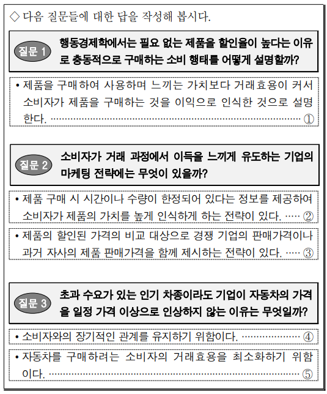

- 배치 / 역할 / 풀이 필수: `PASSAGE` / `INFORMATIONAL` / 아니요
- 종류 / MIME: `IMAGE` / `image/png`
- 크기: 535 × 644
- 원본 URL: [열기](https://d1c00yjit06b00.cloudfront.net/exams/69bbe31fa9ac92778edc4fce/1774227734665-image-0.png)
- 콘텐츠 해시: `sha256:5553db9ddab09e6243e6e4dc5f7bfb4614c9b39065bbe4be26e21b5f9ca9418a`

### 문제

- 문항 제목: 사례 적용 (외투 구매)
- 배점: 3점
- 태그: `사례 적용`

**발문**: (가)와 (나)를 참고하여 <보기>를 이해한 내용으로 적절하지 않은 것은?

#### 보기

갑은 외투를 구매하기 위해 여러 매장을 둘러보았다. 갑은 외투 가격이 부담되어 많은 시간을 들여 꼼꼼하게 제품을 비교해 보았다. 외투 A와 외투 B는 모두 디자인이 마음에 들었지만, 외투 A에 비해 외투 B는 보온성이 떨어져 아쉬웠다. 그런데 외투 B의 가격표에서 기존에 판매했던 가격과 함께 제시된 20% 할인된 가격을 보고 외투 B를 구매하는 것이 이익이라고 판단했다. 하지만 갑은 외투 B가 예약된 상품이라 구매할 수 없다는 말을 듣고 왠지 손해를 보는 것 같아 속상해졌다. 매장을 나오다가 진열대에 있는 양말이 과거 구매했던 가격과 같아 특별한 고민 없이 구매했다.

#### 선지

1. 갑은 외투 B의 보온성에 음의 차별화 가치를 부여했겠군.

2. 갑이 본 외투 B의 가격표에는 과거 준거와 할인된 가격이 모두 제시되어 있군.

3. 갑이 외투 B의 구매가 이익이라고 판단한 것은 외부준거가격을 내부준거가격으로 형성하여 거래효용이 발생했기 때문이겠군.

4. 갑이 외투 B를 구매하지 못해 속상해진 것은 할인된 가격보다 내부준거가격이 높아져 거래비효용이 발생했기 때문이겠군.

5. 갑은 양말 구매 시 차별화 가치에 대해 크게 신경 쓰지 않았겠군.

**공식 정답: 4번 (`C4`) — 갑이 외투 B를 구매하지 못해 속상해진 것은 할인된 가격보다 내부준거가격이 높아져 거래비효용이 발생했기 때문이겠군.**

### 골드 후보 전체

- 스키마: `problem-solving-gold-v2`
- 골드 상태: `candidate`
- 골드 원천: `69c09163fa5063deffe1c180` / 고1 2025년 10월 - 교육청 모의평가 / 15번
- question / passage ID: `69c09163fa5063deffe1c180-q15` / `69c09163fa5063deffe1c180-passage`
- 골드 발문: (가)와 (나)를 참고하여 <보기>를 이해한 내용으로 적절하지 않은 것은?
- 발문 극성: `SELECT_INCORRECT`
- 정답 choice ID: `C4`

#### 시나리오와 사실

갑은 외투를 구매하기 위해 여러 매장을 둘러보았다. 갑은 외투 가격이 부담되어 많은 시간을 들여 꼼꼼하게 제품을 비교해 보았다. 외투 A와 외투 B는 모두 디자인이 마음에 들었지만, 외투 A에 비해 외투 B는 보온성이 떨어져 아쉬웠다. 그런데 외투 B의 가격표에서 기존에 판매했던 가격과 함께 제시된 20% 할인된 가격을 보고 외투 B를 구매하는 것이 이익이라고 판단했다. 하지만 갑은 외투 B가 예약된 상품이라 구매할 수 없다는 말을 듣고 왠지 손해를 보는 것 같아 속상해졌다. 매장을 나오다가 진열대에 있는 양말이 과거 구매했던 가격과 같아 특별한 고민 없이 구매했다.

- `SF1` 갑은 가격이 부담되는 외투를 구매하기 위해 많은 시간을 들여 제품들을 꼼꼼히 비교하였다.
- `SF2` 갑은 외투 A와 외투 B의 디자인을 모두 마음에 들어 하였다.
- `SF3` 갑은 외투 A와 비교할 때 외투 B의 보온성이 떨어지는 점을 아쉬워하였다.
- `SF4` 외투 B의 가격표에는 기존에 판매했던 가격과 20% 할인된 가격이 함께 제시되어 있었다.
- `SF5` 갑은 외투 B의 기존 판매 가격과 할인된 가격을 보고 외투 B를 구매하는 것이 이익이라고 판단하였다.
- `SF6` 갑은 외투 B가 예약된 상품이라 구매할 수 없다는 말을 듣고 손해를 보는 것 같아 속상해하였다.
- `SF7` 갑은 양말 가격이 과거 구매했던 가격과 같다는 이유로 특별한 고민 없이 양말을 구매하였다.

#### 원문 근거 명제

- passage detail ID: `69c09163fa5063deffe1c180-passage`

##### MP1 · P1

준거가격은 제품 가격의 비싸고 쌈을 평가하는 기준이며, 외부준거가격과 내부준거가격으로 나뉜다.

- 원문 증거: “준거가격은 어떤 제품의 가격이 비싼지, 싼지를 평가하는 기준이 되는 가격으로, 외부준거가격과 내부준거가격으로 나눌 수 있다.”
- 범위: 준거가격 일반
- 극성 / 근거 유형: `positive` / `PASSAGE_EXPLICIT`
- 조건: 없음
- 예외: 없음

##### MP2 · P1

외부준거가격은 정가나 할인 가격처럼 소비자의 외부 환경에서 제공되고 광고나 가격표 등으로 제시되는 가격이다.

- 원문 증거: “외부준거가격은 제품의 정가나 할인된 가격 등과 같이 소비자의 외부 환경에서 제공되는 가격으로, 광고나 상품에 붙은 가격표 등에 의해 소비자에게 제시된다.”
- 범위: 외부준거가격
- 극성 / 근거 유형: `positive` / `PASSAGE_EXPLICIT`
- 조건: 없음
- 예외: 없음

##### MP3 · P1

내부준거가격은 과거 경험이나 현재 구매 환경 등을 바탕으로 소비자가 심리적으로 형성한 주관적 가격 기준이며, 제품 가치에 대한 소비자의 평가가 반영된다.

- 원문 증거: “내부준거가격은 소비자가 과거 경험이나 현재 구매 환경 등을 바탕으로 심리적으로 형성한 주관적 기준으로, 제품에 대한 소비자의 가치 평가가 반영되어 형성된다.”
- 범위: 내부준거가격
- 극성 / 근거 유형: `positive` / `PASSAGE_EXPLICIT`
- 조건: 없음
- 예외: 없음

##### MP4 · P2

소비자는 대체 제품의 차별화된 가치에 양 또는 음의 값을 부여하여 주관적으로 내부준거가격을 형성한다.

- 원문 증거: “소비자는 이 차별화된 가치에 양의 값이나 음의 값을 부여하며 주관적 판단에 따라 내부준거가격을 형성한다.”
- 범위: 차별화 가치와 내부준거가격
- 극성 / 근거 유형: `positive` / `PASSAGE_EXPLICIT`
- 조건: 없음
- 예외: 없음

##### MP5 · P2

소비자가 한 제품의 맛이나 영양소 등이 비교 제품보다 뛰어나다고 판단하면 양의 차별화 가치를 부여하고 내부준거가격을 높이며, 육질 등이 떨어진다고 판단하면 음의 차별화 가치를 적용하고 내부준거가격을 낮춘다.

- 원문 증거: “소비자가 돼지고기와 비교해 소고기의 맛이나 영양소가 더 뛰어나다고 판단하면 양의 차별화 가치를 부여해 소고기의 내부준거가격을 높이고, 반대로 육질이 떨어진다고 판단하면 음의 차별화 가치를 적용해 내부준거가격을 낮춘다.”
- 범위: 차별화 가치 평가의 예시
- 극성 / 근거 유형: `positive` / `PASSAGE_EXPLICIT`
- 조건: 없음
- 예외: 없음

##### MP6 · P3

제품 가격이 비싸거나 건강·사회적 위신에 영향을 미치는 경우 일반적으로 소비자의 관여도가 높아진다.

- 원문 증거: “일반적으로 소비자의 건강이나 사회적 위신에 영향을 미치거나 제품의 가격이 비싼 경우에 소비자의 관여도가 높아진다.”
- 범위: 관여도
- 극성 / 근거 유형: `positive` / `PASSAGE_EXPLICIT`
- 조건: 없음
- 예외: 없음

##### MP7 · P3

관여도가 높은 소비자는 손실을 줄이기 위해 구매 의사결정에 많은 시간과 노력을 투입하여 내부준거가격을 형성한다.

- 원문 증거: “이 경우 소비자는 자신의 손실을 줄이기 위해 제품의 구매에 대한 의사결정에 많은 시간과 노력을 투입하여 내부준거가격을 형성한다.”
- 범위: 고관여 소비자
- 극성 / 근거 유형: `positive` / `PASSAGE_EXPLICIT`
- 조건: 제품에 대한 소비자 관여도가 높은 경우
- 예외: 없음

##### MP8 · P3

제품 관여도가 낮은 소비자는 제품의 차별화 가치에 크게 신경 쓰지 않고, 탐색이나 대안 고려를 생략하며, 이전에 형성한 내부준거가격을 유지하는 경향이 있다.

- 원문 증거: “구매하려는 제품에 대한 관여도가 낮으면 소비자는 제품의 차별화 가치에 대해 크게 신경 쓰지 않는다. 따라서 소비자는 제품을 탐색하거나 대안을 생각하는 절차 등을 생략하고 이전에 형성했던 내부준거가격을 그대로 유지하는 경향을 띠게 된다.”
- 범위: 저관여 소비자
- 극성 / 근거 유형: `positive` / `PASSAGE_EXPLICIT`
- 조건: 구매하려는 제품에 대한 관여도가 낮은 경우
- 예외: 없음

##### MP9 · P3

소비자가 기존 내부준거가격을 유지하는 경우 과거에 구매한 동일하거나 유사한 제품의 가격이 판단 기준이 될 수 있다.

- 원문 증거: “이때 과거에 구매했던 동일하거나 유사한 제품의 가격이 판단 기준이 되기도 한다.”
- 범위: 과거 구매 가격
- 극성 / 근거 유형: `positive` / `PASSAGE_EXPLICIT`
- 조건: 기존 내부준거가격을 유지하는 경우
- 예외: 없음

##### MP10 · P4

거래효용은 소비자가 제품 구매 시 느끼는 심리적 가치이고, 소비자가 주관적으로 예측하는 제품 가격인 내부준거가격과 실제 가격의 차이로 결정된다.

- 원문 증거: “거래효용은 소비자가 제품 구매 시 느끼는 심리적 가치로, 소비자가 주관적으로 예측하는 제품의 가격인 내부준거가격과 실제 가격의 차이에 의해 결정된다.”
- 범위: 거래효용
- 극성 / 근거 유형: `positive` / `PASSAGE_EXPLICIT`
- 조건: 없음
- 예외: 없음

##### MP11 · P4

거래효용이 제품을 구매하여 사용하며 느끼는 가치보다 크면 소비자는 제품이 필요하지 않아도 구매를 이익으로 인식한다.

- 원문 증거: “거래효용이 제품을 구매하여 사용하며 느끼는 가치보다 크면, 소비자가 해당 제품이 필요 없어도 구매하는 것을 이익으로 인식한다고 본다.”
- 범위: 거래효용에 따른 구매 인식
- 극성 / 근거 유형: `positive` / `PASSAGE_EXPLICIT`
- 조건: 거래효용이 제품 사용 가치보다 큰 경우
- 예외: 없음

##### MP12 · P5

희소성 제시 전략은 제한된 시간이나 수량의 공급 상황을 제공하여 소비자가 제품 가치를 높게 인식하게 하고, 당장 구매하는 것이 이득이라는 심리를 자극하는 전략이다.

- 원문 증거: “희소성 제시 전략은 기업이 소비자에게 한정된 시간이나 수량 등과 같은 제한된 공급 상황을 정보로 제공함으로써 소비자가 제품의 가치를 높게 인식하게 하는 전략이다. 이는 제품을 당장 구매하는 것이 이득이라는 심리를 자극하는 것이다.”
- 범위: 희소성 제시 전략
- 극성 / 근거 유형: `positive` / `PASSAGE_EXPLICIT`
- 조건: 없음
- 예외: 없음

##### MP13 · P5

정보가 부족한 소비자가 기업이 제공한 제한된 공급 상황을 신뢰하면 제품 가치를 높게 인식하여 내부준거가격이 높아지고 거래효용이 발생한다.

- 원문 증거: “특히 제품에 대한 정보가 부족한 소비자가 기업이 제공하는 정보에 담긴 제한된 공급 상황을 신뢰할 경우, 결과적으로 제품의 가치를 높게 인식하게 되면서 내부준거가격이 높아져 거래효용이 발생하게 된다.”
- 범위: 희소성 전략의 효과
- 극성 / 근거 유형: `positive` / `PASSAGE_EXPLICIT`
- 조건: 제품 정보가 부족한 소비자가 제한된 공급 상황을 신뢰하는 경우
- 예외: 없음

##### MP14 · P5

외부준거가격 제시 전략은 할인된 가격을 비교 대상인 다른 외부준거가격과 함께 제시하여 소비자의 거래효용을 높이도록 유도하는 전략이다.

- 원문 증거: “외부준거가격 제시 전략은 기업이 할인된 제품의 가격을 비교 대상이 되는 다른 외부준거가격과 함께 제시하는 전략이다. 이는 소비자의 거래효용이 높아지도록 유도하는 것으로”
- 범위: 외부준거가격 제시 전략
- 극성 / 근거 유형: `positive` / `PASSAGE_EXPLICIT`
- 조건: 없음
- 예외: 없음

##### MP15 · P5

기업이 제시하는 외부준거가격에는 경쟁 기업의 판매가격인 경쟁 준거와 자사가 과거에 제품을 판매했던 가격인 과거 준거가 있다.

- 원문 증거: “이때 기업이 제시하는 외부준거가격에는 경쟁 기업의 판매가격인 경쟁 준거와 자사에서 과거에 제품을 판매했던 가격인 과거 준거가 있다.”
- 범위: 외부준거가격의 유형
- 극성 / 근거 유형: `positive` / `PASSAGE_EXPLICIT`
- 조건: 없음
- 예외: 없음

##### MP16 · P5

소비자가 기업이 제시한 경쟁 준거 또는 과거 준거를 기준으로 내부준거가격을 형성하면 할인된 제품 가격에 대해 거래효용이 발생한다.

- 원문 증거: “만약 소비자가 기업에서 제시한 경쟁 준거나 과거 준거를 기준으로 자신의 내부준거가격을 형성한다면 제품의 할인된 가격에 대해 거래효용이 발생하게 된다.”
- 범위: 외부준거가격과 거래효용
- 극성 / 근거 유형: `positive` / `PASSAGE_EXPLICIT`
- 조건: 소비자가 기업 제시 경쟁 준거 또는 과거 준거를 기준으로 내부준거가격을 형성하는 경우
- 예외: 없음

##### MP17 · P6

소비자가 외부준거가격을 신뢰하지 않거나 속는 느낌을 받으면 거래효용은 음의 가치를 가지는 거래비효용으로 나타난다.

- 원문 증거: “소비자가 외부준거가격을 신뢰하지 않거나, 오히려 속는 느낌을 받는다면 거래효용은 음의 가치를 가진다.”
- 범위: 거래비효용
- 극성 / 근거 유형: `positive` / `PASSAGE_EXPLICIT`
- 조건: 소비자가 외부준거가격을 신뢰하지 않는 경우 또는 속는 느낌을 받는 경우
- 예외: 없음

##### MP18 · P6

기업이 소비자와 장기 관계를 고려하는 경우에는 초과 수요가 있어도 가격을 소비자의 내부준거가격에서 크게 벗어나지 않게 하여 거래비효용을 방지하려 한다.

- 원문 증거: “기업이 소비자와의 장기적인 관계를 고려해야 하는 경우에는 초과 수요가 있더라도 제품의 가격을 소비자의 내부준거가격에서 크게 벗어나지 않도록 해 거래비효용을 방지하려고 한다.”
- 범위: 거래비효용 방지 가격 전략
- 극성 / 근거 유형: `positive` / `PASSAGE_EXPLICIT`
- 조건: 기업이 소비자와의 장기적 관계를 고려하는 경우
- 예외: 없음

##### MP19 · P6

가격을 올려야 하는 경우 기업은 가격 인상 이유를 소비자에게 명확히 설명하여 정당성을 확보함으로써 거래비효용을 최소화하려 한다.

- 원문 증거: “부득이하게 가격을 높여야 하는 경우에는, 기업에서 가격 인상의 이유를 소비자에게 명확히 설명함으로써 정당성을 확보하여 거래비효용을 최소화하려는 전략을 사용한다.”
- 범위: 거래비효용 최소화 전략
- 극성 / 근거 유형: `positive` / `PASSAGE_EXPLICIT`
- 조건: 기업이 부득이하게 가격을 높여야 하는 경우
- 예외: 없음

#### 시각 자료 주장

없음

#### 문항 추론

##### INF1 · MAP_CONCEPT

갑이 외투 A보다 외투 B의 보온성이 떨어진다고 판단했으므로, 갑은 외투 B의 보온성에 음의 차별화 가치를 부여한 것으로 볼 수 있다.

- 결론: 갑이 외투 A보다 외투 B의 보온성이 떨어진다고 판단했으므로, 갑은 외투 B의 보온성에 음의 차별화 가치를 부여한 것으로 볼 수 있다.
- 대상 주장 / 효과: `OC1-1` / `SUPPORTS`
- 직접 전제 refs: `MP4`, `MP5`, `SF3`
- 원문 참조: 문단 `P2` / 명제 `MP4`, `MP5`
- 시나리오 사실: `SF3`
- 시각 주장: 없음
- grounding / necessity: `SOURCE_ENTAILED` / `REQUIRED`

##### INF2 · CLASSIFY

자사가 기존에 판매했던 가격은 과거 준거이고, 외투 B 가격표에는 그 기존 판매 가격과 20% 할인 가격이 함께 제시되어 있다.

- 결론: 자사가 기존에 판매했던 가격은 과거 준거이고, 외투 B 가격표에는 그 기존 판매 가격과 20% 할인 가격이 함께 제시되어 있다.
- 대상 주장 / 효과: `OC2-1` / `SUPPORTS`
- 직접 전제 refs: `MP15`, `SF4`
- 원문 참조: 문단 `P5` / 명제 `MP15`
- 시나리오 사실: `SF4`
- 시각 주장: 없음
- grounding / necessity: `SOURCE_ENTAILED` / `REQUIRED`

##### INF3 · APPLY_RULE

갑이 가격표의 과거 준거와 할인 가격을 보고 외투 B 구매를 이익으로 판단했으므로, 과거 준거를 내부준거가격 형성의 기준으로 삼아 할인 가격에 대한 거래효용이 발생한 것으로 볼 수 있다.

- 결론: 갑이 가격표의 과거 준거와 할인 가격을 보고 외투 B 구매를 이익으로 판단했으므로, 과거 준거를 내부준거가격 형성의 기준으로 삼아 할인 가격에 대한 거래효용이 발생한 것으로 볼 수 있다.
- 대상 주장 / 효과: `OC3-1` / `SUPPORTS`
- 직접 전제 refs: `MP15`, `MP16`, `SF4`, `SF5`
- 원문 참조: 문단 `P5` / 명제 `MP15`, `MP16`
- 시나리오 사실: `SF4`, `SF5`
- 시각 주장: 없음
- grounding / necessity: `SOURCE_ENTAILED` / `REQUIRED`

##### INF4 · CHECK_JUSTIFICATION

외투 B를 구매하지 못해 속상했다는 사실만으로는 할인 가격보다 내부준거가격이 높았다는 가격 관계나 거래비효용의 발생을 도출할 수 없으므로, 그 원인이라는 주장은 기본 골드에서 정당화되지 않는다.

- 결론: 외투 B를 구매하지 못해 속상했다는 사실만으로는 할인 가격보다 내부준거가격이 높았다는 가격 관계나 거래비효용의 발생을 도출할 수 없으므로, 그 원인이라는 주장은 기본 골드에서 정당화되지 않는다.
- 대상 주장 / 효과: `OC4-1` / `DOES_NOT_JUSTIFY`
- 직접 전제 refs: `MP17`, `MP18`, `SF6`, `ANSWER_KEY`
- 원문 참조: 문단 `P6` / 명제 `MP17`, `MP18`
- 시나리오 사실: `SF6`
- 시각 주장: 없음
- grounding / necessity: `ANSWER_KEY_CONSTRAINED` / `REQUIRED`

##### INF5 · APPLY_RULE

갑이 양말의 과거 구매 가격을 기준으로 특별한 고민 없이 구매했으므로, 제품 탐색을 생략하고 차별화 가치에 크게 신경 쓰지 않은 것으로 볼 수 있다.

- 결론: 갑이 양말의 과거 구매 가격을 기준으로 특별한 고민 없이 구매했으므로, 제품 탐색을 생략하고 차별화 가치에 크게 신경 쓰지 않은 것으로 볼 수 있다.
- 대상 주장 / 효과: `OC5-1` / `SUPPORTS`
- 직접 전제 refs: `MP8`, `MP9`, `SF7`
- 원문 참조: 문단 `P3` / 명제 `MP8`, `MP9`
- 시나리오 사실: `SF7`
- 시각 주장: 없음
- grounding / necessity: `SOURCE_ENTAILED` / `REQUIRED`

#### 보충 설명 추론

없음

#### 선지별 골드 판정

##### C1 · 갑은 외투 B의 보온성에 음의 차별화 가치를 부여했겠군.

- 위치 / 판정: 1 / `TRUE`
- 판정 근거: 외투 A보다 외투 B의 보온성이 떨어진다고 평가한 것은 외투 B의 해당 속성에 음의 차별화 가치를 부여한 것으로 볼 수 있다.
- 주장 IDs: `OC1-1`
- 필수 원문 참조: 문단 `P2` / 명제 `MP4`, `MP5`
- 필수 시나리오 사실: `SF3`
- 필수 시각 주장: 없음

**주장 OC1-1 (1순위)**

갑은 외투 A보다 떨어진다고 판단한 외투 B의 보온성에 음의 차별화 가치를 부여했을 것이다.

- assessment / support: `SUPPORTED` / `ENTAILED`
- decision / basis: `ACCEPTED` / `SOURCE_GROUNDED`
- 결정 핵심: 아니요
- 의존 주장: 없음
- 문항 추론: `INF1`
- 원문 참조: 문단 `P2` / 명제 `MP4`, `MP5`
- 시나리오 사실: `SF3`
- 시각 주장: 없음
- 보충 추론: 없음
- 보충 사용 정책: 없음

##### C2 · 갑이 본 외투 B의 가격표에는 과거 준거와 할인된 가격이 모두 제시되어 있군.

- 위치 / 판정: 2 / `TRUE`
- 판정 근거: 자사의 기존 판매 가격은 과거 준거이고, 가격표에는 그 가격과 20% 할인 가격이 함께 제시되었다.
- 주장 IDs: `OC2-1`
- 필수 원문 참조: 문단 `P5` / 명제 `MP15`
- 필수 시나리오 사실: `SF4`
- 필수 시각 주장: 없음

**주장 OC2-1 (1순위)**

외투 B의 가격표에는 과거 준거인 기존 판매 가격과 할인된 가격이 함께 제시되어 있다.

- assessment / support: `SUPPORTED` / `ENTAILED`
- decision / basis: `ACCEPTED` / `SOURCE_GROUNDED`
- 결정 핵심: 아니요
- 의존 주장: 없음
- 문항 추론: `INF2`
- 원문 참조: 문단 `P5` / 명제 `MP15`
- 시나리오 사실: `SF4`
- 시각 주장: 없음
- 보충 추론: 없음
- 보충 사용 정책: 없음

##### C3 · 갑이 외투 B의 구매가 이익이라고 판단한 것은 외부준거가격을 내부준거가격으로 형성하여 거래효용이 발생했기 때문이겠군.

- 위치 / 판정: 3 / `TRUE`
- 판정 근거: 갑은 제시된 기존 판매 가격인 과거 준거와 할인 가격을 보고 구매를 이익으로 판단했으며, 과거 준거를 기준으로 내부준거가격을 형성하면 할인 가격에 거래효용이 발생한다.
- 주장 IDs: `OC3-1`
- 필수 원문 참조: 문단 `P5` / 명제 `MP15`, `MP16`
- 필수 시나리오 사실: `SF4`, `SF5`
- 필수 시각 주장: 없음

**주장 OC3-1 (1순위)**

갑이 외투 B 구매를 이익으로 판단한 것은 제시된 과거 준거를 바탕으로 내부준거가격을 형성하여 할인 가격에 대한 거래효용이 발생했기 때문이다.

- assessment / support: `SUPPORTED` / `ENTAILED`
- decision / basis: `ACCEPTED` / `SOURCE_GROUNDED`
- 결정 핵심: 아니요
- 의존 주장: 없음
- 문항 추론: `INF3`
- 원문 참조: 문단 `P5` / 명제 `MP15`, `MP16`
- 시나리오 사실: `SF4`, `SF5`
- 시각 주장: 없음
- 보충 추론: 없음
- 보충 사용 정책: 없음

##### C4 · 갑이 외투 B를 구매하지 못해 속상해진 것은 할인된 가격보다 내부준거가격이 높아져 거래비효용이 발생했기 때문이겠군.

- 위치 / 판정: 4 / `FALSE`
- 판정 근거: 구매하지 못해 속상했다는 사실만으로 내부준거가격과 할인 가격의 크기 관계나 거래비효용 발생을 알 수 없다.
- 주장 IDs: `OC4-1`
- 필수 원문 참조: 문단 `P6` / 명제 `MP17`, `MP18`
- 필수 시나리오 사실: `SF6`
- 필수 시각 주장: 없음

**주장 OC4-1 (1순위)**

갑이 외투 B를 구매하지 못해 속상해진 것은 할인 가격보다 내부준거가격이 높아져 거래비효용이 발생했기 때문이다.

- assessment / support: `NOT_JUSTIFIED` / `NONE`
- decision / basis: `REJECTED` / `ANSWER_KEY_CONSTRAINED`
- 결정 핵심: 예
- 의존 주장: 없음
- 문항 추론: `INF4`
- 원문 참조: 문단 `P6` / 명제 `MP17`, `MP18`
- 시나리오 사실: `SF6`
- 시각 주장: 없음
- 보충 추론: 없음
- 보충 사용 정책: 없음

##### C5 · 갑은 양말 구매 시 차별화 가치에 대해 크게 신경 쓰지 않았겠군.

- 위치 / 판정: 5 / `TRUE`
- 판정 근거: 과거 구매 가격을 기준으로 특별한 고민 없이 구매한 행동은 탐색을 생략하고 차별화 가치에 크게 신경 쓰지 않는 저관여 소비자의 경향에 부합한다.
- 주장 IDs: `OC5-1`
- 필수 원문 참조: 문단 `P3` / 명제 `MP8`, `MP9`
- 필수 시나리오 사실: `SF7`
- 필수 시각 주장: 없음

**주장 OC5-1 (1순위)**

갑은 양말 구매 시 차별화 가치에 크게 신경 쓰지 않았을 것이다.

- assessment / support: `SUPPORTED` / `ENTAILED`
- decision / basis: `ACCEPTED` / `SOURCE_GROUNDED`
- 결정 핵심: 아니요
- 의존 주장: 없음
- 문항 추론: `INF5`
- 원문 참조: 문단 `P3` / 명제 `MP8`, `MP9`
- 시나리오 사실: `SF7`
- 시각 주장: 없음
- 보충 추론: 없음
- 보충 사용 정책: 없음

#### 정답 도출 경로

##### STEP1

거래비효용은 소비자가 외부준거가격을 신뢰하지 않거나 속는 느낌을 받는 경우의 음의 거래효용으로 설명된다.

- 원문 참조: 문단 `P6` / 명제 `MP17`
- 시나리오 사실: 없음
- 시각 주장: 없음
- 문항 추론: 없음
- 선지 주장: 없음

##### STEP2

갑은 외투 B가 예약 상품이라 구매할 수 없다는 말을 듣고 속상해했을 뿐, 할인 가격보다 내부준거가격이 높았다는 사실이나 외부준거가격을 신뢰하지 않았다는 사실은 제시되지 않았다.

- 원문 참조: 없음
- 시나리오 사실: `SF6`
- 시각 주장: 없음
- 문항 추론: 없음
- 선지 주장: 없음

##### STEP3

따라서 갑의 속상함을 할인 가격보다 높은 내부준거가격과 거래비효용의 발생으로 설명하는 C4는 정당화되지 않으므로 적절하지 않은 선지이다.

- 원문 참조: 문단 `P6` / 명제 `MP17`, `MP18`
- 시나리오 사실: `SF6`
- 시각 주장: 없음
- 문항 추론: `INF4`
- 선지 주장: `OC4-1`

- 필수 단계: `STEP1`, `STEP2`, `STEP3`
- 결정 단계: `STEP2`
- 결론 단계: `STEP3`
- 최종 답: `C4`
- 최종 설명: 외투 B를 구매하지 못해 속상해한 사실만으로는 내부준거가격이 할인 가격보다 높았거나 거래비효용이 발생했다고 판단할 수 없다. 따라서 적절하지 않은 것은 ④이다.
- 최종 설명 참조 단계: `STEP1`, `STEP2`, `STEP3`

#### 대표 오답 경로

- `WP1` 외부준거가격과 거래효용의 관계를 알지 못해, 과거 준거와 할인 가격을 보고 구매를 이익으로 판단한 C3을 부적절하다고 판단하는 경로.
  - scope: `SELECTED_WRONG_CHOICE`
  - 선택 선지: `C3`
  - 놓친 정답: `없음`
  - 분기 층위 후보: `CONCEPT_SCENARIO_MAPPING`, `CONDITION_APPLICATION`
- `WP2` 과거 구매 가격을 기준으로 특별한 고민 없이 구매한 행동이 저관여 소비자의 차별화 가치 무관심 경향과 연결됨을 놓치는 경로.
  - scope: `SELECTED_WRONG_CHOICE`
  - 선택 선지: `C5`
  - 놓친 정답: `없음`
  - 분기 층위 후보: `CONCEPT_SCENARIO_MAPPING`, `INFERENCE_TRANSFORMATION`

#### 골드 자체 검수 메모

없음

### 충분 근거 조합 후보

#### 69c09163fa5063deffe1c180-q15-C1-SGC1

- 선지 / 대상 주장: `C1` / `OC1-1`
- 제안 경로 / 연산자: `APPROVED_SUFFICIENT_GROUND_SET` / `ALL_OF`
- 필수 근거: `MP4`, `MP5`, `SF3`
- 생략 허용 근거: 없음
- 결론: 갑이 외투 A보다 외투 B의 보온성이 떨어진다고 판단했으므로, 갑은 외투 B의 보온성에 음의 차별화 가치를 부여한 것으로 볼 수 있다.
- 원천 추론: `INF1`
- 생성 방식 / 상태: `AI_INFERENCE_GRAPH_DERIVED` / `candidate`
- 위험 표지: 없음

#### 69c09163fa5063deffe1c180-q15-C2-SGC1

- 선지 / 대상 주장: `C2` / `OC2-1`
- 제안 경로 / 연산자: `APPROVED_SUFFICIENT_GROUND_SET` / `ALL_OF`
- 필수 근거: `MP15`, `SF4`
- 생략 허용 근거: 없음
- 결론: 자사가 기존에 판매했던 가격은 과거 준거이고, 외투 B 가격표에는 그 기존 판매 가격과 20% 할인 가격이 함께 제시되어 있다.
- 원천 추론: `INF2`
- 생성 방식 / 상태: `AI_INFERENCE_GRAPH_DERIVED` / `candidate`
- 위험 표지: 없음

#### 69c09163fa5063deffe1c180-q15-C3-SGC1

- 선지 / 대상 주장: `C3` / `OC3-1`
- 제안 경로 / 연산자: `APPROVED_SUFFICIENT_GROUND_SET` / `ALL_OF`
- 필수 근거: `MP15`, `MP16`, `SF4`, `SF5`
- 생략 허용 근거: 없음
- 결론: 갑이 가격표의 과거 준거와 할인 가격을 보고 외투 B 구매를 이익으로 판단했으므로, 과거 준거를 내부준거가격 형성의 기준으로 삼아 할인 가격에 대한 거래효용이 발생한 것으로 볼 수 있다.
- 원천 추론: `INF3`
- 생성 방식 / 상태: `AI_INFERENCE_GRAPH_DERIVED` / `candidate`
- 위험 표지: 없음

#### 69c09163fa5063deffe1c180-q15-C4-SGC1

- 선지 / 대상 주장: `C4` / `OC4-1`
- 제안 경로 / 연산자: `APPROVED_SUFFICIENT_GROUND_SET` / `ALL_OF`
- 필수 근거: `MP17`, `MP18`, `SF6`, `ANSWER_KEY`
- 생략 허용 근거: 없음
- 결론: 외투 B를 구매하지 못해 속상했다는 사실만으로는 할인 가격보다 내부준거가격이 높았다는 가격 관계나 거래비효용의 발생을 도출할 수 없으므로, 그 원인이라는 주장은 기본 골드에서 정당화되지 않는다.
- 원천 추론: `INF4`
- 생성 방식 / 상태: `AI_INFERENCE_GRAPH_DERIVED` / `candidate`
- 위험 표지: `ANSWER_KEY_CONSTRAINED`, `DOES_NOT_JUSTIFY`

#### 69c09163fa5063deffe1c180-q15-C5-SGC1

- 선지 / 대상 주장: `C5` / `OC5-1`
- 제안 경로 / 연산자: `APPROVED_SUFFICIENT_GROUND_SET` / `ALL_OF`
- 필수 근거: `MP8`, `MP9`, `SF7`
- 생략 허용 근거: 없음
- 결론: 갑이 양말의 과거 구매 가격을 기준으로 특별한 고민 없이 구매했으므로, 제품 탐색을 생략하고 차별화 가치에 크게 신경 쓰지 않은 것으로 볼 수 있다.
- 원천 추론: `INF5`
- 생성 방식 / 상태: `AI_INFERENCE_GRAPH_DERIVED` / `candidate`
- 위험 표지: 없음

### 생성·검증 기록

- 원시 스키마 통과: 아니요
- 원시 오류: decisivePathStepIds: 결정적 분기와 결론 단계는 분리해야 한다.; representativeWrongPaths.0.missedAnswerChoiceId: 선택 선지 경로에는 놓친 정답을 지정하지 않는다.; representativeWrongPaths.1.missedAnswerChoiceId: 선택 선지 경로에는 놓친 정답을 지정하지 않는다.
- 자동 정규화: `SEPARATE_DECISIVE_AND_CONCLUSION_STEPS`, `REBUILD_INFERENCE_PREMISE_REFS`, `ALIGN_WRONG_PATH_MISSED_ANSWER`, `ALIGN_WRONG_PATH_MISSED_ANSWER`
- 최종 스키마 통과: 예
- 최종 오류: 없음
- 생성 모델 / effort: `gpt-5.6-terra` / `medium`
- 프롬프트 버전: `problem-gold-generation-prompt-v2`
- 생성 시간: 63098ms

- 검수 파일 상태: `PENDING`
- 검수자 / 시각: 없음 / 없음
- 승인된 충분 근거 후보: 없음
- 검수 메모: 없음

**사람 검수 메모:**

- 판정:
- 수정 필요 사항:
- 승인할 충분 근거 후보:

[목차로 돌아가기](#빠른-목차)

---

## 11. 고3 2025년(2026학년도) 6월 - 평가원 모의평가 · 법 모델과 임대차 보호 제도 8번

### 검수 상태

- case ID: `prospective-69bffa62fa5063deffe19c88-q8`
- 분야: `SOCIAL`
- 표본 범위: `NEGATIVE_STEM`, `SOCIAL`, `SCENARIO_APPLICATION`, `MULTI_CONDITION`
- 생산 상태: `PENDING_HUMAN_REVIEW`
- 후보 종류: 정적 검증을 통과한 후보
- 사람 검수 상태: `PENDING`
- 검수 위험도: `LOW`
- 원천 해시: `sha256:687c75e83d99aff62aef3d3ba73f6f8ac15badf0702e85576ae3c9c5f18335a2`

검수 체크: [ ] 공식 정답과 선지 판정 일치 · [ ] 원문 근거 정확 · [ ] 추론 비약 없음 · [ ] 충분 근거가 최소 조합 · [ ] 시각 자료 해석 정확

### 원문

근대 국가는 시민의 생명과 재산을 보호하는 것을 일차적인 존립 이유로 삼았다. 최소한의 금지 행위만을 법으로 정하고 이를 위반하는 경우에만 개입함으로써 시민의 자유를 최대한 보장하고자 했다. 이러한 목적이 반영된 자유주의적 법 모델은 근대법의 근간을 이루었다. 그러나 이 모델은 자유를 실질적으로 누릴 사회․경제적 조건이 모두에게 동등하게 주어지지 않은 상황에서 갈등이나 분쟁에 대처하는 데 한계가 있었다. 이를 보완할 목적으로 등장한 것이 사회복지국가적 법 모델이다. 이 모델에서는 법이 삶의 세계에 더 깊숙이 개입한다. 개인의 권리 보장뿐 아니라 주거, 노동, 환경 등의 영역에서 평등과 연대의 가치를 구현하기 위한 제도의 구축 및 관리도 법의 역할이 되어, 그 역할 수행에 필요한 의무 규정들이 늘어난다. 가령 ｢대기환경보전법｣은 오염 물질의 배출을 규제하는 대기 환경 관리 체계의 기능을 강화함으로써, 깨끗한 환경에서 살 시민의 권리를 실현하기 위한 공적 토대를 만들고자 한다.

그런데 법적 규제가 과도할 경우 삶의 세계를 구성해 온 고유한 직업 윤리 등 문화적․도덕적 규범이 강행적 성격을 띤 법 규범에 의해 침범당하는 경우가 생긴다. 이로써 사회 각 영역의 자율적 조절 기능이 훼손되고 사회의 통합이 법에 의해 와해된다. 그럴수록 공동체는 갈등 상황에서 법적 해결에 의존하게 된다. 규제에 대한 요구량이 증가하면 법의 수행 능력은 한계에 부딪힌다. ‘문제가 발생할 때 법은 마지막 수단이어야 한다.’ 등 근대법의 기본 원리가 유지되기도 어렵다. 결국 법의 규범 구조가 균열된 상태에서, 법으로 문제를 해결해야 한다는 당위만 남는다. 그로 인해 법 규범이 삶의 세계에 점점 더 깊숙이 개입하게 되어 사회의 자율적 조절 기능은 더욱 망가지는 과정이 반복된다. 이러한 악순환을 방지하면서 사회복지 체계를 보완하고자 등장한 것이 절차주의적 법 모델이다.

절차주의적 법 모델에 따르면, 법은 분쟁에 직접 개입해 해결책을 내놓는 대신 분쟁 당사자들의 논의와 협상을 위한 절차나 권한 분배 등 분쟁 해결 방식에만 관여한다. 이로써 사회의 자율적 조절 기능을 보존하고 확대하고자 한다. 또한 권력과 자본이 논의의 장에 개입해 일부가 발언권을 독점하거나 부당한 영향력을 행사할 수 있으므로 이에 대한 점검 과정을 절차 안에 두도록 의무화한다. 당사자 간의 자유롭고 균등한 의견 개진 가능성을 최대한 보장하는 것이 절차주의적 법 모델의 목적이다.

위의 세 가지 법 모델은 시대의 요구에 따라 등장했으나 앞선 모델을 다음 모델이 대체하며 법체계를 지배해 온 것은 아니다. 각각의 법 모델이 고유한 타당성과 필요성을 가진 채 현재의 법체계 안에 공존하고 있다.

재산 관계에서는 개인의 자유가 최대한 보장되어야 하므로 계약으로 권리와 의무가 인정되는 것이 원칙이다. 그러나 사회ㆍ경제적 조건을 달리하는 당사자들 간에서는, 약자 보호를 위해 법률로 그 내용이 정해지는 경우가 있고 이때는 이를 계약으로 변경할 수 없다.

임대차의 경우 그 내용은 계약으로 정해지는 것이 원칙이지만, 임대차의 목적물인 임차물이 생활의 근거인 주택이나 생업의 근거인 상가이면 임차인 보호라는 과제는 계약만으로는 실현되기 어렵다. 그래서 ｢주택임대차보호법｣, ｢상가건물 임대차보호법｣에는 계약보다 우선 적용되는 제도가 마련되어 있다. 예컨대 계약으로 임대차 기간을 이 법들에 규정된 최단 존속 기간보다 짧게 정했더라도 임차인에게는 최단 존속 기간이 보장된다. 한편 임대차 계약이 종료되기 전의 일정 기간 내에 임대인이나 임차인이 계약 갱신 여부에 대한 의사를 표시할 수 있다. 이 기간 내에 임대인이 임대차 종료를 요구한 경우, 임차인이 갱신 요구권을 행사하면 임대차 종료 예정일부터 최단 존속 기간만큼 임대차가 연장된다. 이러한 갱신 요구권은 임대차 기간이 정해져 있어야 인정된다. 단, 임대인은 이 법들에 규정된 갱신 거절 사유를 증명해 갱신을 거절함으로써 임대차를 종료시킬 수 있다. 갱신 거절 사유의 예로 임대인이 임차물인 주택에 실거주하려는 경우를 들 수 있다.

주택이나 상가 임대차에서도 법이 아니라 계약으로 재산 관계가 정해지는 경우가 있다. 임차인이 임차물을 사용할 권리가 소멸했거나 임차인의 경제력이 충분하면 임차인을 보호할 필요가 없기 때문이다. 예컨대 임대차 종료 후 임차물을 반환할 때 임차인이 이를 원상회복할 의무를 지는지를 결정할 때는 계약이 법률보다 우선 적용된다. 또한 보증금이 ｢상가건물 임대차보호법｣에 정해진 상한액을 초과하면 최단 존속 기간이 적용되지 않으므로, 이때 존속 기간을 정하지 않기로 계약했다면 당사자들은 자유롭게 임대차를 종료시킬 수 있다.

임대차 분쟁이 발생한 경우 이를 해결하기 위한 원칙적 절차는 법관이 주도하는 재판 절차인데, 여기서 당사자들은 각자 자신의 주장을 뒷받침할 자료를 제출해야 한다. 한편 분쟁 해결 절차에서 당사자들의 자유로운 의견 개진을 보장하기 위해 ｢주택임대차보호법｣과 ｢상가건물 임대차보호법｣에는 임대차 분쟁 조정 절차도 마련되어 있다. 이때 조정 절차를 주관하는 조정위원회가 당사자를 위해 자료를 수집해 줄 수 있다. 그러나 임대차 분쟁 조정 절차는 당사자들이 분쟁 해결을 위해 이 절차를 따르기로 합의해야 시작되며, 이러한 합의가 이루어지지 않으면 재판 절차를 따라야 한다.

### 문제

- 문항 제목: 구체적 사례에의 적용
- 배점: 3점
- 태그: `사례-적용`

**발문**: (가), (나)를 바탕으로 <보기>를 이해한 내용으로 적절하지 않은 것은?

#### 보기

갑은 자신이 소유한 A 주택과 B 상가를 을에게 임대하기로 계약하면서, A 주택의 임대차 기간은 ｢주택임대차보호법｣에 규정된 최단 존속 기간으로 정했으나 B 상가의 임대차 기간은 정하지 않기로 했다. B 상가의 보증금은 ｢상가건물 임대차보호법｣에 규정된 상한액을 초과한다.

갑이 위의 두 법에 규정된, 갱신 여부에 대한 의사를 표시할 수 있는 기간 중에 을에게 A 주택과 B 상가에 대한 임대차 종료를 주장했으나 을은 갱신을 요구했다. 하지만 갑은 위 기간 내에 갱신을 거절하고 을에게 A 주택과 B 상가를 반환하라고 함으로써 분쟁이 생겼다. 을은 임대차 분쟁 조정 절차로 분쟁을 해결하자고 제안했으나 갑이 이를 거절하여 결국 합의가 이루어지지 않았다.

#### 선지

1. 갑이 A 주택에 실거주할 계획이 있음을 증명한 경우, 갑과 을 간의 A 주택 임대차는 갱신되지 않겠군.

2. 을이 갱신 요구권을 행사하여 임대차 기간을 연장할 수 있다면, 이것은 평등과 연대의 가치 실현을 위해 마련된 의무 규정이 적용된 것이겠군.

3. 을은 갑에게 ｢상가건물 임대차보호법｣에 규정된 최단 존속 기간을 주장할 수 없겠군.

4. 을의 의사와 무관하게 갑이 B 상가 임대차를 종료시킬 수 있는 것은, 시민 개개인의 자유가 갑에게 보장된 것이겠군.

5. 갑과 을 간의 A 주택 임대차에 관한 분쟁 해결 절차에서는 조정위원회가 을을 위해 자료를 수집할 수 있겠군.

**공식 정답: 5번 (`C5`) — 갑과 을 간의 A 주택 임대차에 관한 분쟁 해결 절차에서는 조정위원회가 을을 위해 자료를 수집할 수 있겠군.**

### 골드 후보 전체

- 스키마: `problem-solving-gold-v2`
- 골드 상태: `candidate`
- 골드 원천: `69bffa62fa5063deffe19c88` / 고3 2025년(2026학년도) 6월 - 평가원 모의평가 / 8번
- question / passage ID: `69bffa62fa5063deffe19c88-q8` / `69bffa62fa5063deffe19c88-passage`
- 골드 발문: (가), (나)를 바탕으로 <보기>를 이해한 내용으로 적절하지 않은 것은?
- 발문 극성: `SELECT_INCORRECT`
- 정답 choice ID: `C5`

#### 시나리오와 사실

갑은 자신이 소유한 A 주택과 B 상가를 을에게 임대하기로 계약하면서, A 주택의 임대차 기간은 ｢주택임대차보호법｣에 규정된 최단 존속 기간으로 정했으나 B 상가의 임대차 기간은 정하지 않기로 했다. B 상가의 보증금은 ｢상가건물 임대차보호법｣에 규정된 상한액을 초과한다.

갑이 위의 두 법에 규정된, 갱신 여부에 대한 의사를 표시할 수 있는 기간 중에 을에게 A 주택과 B 상가에 대한 임대차 종료를 주장했으나 을은 갱신을 요구했다. 하지만 갑은 위 기간 내에 갱신을 거절하고 을에게 A 주택과 B 상가를 반환하라고 함으로써 분쟁이 생겼다. 을은 임대차 분쟁 조정 절차로 분쟁을 해결하자고 제안했으나 갑이 이를 거절하여 결국 합의가 이루어지지 않았다.

- `SF1` 갑과 을은 A 주택의 임대차 기간을 ｢주택임대차보호법｣상 최단 존속 기간으로 정했다.
- `SF2` 갑과 을은 B 상가의 임대차 기간을 정하지 않기로 계약했다.
- `SF3` B 상가의 보증금은 ｢상가건물 임대차보호법｣상 상한액을 초과한다.
- `SF4` 갱신 여부에 대한 의사를 표시할 수 있는 기간 중 갑은 A 주택과 B 상가의 임대차 종료를 주장했고, 을은 갱신을 요구했다.
- `SF5` 갑은 위 기간 내에 갱신을 거절하고 A 주택과 B 상가의 반환을 요구하여 분쟁이 생겼다.
- `SF6` 을은 임대차 분쟁 조정 절차를 제안했으나 갑이 거절하여, 그 절차를 따르기로 한 당사자 간 합의가 이루어지지 않았다.

#### 원문 근거 명제

- passage detail ID: `69bffa62fa5063deffe19c88-passage`

##### MP1 · P1

사회복지국가적 법 모델에서는 주거·노동·환경 등의 영역에서 평등과 연대의 가치를 구현하기 위한 제도의 구축과 관리도 법의 역할이며, 그 역할 수행에 필요한 의무 규정이 늘어난다.

- 원문 증거: “개인의 권리 보장뿐 아니라 주거, 노동, 환경 등의 영역에서 평등과 연대의 가치를 구현하기 위한 제도의 구축 및 관리도 법의 역할이 되어, 그 역할 수행에 필요한 의무 규정들이 늘어난다.”
- 범위: 사회복지국가적 법 모델
- 극성 / 근거 유형: `positive` / `PASSAGE_EXPLICIT`
- 조건: 없음
- 예외: 없음

##### MP2 · P4

자유주의적 법 모델, 사회복지국가적 법 모델, 절차주의적 법 모델은 각각 고유한 타당성과 필요성을 가진 채 현재 법체계 안에 공존한다.

- 원문 증거: “각각의 법 모델이 고유한 타당성과 필요성을 가진 채 현재의 법체계 안에 공존하고 있다.”
- 범위: 세 법 모델의 관계
- 극성 / 근거 유형: `positive` / `PASSAGE_EXPLICIT`
- 조건: 없음
- 예외: 없음

##### MP3 · P5

재산 관계에서는 개인의 자유를 최대한 보장하기 위해 계약으로 권리와 의무가 인정되는 것이 원칙이다.

- 원문 증거: “재산 관계에서는 개인의 자유가 최대한 보장되어야 하므로 계약으로 권리와 의무가 인정되는 것이 원칙이다.”
- 범위: 재산 관계의 원칙
- 극성 / 근거 유형: `positive` / `PASSAGE_EXPLICIT`
- 조건: 없음
- 예외: 없음

##### MP4 · P5

사회·경제적 조건을 달리하는 당사자들 사이에서는 약자 보호를 위해 법률로 계약 내용을 정할 수 있고, 이 경우 그 내용은 계약으로 변경할 수 없다.

- 원문 증거: “사회ㆍ경제적 조건을 달리하는 당사자들 간에서는, 약자 보호를 위해 법률로 그 내용이 정해지는 경우가 있고 이때는 이를 계약으로 변경할 수 없다.”
- 범위: 재산 관계의 법률상 보호
- 극성 / 근거 유형: `positive` / `PASSAGE_EXPLICIT`
- 조건: 당사자들의 사회·경제적 조건이 다름; 약자 보호가 필요함
- 예외: 없음

##### MP5 · P6

주택이나 상가가 임대차 목적물인 경우 임차인 보호를 위해 ｢주택임대차보호법｣과 ｢상가건물 임대차보호법｣에는 계약보다 우선 적용되는 제도가 마련되어 있다.

- 원문 증거: “｢주택임대차보호법｣, ｢상가건물 임대차보호법｣에는 계약보다 우선 적용되는 제도가 마련되어 있다.”
- 범위: 주택·상가 임대차
- 극성 / 근거 유형: `positive` / `PASSAGE_EXPLICIT`
- 조건: 임차물이 생활의 근거인 주택 또는 생업의 근거인 상가임
- 예외: 없음

##### MP6 · P6

갱신 여부 의사 표시 기간 내 임대인이 임대차 종료를 요구하고 임차인이 갱신 요구권을 행사하면, 임대차는 종료 예정일부터 최단 존속 기간만큼 연장된다.

- 원문 증거: “이 기간 내에 임대인이 임대차 종료를 요구한 경우, 임차인이 갱신 요구권을 행사하면 임대차 종료 예정일부터 최단 존속 기간만큼 임대차가 연장된다. 이러한 갱신 요구권은 임대차 기간이 정해져 있어야 인정된다. 단, 임대인은 이 법들에 규정된 갱신 거절 사유를 증명해 갱신을 거절함으로써 임대차를 종료시킬 수 있다.”
- 범위: 주택·상가 임대차의 갱신 요구권
- 극성 / 근거 유형: `positive` / `PASSAGE_EXPLICIT`
- 조건: 갱신 여부 의사 표시 가능 기간 내 임대인이 종료를 요구함; 임차인이 갱신 요구권을 행사함; 임대차 기간이 정해져 있음
- 예외: 임대인이 법정 갱신 거절 사유를 증명하여 갱신을 거절하는 경우

##### MP7 · P6

임대인이 임차물인 주택에 실거주하려는 경우는 법에 규정된 갱신 거절 사유의 예이다.

- 원문 증거: “갱신 거절 사유의 예로 임대인이 임차물인 주택에 실거주하려는 경우를 들 수 있다.”
- 범위: 주택 임대차의 갱신 거절 사유
- 극성 / 근거 유형: `positive` / `PASSAGE_EXPLICIT`
- 조건: 없음
- 예외: 없음

##### MP8 · P7

상가 임대차의 보증금이 ｢상가건물 임대차보호법｣상 상한액을 초과하면 최단 존속 기간은 적용되지 않는다.

- 원문 증거: “보증금이 ｢상가건물 임대차보호법｣에 정해진 상한액을 초과하면 최단 존속 기간이 적용되지 않는다.”
- 범위: 상가 임대차의 최단 존속 기간
- 극성 / 근거 유형: `positive` / `PASSAGE_EXPLICIT`
- 조건: 상가 임대차 보증금이 법정 상한액을 초과함
- 예외: 없음

##### MP9 · P7

상가 임대차에서 보증금이 법정 상한액을 초과하고 존속 기간을 정하지 않기로 계약한 경우, 당사자들은 자유롭게 임대차를 종료시킬 수 있다.

- 원문 증거: “이때 존속 기간을 정하지 않기로 계약했다면 당사자들은 자유롭게 임대차를 종료시킬 수 있다.”
- 범위: 상가 임대차의 종료
- 극성 / 근거 유형: `positive` / `PASSAGE_EXPLICIT`
- 조건: 상가 임대차 보증금이 법정 상한액을 초과함; 존속 기간을 정하지 않기로 계약함
- 예외: 없음

##### MP10 · P8

임대차 분쟁 조정 절차에서 조정위원회는 당사자를 위해 자료를 수집해 줄 수 있다.

- 원문 증거: “이때 조정 절차를 주관하는 조정위원회가 당사자를 위해 자료를 수집해 줄 수 있다.”
- 범위: 임대차 분쟁 조정 절차
- 극성 / 근거 유형: `positive` / `PASSAGE_EXPLICIT`
- 조건: 임대차 분쟁 조정 절차가 진행됨
- 예외: 없음

##### MP11 · P8

임대차 분쟁 조정 절차는 당사자들이 그 절차를 따르기로 합의해야 시작되며, 합의가 이루어지지 않으면 재판 절차를 따라야 한다.

- 원문 증거: “임대차 분쟁 조정 절차는 당사자들이 분쟁 해결을 위해 이 절차를 따르기로 합의해야 시작되며, 이러한 합의가 이루어지지 않으면 재판 절차를 따라야 한다.”
- 범위: 임대차 분쟁 해결 절차의 개시
- 극성 / 근거 유형: `positive` / `PASSAGE_EXPLICIT`
- 조건: 없음
- 예외: 없음

#### 시각 자료 주장

없음

#### 문항 추론

##### II1 · APPLY_RULE

임대인이 A 주택에 실거주하려는 사실을 증명하면 이는 법정 갱신 거절 사유에 해당하므로, 갑과 을 사이의 A 주택 임대차는 갱신되지 않고 종료될 수 있다.

- 결론: 임대인이 A 주택에 실거주하려는 사실을 증명하면 이는 법정 갱신 거절 사유에 해당하므로, 갑과 을 사이의 A 주택 임대차는 갱신되지 않고 종료될 수 있다.
- 대상 주장 / 효과: `OC1-1` / `SUPPORTS`
- 직접 전제 refs: `MP7`
- 원문 참조: 문단 `P6` / 명제 `MP7`
- 시나리오 사실: 없음
- 시각 주장: 없음
- grounding / necessity: `SOURCE_ENTAILED` / `REQUIRED`

##### II2 · MAP_CONCEPT

주택 임차인 보호를 위해 계약보다 우선하여 임차인의 갱신 요구에 따른 기간 연장을 보장하는 법정 제도는 평등과 연대의 가치를 구현하는 사회복지국가적 법 모델의 의무 규정에 해당한다.

- 결론: 주택 임차인 보호를 위해 계약보다 우선하여 임차인의 갱신 요구에 따른 기간 연장을 보장하는 법정 제도는 평등과 연대의 가치를 구현하는 사회복지국가적 법 모델의 의무 규정에 해당한다.
- 대상 주장 / 효과: `OC2-1` / `SUPPORTS`
- 직접 전제 refs: `MP1`, `MP4`, `MP5`, `MP6`, `SF1`, `SF4`
- 원문 참조: 문단 `P1` / 명제 `MP1`; 문단 `P5` / 명제 `MP4`; 문단 `P6` / 명제 `MP5`, `MP6`
- 시나리오 사실: `SF1`, `SF4`
- 시각 주장: 없음
- grounding / necessity: `SOURCE_ENTAILED` / `REQUIRED`

##### II3 · APPLY_RULE

B 상가의 보증금이 법정 상한액을 초과하므로 ｢상가건물 임대차보호법｣상 최단 존속 기간은 B 상가 임대차에 적용되지 않으며, 을은 그 최단 존속 기간을 주장할 수 없다.

- 결론: B 상가의 보증금이 법정 상한액을 초과하므로 ｢상가건물 임대차보호법｣상 최단 존속 기간은 B 상가 임대차에 적용되지 않으며, 을은 그 최단 존속 기간을 주장할 수 없다.
- 대상 주장 / 효과: `OC3-1` / `SUPPORTS`
- 직접 전제 refs: `MP8`, `SF3`
- 원문 참조: 문단 `P7` / 명제 `MP8`
- 시나리오 사실: `SF3`
- 시각 주장: 없음
- grounding / necessity: `SOURCE_ENTAILED` / `REQUIRED`

##### II4 · MAP_CONCEPT

B 상가의 보증금이 법정 상한액을 초과하고 존속 기간을 정하지 않았으므로 갑은 을의 의사와 무관하게 B 상가 임대차를 자유롭게 종료시킬 수 있으며, 이는 재산 관계에서 계약과 개인의 자유를 원칙으로 하는 자유주의적 법 모델에 부합한다.

- 결론: B 상가의 보증금이 법정 상한액을 초과하고 존속 기간을 정하지 않았으므로 갑은 을의 의사와 무관하게 B 상가 임대차를 자유롭게 종료시킬 수 있으며, 이는 재산 관계에서 계약과 개인의 자유를 원칙으로 하는 자유주의적 법 모델에 부합한다.
- 대상 주장 / 효과: `OC4-1` / `SUPPORTS`
- 직접 전제 refs: `MP3`, `MP9`, `SF2`, `SF3`
- 원문 참조: 문단 `P5` / 명제 `MP3`; 문단 `P7` / 명제 `MP9`
- 시나리오 사실: `SF2`, `SF3`
- 시각 주장: 없음
- grounding / necessity: `SOURCE_ENTAILED` / `REQUIRED`

##### II5 · CHECK_CONDITION

갑과 을이 임대차 분쟁 조정 절차를 따르기로 합의하지 않았으므로 A 주택 임대차 분쟁은 조정 절차가 아니라 재판 절차를 따라야 하며, 조정위원회가 을을 위해 자료를 수집할 수 있는 조정 절차는 진행되지 않는다.

- 결론: 갑과 을이 임대차 분쟁 조정 절차를 따르기로 합의하지 않았으므로 A 주택 임대차 분쟁은 조정 절차가 아니라 재판 절차를 따라야 하며, 조정위원회가 을을 위해 자료를 수집할 수 있는 조정 절차는 진행되지 않는다.
- 대상 주장 / 효과: `OC5-1` / `CONTRADICTS`
- 직접 전제 refs: `MP11`, `SF6`
- 원문 참조: 문단 `P8` / 명제 `MP11`
- 시나리오 사실: `SF6`
- 시각 주장: 없음
- grounding / necessity: `SOURCE_ENTAILED` / `REQUIRED`

#### 보충 설명 추론

없음

#### 선지별 골드 판정

##### C1 · 갑이 A 주택에 실거주할 계획이 있음을 증명한 경우, 갑과 을 간의 A 주택 임대차는 갱신되지 않겠군.

- 위치 / 판정: 1 / `TRUE`
- 판정 근거: 임대인의 주택 실거주는 법정 갱신 거절 사유의 예이므로, 이를 증명하면 갱신을 거절할 수 있다.
- 주장 IDs: `OC1-1`
- 필수 원문 참조: 문단 `P6` / 명제 `MP7`
- 필수 시나리오 사실: 없음
- 필수 시각 주장: 없음

**주장 OC1-1 (1순위)**

갑이 A 주택에 실거주할 계획이 있음을 증명하면 갑과 을 간 A 주택 임대차는 갱신되지 않는다.

- assessment / support: `SUPPORTED` / `ENTAILED`
- decision / basis: `ACCEPTED` / `SOURCE_GROUNDED`
- 결정 핵심: 예
- 의존 주장: 없음
- 문항 추론: `II1`
- 원문 참조: 문단 `P6` / 명제 `MP7`
- 시나리오 사실: 없음
- 시각 주장: 없음
- 보충 추론: 없음
- 보충 사용 정책: 없음

##### C2 · 을이 갱신 요구권을 행사하여 임대차 기간을 연장할 수 있다면, 이것은 평등과 연대의 가치 실현을 위해 마련된 의무 규정이 적용된 것이겠군.

- 위치 / 판정: 2 / `TRUE`
- 판정 근거: 주택 임차인 보호를 위해 계약보다 우선하는 갱신 제도는 사회복지국가적 법 모델의 평등·연대 구현과 연결된다.
- 주장 IDs: `OC2-1`
- 필수 원문 참조: 문단 `P1` / 명제 `MP1`; 문단 `P5` / 명제 `MP4`; 문단 `P6` / 명제 `MP5`, `MP6`
- 필수 시나리오 사실: `SF1`, `SF4`
- 필수 시각 주장: 없음

**주장 OC2-1 (1순위)**

을이 갱신 요구권으로 임대차 기간을 연장하는 것은 평등과 연대의 가치 실현을 위해 마련된 의무 규정이 적용된 것이다.

- assessment / support: `SUPPORTED` / `ENTAILED`
- decision / basis: `ACCEPTED` / `SOURCE_GROUNDED`
- 결정 핵심: 예
- 의존 주장: 없음
- 문항 추론: `II2`
- 원문 참조: 문단 `P1` / 명제 `MP1`; 문단 `P5` / 명제 `MP4`; 문단 `P6` / 명제 `MP5`, `MP6`
- 시나리오 사실: `SF1`, `SF4`
- 시각 주장: 없음
- 보충 추론: 없음
- 보충 사용 정책: 없음

##### C3 · 을은 갑에게 ｢상가건물 임대차보호법｣에 규정된 최단 존속 기간을 주장할 수 없겠군.

- 위치 / 판정: 3 / `TRUE`
- 판정 근거: B 상가의 보증금이 법정 상한액을 초과하므로 최단 존속 기간이 적용되지 않는다.
- 주장 IDs: `OC3-1`
- 필수 원문 참조: 문단 `P7` / 명제 `MP8`
- 필수 시나리오 사실: `SF3`
- 필수 시각 주장: 없음

**주장 OC3-1 (1순위)**

을은 B 상가에 관하여 ｢상가건물 임대차보호법｣상 최단 존속 기간을 주장할 수 없다.

- assessment / support: `SUPPORTED` / `ENTAILED`
- decision / basis: `ACCEPTED` / `SOURCE_GROUNDED`
- 결정 핵심: 예
- 의존 주장: 없음
- 문항 추론: `II3`
- 원문 참조: 문단 `P7` / 명제 `MP8`
- 시나리오 사실: `SF3`
- 시각 주장: 없음
- 보충 추론: 없음
- 보충 사용 정책: 없음

##### C4 · 을의 의사와 무관하게 갑이 B 상가 임대차를 종료시킬 수 있는 것은, 시민 개개인의 자유가 갑에게 보장된 것이겠군.

- 위치 / 판정: 4 / `TRUE`
- 판정 근거: 보증금 상한 초과 및 기간 미정의 경우 당사자는 자유롭게 임대차를 종료할 수 있고, 이는 재산 관계에서 개인의 자유와 계약을 원칙으로 하는 모델에 부합한다.
- 주장 IDs: `OC4-1`
- 필수 원문 참조: 문단 `P5` / 명제 `MP3`; 문단 `P7` / 명제 `MP9`
- 필수 시나리오 사실: `SF2`, `SF3`
- 필수 시각 주장: 없음

**주장 OC4-1 (1순위)**

갑이 을의 의사와 무관하게 B 상가 임대차를 종료시킬 수 있는 것은 갑에게 시민 개개인의 자유가 보장된 것이다.

- assessment / support: `SUPPORTED` / `ENTAILED`
- decision / basis: `ACCEPTED` / `SOURCE_GROUNDED`
- 결정 핵심: 예
- 의존 주장: 없음
- 문항 추론: `II4`
- 원문 참조: 문단 `P5` / 명제 `MP3`; 문단 `P7` / 명제 `MP9`
- 시나리오 사실: `SF2`, `SF3`
- 시각 주장: 없음
- 보충 추론: 없음
- 보충 사용 정책: 없음

##### C5 · 갑과 을 간의 A 주택 임대차에 관한 분쟁 해결 절차에서는 조정위원회가 을을 위해 자료를 수집할 수 있겠군.

- 위치 / 판정: 5 / `FALSE`
- 판정 근거: 조정 절차는 당사자 합의가 있어야 시작되는데 갑이 이를 거절하여 합의가 없으므로, 재판 절차를 따라야 한다.
- 주장 IDs: `OC5-1`
- 필수 원문 참조: 문단 `P8` / 명제 `MP11`
- 필수 시나리오 사실: `SF6`
- 필수 시각 주장: 없음

**주장 OC5-1 (1순위)**

갑과 을 간 A 주택 임대차 분쟁 해결 절차에서 조정위원회가 을을 위해 자료를 수집할 수 있다.

- assessment / support: `CONTRADICTED` / `NONE`
- decision / basis: `REJECTED` / `SOURCE_GROUNDED`
- 결정 핵심: 예
- 의존 주장: 없음
- 문항 추론: `II5`
- 원문 참조: 문단 `P8` / 명제 `MP11`
- 시나리오 사실: `SF6`
- 시각 주장: 없음
- 보충 추론: 없음
- 보충 사용 정책: 없음

#### 정답 도출 경로

##### RP1

임대차 분쟁 조정 절차는 당사자들이 그 절차를 따르기로 합의한 경우에만 시작되고, 합의가 없으면 재판 절차를 따라야 한다.

- 원문 참조: 문단 `P8` / 명제 `MP11`
- 시나리오 사실: 없음
- 시각 주장: 없음
- 문항 추론: 없음
- 선지 주장: 없음

##### RP2

갑이 을의 조정 절차 제안을 거절하여 합의가 이루어지지 않았으므로, A 주택 임대차 분쟁은 조정 절차가 아니라 재판 절차를 따라야 한다.

- 원문 참조: 문단 `P8` / 명제 `MP11`
- 시나리오 사실: `SF6`
- 시각 주장: 없음
- 문항 추론: `II5`
- 선지 주장: `OC5-1`

##### RP3

따라서 조정위원회가 을을 위해 자료를 수집할 수 있다는 C5의 주장은 성립하지 않아, C5가 적절하지 않은 선지이다.

- 원문 참조: 없음
- 시나리오 사실: 없음
- 시각 주장: 없음
- 문항 추론: `II5`
- 선지 주장: `OC5-1`

- 필수 단계: `RP1`, `RP2`, `RP3`
- 결정 단계: `RP2`
- 결론 단계: `RP3`
- 최종 답: `C5`
- 최종 설명: 갑이 임대차 분쟁 조정 절차를 거절하여 당사자 간 합의가 없으므로 조정 절차는 시작되지 않고 재판 절차를 따라야 한다. 따라서 조정위원회가 을을 위해 자료를 수집할 수 있다는 ⑤는 적절하지 않다.
- 최종 설명 참조 단계: `RP1`, `RP2`, `RP3`

#### 대표 오답 경로

- `WP1` 갱신 거절 사유를 증명하면 임대차를 종료시킬 수 있다는 조건을 놓치고, 실거주 계획이 있는 경우에도 반드시 갱신된다고 판단한 경로이다.
  - scope: `SELECTED_WRONG_CHOICE`
  - 선택 선지: `C1`
  - 놓친 정답: `없음`
  - 분기 층위 후보: `CONDITION_APPLICATION`
- `WP2` 상가 보증금이 법정 상한액을 초과하면 최단 존속 기간이 적용되지 않는다는 예외를 누락한 경로이다.
  - scope: `SELECTED_WRONG_CHOICE`
  - 선택 선지: `C3`
  - 놓친 정답: `없음`
  - 분기 층위 후보: `CONDITION_APPLICATION`

#### 골드 자체 검수 메모

없음

### 충분 근거 조합 후보

#### 69bffa62fa5063deffe19c88-q8-C1-SGC1

- 선지 / 대상 주장: `C1` / `OC1-1`
- 제안 경로 / 연산자: `APPROVED_SUFFICIENT_GROUND_SET` / `ALL_OF`
- 필수 근거: `MP7`
- 생략 허용 근거: 없음
- 결론: 임대인이 A 주택에 실거주하려는 사실을 증명하면 이는 법정 갱신 거절 사유에 해당하므로, 갑과 을 사이의 A 주택 임대차는 갱신되지 않고 종료될 수 있다.
- 원천 추론: `II1`
- 생성 방식 / 상태: `AI_INFERENCE_GRAPH_DERIVED` / `candidate`
- 위험 표지: 없음

#### 69bffa62fa5063deffe19c88-q8-C2-SGC1

- 선지 / 대상 주장: `C2` / `OC2-1`
- 제안 경로 / 연산자: `APPROVED_SUFFICIENT_GROUND_SET` / `ALL_OF`
- 필수 근거: `MP1`, `MP4`, `MP5`, `MP6`, `SF1`, `SF4`
- 생략 허용 근거: 없음
- 결론: 주택 임차인 보호를 위해 계약보다 우선하여 임차인의 갱신 요구에 따른 기간 연장을 보장하는 법정 제도는 평등과 연대의 가치를 구현하는 사회복지국가적 법 모델의 의무 규정에 해당한다.
- 원천 추론: `II2`
- 생성 방식 / 상태: `AI_INFERENCE_GRAPH_DERIVED` / `candidate`
- 위험 표지: 없음

#### 69bffa62fa5063deffe19c88-q8-C3-SGC1

- 선지 / 대상 주장: `C3` / `OC3-1`
- 제안 경로 / 연산자: `APPROVED_SUFFICIENT_GROUND_SET` / `ALL_OF`
- 필수 근거: `MP8`, `SF3`
- 생략 허용 근거: 없음
- 결론: B 상가의 보증금이 법정 상한액을 초과하므로 ｢상가건물 임대차보호법｣상 최단 존속 기간은 B 상가 임대차에 적용되지 않으며, 을은 그 최단 존속 기간을 주장할 수 없다.
- 원천 추론: `II3`
- 생성 방식 / 상태: `AI_INFERENCE_GRAPH_DERIVED` / `candidate`
- 위험 표지: 없음

#### 69bffa62fa5063deffe19c88-q8-C4-SGC1

- 선지 / 대상 주장: `C4` / `OC4-1`
- 제안 경로 / 연산자: `APPROVED_SUFFICIENT_GROUND_SET` / `ALL_OF`
- 필수 근거: `MP3`, `MP9`, `SF2`, `SF3`
- 생략 허용 근거: 없음
- 결론: B 상가의 보증금이 법정 상한액을 초과하고 존속 기간을 정하지 않았으므로 갑은 을의 의사와 무관하게 B 상가 임대차를 자유롭게 종료시킬 수 있으며, 이는 재산 관계에서 계약과 개인의 자유를 원칙으로 하는 자유주의적 법 모델에 부합한다.
- 원천 추론: `II4`
- 생성 방식 / 상태: `AI_INFERENCE_GRAPH_DERIVED` / `candidate`
- 위험 표지: 없음

#### 69bffa62fa5063deffe19c88-q8-C5-SGC1

- 선지 / 대상 주장: `C5` / `OC5-1`
- 제안 경로 / 연산자: `APPROVED_SUFFICIENT_GROUND_SET` / `ALL_OF`
- 필수 근거: `MP11`, `SF6`
- 생략 허용 근거: 없음
- 결론: 갑과 을이 임대차 분쟁 조정 절차를 따르기로 합의하지 않았으므로 A 주택 임대차 분쟁은 조정 절차가 아니라 재판 절차를 따라야 하며, 조정위원회가 을을 위해 자료를 수집할 수 있는 조정 절차는 진행되지 않는다.
- 원천 추론: `II5`
- 생성 방식 / 상태: `AI_INFERENCE_GRAPH_DERIVED` / `candidate`
- 위험 표지: 없음

### 생성·검증 기록

- 원시 스키마 통과: 아니요
- 원시 오류: representativeWrongPaths.0.missedAnswerChoiceId: 선택 선지 경로에는 놓친 정답을 지정하지 않는다.; representativeWrongPaths.1.missedAnswerChoiceId: 선택 선지 경로에는 놓친 정답을 지정하지 않는다.; representativeWrongPaths.2.selectedChoiceIds: 대표 오답 경로는 실제 오답 선지만 참조해야 한다.
- 자동 정규화: `ALIGN_WRONG_PATH_MISSED_ANSWER`, `ALIGN_WRONG_PATH_MISSED_ANSWER`, `REMOVE_ANSWER_FROM_WRONG_PATH_SELECTIONS`
- 최종 스키마 통과: 예
- 최종 오류: 없음
- 생성 모델 / effort: `gpt-5.6-terra` / `medium`
- 프롬프트 버전: `problem-gold-generation-prompt-v2`
- 생성 시간: 48869ms

- 검수 파일 상태: `PENDING`
- 검수자 / 시각: 없음 / 없음
- 승인된 충분 근거 후보: 없음
- 검수 메모: 없음

**사람 검수 메모:**

- 판정:
- 수정 필요 사항:
- 승인할 충분 근거 후보:

[목차로 돌아가기](#빠른-목차)

---

## 12. 고2 2025년 6월 - 교육청 모의평가 · 민법의 대리제도와 표현대리 27번

### 검수 상태

- case ID: `prospective-69c01c4f78128b2a9bede42e-q27`
- 분야: `SOCIAL`
- 표본 범위: `NEGATIVE_STEM`, `SOCIAL`, `CALCULATION`, `MULTI_CONDITION`
- 생산 상태: `PENDING_HUMAN_REVIEW`
- 후보 종류: 정적 검증을 통과한 후보
- 사람 검수 상태: `PENDING`
- 검수 위험도: `LOW`
- 원천 해시: `sha256:c32aefcf1fcc184f317e49215b572bdd7e4aea1fa734c624ee94dd8a15b89dc9`

검수 체크: [ ] 공식 정답과 선지 판정 일치 · [ ] 원문 근거 정확 · [ ] 추론 비약 없음 · [ ] 충분 근거가 최소 조합 · [ ] 시각 자료 해석 정확

### 원문

토지를 구매하거나 부동산을 담보로 돈을 빌리려고 하는데 본인이 직접 상대방과 거래를 하기가 어렵다면, 민법에서 규정하는 대리제도를 활용할 수 있다. ‘대리제도’란, 본인*을 대리할 권한을 가진 대리인이 본인 대신에 법률행위를 하고, 그때 발생하는 법률효과를 본인에게 귀속시키는 제도이다. 예를 들어 A가 집을 지을 땅을 사달라고 B에게 위임장을 써 주면, B는 A의 대리인이 되어 A의 이름으로 계약의 상대방인 C와 매매계약을 체결할 수 있다. 이때 A는 매매계약의 본인으로서 C에게 토지 매매대금을 지급할 의무를 지고 토지 소유권의 이전을 청구할 권리를 갖는다. 이와 같이 대리인이 행한 법률행위의 효력을 그가 대리한 본인에게 미치게 하려면 대리인은 본인을 대리할 권한인 대리권이 있어야 하고, 대리권의 범위에서 대리행위를 하여야 한다. 또한 계약서에 ‘A의 대리인 B’라고 기재하는 것과 같이 상대방에게 대리행위에서의 본인이 누구인지를 밝혀야 한다.

그런데 대리권이 없는 사람이 대리행위를 하거나, 대리권이 있는 사람이라도 자기가 가진 대리권의 범위를 넘어서 대리행위를 하는 경우가 있는데, 이를 ‘무권대리’라고 한다. 원칙적으로는 무권대리행위의 법률효과가 본인에게 발생하지 않으며, 본인의 이름으로 한 법률행위이므로 대리인에게도 발생하지 않는다. 이로 인해 무권대리행위의 상대방은 거래가 성립하지 않음에 따라 예측하지 못한 손해를 입게 된다. 본인과 대리인 사이에서 이루어지는 대리권의 수여나 그 범위에 대한 내용을 알 수 없었던 상대방에게 무권대리행위로 인한 책임을 전적으로 지게 한다면, 대리제도 자체에 대한 신뢰도가 떨어질 수 있다.

따라서 민법에서는 무권대리행위에 대하여 본인과 상대방 사이의 이익을 조정하여, 대리행위를 신뢰한 상대방을 보호하기 위해 표현대리를 규정하고 있다. ‘표현대리’란, 대리인에게 대리권이 없음에도 불구하고 마치 있는 것과 같은 외관*이 있고, 이에 본인에게 어느 정도 책임이 있다고 볼 수 있는 경우에 무권대리행위의 법률효과를 본인에게 귀속시키는 제도이다. 표현대리는 대리인에게 대리권이 없음을 상대방이 알았거나, 상대방이 부주의하여 이를 알지 못했던 경우에는 성립하지 않는다. 또한 표현대리가 성립하는 경우라도 상대방이 이를 주장하지 않으면 본인은 대리인의 무권대리행위에 대해 책임지지 않는다.

민법은 표현대리가 성립하는 경우를 세 가지로 나누어 규정하고 있다. 첫째는 ‘대리권 수여의 표시에 의한 표현대리’로, 본인인 A가 실제로는 B에게 대리권을 수여하지 않았으면서 B에게 대리권을 수여했다고 C에게 통지하였고, 이에 따라 C가 B를 A의 대리인으로 오인하여 계약을 체결한 경우가 이에 해당한다. B에게 대리권이 있는 것과 같은 외관이 A의 행동 때문에 만들어졌으므로 A에게 책임을 물을 수 있다. 둘째는 ‘권한을 넘은 표현대리’로, 대리인이 자신이 가진 대리권의 범위를 넘어서 대리행위를 하는 경우가 이에 해당한다. 예를 들어 B가 토지를 담보로 돈을 빌릴 수 있는 대리권을 가졌음에도, C에게 토지를 파는 대리행위를 하였다면 ‘권한을 넘은 표현대리’가 성립할 수 있다. 이때 대리인이 실제로 가진 대리권을 ‘기본대리권’이라고 하는데, 권한을 넘은 무권대리행위가 표현대리로 인정되지 않아도 기본대리권의 범위에서는 본인에게 효력이 있다. 특히 ‘권한을 넘은 표현대리’는 해당 대리행위 당시에 대리인이 필요한 서류를 모두 갖추는 것과 같이, 상대방이 대리인에게 대리권이 있다고 믿을 수밖에 없었던 이유가 있어야 성립한다. 셋째는 ‘대리권 소멸 후의 표현대리’로, 이전까지는 있었던 대리권이 대리행위를 할 때에 이미 소멸한 경우가 이에 해당한다. 예를 들어 본인인 A가 사망하여 B의 대리권이 소멸했다는 것을 C는 쉽게 알 수 없으며, 대리권의 외관이 정리되지 않은 것에 A의 책임이 있다고 보아 표현대리가 성립한다. 단, 이때 상대방은 대리권이 소멸하기 전에 대리인과 거래한 경험이 있어서 여전히 그에게 대리권이 있을 것이라고 믿었던 사정이 있어야 한다.

한편 무권대리행위는 표현대리가 인정되지 않아도 본인이 추인*을 하면 처음부터 정당한 대리권이 있었던 것과 같은 법률효과가 생긴다. 표현대리가 인정되지 않고, 본인의 추인도 받지 못한 경우에 무권대리행위를 행한 대리인은 상대방의 선택에 따라 계약을 이행하거나 손해를 배상하여야 한다. 하지만 이때에도 대리인에게 대리권이 없음을 상대방이 알았거나, 상대방이 부주의하여 이를 알지 못했다면 대리인에게 책임을 물을 수 없다.

* 본인: 대리제도에서 대리인이 대리하는 사람.

* 외관: 보기에만 그러할 뿐 실제로는 그렇지 아니한 겉모습을 가리키는 법률 용어.

* 추인: 불완전한 법률행위를 사후에 보충하여 효력이 생기게 하는 의사표시.

### 문제

- 문항 제목: 글의 내용 파악
- 배점: 2점
- 태그: `내용-확인`

**발문**: 윗글을 통해 알 수 있는 내용으로 적절하지 않은 것은?

#### 선지

1. 무권대리행위의 법률효과는 원칙적으로는 본인과 대리인에게 발생하지 않는다.

2. 대리인에게 준 대리권이 소멸했을 때 대리권의 외관을 정리할 책임은 본인에게 있다.

3. 무권대리행위를 본인이 추인하면 상대방은 대리인과 법률행위를 했을 때 기대했던 이익을 얻을 수 있다.

4. 표현대리가 성립하는 경우라도 상대방이 표현대리를 주장해야만 무권대리행위의 효력이 본인에게 미친다.

5. 특정인에게 실제로 대리권을 주지 않았는데도 본인이 대리권을 주었다고 제3자에게 말하면 특정인에게 기본대리권이 생긴다.

**공식 정답: 5번 (`C5`) — 특정인에게 실제로 대리권을 주지 않았는데도 본인이 대리권을 주었다고 제3자에게 말하면 특정인에게 기본대리권이 생긴다.**

### 골드 후보 전체

- 스키마: `problem-solving-gold-v2`
- 골드 상태: `candidate`
- 골드 원천: `69c01c4f78128b2a9bede42e` / 고2 2025년 6월 - 교육청 모의평가 / 27번
- question / passage ID: `69c01c4f78128b2a9bede42e-q27` / `69c01c4f78128b2a9bede42e-passage`
- 골드 발문: 윗글을 통해 알 수 있는 내용으로 적절하지 않은 것은?
- 발문 극성: `SELECT_INCORRECT`
- 정답 choice ID: `C5`

#### 시나리오와 사실

없음

- 없음

#### 원문 근거 명제

- passage detail ID: `69c01c4f78128b2a9bede42e-passage`

##### MP1 · P1

대리제도는 대리권을 가진 대리인이 본인을 대신하여 법률행위를 하고 그 법률효과를 본인에게 귀속시키는 제도이다.

- 원문 증거: “‘대리제도’란, 본인을 대리할 권한을 가진 대리인이 본인 대신에 법률행위를 하고, 그때 발생하는 법률효과를 본인에게 귀속시키는 제도이다.”
- 범위: 대리제도의 정의
- 극성 / 근거 유형: `positive` / `PASSAGE_EXPLICIT`
- 조건: 없음
- 예외: 없음

##### MP2 · P1

대리행위의 효력이 본인에게 미치려면 대리인에게 대리권이 있고 그 범위에서 행위해야 하며, 상대방에게 본인이 누구인지 밝혀야 한다.

- 원문 증거: “대리인은 본인을 대리할 권한인 대리권이 있어야 하고, 대리권의 범위에서 대리행위를 하여야 한다. 또한 ... 상대방에게 대리행위에서의 본인이 누구인지를 밝혀야 한다.”
- 범위: 유권대리의 요건
- 극성 / 근거 유형: `positive` / `PASSAGE_EXPLICIT`
- 조건: 대리인이 행한 법률행위의 효력이 본인에게 미치는 경우
- 예외: 없음

##### MP3 · P2

대리권이 없거나 대리권 범위를 넘어선 대리행위는 무권대리이다.

- 원문 증거: “대리권이 없는 사람이 대리행위를 하거나, 대리권이 있는 사람이라도 자기가 가진 대리권의 범위를 넘어서 대리행위를 하는 경우가 있는데, 이를 ‘무권대리’라고 한다.”
- 범위: 무권대리의 정의
- 극성 / 근거 유형: `positive` / `PASSAGE_EXPLICIT`
- 조건: 없음
- 예외: 없음

##### MP4 · P2

원칙적으로 무권대리행위의 법률효과는 본인에게도 대리인에게도 발생하지 않는다.

- 원문 증거: “원칙적으로는 무권대리행위의 법률효과가 본인에게 발생하지 않으며, 본인의 이름으로 한 법률행위이므로 대리인에게도 발생하지 않는다.”
- 범위: 무권대리의 원칙적 효과
- 극성 / 근거 유형: `positive` / `PASSAGE_EXPLICIT`
- 조건: 무권대리행위인 경우; 원칙적 처리
- 예외: 없음

##### MP5 · P3

표현대리는 대리권이 없음에도 대리권이 있는 것 같은 외관이 있고 본인에게 어느 정도 책임이 있는 경우, 무권대리행위의 법률효과를 본인에게 귀속시키는 제도이다.

- 원문 증거: “‘표현대리’란, 대리인에게 대리권이 없음에도 불구하고 마치 있는 것과 같은 외관이 있고, 이에 본인에게 어느 정도 책임이 있다고 볼 수 있는 경우에 무권대리행위의 법률효과를 본인에게 귀속시키는 제도이다.”
- 범위: 표현대리의 정의
- 극성 / 근거 유형: `positive` / `PASSAGE_EXPLICIT`
- 조건: 대리권이 있는 것과 같은 외관; 본인에게 어느 정도 책임
- 예외: 없음

##### MP6 · P3

상대방이 대리권 없음을 알았거나 부주의로 알지 못한 경우에는 표현대리가 성립하지 않는다.

- 원문 증거: “표현대리는 대리인에게 대리권이 없음을 상대방이 알았거나, 상대방이 부주의하여 이를 알지 못했던 경우에는 성립하지 않는다.”
- 범위: 표현대리의 성립 제한
- 극성 / 근거 유형: `negative` / `PASSAGE_EXPLICIT`
- 조건: 상대방이 대리권 없음을 안 경우 또는 부주의로 알지 못한 경우
- 예외: 없음

##### MP7 · P3

표현대리가 성립하더라도 상대방이 이를 주장하지 않으면 본인은 무권대리행위에 책임지지 않는다.

- 원문 증거: “표현대리가 성립하는 경우라도 상대방이 이를 주장하지 않으면 본인은 대리인의 무권대리행위에 대해 책임지지 않는다.”
- 범위: 표현대리 주장 요건
- 극성 / 근거 유형: `positive` / `PASSAGE_EXPLICIT`
- 조건: 표현대리가 성립; 상대방이 표현대리를 주장하지 않음
- 예외: 없음

##### MP8 · P4

대리권 수여의 표시에 의한 표현대리는 본인이 실제로는 대리권을 수여하지 않았으면서 대리권을 수여했다고 상대방에게 통지하여, 상대방이 그 사람을 대리인으로 오인해 계약한 경우에 해당한다.

- 원문 증거: “본인인 A가 실제로는 B에게 대리권을 수여하지 않았으면서 B에게 대리권을 수여했다고 C에게 통지하였고, 이에 따라 C가 B를 A의 대리인으로 오인하여 계약을 체결한 경우가 이에 해당한다.”
- 범위: 대리권 수여의 표시에 의한 표현대리
- 극성 / 근거 유형: `positive` / `PASSAGE_EXPLICIT`
- 조건: 본인이 실제 대리권을 수여하지 않음; 본인이 대리권 수여 사실을 상대방에게 통지; 상대방이 대리인으로 오인하여 계약
- 예외: 없음

##### MP9 · P4

권한을 넘은 표현대리에서 기본대리권은 대리인이 실제로 가진 대리권을 뜻한다.

- 원문 증거: “이때 대리인이 실제로 가진 대리권을 ‘기본대리권’이라고 한다.”
- 범위: 기본대리권의 의미
- 극성 / 근거 유형: `positive` / `PASSAGE_EXPLICIT`
- 조건: 권한을 넘은 표현대리의 맥락
- 예외: 없음

##### MP10 · P4

대리권 소멸 후의 표현대리는 이전에는 있었던 대리권이 대리행위 시점에는 이미 소멸한 경우에 해당하며, 대리권 외관이 정리되지 않은 데에는 본인의 책임이 있다고 본다.

- 원문 증거: “이전까지는 있었던 대리권이 대리행위를 할 때에 이미 소멸한 경우가 이에 해당한다. ... 대리권의 외관이 정리되지 않은 것에 A의 책임이 있다고 보아 표현대리가 성립한다.”
- 범위: 대리권 소멸 후의 표현대리
- 극성 / 근거 유형: `positive` / `PASSAGE_EXPLICIT`
- 조건: 이전에 존재한 대리권이 대리행위 시점에 소멸
- 예외: 없음

##### MP11 · P5

표현대리가 인정되지 않아도 본인이 무권대리행위를 추인하면 처음부터 정당한 대리권이 있었던 것과 같은 법률효과가 생긴다.

- 원문 증거: “무권대리행위는 표현대리가 인정되지 않아도 본인이 추인을 하면 처음부터 정당한 대리권이 있었던 것과 같은 법률효과가 생긴다.”
- 범위: 무권대리행위의 추인 효과
- 극성 / 근거 유형: `positive` / `PASSAGE_EXPLICIT`
- 조건: 본인이 무권대리행위를 추인함
- 예외: 없음

##### MP12 · P5

표현대리가 인정되지 않고 본인의 추인도 없는 무권대리행위의 대리인은 상대방의 선택에 따라 계약을 이행하거나 손해를 배상해야 한다.

- 원문 증거: “표현대리가 인정되지 않고, 본인의 추인도 받지 못한 경우에 무권대리행위를 행한 대리인은 상대방의 선택에 따라 계약을 이행하거나 손해를 배상하여야 한다.”
- 범위: 무권대리인의 책임
- 극성 / 근거 유형: `positive` / `PASSAGE_EXPLICIT`
- 조건: 표현대리 불인정; 본인의 추인 없음
- 예외: 상대방이 대리권 없음을 알았거나 부주의로 알지 못한 경우에는 대리인에게 책임을 물을 수 없음

#### 시각 자료 주장

없음

#### 문항 추론

##### INF1 · APPLY_RULE

무권대리행위는 원칙적으로 그 법률효과가 본인과 대리인 모두에게 발생하지 않는다.

- 결론: 무권대리행위는 원칙적으로 그 법률효과가 본인과 대리인 모두에게 발생하지 않는다.
- 대상 주장 / 효과: `OC1-1` / `SUPPORTS`
- 직접 전제 refs: `MP4`
- 원문 참조: 문단 `P2` / 명제 `MP4`
- 시나리오 사실: 없음
- 시각 주장: 없음
- grounding / necessity: `SOURCE_EXPLICIT` / `REQUIRED`

##### INF2 · APPLY_RULE

대리권이 소멸한 뒤에도 외관이 정리되지 않은 경우, 그 외관을 정리하지 않은 데 대한 책임은 본인에게 있다고 본다.

- 결론: 대리권이 소멸한 뒤에도 외관이 정리되지 않은 경우, 그 외관을 정리하지 않은 데 대한 책임은 본인에게 있다고 본다.
- 대상 주장 / 효과: `OC2-1` / `SUPPORTS`
- 직접 전제 refs: `MP10`
- 원문 참조: 문단 `P4` / 명제 `MP10`
- 시나리오 사실: 없음
- 시각 주장: 없음
- grounding / necessity: `SOURCE_EXPLICIT` / `REQUIRED`

##### INF3 · FOLLOW_CAUSAL_CHAIN

본인이 무권대리행위를 추인하면 처음부터 정당한 대리권이 있었던 경우와 같은 법률효과가 생기므로, 상대방은 대리인과 한 법률행위에서 기대한 계약상 이익을 얻을 수 있다.

- 결론: 본인이 무권대리행위를 추인하면 처음부터 정당한 대리권이 있었던 경우와 같은 법률효과가 생기므로, 상대방은 대리인과 한 법률행위에서 기대한 계약상 이익을 얻을 수 있다.
- 대상 주장 / 효과: `OC3-1` / `SUPPORTS`
- 직접 전제 refs: `MP1`, `MP11`
- 원문 참조: 문단 `P1` / 명제 `MP1`; 문단 `P5` / 명제 `MP11`
- 시나리오 사실: 없음
- 시각 주장: 없음
- grounding / necessity: `SOURCE_ENTAILED` / `REQUIRED`

##### INF4 · CHECK_CONDITION

표현대리가 성립하더라도 상대방이 표현대리를 주장하지 않으면 무권대리행위의 효력에 관하여 본인은 책임지지 않으므로, 그 효력은 본인에게 미치지 않는다.

- 결론: 표현대리가 성립하더라도 상대방이 표현대리를 주장하지 않으면 무권대리행위의 효력에 관하여 본인은 책임지지 않으므로, 그 효력은 본인에게 미치지 않는다.
- 대상 주장 / 효과: `OC4-1` / `SUPPORTS`
- 직접 전제 refs: `MP7`
- 원문 참조: 문단 `P3` / 명제 `MP7`
- 시나리오 사실: 없음
- 시각 주장: 없음
- grounding / necessity: `SOURCE_ENTAILED` / `REQUIRED`

##### INF5 · CLASSIFY

본인이 실제 대리권을 주지 않은 사람에게 대리권을 주었다고 상대방에게 통지한 경우에는 대리권 수여의 표시에 의한 표현대리의 외관이 문제될 뿐, 실제로 가진 대리권을 뜻하는 기본대리권이 그 사람에게 생기지는 않는다.

- 결론: 본인이 실제 대리권을 주지 않은 사람에게 대리권을 주었다고 상대방에게 통지한 경우에는 대리권 수여의 표시에 의한 표현대리의 외관이 문제될 뿐, 실제로 가진 대리권을 뜻하는 기본대리권이 그 사람에게 생기지는 않는다.
- 대상 주장 / 효과: `OC5-1` / `CONTRADICTS`
- 직접 전제 refs: `MP8`, `MP9`
- 원문 참조: 문단 `P4` / 명제 `MP8`, `MP9`
- 시나리오 사실: 없음
- 시각 주장: 없음
- grounding / necessity: `SOURCE_ENTAILED` / `REQUIRED`

#### 보충 설명 추론

없음

#### 선지별 골드 판정

##### C1 · 무권대리행위의 법률효과는 원칙적으로는 본인과 대리인에게 발생하지 않는다.

- 위치 / 판정: 1 / `TRUE`
- 판정 근거: 무권대리의 원칙적 법률효과에 관한 지문 진술과 일치한다.
- 주장 IDs: `OC1-1`
- 필수 원문 참조: 문단 `P2` / 명제 `MP4`
- 필수 시나리오 사실: 없음
- 필수 시각 주장: 없음

**주장 OC1-1 (1순위)**

무권대리행위의 법률효과는 원칙적으로 본인과 대리인에게 발생하지 않는다.

- assessment / support: `SUPPORTED` / `DIRECT`
- decision / basis: `ACCEPTED` / `SOURCE_GROUNDED`
- 결정 핵심: 예
- 의존 주장: 없음
- 문항 추론: `INF1`
- 원문 참조: 문단 `P2` / 명제 `MP4`
- 시나리오 사실: 없음
- 시각 주장: 없음
- 보충 추론: 없음
- 보충 사용 정책: 없음

##### C2 · 대리인에게 준 대리권이 소멸했을 때 대리권의 외관을 정리할 책임은 본인에게 있다.

- 위치 / 판정: 2 / `TRUE`
- 판정 근거: 대리권 소멸 후 표현대리에서는 대리권 외관이 정리되지 않은 데 본인의 책임이 있다고 본다.
- 주장 IDs: `OC2-1`
- 필수 원문 참조: 문단 `P4` / 명제 `MP10`
- 필수 시나리오 사실: 없음
- 필수 시각 주장: 없음

**주장 OC2-1 (1순위)**

대리권이 소멸했을 때 대리권 외관을 정리할 책임은 본인에게 있다.

- assessment / support: `SUPPORTED` / `DIRECT`
- decision / basis: `ACCEPTED` / `SOURCE_GROUNDED`
- 결정 핵심: 예
- 의존 주장: 없음
- 문항 추론: `INF2`
- 원문 참조: 문단 `P4` / 명제 `MP10`
- 시나리오 사실: 없음
- 시각 주장: 없음
- 보충 추론: 없음
- 보충 사용 정책: 없음

##### C3 · 무권대리행위를 본인이 추인하면 상대방은 대리인과 법률행위를 했을 때 기대했던 이익을 얻을 수 있다.

- 위치 / 판정: 3 / `TRUE`
- 판정 근거: 추인은 처음부터 정당한 대리권이 있었던 것과 같은 법률효과를 발생시킨다.
- 주장 IDs: `OC3-1`
- 필수 원문 참조: 문단 `P1` / 명제 `MP1`; 문단 `P5` / 명제 `MP11`
- 필수 시나리오 사실: 없음
- 필수 시각 주장: 없음

**주장 OC3-1 (1순위)**

무권대리행위를 본인이 추인하면 상대방은 대리인과 법률행위를 했을 때 기대했던 이익을 얻을 수 있다.

- assessment / support: `SUPPORTED` / `ENTAILED`
- decision / basis: `ACCEPTED` / `SOURCE_GROUNDED`
- 결정 핵심: 예
- 의존 주장: 없음
- 문항 추론: `INF3`
- 원문 참조: 문단 `P1` / 명제 `MP1`; 문단 `P5` / 명제 `MP11`
- 시나리오 사실: 없음
- 시각 주장: 없음
- 보충 추론: 없음
- 보충 사용 정책: 없음

##### C4 · 표현대리가 성립하는 경우라도 상대방이 표현대리를 주장해야만 무권대리행위의 효력이 본인에게 미친다.

- 위치 / 판정: 4 / `TRUE`
- 판정 근거: 표현대리가 성립해도 상대방이 이를 주장하지 않으면 본인은 책임지지 않는다.
- 주장 IDs: `OC4-1`
- 필수 원문 참조: 문단 `P3` / 명제 `MP7`
- 필수 시나리오 사실: 없음
- 필수 시각 주장: 없음

**주장 OC4-1 (1순위)**

표현대리가 성립하더라도 상대방이 표현대리를 주장해야만 무권대리행위의 효력이 본인에게 미친다.

- assessment / support: `SUPPORTED` / `ENTAILED`
- decision / basis: `ACCEPTED` / `SOURCE_GROUNDED`
- 결정 핵심: 예
- 의존 주장: 없음
- 문항 추론: `INF4`
- 원문 참조: 문단 `P3` / 명제 `MP7`
- 시나리오 사실: 없음
- 시각 주장: 없음
- 보충 추론: 없음
- 보충 사용 정책: 없음

##### C5 · 특정인에게 실제로 대리권을 주지 않았는데도 본인이 대리권을 주었다고 제3자에게 말하면 특정인에게 기본대리권이 생긴다.

- 위치 / 판정: 5 / `FALSE`
- 판정 근거: 실제 대리권 없이 외관만 만든 경우는 대리권 수여의 표시에 의한 표현대리의 문제이며, 기본대리권은 대리인이 실제로 가진 대리권이다.
- 주장 IDs: `OC5-1`
- 필수 원문 참조: 문단 `P4` / 명제 `MP8`, `MP9`
- 필수 시나리오 사실: 없음
- 필수 시각 주장: 없음

**주장 OC5-1 (1순위)**

본인이 실제 대리권을 주지 않았는데도 제3자에게 대리권을 주었다고 말하면 그 특정인에게 기본대리권이 생긴다.

- assessment / support: `CONTRADICTED` / `DIRECT`
- decision / basis: `REJECTED` / `SOURCE_GROUNDED`
- 결정 핵심: 예
- 의존 주장: 없음
- 문항 추론: `INF5`
- 원문 참조: 문단 `P4` / 명제 `MP8`, `MP9`
- 시나리오 사실: 없음
- 시각 주장: 없음
- 보충 추론: 없음
- 보충 사용 정책: 없음

#### 정답 도출 경로

##### S1

기본대리권은 권한을 넘은 표현대리에서 대리인이 실제로 가진 대리권을 뜻한다.

- 원문 참조: 문단 `P4` / 명제 `MP9`
- 시나리오 사실: 없음
- 시각 주장: 없음
- 문항 추론: 없음
- 선지 주장: 없음

##### S2

본인이 실제 대리권을 수여하지 않은 채 대리권을 주었다고 상대방에게 통지한 경우는 대리권 수여의 표시에 의한 표현대리의 경우이다.

- 원문 참조: 문단 `P4` / 명제 `MP8`
- 시나리오 사실: 없음
- 시각 주장: 없음
- 문항 추론: 없음
- 선지 주장: 없음

##### S3

실제 대리권을 주지 않은 사람에게는 실제 대리권을 뜻하는 기본대리권이 생기지 않으므로, 선택지 5의 주장은 지문과 모순된다.

- 원문 참조: 문단 `P4` / 명제 `MP8`, `MP9`
- 시나리오 사실: 없음
- 시각 주장: 없음
- 문항 추론: `INF5`
- 선지 주장: `OC5-1`

- 필수 단계: `S1`, `S2`, `S3`
- 결정 단계: `S2`
- 결론 단계: `S3`
- 최종 답: `C5`
- 최종 설명: 기본대리권은 대리인이 실제로 가진 대리권이다. 실제 대리권 없이 본인이 제3자에게 대리권을 주었다고 알린 경우에는 표현대리의 외관이 문제될 수 있을 뿐, 기본대리권이 생기는 것은 아니다.
- 최종 설명 참조 단계: `S1`, `S2`, `S3`

#### 대표 오답 경로

- `WP1` 추인의 효과를 무권대리행위의 원칙적 무효와 혼동하여, 추인 후에도 상대방이 계약상 이익을 얻지 못한다고 판단하는 경우이다.
  - scope: `SELECTED_WRONG_CHOICE`
  - 선택 선지: `C3`
  - 놓친 정답: `없음`
  - 분기 층위 후보: `CONDITION_APPLICATION`, `INFERENCE_TRANSFORMATION`, `CHOICE_INTERPRETATION`

#### 골드 자체 검수 메모

없음

### 충분 근거 조합 후보

#### 69c01c4f78128b2a9bede42e-q27-C1-SGC1

- 선지 / 대상 주장: `C1` / `OC1-1`
- 제안 경로 / 연산자: `APPROVED_SUFFICIENT_GROUND_SET` / `ALL_OF`
- 필수 근거: `MP4`
- 생략 허용 근거: 없음
- 결론: 무권대리행위는 원칙적으로 그 법률효과가 본인과 대리인 모두에게 발생하지 않는다.
- 원천 추론: `INF1`
- 생성 방식 / 상태: `AI_INFERENCE_GRAPH_DERIVED` / `candidate`
- 위험 표지: 없음

#### 69c01c4f78128b2a9bede42e-q27-C2-SGC1

- 선지 / 대상 주장: `C2` / `OC2-1`
- 제안 경로 / 연산자: `APPROVED_SUFFICIENT_GROUND_SET` / `ALL_OF`
- 필수 근거: `MP10`
- 생략 허용 근거: 없음
- 결론: 대리권이 소멸한 뒤에도 외관이 정리되지 않은 경우, 그 외관을 정리하지 않은 데 대한 책임은 본인에게 있다고 본다.
- 원천 추론: `INF2`
- 생성 방식 / 상태: `AI_INFERENCE_GRAPH_DERIVED` / `candidate`
- 위험 표지: 없음

#### 69c01c4f78128b2a9bede42e-q27-C3-SGC1

- 선지 / 대상 주장: `C3` / `OC3-1`
- 제안 경로 / 연산자: `APPROVED_SUFFICIENT_GROUND_SET` / `ALL_OF`
- 필수 근거: `MP1`, `MP11`
- 생략 허용 근거: 없음
- 결론: 본인이 무권대리행위를 추인하면 처음부터 정당한 대리권이 있었던 경우와 같은 법률효과가 생기므로, 상대방은 대리인과 한 법률행위에서 기대한 계약상 이익을 얻을 수 있다.
- 원천 추론: `INF3`
- 생성 방식 / 상태: `AI_INFERENCE_GRAPH_DERIVED` / `candidate`
- 위험 표지: 없음

#### 69c01c4f78128b2a9bede42e-q27-C4-SGC1

- 선지 / 대상 주장: `C4` / `OC4-1`
- 제안 경로 / 연산자: `APPROVED_SUFFICIENT_GROUND_SET` / `ALL_OF`
- 필수 근거: `MP7`
- 생략 허용 근거: 없음
- 결론: 표현대리가 성립하더라도 상대방이 표현대리를 주장하지 않으면 무권대리행위의 효력에 관하여 본인은 책임지지 않으므로, 그 효력은 본인에게 미치지 않는다.
- 원천 추론: `INF4`
- 생성 방식 / 상태: `AI_INFERENCE_GRAPH_DERIVED` / `candidate`
- 위험 표지: 없음

#### 69c01c4f78128b2a9bede42e-q27-C5-SGC1

- 선지 / 대상 주장: `C5` / `OC5-1`
- 제안 경로 / 연산자: `APPROVED_SUFFICIENT_GROUND_SET` / `ALL_OF`
- 필수 근거: `MP8`, `MP9`
- 생략 허용 근거: 없음
- 결론: 본인이 실제 대리권을 주지 않은 사람에게 대리권을 주었다고 상대방에게 통지한 경우에는 대리권 수여의 표시에 의한 표현대리의 외관이 문제될 뿐, 실제로 가진 대리권을 뜻하는 기본대리권이 그 사람에게 생기지는 않는다.
- 원천 추론: `INF5`
- 생성 방식 / 상태: `AI_INFERENCE_GRAPH_DERIVED` / `candidate`
- 위험 표지: 없음

### 생성·검증 기록

- 원시 스키마 통과: 아니요
- 원시 오류: decisivePathStepIds: 결정적 분기와 결론 단계는 분리해야 한다.; representativeWrongPaths.0.missedAnswerChoiceId: 선택 선지 경로에는 놓친 정답을 지정하지 않는다.
- 자동 정규화: `SEPARATE_DECISIVE_AND_CONCLUSION_STEPS`, `ALIGN_WRONG_PATH_MISSED_ANSWER`
- 최종 스키마 통과: 예
- 최종 오류: 없음
- 생성 모델 / effort: `gpt-5.6-terra` / `medium`
- 프롬프트 버전: `problem-gold-generation-prompt-v2`
- 생성 시간: 46319ms

- 검수 파일 상태: `PENDING`
- 검수자 / 시각: 없음 / 없음
- 승인된 충분 근거 후보: 없음
- 검수 메모: 없음

**사람 검수 메모:**

- 판정:
- 수정 필요 사항:
- 승인할 충분 근거 후보:

[목차로 돌아가기](#빠른-목차)

---

## 13. 고3 2026년 3월 - 교육청 모의평가 · 형사 절차에서의 강제 처분과 사법적 통제 6번

### 검수 상태

- case ID: `prospective-69c28572d58cf540a9bc258f-q6`
- 분야: `SOCIAL`
- 표본 범위: `POSITIVE_STEM`, `SOCIAL`, `MULTI_CONDITION`
- 생산 상태: `PENDING_HUMAN_REVIEW`
- 후보 종류: 정적 검증을 통과한 후보
- 사람 검수 상태: `PENDING`
- 검수 위험도: `HIGH`
- 위험 사유: ANSWER_KEY_CONSTRAINED; DOES_NOT_JUSTIFY
- 원천 해시: `sha256:4311ffd8db48f8e1b6aa6a241c176f1e32d46dc7846d5e87a0cf7ecddcf12e32`

검수 체크: [ ] 공식 정답과 선지 판정 일치 · [ ] 원문 근거 정확 · [ ] 추론 비약 없음 · [ ] 충분 근거가 최소 조합 · [ ] 시각 자료 해석 정확

### 원문

국가는 형사 절차를 통해 개인에게 강제력을 행사한다. 형사 절차에서 이루어지는 체포나 구속과 같은 강제 처분은 신체의 자유를 제한한다. 수사 기관이 강제 처분의 행사를 자체적으로 판단하고 결정한다면 권한이 남용되어 인권 침해로 이어질 위험이 크다. 따라서 강제 처분을 행사하기 위해서는 사전에 법관이 발부한 영장을 받는 것을 원칙으로 하는데, 이 원칙을 영장주의라고 한다.

영장주의에 따라 수사 기관은 강제 처분을 행사하기 전에 법원에 영장을 청구해야 한다. 영장은 국가의 권한 행사가 합법적인 것이라는 판단을 명시적으로 드러내는 허가 문서이면서, 기본권 제한의 정당성을 사전에 심사했다는 것을 드러내는 표지이기도 하다. 이 점에서 영장주의는 개인을 보호하는 예방적 통제 장치로 기능한다.

영장주의가 모든 사안에 항상 적용되는 것은 아니다. 체포는 수사를 위해 개인의 신체를 임시적으로 확보하는 조치이므로 원칙적으로 영장이 필요하다. 하지만 영장 발부를 기다리기 어려운 상황에서 이루어지는 긴급 체포나 현행범 체포의 경우에는 체포 영장이 없어도 강제력 행사가 가능하다. 이때 강제 처분에 대한 법원의 판단은 사전 승인이 아닌 사후 검증의 성격을 띠게 된다.

구속은 체포와 달리 신체의 자유를 장기간에 걸쳐 전면적으로 제한하는 강력한 조치이므로 예외 없이 영장주의가 적용된다. 과거에는 법관이 수사 기록만을 검토하여 구속 영장의 발부를 결정하였으나, 이것만으로는 부족하다는 비판을 받았다. 따라서 수사 기록의 검토와 함께 법관이 피의자를 심문하여 구속 여부를 판단하는 영장 실질 심사가 도입되었다. 수사 기관이 구속 영장을 청구하면 법원은 정해진 기일 내에 반드시 피의자 심문을 실시해야 한다. 이는 범죄 혐의의 상당성, 도주나 증거 인멸의 위협과 같은 구속 요건을 검증하는 절차를 강화함으로써 구속 영장이 발부되는 문턱을 과거보다 실질적으로 높인 장치라 할 수 있다.

적부 심사는 체포되거나 구속된 개인이 그 처분이 법적으로 정당한지에 대한 심사를 법원에 청구할 수 있는 제도이다. 이는 형사 절차 중에 행하여진 강제 처분이 적법한 절차를 따랐는지와 실질적으로 필요했는지를 점검하기 위한 것이다. 체포 또는 구속이 이루어진 시점은 이미 개인에 대한 국가의 강제력이 행사된 상태이지만, 적부 심사는 그 효력이 유지될 수 있는지를 판단하도록 하여 국가의 권한을 제도적으로 견제한다.

적부 심사의 청구권자는 피의자 본인뿐 아니라 그 변호인, 법정 대리인, 친족, 동거인 또는 고용주까지 폭넓게 인정된다. 이는 피의자가 강제 처분으로 인해 방어권을 행사하기가 실제로는 어려운 상황임을 고려하여 주변의 다양한 주체가 이미 행사된 강제 처분의 적법성 다툼을 제기할 수 있도록 하기 위한 것이다. 청구서가 접수되면 법원은 48시간 내에 체포 혹은 구속된 피의자를 심문해야 한다. 심문 과정에는 수사 기관과 변호인이 참여할 수 있고 청구권자의 참여도 가능하다. 법관은 체포 또는 구속이 적법한 절차에 따라 진행되었는지, 범죄 혐의의 상당성과 도주 또는 증거 인멸의 위협과 같은 강제 처분의 법률상 요건이 충족되었는지를 확인한다. 그리고 증거의 적법성과 피의자의 진술 등을 심사하여 강제 처분이 유지될 필요가 있는지를 판단한다.

구속 적부 심사에서는 영장 발부가 적법했더라도 이후 상황에서 피의자의 도주 또는 증거 인멸의 위협이 사라졌다면, 법원은 피의자의 석방을 결정하고 피의자는 불구속 상태에서 수사받게 된다. 이는 영장 발부라는 일회적 판단이 강제 처분의 정당성을 지속적으로 담보할 수 없다는 점을 제도적으로 반영한 결과이다. 즉 강제 처분은 합법적인 권력 행사이지만, 적부 심사는 강제 처분이 이루어진 이후 그 효력의 유지 여부를 판단하는 절차라는 점에서 강제 처분에 대한 사법적 통제가 다양한 시점에서 이루어진다는 것을 보여 준다.

### 문제

- 문항 제목: ㉠(영장 실질 심사)과 ㉡(구속 적부 심사) 이해
- 배점: 2점
- 태그: `개념 비교 이해`, `두 절차 비교`

**발문**: ㉠과 ㉡을 이해한 내용으로 가장 적절한 것은?

#### 선지

1. ㉠에서의 법관의 결정이 적법했다고 ㉡에서 인정되더라도 피의자의 기본권을 제한하는 양상은 달라질 수 있다.

2. ㉡에서의 법관의 판단은 ㉠으로 인해 일어날 수 있는 개인의 신체적 자유에 대한 제한을 예방하기 위한 절차이다.

3. ㉠은 상황에 따라 생략될 수도 있지만, ㉡은 상황과 무관하게 필수적으로 진행된다.

4. ㉠은 청구권자가 수사 기관으로 한정되지만, ㉡은 피의자 본인 이외에도 청구권자가 다양하다.

5. ㉠은 강제 처분 이전이므로 법관이 피의자를 심문하지 않지만, ㉡은 강제 처분 이후이므로 법관이 피의자를 심문한다.

**공식 정답: 1번 (`C1`) — ㉠에서의 법관의 결정이 적법했다고 ㉡에서 인정되더라도 피의자의 기본권을 제한하는 양상은 달라질 수 있다.**

### 골드 후보 전체

- 스키마: `problem-solving-gold-v2`
- 골드 상태: `candidate`
- 골드 원천: `69c28572d58cf540a9bc258f` / 고3 2026년 3월 - 교육청 모의평가 / 6번
- question / passage ID: `69c28572d58cf540a9bc258f-q6` / `69c28572d58cf540a9bc258f-passage`
- 골드 발문: ㉠과 ㉡을 이해한 내용으로 가장 적절한 것은?
- 발문 극성: `SELECT_CORRECT`
- 정답 choice ID: `C1`

#### 시나리오와 사실

없음

- 없음

#### 원문 근거 명제

- passage detail ID: `69c28572d58cf540a9bc258f-passage`

##### MP1 · P4

구속은 신체의 자유를 장기간 전면적으로 제한하는 강력한 조치이므로 예외 없이 영장주의가 적용된다.

- 원문 증거: “구속은 체포와 달리 신체의 자유를 장기간에 걸쳐 전면적으로 제한하는 강력한 조치이므로 예외 없이 영장주의가 적용된다.”
- 범위: 구속
- 극성 / 근거 유형: `positive` / `PASSAGE_EXPLICIT`
- 조건: 없음
- 예외: 없음

##### MP2 · P4

수사 기관이 구속 영장을 청구하면 법원은 정해진 기일 내에 반드시 피의자 심문을 실시해야 한다.

- 원문 증거: “수사 기관이 구속 영장을 청구하면 법원은 정해진 기일 내에 반드시 피의자 심문을 실시해야 한다.”
- 범위: 영장 실질 심사
- 극성 / 근거 유형: `positive` / `PASSAGE_EXPLICIT`
- 조건: 수사 기관이 구속 영장을 청구한 경우
- 예외: 없음

##### MP3 · P4

영장 실질 심사는 수사 기록 검토와 법관의 피의자 심문을 함께 실시하여 구속 여부를 판단하는 절차이다.

- 원문 증거: “수사 기록의 검토와 함께 법관이 피의자를 심문하여 구속 여부를 판단하는 영장 실질 심사가 도입되었다.”
- 범위: 영장 실질 심사
- 극성 / 근거 유형: `positive` / `PASSAGE_EXPLICIT`
- 조건: 없음
- 예외: 없음

##### MP4 · P5

적부 심사는 체포되거나 구속된 개인이 해당 처분의 법적 정당성에 관한 심사를 법원에 청구할 수 있는 제도이다.

- 원문 증거: “적부 심사는 체포되거나 구속된 개인이 그 처분이 법적으로 정당한지에 대한 심사를 법원에 청구할 수 있는 제도이다.”
- 범위: 적부 심사
- 극성 / 근거 유형: `positive` / `PASSAGE_EXPLICIT`
- 조건: 체포 또는 구속이 이미 이루어진 경우
- 예외: 없음

##### MP5 · P5

적부 심사는 이미 행사된 강제 처분의 효력이 유지될 수 있는지를 판단하는 사후적 통제 절차이다.

- 원문 증거: “적부 심사는 그 효력이 유지될 수 있는지를 판단하도록 하여 국가의 권한을 제도적으로 견제한다.”
- 범위: 적부 심사
- 극성 / 근거 유형: `positive` / `PASSAGE_EXPLICIT`
- 조건: 강제 처분이 이미 행사된 경우
- 예외: 없음

##### MP6 · P6

적부 심사의 청구권자는 피의자 본인 외에 변호인, 법정 대리인, 친족, 동거인 또는 고용주까지 폭넓게 인정된다.

- 원문 증거: “적부 심사의 청구권자는 피의자 본인뿐 아니라 그 변호인, 법정 대리인, 친족, 동거인 또는 고용주까지 폭넓게 인정된다.”
- 범위: 적부 심사 청구권자
- 극성 / 근거 유형: `positive` / `PASSAGE_EXPLICIT`
- 조건: 없음
- 예외: 없음

##### MP7 · P6

적부 심사 청구서가 접수되면 법원은 48시간 내에 체포 또는 구속된 피의자를 심문해야 한다.

- 원문 증거: “청구서가 접수되면 법원은 48시간 내에 체포 혹은 구속된 피의자를 심문해야 한다.”
- 범위: 적부 심사
- 극성 / 근거 유형: `positive` / `PASSAGE_EXPLICIT`
- 조건: 적부 심사 청구서가 접수된 경우
- 예외: 없음

##### MP8 · P7

구속 영장 발부가 적법했더라도 이후 피의자의 도주 또는 증거 인멸 우려가 사라지면 법원은 석방을 결정하고, 피의자는 불구속 상태에서 수사받게 된다.

- 원문 증거: “구속 적부 심사에서는 영장 발부가 적법했더라도 이후 상황에서 피의자의 도주 또는 증거 인멸의 위협이 사라졌다면, 법원은 피의자의 석방을 결정하고 피의자는 불구속 상태에서 수사받게 된다.”
- 범위: 구속 적부 심사 결과
- 극성 / 근거 유형: `positive` / `PASSAGE_EXPLICIT`
- 조건: 구속 영장 발부가 적법했음; 이후 도주 또는 증거 인멸 우려가 사라짐
- 예외: 없음

#### 시각 자료 주장

없음

#### 문항 추론

##### INF1 · FOLLOW_CAUSAL_CHAIN

영장 실질 심사에 따른 구속 영장 발부가 적법하더라도, 이후 도주 또는 증거 인멸 우려가 사라져 구속 적부 심사에서 석방되면 피의자는 불구속 상태가 되므로 기본권 제한의 양상은 달라질 수 있다.

- 결론: 영장 실질 심사에 따른 구속 영장 발부가 적법하더라도, 이후 도주 또는 증거 인멸 우려가 사라져 구속 적부 심사에서 석방되면 피의자는 불구속 상태가 되므로 기본권 제한의 양상은 달라질 수 있다.
- 대상 주장 / 효과: `OC1-1` / `SUPPORTS`
- 직접 전제 refs: `MP8`
- 원문 참조: 문단 `P7` / 명제 `MP8`
- 시나리오 사실: 없음
- 시각 주장: 없음
- grounding / necessity: `SOURCE_ENTAILED` / `REQUIRED`

##### INF2 · CLASSIFY

구속 적부 심사는 이미 체포 또는 구속된 뒤 처분 효력의 유지 여부를 판단하므로, 영장 실질 심사로 인해 발생할 수 있는 신체의 자유 제한을 사전에 예방하는 절차가 아니다.

- 결론: 구속 적부 심사는 이미 체포 또는 구속된 뒤 처분 효력의 유지 여부를 판단하므로, 영장 실질 심사로 인해 발생할 수 있는 신체의 자유 제한을 사전에 예방하는 절차가 아니다.
- 대상 주장 / 효과: `OC2-1` / `CONTRADICTS`
- 직접 전제 refs: `MP4`, `MP5`
- 원문 참조: 문단 `P5` / 명제 `MP4`, `MP5`
- 시나리오 사실: 없음
- 시각 주장: 없음
- grounding / necessity: `SOURCE_ENTAILED` / `REQUIRED`

##### INF3 · CHECK_CONDITION

수사 기관이 구속 영장을 청구한 경우 영장 실질 심사에서 법원은 반드시 피의자 심문을 실시해야 하므로, 영장 실질 심사가 상황에 따라 생략될 수 있다는 주장은 성립하지 않는다.

- 결론: 수사 기관이 구속 영장을 청구한 경우 영장 실질 심사에서 법원은 반드시 피의자 심문을 실시해야 하므로, 영장 실질 심사가 상황에 따라 생략될 수 있다는 주장은 성립하지 않는다.
- 대상 주장 / 효과: `OC3-1` / `CONTRADICTS`
- 직접 전제 refs: `MP2`
- 원문 참조: 문단 `P4` / 명제 `MP2`
- 시나리오 사실: 없음
- 시각 주장: 없음
- grounding / necessity: `SOURCE_EXPLICIT` / `REQUIRED`

##### INF4 · CHECK_JUSTIFICATION

구속 적부 심사는 체포 또는 구속된 개인 등이 법원에 청구하여 개시되고, 피의자 심문 의무도 청구서가 접수된 경우에 발생하므로 상황과 무관하게 반드시 진행되는 절차라는 주장은 정당화되지 않는다.

- 결론: 구속 적부 심사는 체포 또는 구속된 개인 등이 법원에 청구하여 개시되고, 피의자 심문 의무도 청구서가 접수된 경우에 발생하므로 상황과 무관하게 반드시 진행되는 절차라는 주장은 정당화되지 않는다.
- 대상 주장 / 효과: `OC3-2` / `DOES_NOT_JUSTIFY`
- 직접 전제 refs: `MP4`, `MP7`
- 원문 참조: 문단 `P5` / 명제 `MP4`; 문단 `P6` / 명제 `MP7`
- 시나리오 사실: 없음
- 시각 주장: 없음
- grounding / necessity: `SOURCE_ENTAILED` / `SUPPORTING`

##### INF5 · CLASSIFY

구속 적부 심사의 청구권자는 피의자 본인뿐 아니라 변호인, 법정 대리인, 친족, 동거인 및 고용주에게도 인정되므로 청구권자가 다양하다.

- 결론: 구속 적부 심사의 청구권자는 피의자 본인뿐 아니라 변호인, 법정 대리인, 친족, 동거인 및 고용주에게도 인정되므로 청구권자가 다양하다.
- 대상 주장 / 효과: `OC4-2` / `SUPPORTS`
- 직접 전제 refs: `MP6`
- 원문 참조: 문단 `P6` / 명제 `MP6`
- 시나리오 사실: 없음
- 시각 주장: 없음
- grounding / necessity: `SOURCE_EXPLICIT` / `SUPPORTING`

##### INF6 · CHECK_JUSTIFICATION

수사 기관이 구속 영장을 청구한다는 사실만으로 영장 실질 심사의 청구권자가 수사 기관으로 한정된다는 주장이나 그 부정을 도출할 수 없으므로, 해당 한정 주장은 기본 골드에서 정당화되지 않는다.

- 결론: 수사 기관이 구속 영장을 청구한다는 사실만으로 영장 실질 심사의 청구권자가 수사 기관으로 한정된다는 주장이나 그 부정을 도출할 수 없으므로, 해당 한정 주장은 기본 골드에서 정당화되지 않는다.
- 대상 주장 / 효과: `OC4-1` / `DOES_NOT_JUSTIFY`
- 직접 전제 refs: `MP2`, `ANSWER_KEY`
- 원문 참조: 문단 `P4` / 명제 `MP2`
- 시나리오 사실: 없음
- 시각 주장: 없음
- grounding / necessity: `ANSWER_KEY_CONSTRAINED` / `REQUIRED`

##### INF7 · APPLY_RULE

영장 실질 심사에서는 법관이 피의자를 심문하여 구속 여부를 판단하므로, 강제 처분 이전이라는 이유로 법관이 피의자를 심문하지 않는다는 주장은 성립하지 않는다.

- 결론: 영장 실질 심사에서는 법관이 피의자를 심문하여 구속 여부를 판단하므로, 강제 처분 이전이라는 이유로 법관이 피의자를 심문하지 않는다는 주장은 성립하지 않는다.
- 대상 주장 / 효과: `OC5-1` / `CONTRADICTS`
- 직접 전제 refs: `MP3`
- 원문 참조: 문단 `P4` / 명제 `MP3`
- 시나리오 사실: 없음
- 시각 주장: 없음
- grounding / necessity: `SOURCE_EXPLICIT` / `REQUIRED`

##### INF8 · CLASSIFY

구속 적부 심사는 강제 처분이 이루어진 뒤 청구할 수 있고, 청구서가 접수되면 법관은 체포 또는 구속된 피의자를 심문해야 한다.

- 결론: 구속 적부 심사는 강제 처분이 이루어진 뒤 청구할 수 있고, 청구서가 접수되면 법관은 체포 또는 구속된 피의자를 심문해야 한다.
- 대상 주장 / 효과: `OC5-2` / `SUPPORTS`
- 직접 전제 refs: `MP4`, `MP7`
- 원문 참조: 문단 `P5` / 명제 `MP4`; 문단 `P6` / 명제 `MP7`
- 시나리오 사실: 없음
- 시각 주장: 없음
- grounding / necessity: `SOURCE_EXPLICIT` / `SUPPORTING`

#### 보충 설명 추론

없음

#### 선지별 골드 판정

##### C1 · ㉠에서의 법관의 결정이 적법했다고 ㉡에서 인정되더라도 피의자의 기본권을 제한하는 양상은 달라질 수 있다.

- 위치 / 판정: 1 / `TRUE`
- 판정 근거: 적법한 구속 영장 발부 후에도 도주 또는 증거 인멸 우려가 사라지면 구속 적부 심사에서 석방될 수 있으므로, 기본권 제한 양상은 달라질 수 있다.
- 주장 IDs: `OC1-1`
- 필수 원문 참조: 문단 `P7` / 명제 `MP8`
- 필수 시나리오 사실: 없음
- 필수 시각 주장: 없음

**주장 OC1-1 (1순위)**

영장 실질 심사의 법관 결정이 적법하다고 구속 적부 심사에서 인정되더라도, 피의자의 기본권 제한 양상은 달라질 수 있다.

- assessment / support: `SUPPORTED` / `ENTAILED`
- decision / basis: `ACCEPTED` / `SOURCE_GROUNDED`
- 결정 핵심: 예
- 의존 주장: 없음
- 문항 추론: `INF1`
- 원문 참조: 문단 `P7` / 명제 `MP8`
- 시나리오 사실: 없음
- 시각 주장: 없음
- 보충 추론: 없음
- 보충 사용 정책: 없음

##### C2 · ㉡에서의 법관의 판단은 ㉠으로 인해 일어날 수 있는 개인의 신체적 자유에 대한 제한을 예방하기 위한 절차이다.

- 위치 / 판정: 2 / `FALSE`
- 판정 근거: 구속 적부 심사는 강제 처분이 이미 이루어진 뒤 그 효력의 유지 여부를 판단하는 사후적 통제이다.
- 주장 IDs: `OC2-1`
- 필수 원문 참조: 문단 `P5` / 명제 `MP4`, `MP5`
- 필수 시나리오 사실: 없음
- 필수 시각 주장: 없음

**주장 OC2-1 (1순위)**

구속 적부 심사의 법관 판단은 영장 실질 심사로 인해 일어날 수 있는 신체의 자유 제한을 예방하기 위한 절차이다.

- assessment / support: `CONTRADICTED` / `ENTAILED`
- decision / basis: `REJECTED` / `SOURCE_GROUNDED`
- 결정 핵심: 예
- 의존 주장: 없음
- 문항 추론: `INF2`
- 원문 참조: 문단 `P5` / 명제 `MP4`, `MP5`
- 시나리오 사실: 없음
- 시각 주장: 없음
- 보충 추론: 없음
- 보충 사용 정책: 없음

##### C3 · ㉠은 상황에 따라 생략될 수도 있지만, ㉡은 상황과 무관하게 필수적으로 진행된다.

- 위치 / 판정: 3 / `FALSE`
- 판정 근거: 구속 영장 청구 시 영장 실질 심사의 피의자 심문은 반드시 실시되어야 하며, 구속 적부 심사는 청구가 접수된 경우에 진행된다.
- 주장 IDs: `OC3-1`, `OC3-2`
- 필수 원문 참조: 문단 `P4` / 명제 `MP2`; 문단 `P5` / 명제 `MP4`; 문단 `P6` / 명제 `MP7`
- 필수 시나리오 사실: 없음
- 필수 시각 주장: 없음

**주장 OC3-1 (1순위)**

영장 실질 심사는 상황에 따라 생략될 수 있다.

- assessment / support: `CONTRADICTED` / `DIRECT`
- decision / basis: `REJECTED` / `SOURCE_GROUNDED`
- 결정 핵심: 예
- 의존 주장: 없음
- 문항 추론: `INF3`
- 원문 참조: 문단 `P4` / 명제 `MP2`
- 시나리오 사실: 없음
- 시각 주장: 없음
- 보충 추론: 없음
- 보충 사용 정책: 없음

**주장 OC3-2 (2순위)**

구속 적부 심사는 상황과 무관하게 필수적으로 진행된다.

- assessment / support: `NOT_JUSTIFIED` / `NONE`
- decision / basis: `REJECTED` / `ANSWER_KEY_CONSTRAINED`
- 결정 핵심: 아니요
- 의존 주장: 없음
- 문항 추론: `INF4`
- 원문 참조: 문단 `P5` / 명제 `MP4`; 문단 `P6` / 명제 `MP7`
- 시나리오 사실: 없음
- 시각 주장: 없음
- 보충 추론: 없음
- 보충 사용 정책: 없음

##### C4 · ㉠은 청구권자가 수사 기관으로 한정되지만, ㉡은 피의자 본인 이외에도 청구권자가 다양하다.

- 위치 / 판정: 4 / `FALSE`
- 판정 근거: 구속 적부 심사의 청구권자가 다양하다는 점은 확인되지만, 지문은 영장 실질 심사의 청구권자가 수사 기관으로 한정된다고 명시하지 않는다.
- 주장 IDs: `OC4-1`, `OC4-2`
- 필수 원문 참조: 문단 `P4` / 명제 `MP2`; 문단 `P6` / 명제 `MP6`
- 필수 시나리오 사실: 없음
- 필수 시각 주장: 없음

**주장 OC4-1 (1순위)**

영장 실질 심사의 청구권자는 수사 기관으로 한정된다.

- assessment / support: `NOT_JUSTIFIED` / `NONE`
- decision / basis: `REJECTED` / `ANSWER_KEY_CONSTRAINED`
- 결정 핵심: 예
- 의존 주장: 없음
- 문항 추론: `INF6`
- 원문 참조: 문단 `P4` / 명제 `MP2`
- 시나리오 사실: 없음
- 시각 주장: 없음
- 보충 추론: 없음
- 보충 사용 정책: 없음

**주장 OC4-2 (2순위)**

구속 적부 심사는 피의자 본인 이외에도 청구권자가 다양하다.

- assessment / support: `SUPPORTED` / `DIRECT`
- decision / basis: `ACCEPTED` / `SOURCE_GROUNDED`
- 결정 핵심: 아니요
- 의존 주장: 없음
- 문항 추론: `INF5`
- 원문 참조: 문단 `P6` / 명제 `MP6`
- 시나리오 사실: 없음
- 시각 주장: 없음
- 보충 추론: 없음
- 보충 사용 정책: 없음

##### C5 · ㉠은 강제 처분 이전이므로 법관이 피의자를 심문하지 않지만, ㉡은 강제 처분 이후이므로 법관이 피의자를 심문한다.

- 위치 / 판정: 5 / `FALSE`
- 판정 근거: 영장 실질 심사에서도 법관은 피의자를 심문하여 구속 여부를 판단한다.
- 주장 IDs: `OC5-1`, `OC5-2`
- 필수 원문 참조: 문단 `P4` / 명제 `MP3`; 문단 `P5` / 명제 `MP4`; 문단 `P6` / 명제 `MP7`
- 필수 시나리오 사실: 없음
- 필수 시각 주장: 없음

**주장 OC5-1 (1순위)**

영장 실질 심사는 강제 처분 이전이므로 법관이 피의자를 심문하지 않는다.

- assessment / support: `CONTRADICTED` / `DIRECT`
- decision / basis: `REJECTED` / `SOURCE_GROUNDED`
- 결정 핵심: 예
- 의존 주장: 없음
- 문항 추론: `INF7`
- 원문 참조: 문단 `P4` / 명제 `MP3`
- 시나리오 사실: 없음
- 시각 주장: 없음
- 보충 추론: 없음
- 보충 사용 정책: 없음

**주장 OC5-2 (2순위)**

구속 적부 심사는 강제 처분 이후에 이루어지고 법관은 피의자를 심문한다.

- assessment / support: `SUPPORTED` / `DIRECT`
- decision / basis: `ACCEPTED` / `SOURCE_GROUNDED`
- 결정 핵심: 아니요
- 의존 주장: 없음
- 문항 추론: `INF8`
- 원문 참조: 문단 `P5` / 명제 `MP4`; 문단 `P6` / 명제 `MP7`
- 시나리오 사실: 없음
- 시각 주장: 없음
- 보충 추론: 없음
- 보충 사용 정책: 없음

#### 정답 도출 경로

##### S1

적법하게 발부된 구속 영장이라도 이후 도주 또는 증거 인멸 우려가 사라지면, 구속 적부 심사에서 법원은 석방을 결정할 수 있다.

- 원문 참조: 문단 `P7` / 명제 `MP8`
- 시나리오 사실: 없음
- 시각 주장: 없음
- 문항 추론: 없음
- 선지 주장: 없음

##### S2

따라서 영장 실질 심사의 결정이 적법하더라도 구속 적부 심사 결과 피의자가 불구속 상태가 될 수 있어 기본권 제한 양상은 달라질 수 있다.

- 원문 참조: 문단 `P7` / 명제 `MP8`
- 시나리오 사실: 없음
- 시각 주장: 없음
- 문항 추론: `INF1`
- 선지 주장: `OC1-1`

- 필수 단계: `S1`, `S2`
- 결정 단계: `S1`
- 결론 단계: `S2`
- 최종 답: `C1`
- 최종 설명: 적법한 구속 영장 발부 뒤에도 사정 변경으로 구속 적부 심사에서 석방될 수 있으므로, 피의자에 대한 기본권 제한 양상은 달라질 수 있다.
- 최종 설명 참조 단계: `S1`, `S2`

#### 대표 오답 경로

- `WP1` 구속 적부 심사가 강제 처분을 사전에 막는 예방 절차라고 보았으나, 이는 이미 이루어진 처분의 효력 유지 여부를 판단하는 사후적 통제이다.
  - scope: `SELECTED_WRONG_CHOICE`
  - 선택 선지: `C2`
  - 놓친 정답: `없음`
  - 분기 층위 후보: `CONCEPT_BOUNDARY`, `CHOICE_INTERPRETATION`
- `WP2` 영장 실질 심사에서 피의자 심문이 없다고 보았으나, 법관의 피의자 심문은 영장 실질 심사의 핵심 절차로 명시되어 있다.
  - scope: `SELECTED_WRONG_CHOICE`
  - 선택 선지: `C5`
  - 놓친 정답: `없음`
  - 분기 층위 후보: `PASSAGE_REPRESENTATION`, `CONCEPT_BOUNDARY`

#### 골드 자체 검수 메모

없음

### 충분 근거 조합 후보

#### 69c28572d58cf540a9bc258f-q6-C1-SGC1

- 선지 / 대상 주장: `C1` / `OC1-1`
- 제안 경로 / 연산자: `APPROVED_SUFFICIENT_GROUND_SET` / `ALL_OF`
- 필수 근거: `MP8`
- 생략 허용 근거: 없음
- 결론: 영장 실질 심사에 따른 구속 영장 발부가 적법하더라도, 이후 도주 또는 증거 인멸 우려가 사라져 구속 적부 심사에서 석방되면 피의자는 불구속 상태가 되므로 기본권 제한의 양상은 달라질 수 있다.
- 원천 추론: `INF1`
- 생성 방식 / 상태: `AI_INFERENCE_GRAPH_DERIVED` / `candidate`
- 위험 표지: 없음

#### 69c28572d58cf540a9bc258f-q6-C2-SGC1

- 선지 / 대상 주장: `C2` / `OC2-1`
- 제안 경로 / 연산자: `APPROVED_SUFFICIENT_GROUND_SET` / `ALL_OF`
- 필수 근거: `MP4`, `MP5`
- 생략 허용 근거: 없음
- 결론: 구속 적부 심사는 이미 체포 또는 구속된 뒤 처분 효력의 유지 여부를 판단하므로, 영장 실질 심사로 인해 발생할 수 있는 신체의 자유 제한을 사전에 예방하는 절차가 아니다.
- 원천 추론: `INF2`
- 생성 방식 / 상태: `AI_INFERENCE_GRAPH_DERIVED` / `candidate`
- 위험 표지: 없음

#### 69c28572d58cf540a9bc258f-q6-C3-SGC1

- 선지 / 대상 주장: `C3` / `OC3-1`
- 제안 경로 / 연산자: `APPROVED_SUFFICIENT_GROUND_SET` / `ALL_OF`
- 필수 근거: `MP2`
- 생략 허용 근거: 없음
- 결론: 수사 기관이 구속 영장을 청구한 경우 영장 실질 심사에서 법원은 반드시 피의자 심문을 실시해야 하므로, 영장 실질 심사가 상황에 따라 생략될 수 있다는 주장은 성립하지 않는다.
- 원천 추론: `INF3`
- 생성 방식 / 상태: `AI_INFERENCE_GRAPH_DERIVED` / `candidate`
- 위험 표지: 없음

#### 69c28572d58cf540a9bc258f-q6-C4-SGC1

- 선지 / 대상 주장: `C4` / `OC4-1`
- 제안 경로 / 연산자: `APPROVED_SUFFICIENT_GROUND_SET` / `ALL_OF`
- 필수 근거: `MP2`, `ANSWER_KEY`
- 생략 허용 근거: 없음
- 결론: 수사 기관이 구속 영장을 청구한다는 사실만으로 영장 실질 심사의 청구권자가 수사 기관으로 한정된다는 주장이나 그 부정을 도출할 수 없으므로, 해당 한정 주장은 기본 골드에서 정당화되지 않는다.
- 원천 추론: `INF6`
- 생성 방식 / 상태: `AI_INFERENCE_GRAPH_DERIVED` / `candidate`
- 위험 표지: `ANSWER_KEY_CONSTRAINED`, `DOES_NOT_JUSTIFY`

#### 69c28572d58cf540a9bc258f-q6-C5-SGC1

- 선지 / 대상 주장: `C5` / `OC5-1`
- 제안 경로 / 연산자: `APPROVED_SUFFICIENT_GROUND_SET` / `ALL_OF`
- 필수 근거: `MP3`
- 생략 허용 근거: 없음
- 결론: 영장 실질 심사에서는 법관이 피의자를 심문하여 구속 여부를 판단하므로, 강제 처분 이전이라는 이유로 법관이 피의자를 심문하지 않는다는 주장은 성립하지 않는다.
- 원천 추론: `INF7`
- 생성 방식 / 상태: `AI_INFERENCE_GRAPH_DERIVED` / `candidate`
- 위험 표지: 없음

### 생성·검증 기록

- 원시 스키마 통과: 아니요
- 원시 오류: decisivePathStepIds: 결정적 분기와 결론 단계는 분리해야 한다.; representativeWrongPaths.0.missedAnswerChoiceId: 선택 선지 경로에는 놓친 정답을 지정하지 않는다.; representativeWrongPaths.1.missedAnswerChoiceId: 선택 선지 경로에는 놓친 정답을 지정하지 않는다.
- 자동 정규화: `SEPARATE_DECISIVE_AND_CONCLUSION_STEPS`, `REBUILD_INFERENCE_PREMISE_REFS`, `ALIGN_WRONG_PATH_MISSED_ANSWER`, `ALIGN_WRONG_PATH_MISSED_ANSWER`
- 최종 스키마 통과: 예
- 최종 오류: 없음
- 생성 모델 / effort: `gpt-5.6-terra` / `medium`
- 프롬프트 버전: `problem-gold-generation-prompt-v2`
- 생성 시간: 48721ms

- 검수 파일 상태: `PENDING`
- 검수자 / 시각: 없음 / 없음
- 승인된 충분 근거 후보: 없음
- 검수 메모: 없음

**사람 검수 메모:**

- 판정:
- 수정 필요 사항:
- 승인할 충분 근거 후보:

[목차로 돌아가기](#빠른-목차)

---

## 14. 고2 2026년 3월 - 교육청 모의평가 · 국제 물품 매매 계약의 위험 부담 (CISG) 12번

### 검수 상태

- case ID: `prospective-69c379001d65ab18e18f9c12-q12`
- 분야: `SOCIAL`
- 표본 범위: `POSITIVE_STEM`, `SOCIAL`, `MULTI_CONDITION`
- 생산 상태: `PENDING_HUMAN_REVIEW`
- 후보 종류: 정적 검증을 통과한 후보
- 사람 검수 상태: `PENDING`
- 검수 위험도: `HIGH`
- 위험 사유: ANSWER_KEY_CONSTRAINED; DOES_NOT_JUSTIFY
- 원천 해시: `sha256:28f3830d3578e5294d9bc1bd025570740116f0663d5ee82edb4fa7df88626b46`

검수 체크: [ ] 공식 정답과 선지 판정 일치 · [ ] 원문 근거 정확 · [ ] 추론 비약 없음 · [ ] 충분 근거가 최소 조합 · [ ] 시각 자료 해석 정확

### 원문

물품 매매 계약은 매도인과 매수인이 물품 매매를 약속하는 것이다. 매매 계약의 이행 과정에서 양 당사자의 책임이 없는 사유로 물품이 멸실* 또는 훼손되어 계약의 이행이 불가능하게 되었을 경우, 손해를 누가 부담할지에 관한 위험 부담 문제가 발생할 수 있다. 우리나라 민법에 따르면 위험 부담 문제가 발생했을 때, 매도인의 책임이 없는 사유로 물품 매매 계약의 이행이 불가능하게 되었을지라도 그로 인한 손해를 매도인이 부담한다. 그러나 물품을 매수인이 수령했거나, 매수인의 책임이 있는 사유 또는 매수인의 물품 수령이 늦어지는 중에 양 당사자의 책임이 없는 사유로 계약의 이행이 불가능해진 경우에는 매수인이 손해를 부담한다. 국제 거래에서도 위험 부담 문제가 발생한다. 국제 물품 매매 계약에 관한 유엔 협약(CISG)에는 국제 거래에서의 위험 부담에 관해 규정되어 있다.

CISG에 따르면 위험은 매매 계약이 체결된 시점부터 계약 내용의 이행이 완료된 시점에 이르는 동안 매도인에서 매수인으로 이전된다. 위험 이전은 매매 계약의 이행 과정에서 위험을 부담하는 주체가 변경되는 것을 의미한다. 위험이 매수인에게 이전되기 전에 양 당사자의 책임이 없는 사유로 물품이 멸실 또는 훼손되어 계약의 이행이 불가능하게 되었다면, 매도인이 여전히 물품을 공급할 부담을 지게 된다. 위험이 매수인에게 이전된 후에는 그 위험 부담을 매수인이 지게 되어 물품 대금을 지급할 의무가 있다. CISG의 위험 이전 규정이 적용되기 위해서는 국제 거래에서 매매 계약에 대해 당사자 간에 별도의 합의나 관행이 없고 매매 계약의 물품이 특정되어야 한다.

매매 계약의 유형에 따른 위험 이전에 대한 CISG의 내용은 다음과 같다. 매매 계약에 물품의 운송이 포함되어 있고 매도인이 물품을 운송인에게 특정한 장소에서 인도할 의무가 없는 경우, 위험은 물품이 매도인으로부터 최초의 운송인에게 인도된 시점에 매수인에게 이전된다. 이와 같이 위험 이전 시점을 정하는 이유는 운송의 결과에 따른 손해 배상과 보험금의 지급 청구 및 수령에 매수인이 매도인보다 용이하기 때문이다. 매매 계약에 물품의 운송이 포함되어 있고 매도인이 물품을 운송인에게 특정한 장소에서 인도할 의무가 있는 경우, 위험은 물품이 운송인에게 특정한 장소에서 인도되는 시점에 매수인에게 이전된다. 국제 거래에서는 매매 계약에 물품의 운송이 포함되어 있는 경우가 대부분이지만, 운송이 포함되어 있지 않은 경우도 있다. 예를 들어 매매 계약에 운송이 포함되어 있지 않고 매도인의 영업소에서 매수인이 물품을 수령해야 하는 경우에는, 매수인이 매도인의 영업소에서 물품을 수령했을 때 매수인에게 위험이 이전된다. 한편 원유, 천연가스와 같은 물품은 운송 중에 매매 계약이 빈번하게 이루어진다. 이 경우에는 물품에 관한 위험이 계약 체결 시에 매수인에게 이전된다.

위험 이전 시점은 물품 부적합에 대한 책임을 판단하는 기준이 될 수 있다. 물품 부적합이란 물품이 계약 내용이나 법적 안전 기준에 맞지 않는 상태를 의미한다. CISG에 따르면 물품 부적합이 위험 이전 시점 전에 존재했다면, 매도인이 그 책임을 지도록 하기 위해 매수인은 수령한 물품이 품질, 포장 등에서 계약에 합치하는지 확인할 의무가 있다.

* 멸실: 물건이나 가옥 따위가 재난에 의하여 그 가치를 잃어버릴 정도로 심하게 파손됨.

### 문제

- 문항 제목: ㉠(매매 계약 유형별 위험 이전) 이해
- 배점: 2점
- 태그: `세부내용이해`

**발문**: 윗글과 관련하여 ㉠을 이해한 내용으로 가장 적절한 것은?

#### 선지

1. 물품의 운송이 포함되어 있는 매매 계약의 경우 운송인이 위험 이전 시점을 결정할 수 있다.

2. 물품의 운송이 포함되어 있지 않은 매매 계약의 경우 물품이 특정되지 않아도 위험 이전이 될 수 있다.

3. 운송 중에 있는 물품에 대해 체결된 매매 계약의 경우 계약 체결 시점이 위험 이전 시점이 될 수 있다.

4. 물품의 운송이 포함되어 있지 않은 매매 계약의 경우 물품 인도 장소가 특정한 장소로 지정되어 있으면 계약 체결 시점이 위험 이전 시점이 될 수 있다.

5. 물품의 운송이 포함되어 있는 매매 계약의 경우 물품 인도 장소가 특정한 장소로 지정되어 있지 않으면 물품 부적합이 발생한 시점이 위험 이전 시점이 될 수 있다.

**공식 정답: 3번 (`C3`) — 운송 중에 있는 물품에 대해 체결된 매매 계약의 경우 계약 체결 시점이 위험 이전 시점이 될 수 있다.**

### 골드 후보 전체

- 스키마: `problem-solving-gold-v2`
- 골드 상태: `candidate`
- 골드 원천: `69c379001d65ab18e18f9c12` / 고2 2026년 3월 - 교육청 모의평가 / 12번
- question / passage ID: `69c379001d65ab18e18f9c12-q12` / `69c379001d65ab18e18f9c12-passage`
- 골드 발문: 윗글과 관련하여 ㉠(매매 계약 유형별 위험 이전)을 이해한 내용으로 가장 적절한 것은?
- 발문 극성: `SELECT_CORRECT`
- 정답 choice ID: `C3`

#### 시나리오와 사실

없음

- 없음

#### 원문 근거 명제

- passage detail ID: `69c379001d65ab18e18f9c12-passage`

##### MP1 · P1

우리나라 민법상 양 당사자에게 책임 없는 사유로 매매 계약 이행이 불가능해진 경우 원칙적으로 매도인이 손해를 부담한다.

- 원문 증거: “우리나라 민법에 따르면 위험 부담 문제가 발생했을 때, 매도인의 책임이 없는 사유로 물품 매매 계약의 이행이 불가능하게 되었을지라도 그로 인한 손해를 매도인이 부담한다.”
- 범위: 우리나라 민법상 물품 매매 계약의 위험 부담
- 극성 / 근거 유형: `positive` / `PASSAGE_EXPLICIT`
- 조건: 양 당사자에게 책임 없는 사유로 물품이 멸실 또는 훼손되어 계약 이행이 불가능한 경우
- 예외: 매수인이 물품을 수령했거나, 매수인 책임 사유가 있거나, 매수인의 수령 지체 중 이행 불가능이 된 경우에는 매수인이 손해를 부담한다.

##### MP2 · P2

CISG에서 위험 이전은 매매 계약 이행 과정에서 위험을 부담하는 주체가 매도인에서 매수인으로 변경되는 것이다.

- 원문 증거: “위험 이전은 매매 계약의 이행 과정에서 위험을 부담하는 주체가 변경되는 것을 의미한다.”
- 범위: CISG상 위험 이전의 의미
- 극성 / 근거 유형: `positive` / `PASSAGE_EXPLICIT`
- 조건: 없음
- 예외: 없음

##### MP3 · P2

위험이 매수인에게 이전되기 전에 양 당사자에게 책임 없는 사유로 물품이 멸실 또는 훼손되어 계약 이행이 불가능해지면, 매도인은 여전히 물품을 공급할 부담을 진다.

- 원문 증거: “위험이 매수인에게 이전되기 전에 양 당사자의 책임이 없는 사유로 물품이 멸실 또는 훼손되어 계약의 이행이 불가능하게 되었다면, 매도인이 여전히 물품을 공급할 부담을 지게 된다.”
- 범위: CISG상 위험 이전 전의 위험 부담
- 극성 / 근거 유형: `positive` / `PASSAGE_EXPLICIT`
- 조건: 위험이 매수인에게 이전되기 전; 양 당사자에게 책임 없는 사유로 계약 이행이 불가능해짐
- 예외: 없음

##### MP4 · P2

위험이 매수인에게 이전된 후에는 매수인이 위험을 부담하고 물품 대금을 지급할 의무가 있다.

- 원문 증거: “위험이 매수인에게 이전된 후에는 그 위험 부담을 매수인이 지게 되어 물품 대금을 지급할 의무가 있다.”
- 범위: CISG상 위험 이전 후의 위험 부담
- 극성 / 근거 유형: `positive` / `PASSAGE_EXPLICIT`
- 조건: 위험이 매수인에게 이전된 후
- 예외: 없음

##### MP5 · P2

CISG의 위험 이전 규정이 적용되려면 당사자 사이에 별도의 합의나 관행이 없어야 하고, 매매 계약의 물품이 특정되어야 한다.

- 원문 증거: “CISG의 위험 이전 규정이 적용되기 위해서는 국제 거래에서 매매 계약에 대해 당사자 간에 별도의 합의나 관행이 없고 매매 계약의 물품이 특정되어야 한다.”
- 범위: CISG 위험 이전 규정의 적용 요건
- 극성 / 근거 유형: `positive` / `PASSAGE_EXPLICIT`
- 조건: 국제 거래; 당사자 간 별도의 합의나 관행이 없음; 매매 계약의 물품이 특정됨
- 예외: 없음

##### MP6 · P3

물품 운송이 포함되고 매도인에게 운송인에게 특정 장소에서 인도할 의무가 없는 계약에서는 물품이 매도인으로부터 최초 운송인에게 인도된 때 위험이 매수인에게 이전된다.

- 원문 증거: “매매 계약에 물품의 운송이 포함되어 있고 매도인이 물품을 운송인에게 특정한 장소에서 인도할 의무가 없는 경우, 위험은 물품이 매도인으로부터 최초의 운송인에게 인도된 시점에 매수인에게 이전된다.”
- 범위: 운송 포함 계약 중 특정 장소 인도 의무가 없는 경우
- 극성 / 근거 유형: `positive` / `PASSAGE_EXPLICIT`
- 조건: 물품 운송이 포함됨; 매도인이 운송인에게 특정 장소에서 인도할 의무가 없음
- 예외: 없음

##### MP7 · P3

물품 운송이 포함되고 매도인에게 운송인에게 특정 장소에서 인도할 의무가 있는 계약에서는 물품이 운송인에게 그 특정 장소에서 인도된 때 위험이 매수인에게 이전된다.

- 원문 증거: “매매 계약에 물품의 운송이 포함되어 있고 매도인이 물품을 운송인에게 특정한 장소에서 인도할 의무가 있는 경우, 위험은 물품이 운송인에게 특정한 장소에서 인도되는 시점에 매수인에게 이전된다.”
- 범위: 운송 포함 계약 중 특정 장소 인도 의무가 있는 경우
- 극성 / 근거 유형: `positive` / `PASSAGE_EXPLICIT`
- 조건: 물품 운송이 포함됨; 매도인이 운송인에게 특정 장소에서 인도할 의무가 있음
- 예외: 없음

##### MP8 · P3

운송이 포함되지 않고 매수인이 매도인 영업소에서 물품을 수령해야 하는 계약에서는 매수인이 그 영업소에서 물품을 수령한 때 위험이 매수인에게 이전된다.

- 원문 증거: “매매 계약에 운송이 포함되어 있지 않고 매도인의 영업소에서 매수인이 물품을 수령해야 하는 경우에는, 매수인이 매도인의 영업소에서 물품을 수령했을 때 매수인에게 위험이 이전된다.”
- 범위: 운송 미포함 계약의 제시된 사례
- 극성 / 근거 유형: `positive` / `PASSAGE_EXPLICIT`
- 조건: 운송이 포함되지 않음; 매수인이 매도인 영업소에서 물품을 수령해야 함
- 예외: 없음

##### MP9 · P3

원유나 천연가스처럼 운송 중인 물품에 대하여 체결되는 매매 계약에서는 계약 체결 시에 물품 위험이 매수인에게 이전된다.

- 원문 증거: “이 경우에는 물품에 관한 위험이 계약 체결 시에 매수인에게 이전된다.”
- 범위: 운송 중 물품에 관한 매매 계약
- 극성 / 근거 유형: `positive` / `PASSAGE_EXPLICIT`
- 조건: 물품이 운송 중임; 그 물품에 관한 매매 계약이 체결됨
- 예외: 없음

##### MP10 · P4

위험 이전 시점은 물품 부적합에 대한 책임을 판단하는 기준이 될 수 있다.

- 원문 증거: “위험 이전 시점은 물품 부적합에 대한 책임을 판단하는 기준이 될 수 있다.”
- 범위: 위험 이전과 물품 부적합 책임의 관계
- 극성 / 근거 유형: `positive` / `PASSAGE_EXPLICIT`
- 조건: 없음
- 예외: 없음

##### MP11 · P4

CISG상 물품 부적합이 위험 이전 시점 전에 존재한 경우 매도인의 책임을 묻기 위해, 매수인은 수령한 물품이 품질·포장 등에서 계약에 합치하는지 확인할 의무가 있다.

- 원문 증거: “CISG에 따르면 물품 부적합이 위험 이전 시점 전에 존재했다면, 매도인이 그 책임을 지도록 하기 위해 매수인은 수령한 물품이 품질, 포장 등에서 계약에 합치하는지 확인할 의무가 있다.”
- 범위: 물품 부적합에 관한 매수인의 확인 의무
- 극성 / 근거 유형: `positive` / `PASSAGE_EXPLICIT`
- 조건: 물품 부적합이 위험 이전 시점 전에 존재함
- 예외: 없음

#### 시각 자료 주장

없음

#### 문항 추론

##### INF1 · CHECK_JUSTIFICATION

운송이 포함된 계약에서 위험 이전 시점은 최초 운송인에게 인도하거나 특정 장소에서 운송인에게 인도하는 시점으로 정해질 뿐, 운송인이 위험 이전 시점을 결정할 수 있다는 주장은 지문만으로 정당화되지 않는다.

- 결론: 운송이 포함된 계약에서 위험 이전 시점은 최초 운송인에게 인도하거나 특정 장소에서 운송인에게 인도하는 시점으로 정해질 뿐, 운송인이 위험 이전 시점을 결정할 수 있다는 주장은 지문만으로 정당화되지 않는다.
- 대상 주장 / 효과: `OC1-1` / `DOES_NOT_JUSTIFY`
- 직접 전제 refs: `MP6`, `MP7`, `ANSWER_KEY`
- 원문 참조: 문단 `P3` / 명제 `MP6`, `MP7`
- 시나리오 사실: 없음
- 시각 주장: 없음
- grounding / necessity: `ANSWER_KEY_CONSTRAINED` / `SUPPORTING`

##### INF2 · CHECK_CONDITION

CISG의 위험 이전 규정은 매매 물품이 특정되어야 적용되므로, 운송이 포함되지 않은 계약에서 물품이 특정되지 않아도 위험 이전이 될 수 있다는 주장은 성립하지 않는다.

- 결론: CISG의 위험 이전 규정은 매매 물품이 특정되어야 적용되므로, 운송이 포함되지 않은 계약에서 물품이 특정되지 않아도 위험 이전이 될 수 있다는 주장은 성립하지 않는다.
- 대상 주장 / 효과: `OC2-1` / `CONTRADICTS`
- 직접 전제 refs: `MP5`
- 원문 참조: 문단 `P2` / 명제 `MP5`
- 시나리오 사실: 없음
- 시각 주장: 없음
- grounding / necessity: `SOURCE_EXPLICIT` / `SUPPORTING`

##### INF3 · APPLY_RULE

운송 중인 물품에 관하여 체결된 매매 계약에서는 계약 체결 시에 위험이 매수인에게 이전되므로, 계약 체결 시점이 위험 이전 시점이 될 수 있다.

- 결론: 운송 중인 물품에 관하여 체결된 매매 계약에서는 계약 체결 시에 위험이 매수인에게 이전되므로, 계약 체결 시점이 위험 이전 시점이 될 수 있다.
- 대상 주장 / 효과: `OC3-1` / `SUPPORTS`
- 직접 전제 refs: `MP9`
- 원문 참조: 문단 `P3` / 명제 `MP9`
- 시나리오 사실: 없음
- 시각 주장: 없음
- grounding / necessity: `SOURCE_EXPLICIT` / `REQUIRED`

##### INF4 · CHECK_JUSTIFICATION

지문은 운송이 포함되지 않고 매수인이 매도인 영업소에서 수령하는 경우에는 수령 시 위험이 이전되고, 계약 체결 시 위험 이전은 운송 중 물품의 경우로 제시하므로, 운송이 없는 계약에서 특정 인도 장소의 지정만으로 계약 체결 시 위험이 이전될 수 있다는 주장은 정당화되지 않는다.

- 결론: 지문은 운송이 포함되지 않고 매수인이 매도인 영업소에서 수령하는 경우에는 수령 시 위험이 이전되고, 계약 체결 시 위험 이전은 운송 중 물품의 경우로 제시하므로, 운송이 없는 계약에서 특정 인도 장소의 지정만으로 계약 체결 시 위험이 이전될 수 있다는 주장은 정당화되지 않는다.
- 대상 주장 / 효과: `OC4-1` / `DOES_NOT_JUSTIFY`
- 직접 전제 refs: `MP8`, `MP9`, `ANSWER_KEY`
- 원문 참조: 문단 `P3` / 명제 `MP8`, `MP9`
- 시나리오 사실: 없음
- 시각 주장: 없음
- grounding / necessity: `ANSWER_KEY_CONSTRAINED` / `SUPPORTING`

##### INF5 · CHECK_JUSTIFICATION

운송이 포함되고 특정 장소 인도 의무가 없는 계약의 위험 이전 시점은 최초 운송인에게 인도한 때이며, 물품 부적합 책임은 위험 이전 시점을 기준으로 판단될 뿐이므로, 물품 부적합 발생 시점이 위험 이전 시점이 될 수 있다는 주장은 정당화되지 않는다.

- 결론: 운송이 포함되고 특정 장소 인도 의무가 없는 계약의 위험 이전 시점은 최초 운송인에게 인도한 때이며, 물품 부적합 책임은 위험 이전 시점을 기준으로 판단될 뿐이므로, 물품 부적합 발생 시점이 위험 이전 시점이 될 수 있다는 주장은 정당화되지 않는다.
- 대상 주장 / 효과: `OC5-1` / `DOES_NOT_JUSTIFY`
- 직접 전제 refs: `MP6`, `MP10`, `ANSWER_KEY`
- 원문 참조: 문단 `P3` / 명제 `MP6`; 문단 `P4` / 명제 `MP10`
- 시나리오 사실: 없음
- 시각 주장: 없음
- grounding / necessity: `ANSWER_KEY_CONSTRAINED` / `SUPPORTING`

#### 보충 설명 추론

없음

#### 선지별 골드 판정

##### C1 · 물품의 운송이 포함되어 있는 매매 계약의 경우 운송인이 위험 이전 시점을 결정할 수 있다.

- 위치 / 판정: 1 / `FALSE`
- 판정 근거: 운송 포함 계약의 위험 이전 시점은 운송인에게 물품을 인도하는 시점과 계약상 특정 장소 인도 의무에 따라 제시될 뿐, 운송인의 결정 권한은 제시되지 않았다.
- 주장 IDs: `OC1-1`
- 필수 원문 참조: 문단 `P3` / 명제 `MP6`, `MP7`
- 필수 시나리오 사실: 없음
- 필수 시각 주장: 없음

**주장 OC1-1 (1순위)**

물품 운송이 포함된 매매 계약에서는 운송인이 위험 이전 시점을 결정할 수 있다.

- assessment / support: `NOT_JUSTIFIED` / `NONE`
- decision / basis: `REJECTED` / `ANSWER_KEY_CONSTRAINED`
- 결정 핵심: 아니요
- 의존 주장: 없음
- 문항 추론: `INF1`
- 원문 참조: 문단 `P3` / 명제 `MP6`, `MP7`
- 시나리오 사실: 없음
- 시각 주장: 없음
- 보충 추론: 없음
- 보충 사용 정책: 없음

##### C2 · 물품의 운송이 포함되어 있지 않은 매매 계약의 경우 물품이 특정되지 않아도 위험 이전이 될 수 있다.

- 위치 / 판정: 2 / `FALSE`
- 판정 근거: CISG 위험 이전 규정의 적용 요건에는 매매 물품의 특정이 포함된다.
- 주장 IDs: `OC2-1`
- 필수 원문 참조: 문단 `P2` / 명제 `MP5`
- 필수 시나리오 사실: 없음
- 필수 시각 주장: 없음

**주장 OC2-1 (1순위)**

물품 운송이 포함되지 않은 매매 계약에서는 물품이 특정되지 않아도 위험 이전이 될 수 있다.

- assessment / support: `CONTRADICTED` / `DIRECT`
- decision / basis: `REJECTED` / `SOURCE_GROUNDED`
- 결정 핵심: 아니요
- 의존 주장: 없음
- 문항 추론: `INF2`
- 원문 참조: 문단 `P2` / 명제 `MP5`
- 시나리오 사실: 없음
- 시각 주장: 없음
- 보충 추론: 없음
- 보충 사용 정책: 없음

##### C3 · 운송 중에 있는 물품에 대해 체결된 매매 계약의 경우 계약 체결 시점이 위험 이전 시점이 될 수 있다.

- 위치 / 판정: 3 / `TRUE`
- 판정 근거: 운송 중인 물품에 관하여 체결된 계약에서는 계약 체결 시 위험이 매수인에게 이전된다고 제시되어 있다.
- 주장 IDs: `OC3-1`
- 필수 원문 참조: 문단 `P3` / 명제 `MP9`
- 필수 시나리오 사실: 없음
- 필수 시각 주장: 없음

**주장 OC3-1 (1순위)**

운송 중인 물품에 대해 체결된 매매 계약에서는 계약 체결 시점이 위험 이전 시점이 될 수 있다.

- assessment / support: `SUPPORTED` / `DIRECT`
- decision / basis: `ACCEPTED` / `SOURCE_GROUNDED`
- 결정 핵심: 예
- 의존 주장: 없음
- 문항 추론: `INF3`
- 원문 참조: 문단 `P3` / 명제 `MP9`
- 시나리오 사실: 없음
- 시각 주장: 없음
- 보충 추론: 없음
- 보충 사용 정책: 없음

##### C4 · 물품의 운송이 포함되어 있지 않은 매매 계약의 경우 물품 인도 장소가 특정한 장소로 지정되어 있으면 계약 체결 시점이 위험 이전 시점이 될 수 있다.

- 위치 / 판정: 4 / `FALSE`
- 판정 근거: 운송이 없는 경우로 제시된 사례에서는 매수인의 수령 시 위험이 이전되며, 계약 체결 시 위험 이전은 운송 중 물품의 경우로 제시된다.
- 주장 IDs: `OC4-1`
- 필수 원문 참조: 문단 `P3` / 명제 `MP8`, `MP9`
- 필수 시나리오 사실: 없음
- 필수 시각 주장: 없음

**주장 OC4-1 (1순위)**

물품 운송이 포함되지 않은 매매 계약에서는 물품 인도 장소가 특정 장소로 지정되어 있으면 계약 체결 시점이 위험 이전 시점이 될 수 있다.

- assessment / support: `NOT_JUSTIFIED` / `NONE`
- decision / basis: `REJECTED` / `ANSWER_KEY_CONSTRAINED`
- 결정 핵심: 아니요
- 의존 주장: 없음
- 문항 추론: `INF4`
- 원문 참조: 문단 `P3` / 명제 `MP8`, `MP9`
- 시나리오 사실: 없음
- 시각 주장: 없음
- 보충 추론: 없음
- 보충 사용 정책: 없음

##### C5 · 물품의 운송이 포함되어 있는 매매 계약의 경우 물품 인도 장소가 특정한 장소로 지정되어 있지 않으면 물품 부적합이 발생한 시점이 위험 이전 시점이 될 수 있다.

- 위치 / 판정: 5 / `FALSE`
- 판정 근거: 특정 장소 인도 의무가 없는 운송 계약에서는 최초 운송인에게 인도한 때가 위험 이전 시점이며, 물품 부적합은 그 시점을 기준으로 책임을 판단하는 문제이다.
- 주장 IDs: `OC5-1`
- 필수 원문 참조: 문단 `P3` / 명제 `MP6`; 문단 `P4` / 명제 `MP10`
- 필수 시나리오 사실: 없음
- 필수 시각 주장: 없음

**주장 OC5-1 (1순위)**

물품 운송이 포함되고 물품 인도 장소가 특정 장소로 지정되지 않은 매매 계약에서는 물품 부적합 발생 시점이 위험 이전 시점이 될 수 있다.

- assessment / support: `NOT_JUSTIFIED` / `NONE`
- decision / basis: `REJECTED` / `ANSWER_KEY_CONSTRAINED`
- 결정 핵심: 아니요
- 의존 주장: 없음
- 문항 추론: `INF5`
- 원문 참조: 문단 `P3` / 명제 `MP6`; 문단 `P4` / 명제 `MP10`
- 시나리오 사실: 없음
- 시각 주장: 없음
- 보충 추론: 없음
- 보충 사용 정책: 없음

#### 정답 도출 경로

##### STEP1

운송 중인 물품에 관하여 체결되는 매매 계약의 위험 이전 규칙을 확인한다.

- 원문 참조: 문단 `P3` / 명제 `MP9`
- 시나리오 사실: 없음
- 시각 주장: 없음
- 문항 추론: 없음
- 선지 주장: 없음

##### STEP2

운송 중인 물품에 관한 계약에서는 계약 체결 시 위험이 매수인에게 이전되므로, 계약 체결 시점이 위험 이전 시점이 될 수 있다는 C3의 주장이 성립한다.

- 원문 참조: 문단 `P3` / 명제 `MP9`
- 시나리오 사실: 없음
- 시각 주장: 없음
- 문항 추론: `INF3`
- 선지 주장: `OC3-1`

- 필수 단계: `STEP1`, `STEP2`
- 결정 단계: `STEP1`
- 결론 단계: `STEP2`
- 최종 답: `C3`
- 최종 설명: 운송 중인 물품에 관한 매매 계약에서는 계약 체결 시에 위험이 매수인에게 이전된다고 했으므로, ③이 가장 적절하다.
- 최종 설명 참조 단계: `STEP1`, `STEP2`

#### 대표 오답 경로

없음

#### 골드 자체 검수 메모

없음

### 충분 근거 조합 후보

#### 69c379001d65ab18e18f9c12-q12-C1-SGC1

- 선지 / 대상 주장: `C1` / `OC1-1`
- 제안 경로 / 연산자: `APPROVED_SUFFICIENT_GROUND_SET` / `ALL_OF`
- 필수 근거: `MP6`, `MP7`, `ANSWER_KEY`
- 생략 허용 근거: 없음
- 결론: 운송이 포함된 계약에서 위험 이전 시점은 최초 운송인에게 인도하거나 특정 장소에서 운송인에게 인도하는 시점으로 정해질 뿐, 운송인이 위험 이전 시점을 결정할 수 있다는 주장은 지문만으로 정당화되지 않는다.
- 원천 추론: `INF1`
- 생성 방식 / 상태: `AI_INFERENCE_GRAPH_DERIVED` / `candidate`
- 위험 표지: `ANSWER_KEY_CONSTRAINED`, `DOES_NOT_JUSTIFY`

#### 69c379001d65ab18e18f9c12-q12-C2-SGC1

- 선지 / 대상 주장: `C2` / `OC2-1`
- 제안 경로 / 연산자: `APPROVED_SUFFICIENT_GROUND_SET` / `ALL_OF`
- 필수 근거: `MP5`
- 생략 허용 근거: 없음
- 결론: CISG의 위험 이전 규정은 매매 물품이 특정되어야 적용되므로, 운송이 포함되지 않은 계약에서 물품이 특정되지 않아도 위험 이전이 될 수 있다는 주장은 성립하지 않는다.
- 원천 추론: `INF2`
- 생성 방식 / 상태: `AI_INFERENCE_GRAPH_DERIVED` / `candidate`
- 위험 표지: 없음

#### 69c379001d65ab18e18f9c12-q12-C3-SGC1

- 선지 / 대상 주장: `C3` / `OC3-1`
- 제안 경로 / 연산자: `APPROVED_SUFFICIENT_GROUND_SET` / `ALL_OF`
- 필수 근거: `MP9`
- 생략 허용 근거: 없음
- 결론: 운송 중인 물품에 관하여 체결된 매매 계약에서는 계약 체결 시에 위험이 매수인에게 이전되므로, 계약 체결 시점이 위험 이전 시점이 될 수 있다.
- 원천 추론: `INF3`
- 생성 방식 / 상태: `AI_INFERENCE_GRAPH_DERIVED` / `candidate`
- 위험 표지: 없음

#### 69c379001d65ab18e18f9c12-q12-C4-SGC1

- 선지 / 대상 주장: `C4` / `OC4-1`
- 제안 경로 / 연산자: `APPROVED_SUFFICIENT_GROUND_SET` / `ALL_OF`
- 필수 근거: `MP8`, `MP9`, `ANSWER_KEY`
- 생략 허용 근거: 없음
- 결론: 지문은 운송이 포함되지 않고 매수인이 매도인 영업소에서 수령하는 경우에는 수령 시 위험이 이전되고, 계약 체결 시 위험 이전은 운송 중 물품의 경우로 제시하므로, 운송이 없는 계약에서 특정 인도 장소의 지정만으로 계약 체결 시 위험이 이전될 수 있다는 주장은 정당화되지 않는다.
- 원천 추론: `INF4`
- 생성 방식 / 상태: `AI_INFERENCE_GRAPH_DERIVED` / `candidate`
- 위험 표지: `ANSWER_KEY_CONSTRAINED`, `DOES_NOT_JUSTIFY`

#### 69c379001d65ab18e18f9c12-q12-C5-SGC1

- 선지 / 대상 주장: `C5` / `OC5-1`
- 제안 경로 / 연산자: `APPROVED_SUFFICIENT_GROUND_SET` / `ALL_OF`
- 필수 근거: `MP6`, `MP10`, `ANSWER_KEY`
- 생략 허용 근거: 없음
- 결론: 운송이 포함되고 특정 장소 인도 의무가 없는 계약의 위험 이전 시점은 최초 운송인에게 인도한 때이며, 물품 부적합 책임은 위험 이전 시점을 기준으로 판단될 뿐이므로, 물품 부적합 발생 시점이 위험 이전 시점이 될 수 있다는 주장은 정당화되지 않는다.
- 원천 추론: `INF5`
- 생성 방식 / 상태: `AI_INFERENCE_GRAPH_DERIVED` / `candidate`
- 위험 표지: `ANSWER_KEY_CONSTRAINED`, `DOES_NOT_JUSTIFY`

### 생성·검증 기록

- 원시 스키마 통과: 아니요
- 원시 오류: decisivePathStepIds: 결정적 분기와 결론 단계는 분리해야 한다.
- 자동 정규화: `SEPARATE_DECISIVE_AND_CONCLUSION_STEPS`, `REBUILD_INFERENCE_PREMISE_REFS`, `REBUILD_INFERENCE_PREMISE_REFS`, `REBUILD_INFERENCE_PREMISE_REFS`
- 최종 스키마 통과: 예
- 최종 오류: 없음
- 생성 모델 / effort: `gpt-5.6-terra` / `medium`
- 프롬프트 버전: `problem-gold-generation-prompt-v2`
- 생성 시간: 51224ms

- 검수 파일 상태: `PENDING`
- 검수자 / 시각: 없음 / 없음
- 승인된 충분 근거 후보: 없음
- 검수 메모: 없음

**사람 검수 메모:**

- 판정:
- 수정 필요 사항:
- 승인할 충분 근거 후보:

[목차로 돌아가기](#빠른-목차)

---

## 15. 고3 2025년 5월 - 교육청 모의평가 · 연합형 게임과 섀플리 값 14번

### 검수 상태

- case ID: `prospective-69bbf8ec8937cf14551905a1-q14`
- 분야: `SOCIAL`
- 표본 범위: `POSITIVE_STEM`, `SOCIAL`, `CALCULATION`, `VISUAL`, `MULTI_CONDITION`
- 생산 상태: `PENDING_HUMAN_REVIEW`
- 후보 종류: 정적 검증을 통과한 후보
- 사람 검수 상태: `PENDING`
- 검수 위험도: `HIGH`
- 위험 사유: ANSWER_KEY_CONSTRAINED; DOES_NOT_JUSTIFY
- 원천 해시: `sha256:67b620aa892c701ecd7ebe4f2b9ea21a7c938ebd6bd777058354ad507daa1aa1`

검수 체크: [ ] 공식 정답과 선지 판정 일치 · [ ] 원문 근거 정확 · [ ] 추론 비약 없음 · [ ] 충분 근거가 최소 조합 · [ ] 시각 자료 해석 정확

### 원문

연합형 게임은 경제주체들이 연합을 형성하여 협력한 결과를 공정하게 분배하는 방법을 모색하는 경제학 이론이다. 여기서 연합이란 경제주체들이 공동의 목적을 위해 경제주체의 전체나 일부가 형성한 집단으로, 연합의 경제주체들은 협력의 결과를 분배하기 위한 기준을 정할 수 있다. 그 대표적인 기준으로 섀플리 값이 있다.

섀플리 값은 연합의 경제주체들이 분담할 총비용을 각 경제주체가 연합에 기여한 정도에 따라 공정하게 분배할 수 있는 기준이다. 이 기준은 경제주체들이 연합을 형성할 수 있는 모든 경우의 수를 고려한다는 측면에서 기회 균등성을, 경제주체들이 연합에 참여함으로써 발생하는 총비용의 증가분에 비례하여 비용을 분담하게 한다는 측면에서 기여 공정성을 가진다.

섀플리 값을 구할 때는 먼저, 연합을 형성할 수 있는 모든 경우마다 연합에 참여하는 경제주체들의 한계기여도를 계산한다. 이때 한계기여도는 특정 경제주체가 연합에 참여하면서 연합에서 발생한 총비용의 증가분을 뜻하며, 이는 특정 경제주체가 참여하면서 발생한 연합의 총비용에서 특정 경제주체가 참여하기 전에 발생한 연합의 총비용을 빼서 구한다. 다음으로 이렇게 구한 경제주체들의 한계기여도에 가중치를 곱한 값을 경제주체별로 모두 더하면 경제주체들의 섀플리 값이 결정된다. 이때 가중치란 연합을 형성할 수 있는 모든 경우 중 특정 순서로 형성된 연합이 나타날 확률을 뜻한다. 이렇게 가중치를 한계기여도에 곱하는 이유는 경제주체들이 연합에 참여하는 순서에 따라 한계기여도가 달라질 수 있기 때문이다. 즉 경제주체들이 연합에 참여하는 모든 순서가 동일한 중요성을 가질 수 있도록 하기 위한 것이다.

이제 가상의 게임 상황을 통해 섀플리 값을 구해 보자. 함께 여행을 간 갑과 을이 숙소에서 이동 수단을 불러 같은 경로에 있는 서로 다른 유적지로 가는데, 이동 거리에 따라 발생하는 비용을 분담하기로 한 상황이다. 갑과 을이 각각 이동 수단을 불러 숙소에서 유적지까지 갈 때 갑은 2,000원, 을은 4,400원의 비용이 발생하지만, 갑과 을이 연합을 형성하여 동승하면 총 4,400원의 비용이 발생한다. 먼저 갑과 을의 한계기여도를 구하면, 갑이 부른 이동 수단에 을이 추가로 동승하는 경우에는 갑이 탑승하기 전 발생한 비용이 없기 때문에 갑의 한계기여도는 2,000원이 된다. 그리고 을의 한계기여도는 갑이 부른 이동 수단에 을이 동승하면서 발생한 총비용 4,400원에서 을이 동승하기 전 갑이 탑승하여 발생한 총비용 2,000원을 뺀 2,400원이 된다. 을과 갑의 순서로 연합을 형성하여 동승하는 경우에는 을의 한계기여도는 4,400원, 갑의 한계기여도는 0원이 된다.

이렇게 갑과 을이 연합을 형성하여 동승하는 순서에 따라 한계기여도가 달라질 수 있기 때문에 갑과 을이 동승할 수 있는 모든 경우에서 구한 한계기여도에 가중치를 곱한다. 갑과 을이 동승할 수 있는 경우는 갑과 을의 순서로 동승하는 경우와 을과 갑의 순서로 동승하는 경우로 모두 두 가지이다. 각각의 경우가 나타날 확률은 두 가지 중의 한 가지이므로 가중치는 1/2이 된다. 갑과 을이 형성할 수 있는 모든 연합에서 구한 각각의 한계기여도에 가중치를 곱한 값을 갑과 을별로 모두 더하면, 갑과 을의 섀플리 값은 각각 1,000원과 3,400원이 된다. 두 값을 더하면 갑과 을이 연합을 형성하여 동승한 경우에 발생하는 총비용인 4,400원과 같다. 이렇게 경제주체들의 섀플리 값을 모두 더하면 경제주체들이 연합을 형성하여 발생하는 연합의 총비용과 같다. 따라서 섀플리 값은 연합에 참여한 경제주체들이 분담할 총비용을 균등한 기회 아래 공정하게 분배할 수 있는 기준임을 알 수 있다. 그래서 최근에는 섀플리 값이 사회 기반 시설의 설치 비용과 같은 시장경제에서 해결하기 어려운 비용 분담 문제에도 적용되고 있다.

#### 원문·문제 시각 자료

**MEDIA1 — 숙소에서 유적지 A, B, C로 이어지는 이동 경로를 나타낸 도식**

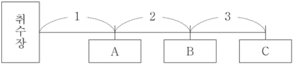

- 배치 / 역할 / 풀이 필수: `PASSAGE` / `ILLUSTRATIVE` / 아니요
- 종류 / MIME: `DIAGRAM` / `image/png`
- 크기: 423 × 95
- 원본 URL: [열기](https://d1c00yjit06b00.cloudfront.net/dev/exams/69bbe336a9ac92778edc5176/1774339498547-sj32nu-img0.png)
- 콘텐츠 해시: `sha256:12878de90eca69cd55a71bb8997bbfdd17f6a1ba7e7f7cad7cefa93a281b5236`

### 문제

- 문항 제목: 글의 내용 파악
- 배점: 2점
- 태그: `내용-확인`

**발문**: 윗글을 통해 답을 찾을 수 없는 질문은?

#### 선지

1. 섀플리 값의 개념은 무엇인가?

2. 섀플리 값을 구하는 방법은 무엇인가?

3. 섀플리 값은 어떤 경우에 사용할 수 있는가?

4. 섀플리 값에서 가중치란 무엇을 의미하는가?

5. 섀플리 값으로 비용을 분담할 때 나타날 수 있는 문제는 무엇인가?

**공식 정답: 5번 (`C5`) — 섀플리 값으로 비용을 분담할 때 나타날 수 있는 문제는 무엇인가?**

### 골드 후보 전체

- 스키마: `problem-solving-gold-v2`
- 골드 상태: `candidate`
- 골드 원천: `69bbf8ec8937cf14551905a1` / 고3 2025년 5월 - 교육청 모의평가 / 14번
- question / passage ID: `69bbf8ec8937cf14551905a1-q14` / `69bbf8ec8937cf14551905a1-passage`
- 골드 발문: 윗글을 통해 답을 찾을 수 없는 질문은?
- 발문 극성: `SELECT_INCORRECT`
- 정답 choice ID: `C5`

#### 시나리오와 사실

없음

- 없음

#### 원문 근거 명제

- passage detail ID: `69bbf8ec8937cf14551905a1-passage`

##### MP1 · P1

연합형 게임은 경제주체들이 연합을 형성하여 협력한 결과를 공정하게 분배하는 방법을 모색하는 경제학 이론이며, 섀플리 값은 그 분배 기준의 대표적 예이다.

- 원문 증거: “연합형 게임은 … 공정하게 분배하는 방법을 모색하는 경제학 이론이다. … 그 대표적인 기준으로 섀플리 값이 있다.”
- 범위: 연합형 게임과 섀플리 값의 관계
- 극성 / 근거 유형: `positive` / `PASSAGE_EXPLICIT`
- 조건: 없음
- 예외: 없음

##### MP2 · P2

섀플리 값은 연합의 경제주체들이 분담할 총비용을 각 경제주체의 연합 기여 정도에 따라 공정하게 분배하는 기준이다.

- 원문 증거: “섀플리 값은 연합의 경제주체들이 분담할 총비용을 각 경제주체가 연합에 기여한 정도에 따라 공정하게 분배할 수 있는 기준이다.”
- 범위: 섀플리 값의 개념
- 극성 / 근거 유형: `positive` / `PASSAGE_EXPLICIT`
- 조건: 없음
- 예외: 없음

##### MP3 · P2

섀플리 값은 모든 연합 형성 경우를 고려한다는 점에서 기회 균등성을 가지며, 연합 참여로 생긴 총비용 증가분에 비례해 비용을 분담한다는 점에서 기여 공정성을 가진다.

- 원문 증거: “이 기준은 … 모든 경우의 수를 고려한다는 측면에서 기회 균등성을, … 총비용의 증가분에 비례하여 비용을 분담하게 한다는 측면에서 기여 공정성을 가진다.”
- 범위: 섀플리 값의 공정성 특성
- 극성 / 근거 유형: `positive` / `PASSAGE_EXPLICIT`
- 조건: 없음
- 예외: 없음

##### MP4 · P3

섀플리 값을 구할 때 각 가능한 연합 참여 순서에서 경제주체별 한계기여도를 계산하고, 그 한계기여도에 가중치를 곱한 값을 경제주체별로 모두 더한다.

- 원문 증거: “먼저, 연합을 형성할 수 있는 모든 경우마다 … 한계기여도를 계산한다. 다음으로 이렇게 구한 … 한계기여도에 가중치를 곱한 값을 경제주체별로 모두 더하면 … 섀플리 값이 결정된다.”
- 범위: 섀플리 값 산출 절차
- 극성 / 근거 유형: `positive` / `PASSAGE_EXPLICIT`
- 조건: 없음
- 예외: 없음

##### MP5 · P3

한계기여도는 특정 경제주체가 참여한 뒤의 연합 총비용에서 그 경제주체가 참여하기 전의 연합 총비용을 뺀 총비용 증가분이다.

- 원문 증거: “한계기여도는 특정 경제주체가 연합에 참여하면서 연합에서 발생한 총비용의 증가분을 뜻하며, 이는 … 총비용에서 … 참여하기 전에 발생한 … 총비용을 빼서 구한다.”
- 범위: 한계기여도의 의미와 계산
- 극성 / 근거 유형: `positive` / `PASSAGE_EXPLICIT`
- 조건: 없음
- 예외: 없음

##### MP6 · P3

가중치는 가능한 모든 연합 형성 경우 중 특정 순서로 형성된 연합이 나타날 확률을 뜻하며, 참여 순서에 따라 한계기여도가 달라질 수 있으므로 모든 순서가 동일한 중요성을 갖게 하려고 한계기여도에 곱한다.

- 원문 증거: “가중치란 … 특정 순서로 형성된 연합이 나타날 확률을 뜻한다. 이렇게 가중치를 한계기여도에 곱하는 이유는 … 참여하는 순서에 따라 한계기여도가 달라질 수 있기 때문이다.”
- 범위: 가중치의 의미와 기능
- 극성 / 근거 유형: `positive` / `PASSAGE_EXPLICIT`
- 조건: 없음
- 예외: 없음

##### MP7 · P4

여행 사례에서 갑과 을이 각각 이동하면 비용은 각각 2,000원과 4,400원이고, 연합하여 동승하면 총비용은 4,400원이다.

- 원문 증거: “갑은 2,000원, 을은 4,400원의 비용이 발생하지만, 갑과 을이 연합을 형성하여 동승하면 총 4,400원의 비용이 발생한다.”
- 범위: 갑·을 동승 사례의 비용 조건
- 극성 / 근거 유형: `positive` / `PASSAGE_EXPLICIT`
- 조건: 없음
- 예외: 없음

##### MP8 · P5

갑과 을의 두 참여 순서는 각각 확률 1/2의 가중치를 가지며, 이 사례에서 섀플리 값은 갑 1,000원과 을 3,400원이다.

- 원문 증거: “각각의 경우가 나타날 확률은 두 가지 중의 한 가지이므로 가중치는 1/2이 된다. … 갑과 을의 섀플리 값은 각각 1,000원과 3,400원이 된다.”
- 범위: 갑·을 사례의 섀플리 값
- 극성 / 근거 유형: `positive` / `PASSAGE_EXPLICIT`
- 조건: 없음
- 예외: 없음

##### MP9 · P5

경제주체들의 섀플리 값을 모두 더한 값은 연합을 형성하여 발생하는 연합의 총비용과 같으며, 섀플리 값은 사회 기반 시설 설치 비용처럼 시장경제에서 해결하기 어려운 비용 분담 문제에도 적용되고 있다.

- 원문 증거: “이렇게 경제주체들의 섀플리 값을 모두 더하면 … 연합의 총비용과 같다. 그래서 최근에는 섀플리 값이 사회 기반 시설의 설치 비용과 같은 시장경제에서 해결하기 어려운 비용 분담 문제에도 적용되고 있다.”
- 범위: 섀플리 값의 합계 성질과 적용 사례
- 극성 / 근거 유형: `positive` / `PASSAGE_EXPLICIT`
- 조건: 없음
- 예외: 없음

#### 시각 자료 주장

- `VA1` (`MEDIA1`, `FLOW`): 도식은 숙소에서 A, B, C 유적지가 차례로 놓인 이동 경로를 제시한다.

#### 문항 추론

##### INF1 · CLASSIFY

글은 섀플리 값을 연합 참여 경제주체들의 총비용을 기여 정도에 따라 공정하게 분배하는 기준으로 정의하므로, 섀플리 값의 개념이 무엇인지 답할 수 있다.

- 결론: 글은 섀플리 값을 연합 참여 경제주체들의 총비용을 기여 정도에 따라 공정하게 분배하는 기준으로 정의하므로, 섀플리 값의 개념이 무엇인지 답할 수 있다.
- 대상 주장 / 효과: `OC1-1` / `SUPPORTS`
- 직접 전제 refs: `MP2`
- 원문 참조: 문단 `P2` / 명제 `MP2`
- 시나리오 사실: 없음
- 시각 주장: 없음
- grounding / necessity: `SOURCE_EXPLICIT` / `REQUIRED`

##### INF2 · CALCULATE

글은 가능한 참여 순서마다 한계기여도를 계산하고 확률 가중치를 곱해 경제주체별로 합산하는 절차를 제시하므로, 섀플리 값을 구하는 방법을 답할 수 있다.

- 결론: 글은 가능한 참여 순서마다 한계기여도를 계산하고 확률 가중치를 곱해 경제주체별로 합산하는 절차를 제시하므로, 섀플리 값을 구하는 방법을 답할 수 있다.
- 대상 주장 / 효과: `OC2-1` / `SUPPORTS`
- 직접 전제 refs: `MP4`, `MP5`, `MP6`
- 원문 참조: 문단 `P3` / 명제 `MP4`, `MP5`, `MP6`
- 시나리오 사실: 없음
- 시각 주장: 없음
- grounding / necessity: `SOURCE_EXPLICIT` / `REQUIRED`

##### INF3 · MAP_CONCEPT

글은 섀플리 값이 사회 기반 시설 설치 비용처럼 시장경제에서 해결하기 어려운 비용 분담 문제에 적용된다고 밝히므로, 섀플리 값을 사용할 수 있는 경우를 답할 수 있다.

- 결론: 글은 섀플리 값이 사회 기반 시설 설치 비용처럼 시장경제에서 해결하기 어려운 비용 분담 문제에 적용된다고 밝히므로, 섀플리 값을 사용할 수 있는 경우를 답할 수 있다.
- 대상 주장 / 효과: `OC3-1` / `SUPPORTS`
- 직접 전제 refs: `MP9`
- 원문 참조: 문단 `P5` / 명제 `MP9`
- 시나리오 사실: 없음
- 시각 주장: 없음
- grounding / necessity: `SOURCE_EXPLICIT` / `REQUIRED`

##### INF4 · CLASSIFY

글은 가중치를 특정 참여 순서로 형성된 연합이 나타날 확률이라고 정의하므로, 섀플리 값에서 가중치가 의미하는 바를 답할 수 있다.

- 결론: 글은 가중치를 특정 참여 순서로 형성된 연합이 나타날 확률이라고 정의하므로, 섀플리 값에서 가중치가 의미하는 바를 답할 수 있다.
- 대상 주장 / 효과: `OC4-1` / `SUPPORTS`
- 직접 전제 refs: `MP6`
- 원문 참조: 문단 `P3` / 명제 `MP6`
- 시나리오 사실: 없음
- 시각 주장: 없음
- grounding / necessity: `SOURCE_EXPLICIT` / `REQUIRED`

##### INF5 · CHECK_JUSTIFICATION

글은 섀플리 값의 정의·산출 방법·사례·적용 가능 분야를 설명할 뿐, 섀플리 값으로 비용을 분담할 때 발생할 수 있는 특정 문제나 한계를 제시하지 않으므로 그 문제를 묻는 질문은 기본 골드에서 정당화되지 않는다.

- 결론: 글은 섀플리 값의 정의·산출 방법·사례·적용 가능 분야를 설명할 뿐, 섀플리 값으로 비용을 분담할 때 발생할 수 있는 특정 문제나 한계를 제시하지 않으므로 그 문제를 묻는 질문은 기본 골드에서 정당화되지 않는다.
- 대상 주장 / 효과: `OC5-1` / `DOES_NOT_JUSTIFY`
- 직접 전제 refs: `MP1`, `MP2`, `MP3`, `MP4`, `MP5`, `MP6`, `MP7`, `MP8`, `MP9`, `ANSWER_KEY`
- 원문 참조: 문단 `P1` / 명제 `MP1`; 문단 `P2` / 명제 `MP2`, `MP3`; 문단 `P3` / 명제 `MP4`, `MP5`, `MP6`; 문단 `P4` / 명제 `MP7`; 문단 `P5` / 명제 `MP8`, `MP9`
- 시나리오 사실: 없음
- 시각 주장: 없음
- grounding / necessity: `ANSWER_KEY_CONSTRAINED` / `REQUIRED`

#### 보충 설명 추론

없음

#### 선지별 골드 판정

##### C1 · 섀플리 값의 개념은 무엇인가?

- 위치 / 판정: 1 / `TRUE`
- 판정 근거: 섀플리 값의 정의가 직접 제시되어 있다.
- 주장 IDs: `OC1-1`
- 필수 원문 참조: 문단 `P2` / 명제 `MP2`
- 필수 시나리오 사실: 없음
- 필수 시각 주장: 없음

**주장 OC1-1 (1순위)**

글을 통해 섀플리 값의 개념이 무엇인지 답할 수 있다.

- assessment / support: `SUPPORTED` / `DIRECT`
- decision / basis: `ACCEPTED` / `SOURCE_GROUNDED`
- 결정 핵심: 예
- 의존 주장: 없음
- 문항 추론: `INF1`
- 원문 참조: 문단 `P2` / 명제 `MP2`
- 시나리오 사실: 없음
- 시각 주장: 없음
- 보충 추론: 없음
- 보충 사용 정책: 없음

##### C2 · 섀플리 값을 구하는 방법은 무엇인가?

- 위치 / 판정: 2 / `TRUE`
- 판정 근거: 한계기여도를 계산하고 가중치를 곱해 합산하는 방법이 제시되어 있다.
- 주장 IDs: `OC2-1`
- 필수 원문 참조: 문단 `P3` / 명제 `MP4`, `MP5`, `MP6`
- 필수 시나리오 사실: 없음
- 필수 시각 주장: 없음

**주장 OC2-1 (1순위)**

글을 통해 섀플리 값을 구하는 방법이 무엇인지 답할 수 있다.

- assessment / support: `SUPPORTED` / `DIRECT`
- decision / basis: `ACCEPTED` / `SOURCE_GROUNDED`
- 결정 핵심: 예
- 의존 주장: 없음
- 문항 추론: `INF2`
- 원문 참조: 문단 `P3` / 명제 `MP4`, `MP5`, `MP6`
- 시나리오 사실: 없음
- 시각 주장: 없음
- 보충 추론: 없음
- 보충 사용 정책: 없음

##### C3 · 섀플리 값은 어떤 경우에 사용할 수 있는가?

- 위치 / 판정: 3 / `TRUE`
- 판정 근거: 시장경제에서 해결하기 어려운 비용 분담 문제 등 적용 분야가 제시되어 있다.
- 주장 IDs: `OC3-1`
- 필수 원문 참조: 문단 `P5` / 명제 `MP9`
- 필수 시나리오 사실: 없음
- 필수 시각 주장: 없음

**주장 OC3-1 (1순위)**

글을 통해 섀플리 값을 사용할 수 있는 경우가 무엇인지 답할 수 있다.

- assessment / support: `SUPPORTED` / `DIRECT`
- decision / basis: `ACCEPTED` / `SOURCE_GROUNDED`
- 결정 핵심: 예
- 의존 주장: 없음
- 문항 추론: `INF3`
- 원문 참조: 문단 `P5` / 명제 `MP9`
- 시나리오 사실: 없음
- 시각 주장: 없음
- 보충 추론: 없음
- 보충 사용 정책: 없음

##### C4 · 섀플리 값에서 가중치란 무엇을 의미하는가?

- 위치 / 판정: 4 / `TRUE`
- 판정 근거: 가중치의 의미가 특정 순서의 연합이 나타날 확률로 직접 정의되어 있다.
- 주장 IDs: `OC4-1`
- 필수 원문 참조: 문단 `P3` / 명제 `MP6`
- 필수 시나리오 사실: 없음
- 필수 시각 주장: 없음

**주장 OC4-1 (1순위)**

글을 통해 섀플리 값에서 가중치가 의미하는 바를 답할 수 있다.

- assessment / support: `SUPPORTED` / `DIRECT`
- decision / basis: `ACCEPTED` / `SOURCE_GROUNDED`
- 결정 핵심: 예
- 의존 주장: 없음
- 문항 추론: `INF4`
- 원문 참조: 문단 `P3` / 명제 `MP6`
- 시나리오 사실: 없음
- 시각 주장: 없음
- 보충 추론: 없음
- 보충 사용 정책: 없음

##### C5 · 섀플리 값으로 비용을 분담할 때 나타날 수 있는 문제는 무엇인가?

- 위치 / 판정: 5 / `FALSE`
- 판정 근거: 글은 섀플리 값의 개념, 계산, 공정성 및 적용 사례를 설명하지만 그 사용에서 발생할 문제나 한계는 제시하지 않는다.
- 주장 IDs: `OC5-1`
- 필수 원문 참조: 문단 `P1` / 명제 `MP1`; 문단 `P2` / 명제 `MP2`, `MP3`; 문단 `P3` / 명제 `MP4`, `MP5`, `MP6`; 문단 `P4` / 명제 `MP7`; 문단 `P5` / 명제 `MP8`, `MP9`
- 필수 시나리오 사실: 없음
- 필수 시각 주장: 없음

**주장 OC5-1 (1순위)**

글을 통해 섀플리 값으로 비용을 분담할 때 나타날 수 있는 문제를 답할 수 있다.

- assessment / support: `NOT_JUSTIFIED` / `NONE`
- decision / basis: `REJECTED` / `ANSWER_KEY_CONSTRAINED`
- 결정 핵심: 예
- 의존 주장: 없음
- 문항 추론: `INF5`
- 원문 참조: 문단 `P1` / 명제 `MP1`; 문단 `P2` / 명제 `MP2`, `MP3`; 문단 `P3` / 명제 `MP4`, `MP5`, `MP6`; 문단 `P4` / 명제 `MP7`; 문단 `P5` / 명제 `MP8`, `MP9`
- 시나리오 사실: 없음
- 시각 주장: 없음
- 보충 추론: 없음
- 보충 사용 정책: 없음

#### 정답 도출 경로

##### STEP1

글은 섀플리 값의 정의, 공정성, 산출 절차, 사례 및 적용 분야를 제시한다.

- 원문 참조: 문단 `P1` / 명제 `MP1`; 문단 `P2` / 명제 `MP2`, `MP3`; 문단 `P3` / 명제 `MP4`, `MP5`, `MP6`; 문단 `P4` / 명제 `MP7`; 문단 `P5` / 명제 `MP8`, `MP9`
- 시나리오 사실: 없음
- 시각 주장: 없음
- 문항 추론: `INF1`, `INF2`, `INF3`, `INF4`
- 선지 주장: 없음

##### STEP2

글에는 섀플리 값으로 비용을 분담할 때 나타날 수 있는 문제나 한계가 제시되지 않아, 해당 질문의 답을 글에서 찾을 수 없다.

- 원문 참조: 문단 `P1` / 명제 `MP1`; 문단 `P2` / 명제 `MP2`, `MP3`; 문단 `P3` / 명제 `MP4`, `MP5`, `MP6`; 문단 `P4` / 명제 `MP7`; 문단 `P5` / 명제 `MP8`, `MP9`
- 시나리오 사실: 없음
- 시각 주장: 없음
- 문항 추론: `INF5`
- 선지 주장: `OC5-1`

- 필수 단계: `STEP1`, `STEP2`
- 결정 단계: `STEP1`
- 결론 단계: `STEP2`
- 최종 답: `C5`
- 최종 설명: 글은 섀플리 값의 개념, 계산 방법, 가중치의 의미, 적용 가능한 비용 분담 사례는 설명한다. 그러나 섀플리 값으로 비용을 분담할 때 발생할 수 있는 문제는 제시하지 않으므로 답을 찾을 수 없는 질문은 ⑤이다.
- 최종 설명 참조 단계: `STEP1`, `STEP2`

#### 대표 오답 경로

- `WP1` 시장경제에서 해결하기 어려운 비용 분담 문제에 적용된다는 서술을 읽고, 섀플리 값 자체를 사용할 수 있는 경우가 제시되지 않았다고 오해하는 경로.
  - scope: `SELECTED_WRONG_CHOICE`
  - 선택 선지: `C3`
  - 놓친 정답: `없음`
  - 분기 층위 후보: `CHOICE_INTERPRETATION`

#### 골드 자체 검수 메모

없음

### 충분 근거 조합 후보

#### 69bbf8ec8937cf14551905a1-q14-C1-SGC1

- 선지 / 대상 주장: `C1` / `OC1-1`
- 제안 경로 / 연산자: `APPROVED_SUFFICIENT_GROUND_SET` / `ALL_OF`
- 필수 근거: `MP2`
- 생략 허용 근거: 없음
- 결론: 글은 섀플리 값을 연합 참여 경제주체들의 총비용을 기여 정도에 따라 공정하게 분배하는 기준으로 정의하므로, 섀플리 값의 개념이 무엇인지 답할 수 있다.
- 원천 추론: `INF1`
- 생성 방식 / 상태: `AI_INFERENCE_GRAPH_DERIVED` / `candidate`
- 위험 표지: 없음

#### 69bbf8ec8937cf14551905a1-q14-C2-SGC1

- 선지 / 대상 주장: `C2` / `OC2-1`
- 제안 경로 / 연산자: `APPROVED_SUFFICIENT_GROUND_SET` / `ALL_OF`
- 필수 근거: `MP4`, `MP5`, `MP6`
- 생략 허용 근거: 없음
- 결론: 글은 가능한 참여 순서마다 한계기여도를 계산하고 확률 가중치를 곱해 경제주체별로 합산하는 절차를 제시하므로, 섀플리 값을 구하는 방법을 답할 수 있다.
- 원천 추론: `INF2`
- 생성 방식 / 상태: `AI_INFERENCE_GRAPH_DERIVED` / `candidate`
- 위험 표지: 없음

#### 69bbf8ec8937cf14551905a1-q14-C3-SGC1

- 선지 / 대상 주장: `C3` / `OC3-1`
- 제안 경로 / 연산자: `APPROVED_SUFFICIENT_GROUND_SET` / `ALL_OF`
- 필수 근거: `MP9`
- 생략 허용 근거: 없음
- 결론: 글은 섀플리 값이 사회 기반 시설 설치 비용처럼 시장경제에서 해결하기 어려운 비용 분담 문제에 적용된다고 밝히므로, 섀플리 값을 사용할 수 있는 경우를 답할 수 있다.
- 원천 추론: `INF3`
- 생성 방식 / 상태: `AI_INFERENCE_GRAPH_DERIVED` / `candidate`
- 위험 표지: 없음

#### 69bbf8ec8937cf14551905a1-q14-C4-SGC1

- 선지 / 대상 주장: `C4` / `OC4-1`
- 제안 경로 / 연산자: `APPROVED_SUFFICIENT_GROUND_SET` / `ALL_OF`
- 필수 근거: `MP6`
- 생략 허용 근거: 없음
- 결론: 글은 가중치를 특정 참여 순서로 형성된 연합이 나타날 확률이라고 정의하므로, 섀플리 값에서 가중치가 의미하는 바를 답할 수 있다.
- 원천 추론: `INF4`
- 생성 방식 / 상태: `AI_INFERENCE_GRAPH_DERIVED` / `candidate`
- 위험 표지: 없음

#### 69bbf8ec8937cf14551905a1-q14-C5-SGC1

- 선지 / 대상 주장: `C5` / `OC5-1`
- 제안 경로 / 연산자: `APPROVED_SUFFICIENT_GROUND_SET` / `ALL_OF`
- 필수 근거: `MP1`, `MP2`, `MP3`, `MP4`, `MP5`, `MP6`, `MP7`, `MP8`, `MP9`, `ANSWER_KEY`
- 생략 허용 근거: 없음
- 결론: 글은 섀플리 값의 정의·산출 방법·사례·적용 가능 분야를 설명할 뿐, 섀플리 값으로 비용을 분담할 때 발생할 수 있는 특정 문제나 한계를 제시하지 않으므로 그 문제를 묻는 질문은 기본 골드에서 정당화되지 않는다.
- 원천 추론: `INF5`
- 생성 방식 / 상태: `AI_INFERENCE_GRAPH_DERIVED` / `candidate`
- 위험 표지: `ANSWER_KEY_CONSTRAINED`, `DOES_NOT_JUSTIFY`

### 생성·검증 기록

- 원시 스키마 통과: 아니요
- 원시 오류: decisivePathStepIds: 결정적 분기와 결론 단계는 분리해야 한다.; representativeWrongPaths.0.missedAnswerChoiceId: 선택 선지 경로에는 놓친 정답을 지정하지 않는다.
- 자동 정규화: `SEPARATE_DECISIVE_AND_CONCLUSION_STEPS`, `REBUILD_INFERENCE_PREMISE_REFS`, `ALIGN_WRONG_PATH_MISSED_ANSWER`
- 최종 스키마 통과: 예
- 최종 오류: 없음
- 생성 모델 / effort: `gpt-5.6-terra` / `medium`
- 프롬프트 버전: `problem-gold-generation-prompt-v2`
- 생성 시간: 48545ms

- 검수 파일 상태: `PENDING`
- 검수자 / 시각: 없음 / 없음
- 승인된 충분 근거 후보: 없음
- 검수 메모: 없음

**사람 검수 메모:**

- 판정:
- 수정 필요 사항:
- 승인할 충분 근거 후보:

[목차로 돌아가기](#빠른-목차)

---

## 16. 고1 2024년 10월 - 교육청 모의평가 · 블라지의 도덕적 자아 모델 23번

### 검수 상태

- case ID: `prospective-69c0d51e78128b2a9befe4b9-q23`
- 분야: `SOCIAL`
- 표본 범위: `POSITIVE_STEM`, `SOCIAL`, `SCENARIO_APPLICATION`
- 생산 상태: `PENDING_HUMAN_REVIEW`
- 후보 종류: 정적 검증을 통과한 후보
- 사람 검수 상태: `PENDING`
- 검수 위험도: `MEDIUM`
- 위험 사유: MULTIPLE_INFERENCES
- 원천 해시: `sha256:7dce602a8c97fbdb70d87579f4cff431a1156cedeb04ecd1e2440b986d51c38c`

검수 체크: [ ] 공식 정답과 선지 판정 일치 · [ ] 원문 근거 정확 · [ ] 추론 비약 없음 · [ ] 충분 근거가 최소 조합 · [ ] 시각 자료 해석 정확

### 원문

도덕 심리학의 중심축을 형성해 온 콜버그의 인지 발달 이론에서는 도덕적 이해를 지식 구조, 즉 인지의 발달에 의한 것으로 보고, 도덕적 이해가 자동적으로 도덕적 행동을 이끌 것이라고 생각했다. 그런데 과연 도덕적 이해가 도덕적 행동을 보장할 수 있을까? 그렇지 않다고 생각할 수 있다. 도덕적으로 옳은 행동인 줄 알면서도 행하지 않는 경우가 많기 때문이다. 블라지는 콜버그의 이론에 의문을 제기하며, 왜 어떤 사람은 도덕적 이해가 행동으로 나타나고 어떤 사람은 그렇지 않은지에 관심을 기울였다. 블라지는 콜버그와 마찬가지로 도덕적 이해가 중요하다고 보았지만, 콜버그와 달리 도덕적 이해가 자아와 통합되는 과정을 거쳐야 도덕적 행동으로 이어진다고 보았다. 그는 이 과정에서 나타나는 자아의 능동적 역할을 강조하며, 도덕적 행동을 이끌기 위한 ‘도덕적 자아 모델’을 제시하였다.

도덕적 자아 모델은 도덕적 이해로부터 도덕적 행동으로 이어지는 과정에 초점을 맞춘 모델이다. 이 모델에서는 도덕적 행동을 이끄는 데 있어 자아가 핵심적 역할을 한다고 보았다. 기존의 학자들이 자아가 무엇인지에 대한 개념적 정의에 관심을 두었다면, 블라지는 전체로서의 자아를 능동적으로 구성하는 방식으로 자아를 설명하는 것이 보다 적절하다고 보았다. 자아는 고정불변의 상태가 아니라 구성 방식에 따라 달리 나타날 수 있는데, 개인마다 다른 자아 구성의 방식에 따라 자아의 여러 특징들은 중심적인 것, 주변적인 것 등으로 위계가 정해진다. 예를 들어 어떤 사람은 자아를 구성하는 데 ‘친절’이나 ‘우정’을 ‘경쟁’보다 중심적 위치에, 어떤 사람은 주변적 위치에 놓을 수 있다. 블라지는 자아에 대한 이러한 견해를 통해, 인간은 선천적인 기질에 따라 살아가는 수동적인 존재가 아니라는 점을 강조한다.

도덕적 자아 모델에서는, 도덕적 이해가 도덕적 행동으로 나타날 수 있게 하는 심리적 요소로 ‘도덕적 정체성’, ‘도덕적 책임감’, ‘자아 일관성’을 강조하고 있는데, 이들은 자아 모델의 세 가지 핵심 구성 요소라고 할 수 있다. 도덕적 정체성은 도덕적 이해에 바탕을 두고 있어, 해야 할 행동의 방향을 일러 준다. 도덕적 책임감과 자아 일관성은 그 방향으로 나아갈 수 있는 추동력을 제공하여 도덕적 행동을 이끈다.

도덕적 자아 모델의 첫 번째 구성 요소인 도덕적 정체성은 도덕성을 자아의 중심에 두는 것, 즉 도덕성과 자아를 통합하는 것을 통해 정체성이 형성된 것이다. ‘도덕성’은 선악에 대한 보편적인 인식을, ‘정체성’은 본질적인 자아를 의미한다. 이때 도덕성이 자아의 중심이 되는 정도, 즉 도덕적 통합의 정도는 사람마다 다를 수 있다. 도덕적 통합은 ‘끊임없이 주의를 요하는, 부서지기 쉬운 것’이기에 본능적인 충동을 억제하려는, 의도적이고 지속적인 노력이 필요하다. 블라지는 도덕성을 자아의 중심에 두는 사람일수록, 자신의 도덕적 이상에 부합하는 삶을 추구하며 도덕적 이해를 행동으로 옮길 가능성이 높다고 보았다. 이러한 주장은 도덕적 이해가 도덕적 행동으로 나타나기 위해서는 도덕성을 자아의 중심에 둘 수 있도록 해야 한다는 것인데, 이때 도덕성을 자아의 중심에 두려면 도덕적 이해뿐만 아니라 도덕적인 사람이 되는 것에 대한 관심도 필요하다.

두 번째 구성 요소인 도덕적 책임감은, 어떤 행동이 도덕적으로 옳은지에 대한 판단과 더불어 그런 행동을 할 도덕적 의무가 있다는 것을 깨닫는 것이다. 도덕적 책임감은 도덕성이 자아와 통합된 결과로 나타나는데, 도덕적 책임감은 반드시 도덕적 행동으로 나타내야 하는 스스로에 대한 욕구이며, 외부의 기대나 요구에 의해 부여되는 것이 아니라 자아가 스스로에게 요구하는 엄중한 의무에 의해 생기게 되는 것이다.

세 번째 구성 요소인 자아 일관성은, 자신의 자아의식과 일치해서 살아가고자 하는 인간의 경향성을 의미한다. 블라지에 의하면, 자아 일관성은 단지 본능적인 경향성이나 자기 충족 욕구에 의한 것이 아니다. 자신의 도덕적 이상과 일치된 행동을 하려는 자아 일관성은 도덕적 정체성에서 나오며, 도덕적 책임감으로부터 도덕적 행동으로의 전환은 자아 일관성에 의해 뒷받침된다. 자신의 판단에 따라 행동하지 않는 것이 자아의 균열을 의미하기 때문이다. 자아의 여러 특징들 중 선(善), 정의, 공평 등과 같은 도덕적 범주를 자아의 중심에 둘 때, 자신의 도덕적 정체성과 일치된 행동을 하고자 하는 자아 일관성은 도덕적 행동을 이끄는 추동력이 된다.

### 문제

- 문항 제목: 자아 일관성의 개념 이해
- 배점: 2점
- 태그: `보기-사례-적용`

**발문**: <보기>는 학자들이 나눈 가상 대화의 일부이다. [A]에 들어갈 내용으로 가장 적절한 것은?

#### 보기

갑: ‘인지 부조화 이론’에 따르면, 개인의 사고와 행동 간의 불일치는 심리적으로 불쾌감을 주기 때문에 사람들은 불일치를 해소하려고 합니다. 건강에 나쁜 줄 알면서도 습관적으로 야식을 먹는 사람은, 야식을 참는 것이 스트레스를 유발해 정신 건강에 오히려 안 좋을 수 있다고 자신을 합리화함으로써 사고와 행동 간의 불일치를 해소하려고 하죠. 이런 사례도 ‘자아 일관성’으로 볼 수 있을까요?

을: 블라지가 말하는 ‘자아 일관성’은 자기 합리화를 통한 불일치의 해소와는 달라요. 자아 일관성은 [A]

#### 선지

1. 도덕적 책임감에서 비롯된 것으로, 자신의 행동이 도덕적으로 옳은지 판단하려는 욕구입니다.

2. 도덕적 정체성에서 비롯된 것으로, 자신의 선천적 기질에 따라 살아가려는 욕구입니다.

3. 도덕적 정체성에서 비롯된 것으로, 자신의 도덕적 이상과 자신의 행위를 일치시키려는 욕구입니다.

4. 본능적인 경향성에서 비롯된 것으로, 자신의 사고와 일치된 행동으로 자아의 균열을 막으려는 욕구입니다.

5. 본능적인 경향성에서 비롯된 것으로, 자신의 판단에 따른 행동으로 심리적 불쾌감을 줄이려는 욕구입니다.

**공식 정답: 3번 (`C3`) — 도덕적 정체성에서 비롯된 것으로, 자신의 도덕적 이상과 자신의 행위를 일치시키려는 욕구입니다.**

### 골드 후보 전체

- 스키마: `problem-solving-gold-v2`
- 골드 상태: `candidate`
- 골드 원천: `69c0d51e78128b2a9befe4b9` / 고1 2024년 10월 - 교육청 모의평가 / 23번
- question / passage ID: `69c0d51e78128b2a9befe4b9-q23` / `69c0d51e78128b2a9befe4b9-passage`
- 골드 발문: <보기>는 학자들이 나눈 가상 대화의 일부이다. [A]에 들어갈 내용으로 가장 적절한 것은?
- 발문 극성: `SELECT_CORRECT`
- 정답 choice ID: `C3`

#### 시나리오와 사실

갑: ‘인지 부조화 이론’에 따르면, 개인의 사고와 행동 간의 불일치는 심리적으로 불쾌감을 주기 때문에 사람들은 불일치를 해소하려고 합니다. 건강에 나쁜 줄 알면서도 습관적으로 야식을 먹는 사람은, 야식을 참는 것이 스트레스를 유발해 정신 건강에 오히려 안 좋을 수 있다고 자신을 합리화함으로써 사고와 행동 간의 불일치를 해소하려고 하죠. 이런 사례도 ‘자아 일관성’으로 볼 수 있을까요?

을: 블라지가 말하는 ‘자아 일관성’은 자기 합리화를 통한 불일치의 해소와는 달라요. 자아 일관성은 [A]

- `SF1` 인지 부조화 이론에서는 사고와 행동의 불일치가 심리적 불쾌감을 주므로 사람들이 그 불일치를 해소하려 한다고 설명된다.
- `SF2` 대화에서 을은 블라지의 자아 일관성이 자기 합리화를 통한 불일치 해소와 다르다고 말한다.

#### 원문 근거 명제

- passage detail ID: `69c0d51e78128b2a9befe4b9-passage`

##### MP1 · P1

콜버그는 도덕적 이해가 자동적으로 도덕적 행동을 이끈다고 보았다.

- 원문 증거: “도덕적 이해가 자동적으로 도덕적 행동을 이끌 것이라고 생각했다.”
- 범위: 콜버그의 인지 발달 이론
- 극성 / 근거 유형: `positive` / `PASSAGE_EXPLICIT`
- 조건: 없음
- 예외: 없음

##### MP2 · P1

블라지는 도덕적 이해가 자아와 통합되는 과정을 거쳐야 도덕적 행동으로 이어진다고 보았다.

- 원문 증거: “도덕적 이해가 자아와 통합되는 과정을 거쳐야 도덕적 행동으로 이어진다고 보았다.”
- 범위: 블라지의 도덕적 자아 모델
- 극성 / 근거 유형: `positive` / `PASSAGE_EXPLICIT`
- 조건: 없음
- 예외: 없음

##### MP3 · P2

자아는 고정불변의 상태가 아니라 개인의 자아 구성 방식에 따라 달리 나타나며, 자아의 특징들은 중심성과 주변성 등의 위계를 갖는다.

- 원문 증거: “자아는 고정불변의 상태가 아니라 구성 방식에 따라 달리 나타날 수 있는데, 개인마다 다른 자아 구성의 방식에 따라 자아의 여러 특징들은 중심적인 것, 주변적인 것 등으로 위계가 정해진다.”
- 범위: 자아의 구성
- 극성 / 근거 유형: `positive` / `PASSAGE_EXPLICIT`
- 조건: 없음
- 예외: 없음

##### MP4 · P2

블라지는 인간이 선천적인 기질에 따라 살아가는 수동적인 존재가 아님을 강조한다.

- 원문 증거: “인간은 선천적인 기질에 따라 살아가는 수동적인 존재가 아니라는 점을 강조한다.”
- 범위: 인간과 자아
- 극성 / 근거 유형: `negative` / `PASSAGE_EXPLICIT`
- 조건: 없음
- 예외: 없음

##### MP5 · P3

도덕적 정체성은 도덕적 이해에 바탕을 두고 해야 할 행동의 방향을 알려 준다.

- 원문 증거: “도덕적 정체성은 도덕적 이해에 바탕을 두고 있어, 해야 할 행동의 방향을 일러 준다.”
- 범위: 도덕적 자아 모델의 구성 요소
- 극성 / 근거 유형: `positive` / `PASSAGE_EXPLICIT`
- 조건: 없음
- 예외: 없음

##### MP6 · P3

도덕적 책임감과 자아 일관성은 도덕적 행동의 방향으로 나아갈 추동력을 제공한다.

- 원문 증거: “도덕적 책임감과 자아 일관성은 그 방향으로 나아갈 수 있는 추동력을 제공하여 도덕적 행동을 이끈다.”
- 범위: 도덕적 자아 모델의 구성 요소
- 극성 / 근거 유형: `positive` / `PASSAGE_EXPLICIT`
- 조건: 없음
- 예외: 없음

##### MP7 · P4

도덕적 정체성은 도덕성을 자아의 중심에 두어 도덕성과 자아를 통합함으로써 형성된다.

- 원문 증거: “도덕적 정체성은 도덕성을 자아의 중심에 두는 것, 즉 도덕성과 자아를 통합하는 것을 통해 정체성이 형성된 것이다.”
- 범위: 도덕적 정체성
- 극성 / 근거 유형: `positive` / `PASSAGE_EXPLICIT`
- 조건: 없음
- 예외: 없음

##### MP8 · P5

도덕적 책임감은 어떤 행동이 도덕적으로 옳은지 판단함과 더불어 그 행동을 할 도덕적 의무가 있음을 깨닫는 것이다.

- 원문 증거: “도덕적 책임감은, 어떤 행동이 도덕적으로 옳은지에 대한 판단과 더불어 그런 행동을 할 도덕적 의무가 있다는 것을 깨닫는 것이다.”
- 범위: 도덕적 책임감
- 극성 / 근거 유형: `positive` / `PASSAGE_EXPLICIT`
- 조건: 없음
- 예외: 없음

##### MP9 · P5

도덕적 책임감은 도덕성이 자아와 통합된 결과로 나타나며, 외부의 요구가 아니라 자아가 스스로에게 요구하는 의무에 의해 생긴다.

- 원문 증거: “도덕적 책임감은 도덕성이 자아와 통합된 결과로 나타나는데, ... 외부의 기대나 요구에 의해 부여되는 것이 아니라 자아가 스스로에게 요구하는 엄중한 의무에 의해 생기게 되는 것이다.”
- 범위: 도덕적 책임감
- 극성 / 근거 유형: `positive` / `PASSAGE_EXPLICIT`
- 조건: 없음
- 예외: 없음

##### MP10 · P6

자아 일관성은 자신의 자아의식과 일치하여 살아가고자 하는 인간의 경향성이다.

- 원문 증거: “자아 일관성은, 자신의 자아의식과 일치해서 살아가고자 하는 인간의 경향성을 의미한다.”
- 범위: 자아 일관성
- 극성 / 근거 유형: `positive` / `PASSAGE_EXPLICIT`
- 조건: 없음
- 예외: 없음

##### MP11 · P6

자아 일관성은 단지 본능적인 경향성이나 자기 충족 욕구에 의한 것이 아니다.

- 원문 증거: “자아 일관성은 단지 본능적인 경향성이나 자기 충족 욕구에 의한 것이 아니다.”
- 범위: 자아 일관성
- 극성 / 근거 유형: `negative` / `PASSAGE_EXPLICIT`
- 조건: 없음
- 예외: 없음

##### MP12 · P6

자신의 도덕적 이상과 일치된 행동을 하려는 자아 일관성은 도덕적 정체성에서 나온다.

- 원문 증거: “자신의 도덕적 이상과 일치된 행동을 하려는 자아 일관성은 도덕적 정체성에서 나오며”
- 범위: 자아 일관성과 도덕적 정체성의 관계
- 극성 / 근거 유형: `positive` / `PASSAGE_EXPLICIT`
- 조건: 없음
- 예외: 없음

##### MP13 · P6

도덕적 책임감에서 도덕적 행동으로 전환되는 과정은 자아 일관성에 의해 뒷받침된다.

- 원문 증거: “도덕적 책임감으로부터 도덕적 행동으로의 전환은 자아 일관성에 의해 뒷받침된다.”
- 범위: 자아 일관성의 역할
- 극성 / 근거 유형: `positive` / `PASSAGE_EXPLICIT`
- 조건: 없음
- 예외: 없음

##### MP14 · P6

자신의 판단에 따라 행동하지 않는 것은 자아의 균열을 의미한다.

- 원문 증거: “자신의 판단에 따라 행동하지 않는 것이 자아의 균열을 의미하기 때문이다.”
- 범위: 자아 일관성
- 극성 / 근거 유형: `positive` / `PASSAGE_EXPLICIT`
- 조건: 없음
- 예외: 없음

##### MP15 · P6

도덕적 범주를 자아의 중심에 둘 때, 도덕적 정체성과 일치되게 행동하려는 자아 일관성은 도덕적 행동을 이끄는 추동력이 된다.

- 원문 증거: “선(善), 정의, 공평 등과 같은 도덕적 범주를 자아의 중심에 둘 때, 자신의 도덕적 정체성과 일치된 행동을 하고자 하는 자아 일관성은 도덕적 행동을 이끄는 추동력이 된다.”
- 범위: 자아 일관성과 도덕적 행동
- 극성 / 근거 유형: `positive` / `PASSAGE_EXPLICIT`
- 조건: 선·정의·공평 등 도덕적 범주를 자아의 중심에 둘 때
- 예외: 없음

#### 시각 자료 주장

없음

#### 문항 추론

##### INF1 · CLASSIFY

블라지의 자아 일관성은 도덕적 책임감이 아니라 도덕적 정체성에서 나온다.

- 결론: 블라지의 자아 일관성은 도덕적 책임감이 아니라 도덕적 정체성에서 나온다.
- 대상 주장 / 효과: `OC1-1` / `CONTRADICTS`
- 직접 전제 refs: `MP12`
- 원문 참조: 문단 `P6` / 명제 `MP12`
- 시나리오 사실: 없음
- 시각 주장: 없음
- grounding / necessity: `SOURCE_EXPLICIT` / `REQUIRED`

##### INF2 · CLASSIFY

도덕적으로 옳은지 판단하고 의무를 깨닫는 것은 도덕적 책임감의 내용이므로, 이를 자아 일관성의 욕구로 규정할 수 없다.

- 결론: 도덕적으로 옳은지 판단하고 의무를 깨닫는 것은 도덕적 책임감의 내용이므로, 이를 자아 일관성의 욕구로 규정할 수 없다.
- 대상 주장 / 효과: `OC1-2` / `CONTRADICTS`
- 직접 전제 refs: `MP8`
- 원문 참조: 문단 `P5` / 명제 `MP8`
- 시나리오 사실: 없음
- 시각 주장: 없음
- grounding / necessity: `SOURCE_EXPLICIT` / `SUPPORTING`

##### INF3 · APPLY_RULE

자아 일관성은 도덕적 정체성에서 나온다.

- 결론: 자아 일관성은 도덕적 정체성에서 나온다.
- 대상 주장 / 효과: `OC2-1`, `OC3-1` / `SUPPORTS`
- 직접 전제 refs: `MP12`
- 원문 참조: 문단 `P6` / 명제 `MP12`
- 시나리오 사실: 없음
- 시각 주장: 없음
- grounding / necessity: `SOURCE_EXPLICIT` / `REQUIRED`

##### INF4 · CLASSIFY

블라지는 인간이 선천적 기질에 따라 살아가는 수동적 존재가 아니라고 보았으므로, 자아 일관성을 선천적 기질에 따라 살려는 욕구로 볼 수 없다.

- 결론: 블라지는 인간이 선천적 기질에 따라 살아가는 수동적 존재가 아니라고 보았으므로, 자아 일관성을 선천적 기질에 따라 살려는 욕구로 볼 수 없다.
- 대상 주장 / 효과: `OC2-2` / `CONTRADICTS`
- 직접 전제 refs: `MP4`
- 원문 참조: 문단 `P2` / 명제 `MP4`
- 시나리오 사실: 없음
- 시각 주장: 없음
- grounding / necessity: `SOURCE_EXPLICIT` / `REQUIRED`

##### INF5 · APPLY_RULE

자아 일관성은 자신의 도덕적 이상과 일치된 행동을 하려는 경향성이다.

- 결론: 자아 일관성은 자신의 도덕적 이상과 일치된 행동을 하려는 경향성이다.
- 대상 주장 / 효과: `OC3-2` / `SUPPORTS`
- 직접 전제 refs: `MP12`
- 원문 참조: 문단 `P6` / 명제 `MP12`
- 시나리오 사실: 없음
- 시각 주장: 없음
- grounding / necessity: `SOURCE_EXPLICIT` / `REQUIRED`

##### INF6 · CHECK_CONDITION

블라지는 자아 일관성이 본능적인 경향성에 의한 것이 아니라고 하였으므로, 자아 일관성이 본능적인 경향성에서 비롯된다는 주장은 성립하지 않는다.

- 결론: 블라지는 자아 일관성이 본능적인 경향성에 의한 것이 아니라고 하였으므로, 자아 일관성이 본능적인 경향성에서 비롯된다는 주장은 성립하지 않는다.
- 대상 주장 / 효과: `OC4-1`, `OC5-1` / `CONTRADICTS`
- 직접 전제 refs: `MP11`
- 원문 참조: 문단 `P6` / 명제 `MP11`
- 시나리오 사실: 없음
- 시각 주장: 없음
- grounding / necessity: `SOURCE_EXPLICIT` / `REQUIRED`

##### INF7 · APPLY_RULE

자아 일관성은 자신의 자아의식에 맞게 살려는 경향성이고 자신의 판단대로 행동하지 않는 것은 자아의 균열을 뜻하므로, 자신의 판단과 일치되게 행동하려는 설명은 자아 일관성과 부합한다.

- 결론: 자아 일관성은 자신의 자아의식에 맞게 살려는 경향성이고 자신의 판단대로 행동하지 않는 것은 자아의 균열을 뜻하므로, 자신의 판단과 일치되게 행동하려는 설명은 자아 일관성과 부합한다.
- 대상 주장 / 효과: `OC4-2` / `SUPPORTS`
- 직접 전제 refs: `MP10`, `MP14`
- 원문 참조: 문단 `P6` / 명제 `MP10`, `MP14`
- 시나리오 사실: 없음
- 시각 주장: 없음
- grounding / necessity: `SOURCE_ENTAILED` / `SUPPORTING`

##### INF8 · CHECK_JUSTIFICATION

자아 일관성이 본능적 경향성이나 자기 충족 욕구에 의한 것이 아니고 자기 합리화를 통한 불일치 해소와도 구별된다는 사실만으로, 그것이 심리적 불쾌감을 줄이려는 욕구라는 주장은 정당화되지 않는다.

- 결론: 자아 일관성이 본능적 경향성이나 자기 충족 욕구에 의한 것이 아니고 자기 합리화를 통한 불일치 해소와도 구별된다는 사실만으로, 그것이 심리적 불쾌감을 줄이려는 욕구라는 주장은 정당화되지 않는다.
- 대상 주장 / 효과: `OC5-2` / `DOES_NOT_JUSTIFY`
- 직접 전제 refs: `MP11`, `MP12`, `SF1`, `SF2`, `ANSWER_KEY`
- 원문 참조: 문단 `P6` / 명제 `MP11`, `MP12`
- 시나리오 사실: `SF1`, `SF2`
- 시각 주장: 없음
- grounding / necessity: `ANSWER_KEY_CONSTRAINED` / `SUPPORTING`

#### 보충 설명 추론

없음

#### 선지별 골드 판정

##### C1 · 도덕적 책임감에서 비롯된 것으로, 자신의 행동이 도덕적으로 옳은지 판단하려는 욕구입니다.

- 위치 / 판정: 1 / `FALSE`
- 판정 근거: 자아 일관성은 도덕적 책임감이 아니라 도덕적 정체성에서 나오며, 도덕적으로 옳은지 판단하고 의무를 깨닫는 것은 도덕적 책임감의 내용이다.
- 주장 IDs: `OC1-1`, `OC1-2`
- 필수 원문 참조: 문단 `P6` / 명제 `MP12`; 문단 `P5` / 명제 `MP8`
- 필수 시나리오 사실: 없음
- 필수 시각 주장: 없음

**주장 OC1-1 (1순위)**

자아 일관성은 도덕적 책임감에서 비롯된다.

- assessment / support: `CONTRADICTED` / `DIRECT`
- decision / basis: `REJECTED` / `SOURCE_GROUNDED`
- 결정 핵심: 예
- 의존 주장: 없음
- 문항 추론: `INF1`
- 원문 참조: 문단 `P6` / 명제 `MP12`
- 시나리오 사실: 없음
- 시각 주장: 없음
- 보충 추론: 없음
- 보충 사용 정책: 없음

**주장 OC1-2 (2순위)**

자아 일관성은 자신의 행동이 도덕적으로 옳은지 판단하려는 욕구이다.

- assessment / support: `CONTRADICTED` / `DIRECT`
- decision / basis: `REJECTED` / `SOURCE_GROUNDED`
- 결정 핵심: 아니요
- 의존 주장: 없음
- 문항 추론: `INF2`
- 원문 참조: 문단 `P5` / 명제 `MP8`
- 시나리오 사실: 없음
- 시각 주장: 없음
- 보충 추론: 없음
- 보충 사용 정책: 없음

##### C2 · 도덕적 정체성에서 비롯된 것으로, 자신의 선천적 기질에 따라 살아가려는 욕구입니다.

- 위치 / 판정: 2 / `FALSE`
- 판정 근거: 자아 일관성이 도덕적 정체성에서 나온다는 부분은 맞지만, 블라지는 인간이 선천적 기질에 따라 살아가는 수동적 존재가 아니라고 보았다.
- 주장 IDs: `OC2-1`, `OC2-2`
- 필수 원문 참조: 문단 `P6` / 명제 `MP12`; 문단 `P2` / 명제 `MP4`
- 필수 시나리오 사실: 없음
- 필수 시각 주장: 없음

**주장 OC2-1 (1순위)**

자아 일관성은 도덕적 정체성에서 비롯된다.

- assessment / support: `SUPPORTED` / `DIRECT`
- decision / basis: `ACCEPTED` / `SOURCE_GROUNDED`
- 결정 핵심: 아니요
- 의존 주장: 없음
- 문항 추론: `INF3`
- 원문 참조: 문단 `P6` / 명제 `MP12`
- 시나리오 사실: 없음
- 시각 주장: 없음
- 보충 추론: 없음
- 보충 사용 정책: 없음

**주장 OC2-2 (2순위)**

자아 일관성은 자신의 선천적 기질에 따라 살아가려는 욕구이다.

- assessment / support: `CONTRADICTED` / `DIRECT`
- decision / basis: `REJECTED` / `SOURCE_GROUNDED`
- 결정 핵심: 예
- 의존 주장: 없음
- 문항 추론: `INF4`
- 원문 참조: 문단 `P2` / 명제 `MP4`
- 시나리오 사실: 없음
- 시각 주장: 없음
- 보충 추론: 없음
- 보충 사용 정책: 없음

##### C3 · 도덕적 정체성에서 비롯된 것으로, 자신의 도덕적 이상과 자신의 행위를 일치시키려는 욕구입니다.

- 위치 / 판정: 3 / `TRUE`
- 판정 근거: 블라지는 자신의 도덕적 이상과 일치된 행동을 하려는 자아 일관성이 도덕적 정체성에서 나온다고 설명한다.
- 주장 IDs: `OC3-1`, `OC3-2`
- 필수 원문 참조: 문단 `P6` / 명제 `MP12`
- 필수 시나리오 사실: 없음
- 필수 시각 주장: 없음

**주장 OC3-1 (1순위)**

자아 일관성은 도덕적 정체성에서 비롯된다.

- assessment / support: `SUPPORTED` / `DIRECT`
- decision / basis: `ACCEPTED` / `SOURCE_GROUNDED`
- 결정 핵심: 예
- 의존 주장: 없음
- 문항 추론: `INF3`
- 원문 참조: 문단 `P6` / 명제 `MP12`
- 시나리오 사실: 없음
- 시각 주장: 없음
- 보충 추론: 없음
- 보충 사용 정책: 없음

**주장 OC3-2 (2순위)**

자아 일관성은 자신의 도덕적 이상과 자신의 행위를 일치시키려는 욕구이다.

- assessment / support: `SUPPORTED` / `DIRECT`
- decision / basis: `ACCEPTED` / `SOURCE_GROUNDED`
- 결정 핵심: 예
- 의존 주장: 없음
- 문항 추론: `INF5`
- 원문 참조: 문단 `P6` / 명제 `MP12`
- 시나리오 사실: 없음
- 시각 주장: 없음
- 보충 추론: 없음
- 보충 사용 정책: 없음

##### C4 · 본능적인 경향성에서 비롯된 것으로, 자신의 사고와 일치된 행동으로 자아의 균열을 막으려는 욕구입니다.

- 위치 / 판정: 4 / `FALSE`
- 판정 근거: 자아 일관성은 본능적인 경향성에 의한 것이 아니므로 선지의 발생 근거가 틀렸다.
- 주장 IDs: `OC4-1`, `OC4-2`
- 필수 원문 참조: 문단 `P6` / 명제 `MP11`
- 필수 시나리오 사실: 없음
- 필수 시각 주장: 없음

**주장 OC4-1 (1순위)**

자아 일관성은 본능적인 경향성에서 비롯된다.

- assessment / support: `CONTRADICTED` / `DIRECT`
- decision / basis: `REJECTED` / `SOURCE_GROUNDED`
- 결정 핵심: 예
- 의존 주장: 없음
- 문항 추론: `INF6`
- 원문 참조: 문단 `P6` / 명제 `MP11`
- 시나리오 사실: 없음
- 시각 주장: 없음
- 보충 추론: 없음
- 보충 사용 정책: 없음

**주장 OC4-2 (2순위)**

자아 일관성은 자신의 사고와 일치된 행동으로 자아의 균열을 막으려는 욕구이다.

- assessment / support: `SUPPORTED` / `ENTAILED`
- decision / basis: `ACCEPTED` / `SOURCE_GROUNDED`
- 결정 핵심: 아니요
- 의존 주장: 없음
- 문항 추론: `INF7`
- 원문 참조: 문단 `P6` / 명제 `MP10`, `MP14`
- 시나리오 사실: 없음
- 시각 주장: 없음
- 보충 추론: 없음
- 보충 사용 정책: 없음

##### C5 · 본능적인 경향성에서 비롯된 것으로, 자신의 판단에 따른 행동으로 심리적 불쾌감을 줄이려는 욕구입니다.

- 위치 / 판정: 5 / `FALSE`
- 판정 근거: 자아 일관성은 본능적인 경향성에 의한 것이 아니며, 심리적 불쾌감 감소를 위한 자기 합리화와 구별된다.
- 주장 IDs: `OC5-1`, `OC5-2`
- 필수 원문 참조: 문단 `P6` / 명제 `MP11`, `MP12`
- 필수 시나리오 사실: `SF1`, `SF2`
- 필수 시각 주장: 없음

**주장 OC5-1 (1순위)**

자아 일관성은 본능적인 경향성에서 비롯된다.

- assessment / support: `CONTRADICTED` / `DIRECT`
- decision / basis: `REJECTED` / `SOURCE_GROUNDED`
- 결정 핵심: 예
- 의존 주장: 없음
- 문항 추론: `INF6`
- 원문 참조: 문단 `P6` / 명제 `MP11`
- 시나리오 사실: 없음
- 시각 주장: 없음
- 보충 추론: 없음
- 보충 사용 정책: 없음

**주장 OC5-2 (2순위)**

자아 일관성은 자신의 판단에 따른 행동으로 심리적 불쾌감을 줄이려는 욕구이다.

- assessment / support: `NOT_JUSTIFIED` / `NONE`
- decision / basis: `REJECTED` / `ANSWER_KEY_CONSTRAINED`
- 결정 핵심: 아니요
- 의존 주장: 없음
- 문항 추론: `INF8`
- 원문 참조: 문단 `P6` / 명제 `MP11`, `MP12`
- 시나리오 사실: `SF1`, `SF2`
- 시각 주장: 없음
- 보충 추론: 없음
- 보충 사용 정책: 없음

#### 정답 도출 경로

##### STEP1

블라지는 자아 일관성이 본능적 경향성이나 자기 충족 욕구에 의한 것이 아니라고 설명한다.

- 원문 참조: 문단 `P6` / 명제 `MP11`
- 시나리오 사실: 없음
- 시각 주장: 없음
- 문항 추론: `INF6`
- 선지 주장: `OC4-1`, `OC5-1`

##### STEP2

블라지는 자신의 도덕적 이상과 일치되게 행동하려는 자아 일관성이 도덕적 정체성에서 나온다고 설명한다.

- 원문 참조: 문단 `P6` / 명제 `MP12`
- 시나리오 사실: 없음
- 시각 주장: 없음
- 문항 추론: `INF3`, `INF5`
- 선지 주장: `OC3-1`, `OC3-2`

##### STEP3

도덕적 정체성에서 비롯되어 자신의 도덕적 이상과 행위를 일치시키려는 욕구라는 C3이 지문 설명과 일치한다.

- 원문 참조: 없음
- 시나리오 사실: 없음
- 시각 주장: 없음
- 문항 추론: `INF3`, `INF5`
- 선지 주장: `OC3-1`, `OC3-2`

- 필수 단계: `STEP2`, `STEP3`
- 결정 단계: `STEP2`
- 결론 단계: `STEP3`
- 최종 답: `C3`
- 최종 설명: 자아 일관성은 자신의 도덕적 이상과 일치된 행동을 하려는 경향성이며, 블라지는 이것이 도덕적 정체성에서 나온다고 보았다. 따라서 C3이 가장 적절하다.
- 최종 설명 참조 단계: `STEP2`, `STEP3`

#### 대표 오답 경로

- `WP1` 자아 일관성이 도덕적 행동을 뒷받침한다는 점만 보고, 도덕적으로 옳은지 판단하고 의무를 깨닫는 도덕적 책임감과 혼동한 경우이다.
  - scope: `SELECTED_WRONG_CHOICE`
  - 선택 선지: `C1`
  - 놓친 정답: `없음`
  - 분기 층위 후보: `CONCEPT_BOUNDARY`, `CHOICE_INTERPRETATION`
- `WP2` 자아 일관성을 본능적 경향성 또는 심리적 불쾌감 해소 욕구로 오인한 경우이다.
  - scope: `SELECTED_WRONG_CHOICE`
  - 선택 선지: `C4`, `C5`
  - 놓친 정답: `없음`
  - 분기 층위 후보: `PASSAGE_REPRESENTATION`, `CONCEPT_BOUNDARY`

#### 골드 자체 검수 메모

없음

### 충분 근거 조합 후보

#### 69c0d51e78128b2a9befe4b9-q23-C1-SGC1

- 선지 / 대상 주장: `C1` / `OC1-1`
- 제안 경로 / 연산자: `APPROVED_SUFFICIENT_GROUND_SET` / `ALL_OF`
- 필수 근거: `MP12`
- 생략 허용 근거: 없음
- 결론: 블라지의 자아 일관성은 도덕적 책임감이 아니라 도덕적 정체성에서 나온다.
- 원천 추론: `INF1`
- 생성 방식 / 상태: `AI_INFERENCE_GRAPH_DERIVED` / `candidate`
- 위험 표지: 없음

#### 69c0d51e78128b2a9befe4b9-q23-C2-SGC1

- 선지 / 대상 주장: `C2` / `OC2-1`, `OC3-1`, `OC2-2`
- 제안 경로 / 연산자: `APPROVED_SUFFICIENT_GROUND_SET` / `ALL_OF`
- 필수 근거: `MP12`, `MP4`
- 생략 허용 근거: 없음
- 결론: 자아 일관성은 도덕적 정체성에서 나온다. 블라지는 인간이 선천적 기질에 따라 살아가는 수동적 존재가 아니라고 보았으므로, 자아 일관성을 선천적 기질에 따라 살려는 욕구로 볼 수 없다.
- 원천 추론: `INF3`, `INF4`
- 생성 방식 / 상태: `AI_INFERENCE_GRAPH_DERIVED` / `candidate`
- 위험 표지: `MULTIPLE_INFERENCES`

#### 69c0d51e78128b2a9befe4b9-q23-C3-SGC1

- 선지 / 대상 주장: `C3` / `OC2-1`, `OC3-1`, `OC3-2`
- 제안 경로 / 연산자: `APPROVED_SUFFICIENT_GROUND_SET` / `ALL_OF`
- 필수 근거: `MP12`
- 생략 허용 근거: 없음
- 결론: 자아 일관성은 도덕적 정체성에서 나온다. 자아 일관성은 자신의 도덕적 이상과 일치된 행동을 하려는 경향성이다.
- 원천 추론: `INF3`, `INF5`
- 생성 방식 / 상태: `AI_INFERENCE_GRAPH_DERIVED` / `candidate`
- 위험 표지: `MULTIPLE_INFERENCES`

#### 69c0d51e78128b2a9befe4b9-q23-C4-SGC1

- 선지 / 대상 주장: `C4` / `OC4-1`, `OC5-1`
- 제안 경로 / 연산자: `APPROVED_SUFFICIENT_GROUND_SET` / `ALL_OF`
- 필수 근거: `MP11`
- 생략 허용 근거: 없음
- 결론: 블라지는 자아 일관성이 본능적인 경향성에 의한 것이 아니라고 하였으므로, 자아 일관성이 본능적인 경향성에서 비롯된다는 주장은 성립하지 않는다.
- 원천 추론: `INF6`
- 생성 방식 / 상태: `AI_INFERENCE_GRAPH_DERIVED` / `candidate`
- 위험 표지: 없음

#### 69c0d51e78128b2a9befe4b9-q23-C5-SGC1

- 선지 / 대상 주장: `C5` / `OC4-1`, `OC5-1`
- 제안 경로 / 연산자: `APPROVED_SUFFICIENT_GROUND_SET` / `ALL_OF`
- 필수 근거: `MP11`
- 생략 허용 근거: 없음
- 결론: 블라지는 자아 일관성이 본능적인 경향성에 의한 것이 아니라고 하였으므로, 자아 일관성이 본능적인 경향성에서 비롯된다는 주장은 성립하지 않는다.
- 원천 추론: `INF6`
- 생성 방식 / 상태: `AI_INFERENCE_GRAPH_DERIVED` / `candidate`
- 위험 표지: 없음

### 생성·검증 기록

- 원시 스키마 통과: 아니요
- 원시 오류: optionClaims.9.supplementalUsePolicy: 보충 해설 참조와 사용 정책은 함께 지정해야 한다.; decisivePathStepIds: 결정적 분기와 결론 단계는 분리해야 한다.; representativeWrongPaths.0.missedAnswerChoiceId: 선택 선지 경로에는 놓친 정답을 지정하지 않는다.; representativeWrongPaths.1.missedAnswerChoiceId: 선택 선지 경로에는 놓친 정답을 지정하지 않는다.
- 자동 정규화: `SEPARATE_DECISIVE_AND_CONCLUSION_STEPS`, `CLEAR_UNUSED_SUPPLEMENTAL_POLICY`, `REBUILD_INFERENCE_PREMISE_REFS`, `ALIGN_WRONG_PATH_MISSED_ANSWER`, `ALIGN_WRONG_PATH_MISSED_ANSWER`
- 최종 스키마 통과: 예
- 최종 오류: 없음
- 생성 모델 / effort: `gpt-5.6-terra` / `medium`
- 프롬프트 버전: `problem-gold-generation-prompt-v2`
- 생성 시간: 58197ms

- 검수 파일 상태: `PENDING`
- 검수자 / 시각: 없음 / 없음
- 승인된 충분 근거 후보: 없음
- 검수 메모: 없음

**사람 검수 메모:**

- 판정:
- 수정 필요 사항:
- 승인할 충분 근거 후보:

[목차로 돌아가기](#빠른-목차)

---

## 17. 고2 2024년 9월 - 교육청 모의평가 · 의미 내재주의와 의미 외재주의 20번

### 검수 상태

- case ID: `prospective-69c01e63fa5063deffe1b596-q20`
- 분야: `HUMANITIES`
- 표본 범위: `NEGATIVE_STEM`, `HUMANITIES`, `MULTI_CONDITION`
- 생산 상태: `PENDING_HUMAN_REVIEW`
- 후보 종류: 정적 검증을 통과한 후보
- 사람 검수 상태: `PENDING`
- 검수 위험도: `LOW`
- 원천 해시: `sha256:0c9e4b0e4b3a26d1a7baf86203300b361d7069931b2a47585b6919dd1241fd9b`

검수 체크: [ ] 공식 정답과 선지 판정 일치 · [ ] 원문 근거 정확 · [ ] 추론 비약 없음 · [ ] 충분 근거가 최소 조합 · [ ] 시각 자료 해석 정확

### 원문

전통적으로 철학자들은 인간이 대상에 대해 가진 생각과 느낌을 바탕으로 형성된 인식이 언어의 의미를 구성한다고 보았다. 이렇게 언어의 의미가 인간의 의식에 내재된 생각과 느낌에 기반한다고 보는 관점을 의미 내재주의라고 한다. 이 관점에 따르면 우리는 대상에 대해 각자 가지고 있는 인식의 일부를 언어의 의미로 제시한다. 예를 들어 우리는 ‘레몬’에 대해 ‘노란색의 둥근 열매’, ‘신맛이 나는 과일’과 같이 설명하는데, 레몬이라는 단어가 지시하는 대상을 ‘지시체’, 지시체에 대한 인식을 기술한 설명을 ‘기술구’라고 한다. 의미 내재주의에 따르면 언어의 의미는 기술구에 의해 결정되고, 의미를 안다는 것은 곧 기술구를 아는 것이 된다.

그러나 분석 철학자 퍼트넘은 기술구가 결정하는 의미가 객관적이지 않다고 비판하며, 의미는 우리를 둘러싼 객관적인 외부 세계에 의해 결정된다는 관점에서 의미 외재주의를 주장하였다. 그는 인간의 생각이나 느낌이 아니라 외부 세계를 구성하는 대상으로서의 지시체, 그 자체가 의미를 결정한다는 것을 논증하고자 ‘쌍둥이 지구 사고 실험’을 제시하였다.

지구와 모든 것이 똑같다고 인식되는 쌍둥이 지구가 존재한다고 가정해 보자. 화학이 고도로 발전하기 전에 두 지구에는 모두 ‘물’이라고 부르는 무색무취의 액체가 있어 사람들은 물을 마시고, 수영이나 목욕 등 동일한 용도로 물을 사용한다. 그러므로 두 지구의 사람들이 물에 대해 가진 생각과 느낌은 동일하다. 그런데 화학식이 H2O인 지구의 물과 달리, 쌍둥이 지구에서 물이라 불리는 대상은 화학식이 XYZ인 물질이라고 밝혀졌다면, 물에 대해 사람들이 제시하는 기술구는 동일할 수 있지만 두 지구의 ‘물’의 의미는 같지 않다. 퍼트넘은 사고 실험을 통해 어떤 대상에 대한 사람들의 생각과 느낌이 동일해도 대상 자체가 다를 수 있음을 보여 주어, 의미는 인간의 인식이 아닌 외부 세계를 구성하는 대상에 의해 결정된다는 것을 증명하려 하였다.

퍼트넘은 한 단어의 의미는 관습적 사고가 아닌 단어가 지시하는 외부 세계의 대상이 가진 ‘실제적 본성’에 의해 결정된다고 생각했다. 실제적 본성은 대상 속에 숨겨진 본질적 구조로 과학적 발견을 통해 알려진다. 예를 들어 어떤 금속이 노랗고 반짝거리는 속성을 지닌다고 해도 실제적 본성이 금으로 밝혀져야 금이라고 부를 수 있다. 그는 물, 금, 알루미늄과 같이 자연에서 발견되는 대상을 나타내는 단어인 ‘자연종 명사’를 근거로, 의미는 외부 세계의 대상이 가지는 실제적 본성에 의해 결정된다는 자신의 생각을 뒷받침하였다. 또한 금에 대해 잘 알지 못하는 일반인은 금의 실제적 본성을 잘 아는 감별사나 금의 원소를 밝힐 수 있는 과학자 등과 같은 전문가의 안내에 의존한다. 즉 금을 구별하는 일은 소수의 전문가들이 담당하고 일반인들은 전문가의 지식에 따라 금이라는 단어를 사용하게 되는 것이다. 퍼트넘은 언어 사용을 위해 언어 공동체에서 일상적으로 이루어지는 언어적 협업을 ‘언어적 노동 분업’이라고 불렀다.

이러한 퍼트넘의 주장에 대해 다양한 비판적 시각이 존재한다. 하지만 언어의 의미에 대한 기존의 관점과 달리 그의 주장은 대상을 기반으로 한 객관적 의미를 찾으려 했다는 점에서 언어를 바라보는 새로운 관점을 제시했다는 평가를 받는다.

### 문제

- 문항 제목: 글의 내용 파악
- 배점: 2점
- 태그: `내용-확인`

**발문**: 윗글에서 알 수 있는 내용으로 적절하지 않은 것은?

#### 선지

1. 의미 내재주의에 의하면 의미는 지시체에 대한 기술구에 따라 결정된다.

2. 의미에 대한 전통적 관점에 의하면 대상에 대한 인간의 인식이 의미를 구성한다.

3. 의미 외재주의에 의하면 의미는 우리가 살고 있는 객관적인 외부 세계에 의해 결정된다.

4. 의미 내재주의자와 퍼트넘 모두 개인이 부여한 의미의 주관성이 중요하다고 생각했다.

5. 퍼트넘은 의미 내재주의자와 달리 외부 세계를 구성하는 지시체가 의미를 결정한다고 주장했다.

**공식 정답: 4번 (`C4`) — 의미 내재주의자와 퍼트넘 모두 개인이 부여한 의미의 주관성이 중요하다고 생각했다.**

### 골드 후보 전체

- 스키마: `problem-solving-gold-v2`
- 골드 상태: `candidate`
- 골드 원천: `69c01e63fa5063deffe1b596` / 고2 2024년 9월 - 교육청 모의평가 / 20번
- question / passage ID: `69c01e63fa5063deffe1b596-q20` / `69c01e63fa5063deffe1b596-passage`
- 골드 발문: 윗글에서 알 수 있는 내용으로 적절하지 않은 것은?
- 발문 극성: `SELECT_INCORRECT`
- 정답 choice ID: `C4`

#### 시나리오와 사실

없음

- 없음

#### 원문 근거 명제

- passage detail ID: `69c01e63fa5063deffe1b596-passage`

##### MP1 · P1

전통적 관점에서는 인간이 대상에 대해 가진 생각과 느낌을 바탕으로 형성된 인식이 언어의 의미를 구성한다.

- 원문 증거: “전통적으로 철학자들은 인간이 대상에 대해 가진 생각과 느낌을 바탕으로 형성된 인식이 언어의 의미를 구성한다고 보았다.”
- 범위: 전통적 의미관
- 극성 / 근거 유형: `positive` / `PASSAGE_EXPLICIT`
- 조건: 없음
- 예외: 없음

##### MP2 · P1

의미 내재주의는 언어의 의미가 인간의 의식에 내재된 생각과 느낌에 기반한다고 보는 관점이다.

- 원문 증거: “이렇게 언어의 의미가 인간의 의식에 내재된 생각과 느낌에 기반한다고 보는 관점을 의미 내재주의라고 한다.”
- 범위: 의미 내재주의
- 극성 / 근거 유형: `positive` / `PASSAGE_EXPLICIT`
- 조건: 없음
- 예외: 없음

##### MP3 · P1

의미 내재주의에 따르면 언어의 의미는 지시체에 대한 인식을 기술한 기술구에 의해 결정된다.

- 원문 증거: “의미 내재주의에 따르면 언어의 의미는 기술구에 의해 결정되고”
- 범위: 의미 내재주의
- 극성 / 근거 유형: `positive` / `PASSAGE_EXPLICIT`
- 조건: 없음
- 예외: 없음

##### MP4 · P2

퍼트넘은 기술구가 결정하는 의미가 객관적이지 않다고 비판하고, 의미는 객관적인 외부 세계에 의해 결정된다는 의미 외재주의를 주장했다.

- 원문 증거: “퍼트넘은 기술구가 결정하는 의미가 객관적이지 않다고 비판하며, 의미는 우리를 둘러싼 객관적인 외부 세계에 의해 결정된다는 관점에서 의미 외재주의를 주장하였다.”
- 범위: 퍼트넘의 의미 외재주의
- 극성 / 근거 유형: `positive` / `PASSAGE_EXPLICIT`
- 조건: 없음
- 예외: 없음

##### MP5 · P2

퍼트넘은 인간의 생각이나 느낌이 아니라 외부 세계를 구성하는 대상으로서의 지시체 자체가 의미를 결정한다고 보았다.

- 원문 증거: “그는 인간의 생각이나 느낌이 아니라 외부 세계를 구성하는 대상으로서의 지시체, 그 자체가 의미를 결정한다는 것을 논증하고자”
- 범위: 퍼트넘의 의미 외재주의
- 극성 / 근거 유형: `positive` / `PASSAGE_EXPLICIT`
- 조건: 없음
- 예외: 없음

##### MP6 · P3

쌍둥이 지구 사고 실험에서 두 지구 사람들의 물에 대한 생각과 느낌 및 기술구는 동일할 수 있지만, H2O와 XYZ라는 대상의 차이로 두 지구의 ‘물’의 의미는 같지 않다.

- 원문 증거: “물에 대해 사람들이 제시하는 기술구는 동일할 수 있지만 두 지구의 ‘물’의 의미는 같지 않다.”
- 범위: 쌍둥이 지구 사고 실험
- 극성 / 근거 유형: `positive` / `PASSAGE_EXPLICIT`
- 조건: 지구의 물은 H2O이고 쌍둥이 지구에서 물이라 불리는 대상은 XYZ이다.
- 예외: 없음

##### MP7 · P3

퍼트넘은 대상에 대한 사람들의 생각과 느낌이 동일해도 대상 자체가 다를 수 있음을 통해 의미가 인간의 인식이 아닌 외부 세계의 대상에 의해 결정됨을 보이려 했다.

- 원문 증거: “의미는 인간의 인식이 아닌 외부 세계를 구성하는 대상에 의해 결정된다는 것을 증명하려 하였다.”
- 범위: 퍼트넘의 사고 실험의 논증 목적
- 극성 / 근거 유형: `positive` / `PASSAGE_EXPLICIT`
- 조건: 없음
- 예외: 없음

##### MP8 · P4

퍼트넘은 한 단어의 의미가 관습적 사고가 아니라 그 단어가 지시하는 외부 세계 대상의 실제적 본성에 의해 결정된다고 생각했다.

- 원문 증거: “퍼트넘은 한 단어의 의미는 관습적 사고가 아닌 단어가 지시하는 외부 세계의 대상이 가진 ‘실제적 본성’에 의해 결정된다고 생각했다.”
- 범위: 퍼트넘의 의미론
- 극성 / 근거 유형: `positive` / `PASSAGE_EXPLICIT`
- 조건: 없음
- 예외: 없음

##### MP9 · P4

실제적 본성은 대상 속에 숨겨진 본질적 구조이며 과학적 발견을 통해 알려진다.

- 원문 증거: “실제적 본성은 대상 속에 숨겨진 본질적 구조로 과학적 발견을 통해 알려진다.”
- 범위: 실제적 본성
- 극성 / 근거 유형: `positive` / `PASSAGE_EXPLICIT`
- 조건: 없음
- 예외: 없음

##### MP10 · P4

퍼트넘은 자연종 명사를 근거로 의미가 외부 세계 대상의 실제적 본성에 의해 결정된다는 생각을 뒷받침했다.

- 원문 증거: “‘자연종 명사’를 근거로, 의미는 외부 세계의 대상이 가지는 실제적 본성에 의해 결정된다는 자신의 생각을 뒷받침하였다.”
- 범위: 퍼트넘의 자연종 명사 논의
- 극성 / 근거 유형: `positive` / `PASSAGE_EXPLICIT`
- 조건: 없음
- 예외: 없음

##### MP11 · P4

퍼트넘에 따르면 일반인은 전문가의 지식에 따라 금이라는 단어를 사용하며, 이러한 언어 공동체의 언어적 협업을 언어적 노동 분업이라고 한다.

- 원문 증거: “일반인들은 전문가의 지식에 따라 금이라는 단어를 사용하게 되는 것이다. 퍼트넘은 언어 사용을 위해 언어 공동체에서 일상적으로 이루어지는 언어적 협업을 ‘언어적 노동 분업’이라고 불렀다.”
- 범위: 언어적 노동 분업
- 극성 / 근거 유형: `positive` / `PASSAGE_EXPLICIT`
- 조건: 없음
- 예외: 없음

##### MP12 · P5

퍼트넘의 주장은 대상을 기반으로 한 객관적 의미를 찾으려 했다는 점에서 새로운 언어관을 제시했다는 평가를 받는다.

- 원문 증거: “그의 주장은 대상을 기반으로 한 객관적 의미를 찾으려 했다는 점에서 언어를 바라보는 새로운 관점을 제시했다는 평가를 받는다.”
- 범위: 퍼트넘 주장에 대한 평가
- 극성 / 근거 유형: `positive` / `PASSAGE_EXPLICIT`
- 조건: 없음
- 예외: 없음

#### 시각 자료 주장

없음

#### 문항 추론

##### INF1 · APPLY_RULE

의미 내재주의에서는 언어의 의미가 지시체에 대한 인식을 기술한 기술구에 의해 결정된다.

- 결론: 의미 내재주의에서는 언어의 의미가 지시체에 대한 인식을 기술한 기술구에 의해 결정된다.
- 대상 주장 / 효과: `OC1-1` / `SUPPORTS`
- 직접 전제 refs: `MP3`
- 원문 참조: 문단 `P1` / 명제 `MP3`
- 시나리오 사실: 없음
- 시각 주장: 없음
- grounding / necessity: `SOURCE_EXPLICIT` / `REQUIRED`

##### INF2 · APPLY_RULE

전통적 의미관에서는 대상에 대해 인간이 형성한 인식이 언어의 의미를 구성한다.

- 결론: 전통적 의미관에서는 대상에 대해 인간이 형성한 인식이 언어의 의미를 구성한다.
- 대상 주장 / 효과: `OC2-1` / `SUPPORTS`
- 직접 전제 refs: `MP1`
- 원문 참조: 문단 `P1` / 명제 `MP1`
- 시나리오 사실: 없음
- 시각 주장: 없음
- grounding / necessity: `SOURCE_EXPLICIT` / `REQUIRED`

##### INF3 · APPLY_RULE

의미 외재주의에서는 의미가 인간을 둘러싼 객관적인 외부 세계에 의해 결정된다.

- 결론: 의미 외재주의에서는 의미가 인간을 둘러싼 객관적인 외부 세계에 의해 결정된다.
- 대상 주장 / 효과: `OC3-1` / `SUPPORTS`
- 직접 전제 refs: `MP4`
- 원문 참조: 문단 `P2` / 명제 `MP4`
- 시나리오 사실: 없음
- 시각 주장: 없음
- grounding / necessity: `SOURCE_EXPLICIT` / `REQUIRED`

##### INF4 · CLASSIFY

의미 내재주의는 인간의 의식에 내재된 생각과 느낌을 의미의 기반으로 본다.

- 결론: 의미 내재주의는 인간의 의식에 내재된 생각과 느낌을 의미의 기반으로 본다.
- 대상 주장 / 효과: `OC4-1` / `SUPPORTS`
- 직접 전제 refs: `MP2`
- 원문 참조: 문단 `P1` / 명제 `MP2`
- 시나리오 사실: 없음
- 시각 주장: 없음
- grounding / necessity: `SOURCE_EXPLICIT` / `SUPPORTING`

##### INF5 · COMPARE

퍼트넘은 인간이 개인적으로 지닌 생각과 느낌이 아니라 객관적 외부 세계의 지시체가 의미를 결정한다고 보았으므로, 개인이 부여한 의미의 주관성이 중요하다고 생각했다는 주장은 성립하지 않는다.

- 결론: 퍼트넘은 인간이 개인적으로 지닌 생각과 느낌이 아니라 객관적 외부 세계의 지시체가 의미를 결정한다고 보았으므로, 개인이 부여한 의미의 주관성이 중요하다고 생각했다는 주장은 성립하지 않는다.
- 대상 주장 / 효과: `OC4-2` / `CONTRADICTS`
- 직접 전제 refs: `MP4`, `MP5`
- 원문 참조: 문단 `P2` / 명제 `MP4`, `MP5`
- 시나리오 사실: 없음
- 시각 주장: 없음
- grounding / necessity: `SOURCE_EXPLICIT` / `REQUIRED`

##### INF6 · COMPARE

퍼트넘은 의미 내재주의와 달리 외부 세계를 구성하는 지시체 자체가 의미를 결정한다고 주장했다.

- 결론: 퍼트넘은 의미 내재주의와 달리 외부 세계를 구성하는 지시체 자체가 의미를 결정한다고 주장했다.
- 대상 주장 / 효과: `OC5-1` / `SUPPORTS`
- 직접 전제 refs: `MP5`
- 원문 참조: 문단 `P2` / 명제 `MP5`
- 시나리오 사실: 없음
- 시각 주장: 없음
- grounding / necessity: `SOURCE_EXPLICIT` / `REQUIRED`

#### 보충 설명 추론

없음

#### 선지별 골드 판정

##### C1 · 의미 내재주의에 의하면 의미는 지시체에 대한 기술구에 따라 결정된다.

- 위치 / 판정: 1 / `TRUE`
- 판정 근거: 의미 내재주의는 의미가 기술구에 의해 결정된다고 본다.
- 주장 IDs: `OC1-1`
- 필수 원문 참조: 문단 `P1` / 명제 `MP3`
- 필수 시나리오 사실: 없음
- 필수 시각 주장: 없음

**주장 OC1-1 (1순위)**

의미 내재주의에 의하면 의미는 지시체에 대한 기술구에 따라 결정된다.

- assessment / support: `SUPPORTED` / `DIRECT`
- decision / basis: `ACCEPTED` / `SOURCE_GROUNDED`
- 결정 핵심: 예
- 의존 주장: 없음
- 문항 추론: `INF1`
- 원문 참조: 문단 `P1` / 명제 `MP3`
- 시나리오 사실: 없음
- 시각 주장: 없음
- 보충 추론: 없음
- 보충 사용 정책: 없음

##### C2 · 의미에 대한 전통적 관점에 의하면 대상에 대한 인간의 인식이 의미를 구성한다.

- 위치 / 판정: 2 / `TRUE`
- 판정 근거: 전통적 관점은 인간이 대상에 대해 형성한 인식이 언어의 의미를 구성한다고 본다.
- 주장 IDs: `OC2-1`
- 필수 원문 참조: 문단 `P1` / 명제 `MP1`
- 필수 시나리오 사실: 없음
- 필수 시각 주장: 없음

**주장 OC2-1 (1순위)**

의미에 대한 전통적 관점에 의하면 대상에 대한 인간의 인식이 의미를 구성한다.

- assessment / support: `SUPPORTED` / `DIRECT`
- decision / basis: `ACCEPTED` / `SOURCE_GROUNDED`
- 결정 핵심: 예
- 의존 주장: 없음
- 문항 추론: `INF2`
- 원문 참조: 문단 `P1` / 명제 `MP1`
- 시나리오 사실: 없음
- 시각 주장: 없음
- 보충 추론: 없음
- 보충 사용 정책: 없음

##### C3 · 의미 외재주의에 의하면 의미는 우리가 살고 있는 객관적인 외부 세계에 의해 결정된다.

- 위치 / 판정: 3 / `TRUE`
- 판정 근거: 퍼트넘의 의미 외재주의는 객관적 외부 세계가 의미를 결정한다고 본다.
- 주장 IDs: `OC3-1`
- 필수 원문 참조: 문단 `P2` / 명제 `MP4`
- 필수 시나리오 사실: 없음
- 필수 시각 주장: 없음

**주장 OC3-1 (1순위)**

의미 외재주의에 의하면 의미는 우리가 살고 있는 객관적인 외부 세계에 의해 결정된다.

- assessment / support: `SUPPORTED` / `DIRECT`
- decision / basis: `ACCEPTED` / `SOURCE_GROUNDED`
- 결정 핵심: 예
- 의존 주장: 없음
- 문항 추론: `INF3`
- 원문 참조: 문단 `P2` / 명제 `MP4`
- 시나리오 사실: 없음
- 시각 주장: 없음
- 보충 추론: 없음
- 보충 사용 정책: 없음

##### C4 · 의미 내재주의자와 퍼트넘 모두 개인이 부여한 의미의 주관성이 중요하다고 생각했다.

- 위치 / 판정: 4 / `FALSE`
- 판정 근거: 의미 내재주의는 개인의 생각과 느낌을 의미의 기반으로 보지만, 퍼트넘은 이를 비판하고 객관적 외부 세계의 지시체가 의미를 결정한다고 보았다.
- 주장 IDs: `OC4-1`, `OC4-2`
- 필수 원문 참조: 문단 `P1` / 명제 `MP2`; 문단 `P2` / 명제 `MP4`, `MP5`
- 필수 시나리오 사실: 없음
- 필수 시각 주장: 없음

**주장 OC4-1 (1순위)**

의미 내재주의자는 인간의 의식에 내재된 개인의 생각과 느낌을 의미의 기반으로 중요하게 본다.

- assessment / support: `SUPPORTED` / `DIRECT`
- decision / basis: `ACCEPTED` / `SOURCE_GROUNDED`
- 결정 핵심: 아니요
- 의존 주장: 없음
- 문항 추론: `INF4`
- 원문 참조: 문단 `P1` / 명제 `MP2`
- 시나리오 사실: 없음
- 시각 주장: 없음
- 보충 추론: 없음
- 보충 사용 정책: 없음

**주장 OC4-2 (2순위)**

퍼트넘은 개인이 부여한 의미의 주관성이 중요하다고 생각했다.

- assessment / support: `CONTRADICTED` / `NONE`
- decision / basis: `REJECTED` / `SOURCE_GROUNDED`
- 결정 핵심: 예
- 의존 주장: 없음
- 문항 추론: `INF5`
- 원문 참조: 문단 `P2` / 명제 `MP4`, `MP5`
- 시나리오 사실: 없음
- 시각 주장: 없음
- 보충 추론: 없음
- 보충 사용 정책: 없음

##### C5 · 퍼트넘은 의미 내재주의자와 달리 외부 세계를 구성하는 지시체가 의미를 결정한다고 주장했다.

- 위치 / 판정: 5 / `TRUE`
- 판정 근거: 퍼트넘은 인간의 생각이나 느낌이 아니라 외부 세계를 구성하는 지시체 자체가 의미를 결정한다고 보았다.
- 주장 IDs: `OC5-1`
- 필수 원문 참조: 문단 `P2` / 명제 `MP5`
- 필수 시나리오 사실: 없음
- 필수 시각 주장: 없음

**주장 OC5-1 (1순위)**

퍼트넘은 의미 내재주의자와 달리 외부 세계를 구성하는 지시체가 의미를 결정한다고 주장했다.

- assessment / support: `SUPPORTED` / `DIRECT`
- decision / basis: `ACCEPTED` / `SOURCE_GROUNDED`
- 결정 핵심: 예
- 의존 주장: 없음
- 문항 추론: `INF6`
- 원문 참조: 문단 `P2` / 명제 `MP5`
- 시나리오 사실: 없음
- 시각 주장: 없음
- 보충 추론: 없음
- 보충 사용 정책: 없음

#### 정답 도출 경로

##### STEP1

의미 내재주의는 인간 의식에 내재된 생각과 느낌을 의미의 기반으로 본다.

- 원문 참조: 문단 `P1` / 명제 `MP2`
- 시나리오 사실: 없음
- 시각 주장: 없음
- 문항 추론: `INF4`
- 선지 주장: `OC4-1`

##### STEP2

퍼트넘은 개인의 생각과 느낌이 아니라 객관적 외부 세계의 지시체가 의미를 결정한다고 보므로, 개인이 부여한 의미의 주관성이 중요하다고 보았다는 주장은 성립하지 않는다.

- 원문 참조: 문단 `P2` / 명제 `MP4`, `MP5`
- 시나리오 사실: 없음
- 시각 주장: 없음
- 문항 추론: `INF5`
- 선지 주장: `OC4-2`

##### STEP3

선지 4는 퍼트넘 역시 개인적 의미의 주관성을 중요하게 여겼다고 주장하지만 이는 지문과 모순되므로 적절하지 않다.

- 원문 참조: 없음
- 시나리오 사실: 없음
- 시각 주장: 없음
- 문항 추론: `INF5`
- 선지 주장: `OC4-2`

- 필수 단계: `STEP2`, `STEP3`
- 결정 단계: `STEP2`
- 결론 단계: `STEP3`
- 최종 답: `C4`
- 최종 설명: 퍼트넘은 인간의 개인적 생각·느낌이 아니라 객관적 외부 세계의 지시체가 의미를 결정한다고 보았다. 따라서 퍼트넘도 개인이 부여한 의미의 주관성을 중요하게 여겼다는 ④는 적절하지 않다.
- 최종 설명 참조 단계: `STEP2`, `STEP3`

#### 대표 오답 경로

- `WP1` 의미 내재주의가 개인의 생각과 느낌에 기반한다는 점만 보고, 퍼트넘이 이를 비판하며 객관적 외부 세계의 지시체를 의미 결정 근거로 제시했다는 대조를 놓친 경우이다.
  - scope: `MISSED_ANSWER`
  - 선택 선지: `C1`, `C2`, `C3`, `C5`
  - 놓친 정답: `C4`
  - 분기 층위 후보: `CONCEPT_BOUNDARY`, `CHOICE_INTERPRETATION`

#### 골드 자체 검수 메모

없음

### 충분 근거 조합 후보

#### 69c01e63fa5063deffe1b596-q20-C1-SGC1

- 선지 / 대상 주장: `C1` / `OC1-1`
- 제안 경로 / 연산자: `APPROVED_SUFFICIENT_GROUND_SET` / `ALL_OF`
- 필수 근거: `MP3`
- 생략 허용 근거: 없음
- 결론: 의미 내재주의에서는 언어의 의미가 지시체에 대한 인식을 기술한 기술구에 의해 결정된다.
- 원천 추론: `INF1`
- 생성 방식 / 상태: `AI_INFERENCE_GRAPH_DERIVED` / `candidate`
- 위험 표지: 없음

#### 69c01e63fa5063deffe1b596-q20-C2-SGC1

- 선지 / 대상 주장: `C2` / `OC2-1`
- 제안 경로 / 연산자: `APPROVED_SUFFICIENT_GROUND_SET` / `ALL_OF`
- 필수 근거: `MP1`
- 생략 허용 근거: 없음
- 결론: 전통적 의미관에서는 대상에 대해 인간이 형성한 인식이 언어의 의미를 구성한다.
- 원천 추론: `INF2`
- 생성 방식 / 상태: `AI_INFERENCE_GRAPH_DERIVED` / `candidate`
- 위험 표지: 없음

#### 69c01e63fa5063deffe1b596-q20-C3-SGC1

- 선지 / 대상 주장: `C3` / `OC3-1`
- 제안 경로 / 연산자: `APPROVED_SUFFICIENT_GROUND_SET` / `ALL_OF`
- 필수 근거: `MP4`
- 생략 허용 근거: 없음
- 결론: 의미 외재주의에서는 의미가 인간을 둘러싼 객관적인 외부 세계에 의해 결정된다.
- 원천 추론: `INF3`
- 생성 방식 / 상태: `AI_INFERENCE_GRAPH_DERIVED` / `candidate`
- 위험 표지: 없음

#### 69c01e63fa5063deffe1b596-q20-C4-SGC1

- 선지 / 대상 주장: `C4` / `OC4-2`
- 제안 경로 / 연산자: `APPROVED_SUFFICIENT_GROUND_SET` / `ALL_OF`
- 필수 근거: `MP4`, `MP5`
- 생략 허용 근거: 없음
- 결론: 퍼트넘은 인간이 개인적으로 지닌 생각과 느낌이 아니라 객관적 외부 세계의 지시체가 의미를 결정한다고 보았으므로, 개인이 부여한 의미의 주관성이 중요하다고 생각했다는 주장은 성립하지 않는다.
- 원천 추론: `INF5`
- 생성 방식 / 상태: `AI_INFERENCE_GRAPH_DERIVED` / `candidate`
- 위험 표지: 없음

#### 69c01e63fa5063deffe1b596-q20-C5-SGC1

- 선지 / 대상 주장: `C5` / `OC5-1`
- 제안 경로 / 연산자: `APPROVED_SUFFICIENT_GROUND_SET` / `ALL_OF`
- 필수 근거: `MP5`
- 생략 허용 근거: 없음
- 결론: 퍼트넘은 의미 내재주의와 달리 외부 세계를 구성하는 지시체 자체가 의미를 결정한다고 주장했다.
- 원천 추론: `INF6`
- 생성 방식 / 상태: `AI_INFERENCE_GRAPH_DERIVED` / `candidate`
- 위험 표지: 없음

### 생성·검증 기록

- 원시 스키마 통과: 예
- 원시 오류: 없음
- 자동 정규화: 없음
- 최종 스키마 통과: 예
- 최종 오류: 없음
- 생성 모델 / effort: `gpt-5.6-terra` / `medium`
- 프롬프트 버전: `problem-gold-generation-prompt-v2`
- 생성 시간: 40319ms

- 검수 파일 상태: `PENDING`
- 검수자 / 시각: 없음 / 없음
- 승인된 충분 근거 후보: 없음
- 검수 메모: 없음

**사람 검수 메모:**

- 판정:
- 수정 필요 사항:
- 승인할 충분 근거 후보:

[목차로 돌아가기](#빠른-목차)

---

## 18. 고3 2024년 7월 - 교육청 모의평가 · 음악의 정서 표현과 감정 미학 6번

### 검수 상태

- case ID: `prospective-69bffb2978128b2a9bedcf17-q6`
- 분야: `HUMANITIES`
- 표본 범위: `NEGATIVE_STEM`, `HUMANITIES`, `MULTI_CONDITION`
- 생산 상태: `PENDING_HUMAN_REVIEW`
- 후보 종류: 정적 검증을 통과한 후보
- 사람 검수 상태: `PENDING`
- 검수 위험도: `LOW`
- 원천 해시: `sha256:73c2e84fc62356197dd272f4ba361c7e40a9694de41069c0997305a5ac150f78`

검수 체크: [ ] 공식 정답과 선지 판정 일치 · [ ] 원문 근거 정확 · [ ] 추론 비약 없음 · [ ] 충분 근거가 최소 조합 · [ ] 시각 자료 해석 정확

### 원문

‘감정 미학’은 미의 본질이 감정에 있다고 보는 이론으로, 음악에서의 감정 미학은 바로크 시대에 본격화된 개념이다. 바로크 시대 이전에도 음악과 감정의 관계에 주목했던 때가 있었는데 바로 고대 그리스 시대이다. 고대 그리스 철학자들은 감정을 모방한 음악이 인간의 도덕적 속성에 미치는 강한 영향력에 주목하였다. 음악이 주는 감정적 흥분이 인간의 도덕적 성향인 에토스(ethos)에 영향을 미쳐 인간의 영혼을 변화시킬 수 있다고 믿었기에 음악을 교육을 위한 도구로 활용하였다. 음악이 인간의 윤리적 성향과 밀접하게 연결되어 있다고 여기는 이러한 사고는 음악에서의 감정 미학 발전에 중요한 토대가 되었다.

중세도 고대와 마찬가지로 음악의 윤리적 영향력을 중요시하여 음악의 교육적 기능을 강조하였지만, 르네상스 시대에 들어서 음악의 윤리적 작용보다는 감정적 효과에 관심을 갖기 시작했다. 특히 바로크 시대에 이르러 감정을 음악에 표현한다는 것이 매우 중요한 의미를 지니게 되었고, 이 시대의 음악가들은 적극적으로 감정을 음악과 연결시키기 위해 노력하였다. 그러나 이때의 감정은 일반적이고 객관화된 감정을 뜻하는 것으로, 작곡가 개인의 주관적 감정은 중요하지 않았다. 작곡가들은 감정을 객관적으로 분류한 후 리듬, 선율, 화성 등의 형식적 요소를 활용하여 음악을 각각의 감정들과 논리적으로 연결하였다. 청자들의 감상 역시 음악과 대응된 감정을 식별해 내는 것일 뿐, 가슴에 호소되는 바를 느끼는 것은 아니라고 보았다.

바로크 시대에 본격화된 음악에서의 감정 미학은 낭만주의 시대에 이르러 전성기를 맞게 된다. 낭만주의로의 이행이 진행되면서, 작곡가 자신이 느낀 주관적 감정이 음악을 통해 표현될 수 있다는 사고의 전환이 이루어졌다. 감정의 의미가 작곡가의 주관적인 감정으로 바뀌면서, 작곡가는 자신의 개성이나 독창성에 기초한 창작 활동을 할 수 있게 되었다. 또한 청자에게도 작곡가의 감정을 이해하기 위해 자신의 감정에 따라 음악을 능동적으로 수용하는 태도가 중요해졌다. 이렇게 낭만주의 음악에서 음악이 자율성과 개별성을 바탕으로 인간의 주관적인 감정을 담아내는 것이 중시되면서, 음악은 인간의 감정을 가장 잘 표현해 낼 수 있는 예술로 인정받게 되었다.

음악의 정서 표현성에 대한 논쟁은 ‘음악이 슬프다.’라는 일상적 어법에 대한 분석 철학자들의 문제의식에서 시작되었다. 무생물인 ‘음악’에 ‘슬프다’라는 술어가 적용될 때 생기는 논리적 모순에 주목한 것이다. 이러한 문제의식은 환기론과 인지론의 입장에서 활발하게 논의되었다. 두 입장 모두 음악이 감정을 표현할 수 있다고 본다는 점에서는 동일하지만 음악이 이를 구체적으로 어떻게 표현하는지에 대해서는 서로 달랐다.

환기론을 대표하는 학자인 매트러버스는 음악이 청자에게 특정 감정을 환기함으로써 그 감정을 표현한다고 주장한다. ‘음악이 슬프다.’를 ‘음악이 내게 슬픔을 불러일으킨다.’로 해석하면서 음악이 아닌 청자를 주체로 보는 것이다. 매트러버스는 음악을 들으며 청자가 즉각적으로 감정을 경험하고, 이러한 청자의 주관적인 감정에 근거하여 그 음악이 감정을 표현하는 것으로 설명한다. 환기론은 사람들이 음악을 들으면서 실제로 느끼는 감정을 설명하는 데 부합하는 이론이지만, 음악에서 느끼는 감정을 음악이 지니는 속성이 아닌 개인의 가변적인 주관에서 찾고 있다는 점에서 인지론의 비판을 받는다.

인지론을 대표하는 키비는 음악이 감정을 불러일으키는 것이 아니라 청자의 감정과는 무관하게 음악이 특정 감정에 대한 표현적 속성을 지니고 있다고 설명하면서, 청자가 이를 느끼는 것이 아니라 인지한다고 주장한다. 무생물인 음악이 감정의 주체가 될 수 없으므로, ‘음악이 슬프다.’를 ‘음악이 슬픔에 대한 표현적 속성을 지니고 있다.’로 해석하는 것이다. 여기서 표현적 속성은 리듬이나 선율, 화성 등의 형식적 요소를 말한다. 키비는 짧은 몇 마디의 형식적 요소에 특정 감정이 단편적으로 구현되어 있어 청자가 음악을 들으며 그 감정을 인지하는 것이라 설명한다. 그러나 인지론은 청자가 음악을 들으며 느낄 수 있는 감정을 인지적 수준으로 제한한다는 점에서 환기론의 비판을 받는다.

로빈슨은 상상 이론에서 음악이 감정에 대한 표현적 속성을 지녔을 뿐 아니라 청자에게 다양한 감정도 환기할 수 있다고 주장한다. 이를 설명하기 위해 감정의 주체로 음악 내의 허구적 존재인 ‘페르소나’를 상정하는데, 여기서 페르소나는 음악의 형식적 요소들을 바탕으로 청자의 상상에 의해 만들어져 청자와 역동적으로 상호 작용하는 존재를 말한다. 우선, 로빈슨은 작곡가에 의해 리듬, 선율, 화성 등의 움직임에 감정의 흐름이 구현될 수 있다고 보았다. 그리고 음악 속 페르소나가 감정의 흐름을 경험하게 되고 페르소나와의 활발한 상호 작용을 통해 청자는 그 감정에 대해 분명히 인지하게 된다고 설명한다. 또한 로빈슨은 음악이 페르소나의 감정뿐만 아니라 또 다른 감정들도 청자에게 환기할 수 있다고 보았다. 청자가 느끼는 감정이 페르소나의 감정과 반드시 일치할 필요는 없다고 보면서 청자가 느끼는 실제 감정을 인정한 것이다. 이렇게 로빈슨은 상상 이론을 통해 인지론과 환기론의 입장을 포함한 종합적인 해석을 제시하였다.

### 문제

- 문항 제목: 음악의 정서 표현성 논쟁 이해
- 배점: 2점
- 태그: `핵심-개념-이해`

**발문**: 음악의 정서 표현성에 대한 논쟁에 대한 이해로 적절하지 않은 것은?

#### 선지

1. ‘음악이 슬프다.’가 갖는 논리적 모순을 해결하려는 문제의식에서 시작한다.

2. 환기론은 인지론이 청자의 감정을 인지적 수준으로 제한한다고 비판한다.

3. 인지론은 환기론이 청자의 감정을 음악이 지니는 속성에서 찾지 않는다고 지적한다.

4. 환기론과 인지론 모두 음악이 감정을 표현할 수 있다고 전제한다.

5. 환기론과 인지론 모두 음악이 청자에게 일으키는 감정적 변화를 인정한다.

**공식 정답: 5번 (`C5`) — 환기론과 인지론 모두 음악이 청자에게 일으키는 감정적 변화를 인정한다.**

### 골드 후보 전체

- 스키마: `problem-solving-gold-v2`
- 골드 상태: `candidate`
- 골드 원천: `69bffb2978128b2a9bedcf17` / 고3 2024년 7월 - 교육청 모의평가 / 6번
- question / passage ID: `69bffb2978128b2a9bedcf17-q6` / `69bffb2978128b2a9bedcf17-passage`
- 골드 발문: 음악의 정서 표현성에 대한 논쟁에 대한 이해로 적절하지 않은 것은?
- 발문 극성: `SELECT_INCORRECT`
- 정답 choice ID: `C5`

#### 시나리오와 사실

없음

- 없음

#### 원문 근거 명제

- passage detail ID: `69bffb2978128b2a9bedcf17-passage`

##### MP1 · P1

고대 그리스 철학자들은 감정을 모방한 음악이 인간의 도덕적 속성에 강한 영향을 미친다고 보았으며, 음악을 교육 도구로 활용하였다.

- 원문 증거: “고대 그리스 철학자들은 감정을 모방한 음악이 인간의 도덕적 속성에 미치는 강한 영향력에 주목하였다. ... 음악을 교육을 위한 도구로 활용하였다.”
- 범위: 고대 그리스의 음악관
- 극성 / 근거 유형: `positive` / `PASSAGE_EXPLICIT`
- 조건: 없음
- 예외: 없음

##### MP2 · P2

바로크 시대 음악가들은 일반적이고 객관화된 감정을 형식적 요소와 논리적으로 연결했으며, 작곡가 개인의 주관적 감정은 중요하지 않았다.

- 원문 증거: “이때의 감정은 일반적이고 객관화된 감정을 뜻하는 것으로, 작곡가 개인의 주관적 감정은 중요하지 않았다. 작곡가들은 감정을 객관적으로 분류한 후 리듬, 선율, 화성 등의 형식적 요소를 활용하여 음악을 각각의 감정들과 논리적으로 연결하였다.”
- 범위: 바로크 시대의 감정 표현
- 극성 / 근거 유형: `positive` / `PASSAGE_EXPLICIT`
- 조건: 없음
- 예외: 없음

##### MP3 · P3

낭만주의 시대에는 작곡가의 주관적 감정이 음악을 통해 표현될 수 있다고 보았고, 청자는 자신의 감정에 따라 음악을 능동적으로 수용하는 태도가 중요해졌다.

- 원문 증거: “작곡가 자신이 느낀 주관적 감정이 음악을 통해 표현될 수 있다는 사고의 전환이 이루어졌다. ... 청자에게도 작곡가의 감정을 이해하기 위해 자신의 감정에 따라 음악을 능동적으로 수용하는 태도가 중요해졌다.”
- 범위: 낭만주의 음악
- 극성 / 근거 유형: `positive` / `PASSAGE_EXPLICIT`
- 조건: 없음
- 예외: 없음

##### MP4 · P4

음악의 정서 표현성 논쟁은 무생물인 음악에 ‘슬프다’라는 술어를 적용할 때 생기는 논리적 모순에 대한 분석 철학자들의 문제의식에서 시작되었다.

- 원문 증거: “음악의 정서 표현성에 대한 논쟁은 ‘음악이 슬프다.’라는 일상적 어법에 대한 분석 철학자들의 문제의식에서 시작되었다. 무생물인 ‘음악’에 ‘슬프다’라는 술어가 적용될 때 생기는 논리적 모순에 주목한 것이다.”
- 범위: 음악의 정서 표현성 논쟁의 출발점
- 극성 / 근거 유형: `positive` / `PASSAGE_EXPLICIT`
- 조건: 없음
- 예외: 없음

##### MP5 · P4

환기론과 인지론은 모두 음악이 감정을 표현할 수 있다고 보지만, 음악이 감정을 구체적으로 표현하는 방식에 대해서는 다르다.

- 원문 증거: “두 입장 모두 음악이 감정을 표현할 수 있다고 본다는 점에서는 동일하지만 음악이 이를 구체적으로 어떻게 표현하는지에 대해서는 서로 달랐다.”
- 범위: 환기론과 인지론의 공통점과 차이
- 극성 / 근거 유형: `positive` / `PASSAGE_EXPLICIT`
- 조건: 없음
- 예외: 없음

##### MP6 · P5

환기론의 매트러버스는 음악이 청자에게 특정 감정을 환기함으로써 그 감정을 표현한다고 주장한다.

- 원문 증거: “매트러버스는 음악이 청자에게 특정 감정을 환기함으로써 그 감정을 표현한다고 주장한다.”
- 범위: 환기론
- 극성 / 근거 유형: `positive` / `PASSAGE_EXPLICIT`
- 조건: 없음
- 예외: 없음

##### MP7 · P5

환기론은 청자가 음악을 들으며 즉각적으로 경험하는 주관적 감정에 근거하여 음악의 감정 표현을 설명한다.

- 원문 증거: “매트러버스는 음악을 들으며 청자가 즉각적으로 감정을 경험하고, 이러한 청자의 주관적인 감정에 근거하여 그 음악이 감정을 표현하는 것으로 설명한다.”
- 범위: 환기론
- 극성 / 근거 유형: `positive` / `PASSAGE_EXPLICIT`
- 조건: 없음
- 예외: 없음

##### MP8 · P5

인지론은 환기론이 음악에서 느끼는 감정을 음악의 속성이 아니라 개인의 가변적인 주관에서 찾는다고 비판한다.

- 원문 증거: “환기론은 ... 음악에서 느끼는 감정을 음악이 지니는 속성이 아닌 개인의 가변적인 주관에서 찾고 있다는 점에서 인지론의 비판을 받는다.”
- 범위: 인지론의 환기론 비판
- 극성 / 근거 유형: `positive` / `PASSAGE_EXPLICIT`
- 조건: 없음
- 예외: 없음

##### MP9 · P6

인지론의 키비는 음악이 감정을 불러일으키는 것이 아니라, 청자의 감정과 무관하게 음악 자체가 특정 감정에 대한 표현적 속성을 지닌다고 본다.

- 원문 증거: “키비는 음악이 감정을 불러일으키는 것이 아니라 청자의 감정과는 무관하게 음악이 특정 감정에 대한 표현적 속성을 지니고 있다고 설명한다.”
- 범위: 인지론
- 극성 / 근거 유형: `positive` / `PASSAGE_EXPLICIT`
- 조건: 없음
- 예외: 없음

##### MP10 · P6

인지론은 청자가 음악의 감정을 느끼는 것이 아니라 인지한다고 주장한다.

- 원문 증거: “청자가 이를 느끼는 것이 아니라 인지한다고 주장한다.”
- 범위: 인지론
- 극성 / 근거 유형: `positive` / `PASSAGE_EXPLICIT`
- 조건: 없음
- 예외: 없음

##### MP11 · P6

환기론은 인지론이 청자가 음악을 들으며 느낄 수 있는 감정을 인지적 수준으로 제한한다고 비판한다.

- 원문 증거: “인지론은 청자가 음악을 들으며 느낄 수 있는 감정을 인지적 수준으로 제한한다는 점에서 환기론의 비판을 받는다.”
- 범위: 환기론의 인지론 비판
- 극성 / 근거 유형: `positive` / `PASSAGE_EXPLICIT`
- 조건: 없음
- 예외: 없음

##### MP12 · P7

로빈슨의 상상 이론은 음악이 감정에 대한 표현적 속성을 지니고 청자에게 다양한 감정을 환기할 수도 있다고 본다.

- 원문 증거: “로빈슨은 상상 이론에서 음악이 감정에 대한 표현적 속성을 지녔을 뿐 아니라 청자에게 다양한 감정도 환기할 수 있다고 주장한다.”
- 범위: 상상 이론
- 극성 / 근거 유형: `positive` / `PASSAGE_EXPLICIT`
- 조건: 없음
- 예외: 없음

##### MP13 · P7

상상 이론에서 페르소나는 음악의 형식적 요소를 바탕으로 청자의 상상에 의해 만들어져 청자와 역동적으로 상호 작용하는 음악 내 허구적 존재이다.

- 원문 증거: “페르소나는 음악의 형식적 요소들을 바탕으로 청자의 상상에 의해 만들어져 청자와 역동적으로 상호 작용하는 존재를 말한다.”
- 범위: 상상 이론의 페르소나
- 극성 / 근거 유형: `positive` / `PASSAGE_EXPLICIT`
- 조건: 없음
- 예외: 없음

##### MP14 · P7

로빈슨은 청자가 느끼는 실제 감정을 인정하며, 그 감정이 페르소나의 감정과 반드시 일치할 필요는 없다고 본다.

- 원문 증거: “청자가 느끼는 감정이 페르소나의 감정과 반드시 일치할 필요는 없다고 보면서 청자가 느끼는 실제 감정을 인정한 것이다.”
- 범위: 상상 이론
- 극성 / 근거 유형: `positive` / `PASSAGE_EXPLICIT`
- 조건: 없음
- 예외: 없음

#### 시각 자료 주장

없음

#### 문항 추론

##### INF1 · MAP_CONCEPT

음악의 정서 표현성 논쟁은 무생물인 음악에 ‘슬프다’라는 술어를 적용할 때의 논리적 모순을 문제 삼는 데서 시작되었다.

- 결론: 음악의 정서 표현성 논쟁은 무생물인 음악에 ‘슬프다’라는 술어를 적용할 때의 논리적 모순을 문제 삼는 데서 시작되었다.
- 대상 주장 / 효과: `OC1-1` / `SUPPORTS`
- 직접 전제 refs: `MP4`
- 원문 참조: 문단 `P4` / 명제 `MP4`
- 시나리오 사실: 없음
- 시각 주장: 없음
- grounding / necessity: `SOURCE_EXPLICIT` / `REQUIRED`

##### INF2 · MAP_CONCEPT

환기론은 인지론이 청자가 음악을 들으며 느낄 수 있는 감정을 인지적 수준으로 제한한다고 비판한다.

- 결론: 환기론은 인지론이 청자가 음악을 들으며 느낄 수 있는 감정을 인지적 수준으로 제한한다고 비판한다.
- 대상 주장 / 효과: `OC2-1` / `SUPPORTS`
- 직접 전제 refs: `MP11`
- 원문 참조: 문단 `P6` / 명제 `MP11`
- 시나리오 사실: 없음
- 시각 주장: 없음
- grounding / necessity: `SOURCE_EXPLICIT` / `REQUIRED`

##### INF3 · MAP_CONCEPT

인지론은 환기론이 음악에서 느끼는 감정을 음악이 지니는 속성이 아니라 개인의 가변적인 주관에서 찾는다고 비판한다.

- 결론: 인지론은 환기론이 음악에서 느끼는 감정을 음악이 지니는 속성이 아니라 개인의 가변적인 주관에서 찾는다고 비판한다.
- 대상 주장 / 효과: `OC3-1` / `SUPPORTS`
- 직접 전제 refs: `MP8`
- 원문 참조: 문단 `P5` / 명제 `MP8`
- 시나리오 사실: 없음
- 시각 주장: 없음
- grounding / necessity: `SOURCE_EXPLICIT` / `REQUIRED`

##### INF4 · MAP_CONCEPT

환기론과 인지론은 모두 음악이 감정을 표현할 수 있다고 본다.

- 결론: 환기론과 인지론은 모두 음악이 감정을 표현할 수 있다고 본다.
- 대상 주장 / 효과: `OC4-1` / `SUPPORTS`
- 직접 전제 refs: `MP5`
- 원문 참조: 문단 `P4` / 명제 `MP5`
- 시나리오 사실: 없음
- 시각 주장: 없음
- grounding / necessity: `SOURCE_EXPLICIT` / `REQUIRED`

##### INF5 · APPLY_RULE

환기론은 음악이 청자에게 특정 감정을 환기한다고 보므로, 음악이 청자에게 일으키는 감정적 변화를 인정한다.

- 결론: 환기론은 음악이 청자에게 특정 감정을 환기한다고 보므로, 음악이 청자에게 일으키는 감정적 변화를 인정한다.
- 대상 주장 / 효과: `OC5-1` / `SUPPORTS`
- 직접 전제 refs: `MP6`
- 원문 참조: 문단 `P5` / 명제 `MP6`
- 시나리오 사실: 없음
- 시각 주장: 없음
- grounding / necessity: `SOURCE_ENTAILED` / `SUPPORTING`

##### INF6 · CHECK_CONDITION

인지론은 음악이 청자에게 감정을 불러일으키는 것이 아니라고 보므로, 음악이 청자에게 일으키는 감정적 변화를 인정한다는 주장은 성립하지 않는다.

- 결론: 인지론은 음악이 청자에게 감정을 불러일으키는 것이 아니라고 보므로, 음악이 청자에게 일으키는 감정적 변화를 인정한다는 주장은 성립하지 않는다.
- 대상 주장 / 효과: `OC5-2` / `CONTRADICTS`
- 직접 전제 refs: `MP9`
- 원문 참조: 문단 `P6` / 명제 `MP9`
- 시나리오 사실: 없음
- 시각 주장: 없음
- grounding / necessity: `SOURCE_EXPLICIT` / `REQUIRED`

#### 보충 설명 추론

없음

#### 선지별 골드 판정

##### C1 · ‘음악이 슬프다.’가 갖는 논리적 모순을 해결하려는 문제의식에서 시작한다.

- 위치 / 판정: 1 / `TRUE`
- 판정 근거: 논쟁은 무생물인 음악에 ‘슬프다’라는 술어를 적용할 때 생기는 논리적 모순에 대한 문제의식에서 시작되었다.
- 주장 IDs: `OC1-1`
- 필수 원문 참조: 문단 `P4` / 명제 `MP4`
- 필수 시나리오 사실: 없음
- 필수 시각 주장: 없음

**주장 OC1-1 (1순위)**

음악의 정서 표현성 논쟁은 ‘음악이 슬프다.’라는 표현이 갖는 논리적 모순을 해결하려는 문제의식에서 시작한다.

- assessment / support: `SUPPORTED` / `DIRECT`
- decision / basis: `ACCEPTED` / `SOURCE_GROUNDED`
- 결정 핵심: 예
- 의존 주장: 없음
- 문항 추론: `INF1`
- 원문 참조: 문단 `P4` / 명제 `MP4`
- 시나리오 사실: 없음
- 시각 주장: 없음
- 보충 추론: 없음
- 보충 사용 정책: 없음

##### C2 · 환기론은 인지론이 청자의 감정을 인지적 수준으로 제한한다고 비판한다.

- 위치 / 판정: 2 / `TRUE`
- 판정 근거: 환기론은 인지론이 청자가 느낄 수 있는 감정을 인지적 수준으로 제한한다고 비판한다.
- 주장 IDs: `OC2-1`
- 필수 원문 참조: 문단 `P6` / 명제 `MP11`
- 필수 시나리오 사실: 없음
- 필수 시각 주장: 없음

**주장 OC2-1 (1순위)**

환기론은 인지론이 청자의 감정을 인지적 수준으로 제한한다고 비판한다.

- assessment / support: `SUPPORTED` / `DIRECT`
- decision / basis: `ACCEPTED` / `SOURCE_GROUNDED`
- 결정 핵심: 예
- 의존 주장: 없음
- 문항 추론: `INF2`
- 원문 참조: 문단 `P6` / 명제 `MP11`
- 시나리오 사실: 없음
- 시각 주장: 없음
- 보충 추론: 없음
- 보충 사용 정책: 없음

##### C3 · 인지론은 환기론이 청자의 감정을 음악이 지니는 속성에서 찾지 않는다고 지적한다.

- 위치 / 판정: 3 / `TRUE`
- 판정 근거: 인지론은 환기론이 음악에서 느끼는 감정을 음악의 속성이 아닌 개인의 가변적 주관에서 찾는다고 비판한다.
- 주장 IDs: `OC3-1`
- 필수 원문 참조: 문단 `P5` / 명제 `MP8`
- 필수 시나리오 사실: 없음
- 필수 시각 주장: 없음

**주장 OC3-1 (1순위)**

인지론은 환기론이 음악에서 느끼는 감정을 음악이 지니는 속성이 아니라 개인의 가변적인 주관에서 찾는다고 지적한다.

- assessment / support: `SUPPORTED` / `DIRECT`
- decision / basis: `ACCEPTED` / `SOURCE_GROUNDED`
- 결정 핵심: 예
- 의존 주장: 없음
- 문항 추론: `INF3`
- 원문 참조: 문단 `P5` / 명제 `MP8`
- 시나리오 사실: 없음
- 시각 주장: 없음
- 보충 추론: 없음
- 보충 사용 정책: 없음

##### C4 · 환기론과 인지론 모두 음악이 감정을 표현할 수 있다고 전제한다.

- 위치 / 판정: 4 / `TRUE`
- 판정 근거: 지문은 환기론과 인지론이 모두 음악의 감정 표현 가능성을 인정한다고 명시한다.
- 주장 IDs: `OC4-1`
- 필수 원문 참조: 문단 `P4` / 명제 `MP5`
- 필수 시나리오 사실: 없음
- 필수 시각 주장: 없음

**주장 OC4-1 (1순위)**

환기론과 인지론 모두 음악이 감정을 표현할 수 있다고 전제한다.

- assessment / support: `SUPPORTED` / `DIRECT`
- decision / basis: `ACCEPTED` / `SOURCE_GROUNDED`
- 결정 핵심: 예
- 의존 주장: 없음
- 문항 추론: `INF4`
- 원문 참조: 문단 `P4` / 명제 `MP5`
- 시나리오 사실: 없음
- 시각 주장: 없음
- 보충 추론: 없음
- 보충 사용 정책: 없음

##### C5 · 환기론과 인지론 모두 음악이 청자에게 일으키는 감정적 변화를 인정한다.

- 위치 / 판정: 5 / `FALSE`
- 판정 근거: 환기론은 음악이 청자에게 감정을 환기한다고 보지만, 인지론은 음악이 감정을 불러일으키는 것이 아니라고 본다.
- 주장 IDs: `OC5-1`, `OC5-2`
- 필수 원문 참조: 문단 `P5` / 명제 `MP6`; 문단 `P6` / 명제 `MP9`
- 필수 시나리오 사실: 없음
- 필수 시각 주장: 없음

**주장 OC5-1 (1순위)**

환기론은 음악이 청자에게 일으키는 감정적 변화를 인정한다.

- assessment / support: `SUPPORTED` / `ENTAILED`
- decision / basis: `ACCEPTED` / `SOURCE_GROUNDED`
- 결정 핵심: 아니요
- 의존 주장: 없음
- 문항 추론: `INF5`
- 원문 참조: 문단 `P5` / 명제 `MP6`
- 시나리오 사실: 없음
- 시각 주장: 없음
- 보충 추론: 없음
- 보충 사용 정책: 없음

**주장 OC5-2 (2순위)**

인지론은 음악이 청자에게 일으키는 감정적 변화를 인정한다.

- assessment / support: `CONTRADICTED` / `NONE`
- decision / basis: `REJECTED` / `SOURCE_GROUNDED`
- 결정 핵심: 예
- 의존 주장: 없음
- 문항 추론: `INF6`
- 원문 참조: 문단 `P6` / 명제 `MP9`
- 시나리오 사실: 없음
- 시각 주장: 없음
- 보충 추론: 없음
- 보충 사용 정책: 없음

#### 정답 도출 경로

##### STEP1

인지론은 음악이 청자에게 감정을 불러일으키는 것이 아니라 청자의 감정과 무관하게 음악 자체가 표현적 속성을 지닌다고 본다.

- 원문 참조: 문단 `P6` / 명제 `MP9`
- 시나리오 사실: 없음
- 시각 주장: 없음
- 문항 추론: `INF6`
- 선지 주장: `OC5-2`

##### STEP2

따라서 인지론까지 음악이 청자에게 일으키는 감정적 변화를 인정한다는 선지 ⑤의 주장은 성립하지 않는다.

- 원문 참조: 문단 `P6` / 명제 `MP9`
- 시나리오 사실: 없음
- 시각 주장: 없음
- 문항 추론: `INF6`
- 선지 주장: `OC5-2`

- 필수 단계: `STEP1`, `STEP2`
- 결정 단계: `STEP1`
- 결론 단계: `STEP2`
- 최종 답: `C5`
- 최종 설명: 인지론은 음악이 청자에게 감정을 불러일으키는 것이 아니라고 본다. 따라서 환기론과 인지론 모두가 음악이 청자에게 일으키는 감정적 변화를 인정한다는 ⑤는 적절하지 않다.
- 최종 설명 참조 단계: `STEP1`, `STEP2`

#### 대표 오답 경로

- `WP1` 음악이 감정을 표현할 수 있다는 양 이론의 공통점을, 음악이 청자에게 실제 감정을 불러일으킨다는 공통점으로 혼동한 경우이다.
  - scope: `SELECTED_WRONG_CHOICE`
  - 선택 선지: `C4`
  - 놓친 정답: `없음`
  - 분기 층위 후보: `CONCEPT_BOUNDARY`, `CHOICE_INTERPRETATION`

#### 골드 자체 검수 메모

없음

### 충분 근거 조합 후보

#### 69bffb2978128b2a9bedcf17-q6-C1-SGC1

- 선지 / 대상 주장: `C1` / `OC1-1`
- 제안 경로 / 연산자: `APPROVED_SUFFICIENT_GROUND_SET` / `ALL_OF`
- 필수 근거: `MP4`
- 생략 허용 근거: 없음
- 결론: 음악의 정서 표현성 논쟁은 무생물인 음악에 ‘슬프다’라는 술어를 적용할 때의 논리적 모순을 문제 삼는 데서 시작되었다.
- 원천 추론: `INF1`
- 생성 방식 / 상태: `AI_INFERENCE_GRAPH_DERIVED` / `candidate`
- 위험 표지: 없음

#### 69bffb2978128b2a9bedcf17-q6-C2-SGC1

- 선지 / 대상 주장: `C2` / `OC2-1`
- 제안 경로 / 연산자: `APPROVED_SUFFICIENT_GROUND_SET` / `ALL_OF`
- 필수 근거: `MP11`
- 생략 허용 근거: 없음
- 결론: 환기론은 인지론이 청자가 음악을 들으며 느낄 수 있는 감정을 인지적 수준으로 제한한다고 비판한다.
- 원천 추론: `INF2`
- 생성 방식 / 상태: `AI_INFERENCE_GRAPH_DERIVED` / `candidate`
- 위험 표지: 없음

#### 69bffb2978128b2a9bedcf17-q6-C3-SGC1

- 선지 / 대상 주장: `C3` / `OC3-1`
- 제안 경로 / 연산자: `APPROVED_SUFFICIENT_GROUND_SET` / `ALL_OF`
- 필수 근거: `MP8`
- 생략 허용 근거: 없음
- 결론: 인지론은 환기론이 음악에서 느끼는 감정을 음악이 지니는 속성이 아니라 개인의 가변적인 주관에서 찾는다고 비판한다.
- 원천 추론: `INF3`
- 생성 방식 / 상태: `AI_INFERENCE_GRAPH_DERIVED` / `candidate`
- 위험 표지: 없음

#### 69bffb2978128b2a9bedcf17-q6-C4-SGC1

- 선지 / 대상 주장: `C4` / `OC4-1`
- 제안 경로 / 연산자: `APPROVED_SUFFICIENT_GROUND_SET` / `ALL_OF`
- 필수 근거: `MP5`
- 생략 허용 근거: 없음
- 결론: 환기론과 인지론은 모두 음악이 감정을 표현할 수 있다고 본다.
- 원천 추론: `INF4`
- 생성 방식 / 상태: `AI_INFERENCE_GRAPH_DERIVED` / `candidate`
- 위험 표지: 없음

#### 69bffb2978128b2a9bedcf17-q6-C5-SGC1

- 선지 / 대상 주장: `C5` / `OC5-2`
- 제안 경로 / 연산자: `APPROVED_SUFFICIENT_GROUND_SET` / `ALL_OF`
- 필수 근거: `MP9`
- 생략 허용 근거: 없음
- 결론: 인지론은 음악이 청자에게 감정을 불러일으키는 것이 아니라고 보므로, 음악이 청자에게 일으키는 감정적 변화를 인정한다는 주장은 성립하지 않는다.
- 원천 추론: `INF6`
- 생성 방식 / 상태: `AI_INFERENCE_GRAPH_DERIVED` / `candidate`
- 위험 표지: 없음

### 생성·검증 기록

- 원시 스키마 통과: 아니요
- 원시 오류: decisivePathStepIds: 결정적 분기와 결론 단계는 분리해야 한다.; representativeWrongPaths.0.missedAnswerChoiceId: 선택 선지 경로에는 놓친 정답을 지정하지 않는다.
- 자동 정규화: `SEPARATE_DECISIVE_AND_CONCLUSION_STEPS`, `ALIGN_WRONG_PATH_MISSED_ANSWER`
- 최종 스키마 통과: 예
- 최종 오류: 없음
- 생성 모델 / effort: `gpt-5.6-terra` / `medium`
- 프롬프트 버전: `problem-gold-generation-prompt-v2`
- 생성 시간: 43908ms

- 검수 파일 상태: `PENDING`
- 검수자 / 시각: 없음 / 없음
- 승인된 충분 근거 후보: 없음
- 검수 메모: 없음

**사람 검수 메모:**

- 판정:
- 수정 필요 사항:
- 승인할 충분 근거 후보:

[목차로 돌아가기](#빠른-목차)

---

## 19. 고2 2024년 3월 - 교육청 모의평가 · 신고전주의와 낭만주의 미술 22번

### 검수 상태

- case ID: `prospective-69c02034fa5063deffe1b915-q22`
- 분야: `HUMANITIES`
- 표본 범위: `NEGATIVE_STEM`, `HUMANITIES`
- 생산 상태: `PENDING_HUMAN_REVIEW`
- 후보 종류: 정적 검증을 통과한 후보
- 사람 검수 상태: `PENDING`
- 검수 위험도: `MEDIUM`
- 위험 사유: MULTIPLE_INFERENCES
- 원천 해시: `sha256:a80874554467b4118b7a392907fcbc46f592f0ff8e6d929b32ada60e8982f820`

검수 체크: [ ] 공식 정답과 선지 판정 일치 · [ ] 원문 근거 정확 · [ ] 추론 비약 없음 · [ ] 충분 근거가 최소 조합 · [ ] 시각 자료 해석 정확

### 원문

18세기 중반 등장한 신고전주의는 고대 그리스의 고전주의 양식으로 회귀하고자 한 복고주의 미술 사조이다. 르네상스 시기에 부활했던 고전주의가 다시금 등장한 것에는 계몽주의가 큰 영향을 미쳤다. 계몽주의자들은 기존의 로코코 미술에 대해 귀족들의 향락을 주제로 하고 장식적인 기교에 치중했다는 점에서 경박하고 부도덕하다고 비판했다. 그들은 근대적 시민 사회의 세계상에 걸맞은 미술에 관심을 가졌는데, 정제된 형식미와 엄숙함을 강조하는 고전주의 미술은 그들의 관심에 부합하는 것이었다.

고전주의는 아름다움은 사물이 본래 가지고 있는 어떤 특질이라고 보는 미학적 관점을 바탕으로 한다. 이 관점에 따르면 아름다움이란 수학적으로 적절한 비례와 그것이 만들어 내는 조화와 질서 등의 객관적인 형식적 특질이다. 플라톤은 “아름다운 것 치고 비례를 갖추지 않은 것은 없다.”라고 말했는데, 이러한 관점은 본질적으로 아름다운 사물이 존재한다는 생각을 내포한다. 또한 고전주의 미술은 엄격한 비례, 즉 기하학적 조형성을 갖춘 사물은 그 자체로 감상자에게 감각적 즐거움을 준다고 보았다.

신고전주의 미술의 이론적 토대를 수립한 빈켈만은 고대 그리스 미술을 참된 예술의 전범으로 삼아 당대 미술이 고대 그리스 미술의 ‘고귀한 단순성과 고요한 위대함’을 모방해야 한다고 역설했다. 고귀한 단순성이란 완벽한 비례에 따라 표현된 형태를, 고요한 위대함이란 격정 속에서도 내면의 평정을 잃지 않는 감정의 절제를 의미한다. 그는 육체적 아름다움과 정신적 숭고함, 즉 형식과 내용이 완벽한 일치를 이루는 고대 그리스 미술에 보편적이고 이상적인 절대미가 구현되었다고 보았다.

신고전주의 화가들은 빈켈만의 미학을 이론적 토대로 하여 고전주의 미술의 규범을 준수했다. 이에 따라 신고전주의 미술은 붓 자국 없이 매끈하게 처리된 표면, 뚜렷한 윤곽선, 균형 잡힌 안정된 구도 등의 특징을 보이며 색채보다는 형태를 강조했다. 또한 신고전주의 화가들은 계몽주의의 영향을 받아 도덕적인 시민 양성에 필요한 사회적 교훈을 미술에 담고자 하였다. 이들은 고대 그리스의 신화와 역사 속 애국적 희생을 보여 준 영웅의 이야기를 주된 주제로 삼았다. 죽음을 불사하는 영웅의 표정은 작품에서 한결같이 침착하게 표현되었는데, 이는 감정 표현을 절제함으로써 정신적 숭고함, 즉 도덕성을 드러내고자 했기 때문이다.

19세기 전반 등장한 낭만주의는 이상적인 형식미와 엄격한 도덕성을 추구했던 신고전주의 미술을 거부하고 개인의 상상력과 감정의 자유로운 표현을 중시한 미술 사조이다. 낭만주의는 헤르더가 상대주의적 관점에서 고대 그리스에 편향된 빈켈만의 예술관을 비판하면서 시작되었다. 헤르더는 각 개체란 고유한 의미를 지니는 독자적 존재로서 동등한 가치를 가진다고 보고, 빈켈만이 고대 그리스 미술을 절대적이고 보편적 이상으로 여긴 것을 문제 삼았다. 또한 그는 변화와 시간의 흐름에 주목하며, 고대 그리스 미술에 시대를 초월하는 의미를 부여하고 그것을 모방해야 한다고 주장한 빈켈만의 예술관이 시대착오적이라고 비판했다. 개체성을 강조한 헤르더의 사상은 집단과 구분되는 개별자로서의 개인의 각성을 촉발했으며, 자기표현 수단으로서의 미술이 등장하는 계기가 되었다.

폭넓은 주제와 표현 방식을 보여 준 낭만주의는 아름다움은 사물에 대해 느끼는 감각적 즐거움에서 기인하는 것이라는 미학적 관점을 토대로 한다. “사물의 아름다움은 그 사물을 관조하는 마음속에 있다.”라고 말한 흄의 주장은 이러한 관점을 드러낸다. 모든 사물이 그 자체로는 아름답지도 추하지도 않다는 미학적 관점을 바탕으로, 낭만주의 미술에서는 불안, 공포와 같은 감정이나 악마, 유령처럼 비현실적이고 환상적인 존재 등 신고전주의가 관심을 보이지 않았던 영역으로 주제가 확장되었다. 또한 강렬한 채색, 거친 붓 자국, 역동적인 구도 등의 특징을 보이며 감정 표현을 위해 형태보다 색채를 강조했다. 낭만주의는 개별성과 다양성을 꽃피운 미술 사조라고 할 수 있다.

### 문제

- 문항 제목: 글의 세부 내용 파악
- 배점: 2점
- 태그: `세부-내용-파악`

**발문**: 윗글의 내용과 일치하지 않는 것은?

#### 선지

1. 로코코 미술에 대한 반발로 등장한 신고전주의는 당대 사회를 향한 교훈적 메시지를 미술에 반영하고자 했다.

2. 신고전주의 미술에서는 붓질의 흔적이 보이지 않는 매끈한 표면과 명확한 윤곽선으로 사물의 형태가 강조되어 있다.

3. 신고전주의 화가들은 그리스 역사 속 죽음을 앞둔 영웅의 불안과 공포를 강렬한 색채를 통해 드러내고자 했다.

4. 낭만주의 미술이 보여 준 역동적인 구도는 신고전주의 미술이 추구한 이상적인 형식미에 부합하지 않는 것이었다.

5. 미술을 상상력의 표현이라고 생각한 낭만주의 화가들은 신고전주의 미술에서 다루지 않았던 비현실적이고 환상적인 주제에 관심을 보였다.

**공식 정답: 3번 (`C3`) — 신고전주의 화가들은 그리스 역사 속 죽음을 앞둔 영웅의 불안과 공포를 강렬한 색채를 통해 드러내고자 했다.**

### 골드 후보 전체

- 스키마: `problem-solving-gold-v2`
- 골드 상태: `candidate`
- 골드 원천: `69c02034fa5063deffe1b915` / 고2 2024년 3월 - 교육청 모의평가 / 22번
- question / passage ID: `69c02034fa5063deffe1b915-q22` / `69c02034fa5063deffe1b915-passage`
- 골드 발문: 윗글의 내용과 일치하지 않는 것은?
- 발문 극성: `SELECT_INCORRECT`
- 정답 choice ID: `C3`

#### 시나리오와 사실

없음

- 없음

#### 원문 근거 명제

- passage detail ID: `69c02034fa5063deffe1b915-passage`

##### MP1 · P1

18세기 중반 등장한 신고전주의는 고대 그리스의 고전주의 양식으로 회귀하려 한 복고주의 미술 사조이다.

- 원문 증거: “18세기 중반 등장한 신고전주의는 고대 그리스의 고전주의 양식으로 회귀하고자 한 복고주의 미술 사조이다.”
- 범위: 신고전주의
- 극성 / 근거 유형: `positive` / `PASSAGE_EXPLICIT`
- 조건: 없음
- 예외: 없음

##### MP2 · P1

계몽주의자들은 귀족의 향락과 장식적 기교에 치중한 로코코 미술을 경박하고 부도덕하다고 비판했다.

- 원문 증거: “계몽주의자들은 기존의 로코코 미술에 대해 귀족들의 향락을 주제로 하고 장식적인 기교에 치중했다는 점에서 경박하고 부도덕하다고 비판했다.”
- 범위: 계몽주의자들의 로코코 비판
- 극성 / 근거 유형: `positive` / `PASSAGE_EXPLICIT`
- 조건: 없음
- 예외: 없음

##### MP3 · P1

계몽주의자들은 근대적 시민 사회에 걸맞은 미술에 관심을 가졌고, 정제된 형식미와 엄숙함을 강조하는 고전주의 미술은 그 관심에 부합했다.

- 원문 증거: “그들은 근대적 시민 사회의 세계상에 걸맞은 미술에 관심을 가졌는데, 정제된 형식미와 엄숙함을 강조하는 고전주의 미술은 그들의 관심에 부합하는 것이었다.”
- 범위: 계몽주의와 고전주의 미술
- 극성 / 근거 유형: `positive` / `PASSAGE_EXPLICIT`
- 조건: 없음
- 예외: 없음

##### MP4 · P4

신고전주의 미술은 붓 자국 없이 매끈하게 처리된 표면, 뚜렷한 윤곽선, 균형 잡힌 안정된 구도를 보이며 색채보다 형태를 강조했다.

- 원문 증거: “신고전주의 미술은 붓 자국 없이 매끈하게 처리된 표면, 뚜렷한 윤곽선, 균형 잡힌 안정된 구도 등의 특징을 보이며 색채보다는 형태를 강조했다.”
- 범위: 신고전주의 미술의 표현 특징
- 극성 / 근거 유형: `positive` / `PASSAGE_EXPLICIT`
- 조건: 없음
- 예외: 없음

##### MP5 · P4

신고전주의 화가들은 도덕적인 시민 양성에 필요한 사회적 교훈을 미술에 담고자 했으며, 고대 그리스의 신화와 역사 속 애국적 희생을 보여 준 영웅 이야기를 주제로 삼았다.

- 원문 증거: “신고전주의 화가들은 계몽주의의 영향을 받아 도덕적인 시민 양성에 필요한 사회적 교훈을 미술에 담고자 하였다. 이들은 고대 그리스의 신화와 역사 속 애국적 희생을 보여 준 영웅의 이야기를 주된 주제로 삼았다.”
- 범위: 신고전주의 미술의 주제와 목적
- 극성 / 근거 유형: `positive` / `PASSAGE_EXPLICIT`
- 조건: 없음
- 예외: 없음

##### MP6 · P4

신고전주의 작품에서 죽음을 불사하는 영웅의 표정은 감정 표현을 절제하여 정신적 숭고함과 도덕성을 드러내기 위해 한결같이 침착하게 표현되었다.

- 원문 증거: “죽음을 불사하는 영웅의 표정은 작품에서 한결같이 침착하게 표현되었는데, 이는 감정 표현을 절제함으로써 정신적 숭고함, 즉 도덕성을 드러내고자 했기 때문이다.”
- 범위: 신고전주의의 영웅 감정 표현
- 극성 / 근거 유형: `positive` / `PASSAGE_EXPLICIT`
- 조건: 없음
- 예외: 없음

##### MP7 · P5

19세기 전반의 낭만주의는 신고전주의의 이상적 형식미와 엄격한 도덕성을 거부하고 개인의 상상력과 감정의 자유로운 표현을 중시했다.

- 원문 증거: “19세기 전반 등장한 낭만주의는 이상적인 형식미와 엄격한 도덕성을 추구했던 신고전주의 미술을 거부하고 개인의 상상력과 감정의 자유로운 표현을 중시한 미술 사조이다.”
- 범위: 낭만주의
- 극성 / 근거 유형: `positive` / `PASSAGE_EXPLICIT`
- 조건: 없음
- 예외: 없음

##### MP8 · P6

낭만주의 미술은 강렬한 채색, 거친 붓 자국, 역동적인 구도를 보이며 감정 표현을 위해 형태보다 색채를 강조했다.

- 원문 증거: “강렬한 채색, 거친 붓 자국, 역동적인 구도 등의 특징을 보이며 감정 표현을 위해 형태보다 색채를 강조했다.”
- 범위: 낭만주의 미술의 표현 특징
- 극성 / 근거 유형: `positive` / `PASSAGE_EXPLICIT`
- 조건: 없음
- 예외: 없음

##### MP9 · P6

낭만주의 미술은 신고전주의가 관심을 보이지 않았던 불안·공포 같은 감정 및 악마·유령처럼 비현실적이고 환상적인 존재로 주제를 확장했다.

- 원문 증거: “낭만주의 미술에서는 불안, 공포와 같은 감정이나 악마, 유령처럼 비현실적이고 환상적인 존재 등 신고전주의가 관심을 보이지 않았던 영역으로 주제가 확장되었다.”
- 범위: 낭만주의 미술의 주제
- 극성 / 근거 유형: `positive` / `PASSAGE_EXPLICIT`
- 조건: 없음
- 예외: 없음

#### 시각 자료 주장

없음

#### 문항 추론

##### INF1 · FOLLOW_CAUSAL_CHAIN

로코코를 비판한 계몽주의의 영향 아래 신고전주의 화가들은 근대 시민 사회에 필요한 도덕적·사회적 교훈을 미술에 담고자 했다.

- 결론: 로코코를 비판한 계몽주의의 영향 아래 신고전주의 화가들은 근대 시민 사회에 필요한 도덕적·사회적 교훈을 미술에 담고자 했다.
- 대상 주장 / 효과: `OC1-1`, `OC1-2` / `SUPPORTS`
- 직접 전제 refs: `MP2`, `MP3`, `MP5`
- 원문 참조: 문단 `P1` / 명제 `MP2`, `MP3`; 문단 `P4` / 명제 `MP5`
- 시나리오 사실: 없음
- 시각 주장: 없음
- grounding / necessity: `SOURCE_ENTAILED` / `REQUIRED`

##### INF2 · CLASSIFY

신고전주의 미술은 붓 자국 없는 매끈한 표면과 뚜렷한 윤곽선을 통해 색채보다 사물의 형태를 강조한다.

- 결론: 신고전주의 미술은 붓 자국 없는 매끈한 표면과 뚜렷한 윤곽선을 통해 색채보다 사물의 형태를 강조한다.
- 대상 주장 / 효과: `OC2-1` / `SUPPORTS`
- 직접 전제 refs: `MP4`
- 원문 참조: 문단 `P4` / 명제 `MP4`
- 시나리오 사실: 없음
- 시각 주장: 없음
- grounding / necessity: `SOURCE_EXPLICIT` / `REQUIRED`

##### INF3 · CLASSIFY

신고전주의 화가들은 고대 그리스의 역사 속 애국적 희생을 보여 주는 영웅 이야기를 주된 주제로 삼았다.

- 결론: 신고전주의 화가들은 고대 그리스의 역사 속 애국적 희생을 보여 주는 영웅 이야기를 주된 주제로 삼았다.
- 대상 주장 / 효과: `OC3-1` / `SUPPORTS`
- 직접 전제 refs: `MP5`
- 원문 참조: 문단 `P4` / 명제 `MP5`
- 시나리오 사실: 없음
- 시각 주장: 없음
- grounding / necessity: `SOURCE_EXPLICIT` / `SUPPORTING`

##### INF4 · CHECK_CONDITION

신고전주의 작품의 죽음을 불사하는 영웅은 감정을 절제한 침착한 표정으로 표현되므로, 그 영웅의 불안과 공포를 드러냈다는 주장은 성립하지 않는다.

- 결론: 신고전주의 작품의 죽음을 불사하는 영웅은 감정을 절제한 침착한 표정으로 표현되므로, 그 영웅의 불안과 공포를 드러냈다는 주장은 성립하지 않는다.
- 대상 주장 / 효과: `OC3-2` / `CONTRADICTS`
- 직접 전제 refs: `MP6`
- 원문 참조: 문단 `P4` / 명제 `MP6`
- 시나리오 사실: 없음
- 시각 주장: 없음
- grounding / necessity: `SOURCE_EXPLICIT` / `REQUIRED`

##### INF5 · CHECK_CONDITION

신고전주의 미술은 색채보다 형태를 강조하므로, 영웅의 감정을 강렬한 색채로 드러내고자 했다는 주장은 성립하지 않는다.

- 결론: 신고전주의 미술은 색채보다 형태를 강조하므로, 영웅의 감정을 강렬한 색채로 드러내고자 했다는 주장은 성립하지 않는다.
- 대상 주장 / 효과: `OC3-3` / `CONTRADICTS`
- 직접 전제 refs: `MP4`
- 원문 참조: 문단 `P4` / 명제 `MP4`
- 시나리오 사실: 없음
- 시각 주장: 없음
- grounding / necessity: `SOURCE_ENTAILED` / `REQUIRED`

##### INF6 · COMPARE

신고전주의의 이상적 형식미를 거부한 낭만주의의 역동적 구도는 신고전주의 미술이 추구한 이상적 형식미에 부합하지 않는다.

- 결론: 신고전주의의 이상적 형식미를 거부한 낭만주의의 역동적 구도는 신고전주의 미술이 추구한 이상적 형식미에 부합하지 않는다.
- 대상 주장 / 효과: `OC4-1` / `SUPPORTS`
- 직접 전제 refs: `MP7`, `MP8`
- 원문 참조: 문단 `P5` / 명제 `MP7`; 문단 `P6` / 명제 `MP8`
- 시나리오 사실: 없음
- 시각 주장: 없음
- grounding / necessity: `SOURCE_ENTAILED` / `REQUIRED`

##### INF7 · FOLLOW_CAUSAL_CHAIN

개인의 상상력과 자유로운 감정 표현을 중시한 낭만주의는 신고전주의가 관심을 보이지 않았던 비현실적이고 환상적인 주제로 관심을 확장했다.

- 결론: 개인의 상상력과 자유로운 감정 표현을 중시한 낭만주의는 신고전주의가 관심을 보이지 않았던 비현실적이고 환상적인 주제로 관심을 확장했다.
- 대상 주장 / 효과: `OC5-1`, `OC5-2` / `SUPPORTS`
- 직접 전제 refs: `MP7`, `MP9`
- 원문 참조: 문단 `P5` / 명제 `MP7`; 문단 `P6` / 명제 `MP9`
- 시나리오 사실: 없음
- 시각 주장: 없음
- grounding / necessity: `SOURCE_ENTAILED` / `REQUIRED`

#### 보충 설명 추론

없음

#### 선지별 골드 판정

##### C1 · 로코코 미술에 대한 반발로 등장한 신고전주의는 당대 사회를 향한 교훈적 메시지를 미술에 반영하고자 했다.

- 위치 / 판정: 1 / `TRUE`
- 판정 근거: 계몽주의의 로코코 비판과 시민 사회에 필요한 사회적 교훈을 담으려 한 신고전주의 화가들의 목적에 부합한다.
- 주장 IDs: `OC1-1`, `OC1-2`
- 필수 원문 참조: 문단 `P1` / 명제 `MP2`, `MP3`; 문단 `P4` / 명제 `MP5`
- 필수 시나리오 사실: 없음
- 필수 시각 주장: 없음

**주장 OC1-1 (1순위)**

신고전주의는 로코코 미술에 대한 계몽주의적 비판·반발의 맥락에서 등장했다.

- assessment / support: `SUPPORTED` / `ENTAILED`
- decision / basis: `ACCEPTED` / `SOURCE_GROUNDED`
- 결정 핵심: 예
- 의존 주장: 없음
- 문항 추론: `INF1`
- 원문 참조: 문단 `P1` / 명제 `MP2`, `MP3`
- 시나리오 사실: 없음
- 시각 주장: 없음
- 보충 추론: 없음
- 보충 사용 정책: 없음

**주장 OC1-2 (2순위)**

신고전주의 화가들은 당대 사회를 향한 교훈적 메시지를 미술에 반영하려 했다.

- assessment / support: `SUPPORTED` / `DIRECT`
- decision / basis: `ACCEPTED` / `SOURCE_GROUNDED`
- 결정 핵심: 예
- 의존 주장: 없음
- 문항 추론: `INF1`
- 원문 참조: 문단 `P4` / 명제 `MP5`
- 시나리오 사실: 없음
- 시각 주장: 없음
- 보충 추론: 없음
- 보충 사용 정책: 없음

##### C2 · 신고전주의 미술에서는 붓질의 흔적이 보이지 않는 매끈한 표면과 명확한 윤곽선으로 사물의 형태가 강조되어 있다.

- 위치 / 판정: 2 / `TRUE`
- 판정 근거: 신고전주의는 붓 자국 없는 매끈한 표면과 뚜렷한 윤곽선을 보이며 색채보다 형태를 강조했다.
- 주장 IDs: `OC2-1`
- 필수 원문 참조: 문단 `P4` / 명제 `MP4`
- 필수 시나리오 사실: 없음
- 필수 시각 주장: 없음

**주장 OC2-1 (1순위)**

신고전주의 미술은 붓질 흔적이 보이지 않는 매끈한 표면과 명확한 윤곽선으로 사물의 형태를 강조한다.

- assessment / support: `SUPPORTED` / `DIRECT`
- decision / basis: `ACCEPTED` / `SOURCE_GROUNDED`
- 결정 핵심: 예
- 의존 주장: 없음
- 문항 추론: `INF2`
- 원문 참조: 문단 `P4` / 명제 `MP4`
- 시나리오 사실: 없음
- 시각 주장: 없음
- 보충 추론: 없음
- 보충 사용 정책: 없음

##### C3 · 신고전주의 화가들은 그리스 역사 속 죽음을 앞둔 영웅의 불안과 공포를 강렬한 색채를 통해 드러내고자 했다.

- 위치 / 판정: 3 / `FALSE`
- 판정 근거: 신고전주의의 영웅은 감정을 절제한 침착한 표정으로 표현되었고, 신고전주의는 강렬한 색채가 아니라 형태를 강조했다.
- 주장 IDs: `OC3-1`, `OC3-2`, `OC3-3`
- 필수 원문 참조: 문단 `P4` / 명제 `MP4`, `MP5`, `MP6`
- 필수 시나리오 사실: 없음
- 필수 시각 주장: 없음

**주장 OC3-1 (1순위)**

신고전주의 화가들은 고대 그리스 역사 속 영웅을 주제로 삼았다.

- assessment / support: `SUPPORTED` / `DIRECT`
- decision / basis: `ACCEPTED` / `SOURCE_GROUNDED`
- 결정 핵심: 아니요
- 의존 주장: 없음
- 문항 추론: `INF3`
- 원문 참조: 문단 `P4` / 명제 `MP5`
- 시나리오 사실: 없음
- 시각 주장: 없음
- 보충 추론: 없음
- 보충 사용 정책: 없음

**주장 OC3-2 (2순위)**

신고전주의 화가들은 죽음을 앞둔 영웅의 불안과 공포를 드러내고자 했다.

- assessment / support: `CONTRADICTED` / `NONE`
- decision / basis: `REJECTED` / `SOURCE_GROUNDED`
- 결정 핵심: 예
- 의존 주장: 없음
- 문항 추론: `INF4`
- 원문 참조: 문단 `P4` / 명제 `MP6`
- 시나리오 사실: 없음
- 시각 주장: 없음
- 보충 추론: 없음
- 보충 사용 정책: 없음

**주장 OC3-3 (3순위)**

신고전주의 화가들은 영웅의 감정을 강렬한 색채를 통해 드러내고자 했다.

- assessment / support: `CONTRADICTED` / `NONE`
- decision / basis: `REJECTED` / `SOURCE_GROUNDED`
- 결정 핵심: 예
- 의존 주장: 없음
- 문항 추론: `INF5`
- 원문 참조: 문단 `P4` / 명제 `MP4`
- 시나리오 사실: 없음
- 시각 주장: 없음
- 보충 추론: 없음
- 보충 사용 정책: 없음

##### C4 · 낭만주의 미술이 보여 준 역동적인 구도는 신고전주의 미술이 추구한 이상적인 형식미에 부합하지 않는 것이었다.

- 위치 / 판정: 4 / `TRUE`
- 판정 근거: 낭만주의는 신고전주의의 이상적 형식미를 거부했으며 역동적 구도를 보였다.
- 주장 IDs: `OC4-1`
- 필수 원문 참조: 문단 `P5` / 명제 `MP7`; 문단 `P6` / 명제 `MP8`
- 필수 시나리오 사실: 없음
- 필수 시각 주장: 없음

**주장 OC4-1 (1순위)**

낭만주의의 역동적 구도는 신고전주의 미술이 추구한 이상적 형식미에 부합하지 않는다.

- assessment / support: `SUPPORTED` / `ENTAILED`
- decision / basis: `ACCEPTED` / `SOURCE_GROUNDED`
- 결정 핵심: 예
- 의존 주장: 없음
- 문항 추론: `INF6`
- 원문 참조: 문단 `P5` / 명제 `MP7`; 문단 `P6` / 명제 `MP8`
- 시나리오 사실: 없음
- 시각 주장: 없음
- 보충 추론: 없음
- 보충 사용 정책: 없음

##### C5 · 미술을 상상력의 표현이라고 생각한 낭만주의 화가들은 신고전주의 미술에서 다루지 않았던 비현실적이고 환상적인 주제에 관심을 보였다.

- 위치 / 판정: 5 / `TRUE`
- 판정 근거: 낭만주의는 개인의 상상력을 중시했고, 신고전주의가 관심을 보이지 않았던 비현실적·환상적 존재로 주제를 확장했다.
- 주장 IDs: `OC5-1`, `OC5-2`
- 필수 원문 참조: 문단 `P5` / 명제 `MP7`; 문단 `P6` / 명제 `MP9`
- 필수 시나리오 사실: 없음
- 필수 시각 주장: 없음

**주장 OC5-1 (1순위)**

낭만주의는 개인의 상상력 표현을 중시했다.

- assessment / support: `SUPPORTED` / `DIRECT`
- decision / basis: `ACCEPTED` / `SOURCE_GROUNDED`
- 결정 핵심: 예
- 의존 주장: 없음
- 문항 추론: `INF7`
- 원문 참조: 문단 `P5` / 명제 `MP7`
- 시나리오 사실: 없음
- 시각 주장: 없음
- 보충 추론: 없음
- 보충 사용 정책: 없음

**주장 OC5-2 (2순위)**

낭만주의 화가들은 신고전주의가 다루지 않았던 비현실적이고 환상적인 주제에 관심을 보였다.

- assessment / support: `SUPPORTED` / `DIRECT`
- decision / basis: `ACCEPTED` / `SOURCE_GROUNDED`
- 결정 핵심: 예
- 의존 주장: 없음
- 문항 추론: `INF7`
- 원문 참조: 문단 `P6` / 명제 `MP9`
- 시나리오 사실: 없음
- 시각 주장: 없음
- 보충 추론: 없음
- 보충 사용 정책: 없음

#### 정답 도출 경로

##### STEP1

신고전주의는 색채보다 형태를 강조하고, 죽음을 불사하는 영웅을 감정을 절제한 침착한 표정으로 표현했다.

- 원문 참조: 문단 `P4` / 명제 `MP4`, `MP6`
- 시나리오 사실: 없음
- 시각 주장: 없음
- 문항 추론: `INF4`, `INF5`
- 선지 주장: 없음

##### STEP2

따라서 신고전주의 화가들이 영웅의 불안과 공포를 강렬한 색채로 드러내려 했다는 C3의 핵심 주장들은 지문과 모순된다.

- 원문 참조: 없음
- 시나리오 사실: 없음
- 시각 주장: 없음
- 문항 추론: `INF4`, `INF5`
- 선지 주장: `OC3-2`, `OC3-3`

- 필수 단계: `STEP1`, `STEP2`
- 결정 단계: `STEP1`
- 결론 단계: `STEP2`
- 최종 답: `C3`
- 최종 설명: 신고전주의는 영웅의 감정을 절제된 침착한 표정으로 표현하고 색채보다 형태를 강조했으므로, 영웅의 불안·공포를 강렬한 색채로 드러냈다는 ③은 일치하지 않는다.
- 최종 설명 참조 단계: `STEP1`, `STEP2`

#### 대표 오답 경로

없음

#### 골드 자체 검수 메모

없음

### 충분 근거 조합 후보

#### 69c02034fa5063deffe1b915-q22-C1-SGC1

- 선지 / 대상 주장: `C1` / `OC1-1`, `OC1-2`
- 제안 경로 / 연산자: `APPROVED_SUFFICIENT_GROUND_SET` / `ALL_OF`
- 필수 근거: `MP2`, `MP3`, `MP5`
- 생략 허용 근거: 없음
- 결론: 로코코를 비판한 계몽주의의 영향 아래 신고전주의 화가들은 근대 시민 사회에 필요한 도덕적·사회적 교훈을 미술에 담고자 했다.
- 원천 추론: `INF1`
- 생성 방식 / 상태: `AI_INFERENCE_GRAPH_DERIVED` / `candidate`
- 위험 표지: 없음

#### 69c02034fa5063deffe1b915-q22-C2-SGC1

- 선지 / 대상 주장: `C2` / `OC2-1`
- 제안 경로 / 연산자: `APPROVED_SUFFICIENT_GROUND_SET` / `ALL_OF`
- 필수 근거: `MP4`
- 생략 허용 근거: 없음
- 결론: 신고전주의 미술은 붓 자국 없는 매끈한 표면과 뚜렷한 윤곽선을 통해 색채보다 사물의 형태를 강조한다.
- 원천 추론: `INF2`
- 생성 방식 / 상태: `AI_INFERENCE_GRAPH_DERIVED` / `candidate`
- 위험 표지: 없음

#### 69c02034fa5063deffe1b915-q22-C3-SGC1

- 선지 / 대상 주장: `C3` / `OC3-2`, `OC3-3`
- 제안 경로 / 연산자: `APPROVED_SUFFICIENT_GROUND_SET` / `ALL_OF`
- 필수 근거: `MP6`, `MP4`
- 생략 허용 근거: 없음
- 결론: 신고전주의 작품의 죽음을 불사하는 영웅은 감정을 절제한 침착한 표정으로 표현되므로, 그 영웅의 불안과 공포를 드러냈다는 주장은 성립하지 않는다. 신고전주의 미술은 색채보다 형태를 강조하므로, 영웅의 감정을 강렬한 색채로 드러내고자 했다는 주장은 성립하지 않는다.
- 원천 추론: `INF4`, `INF5`
- 생성 방식 / 상태: `AI_INFERENCE_GRAPH_DERIVED` / `candidate`
- 위험 표지: `MULTIPLE_INFERENCES`

#### 69c02034fa5063deffe1b915-q22-C4-SGC1

- 선지 / 대상 주장: `C4` / `OC4-1`
- 제안 경로 / 연산자: `APPROVED_SUFFICIENT_GROUND_SET` / `ALL_OF`
- 필수 근거: `MP7`, `MP8`
- 생략 허용 근거: 없음
- 결론: 신고전주의의 이상적 형식미를 거부한 낭만주의의 역동적 구도는 신고전주의 미술이 추구한 이상적 형식미에 부합하지 않는다.
- 원천 추론: `INF6`
- 생성 방식 / 상태: `AI_INFERENCE_GRAPH_DERIVED` / `candidate`
- 위험 표지: 없음

#### 69c02034fa5063deffe1b915-q22-C5-SGC1

- 선지 / 대상 주장: `C5` / `OC5-1`, `OC5-2`
- 제안 경로 / 연산자: `APPROVED_SUFFICIENT_GROUND_SET` / `ALL_OF`
- 필수 근거: `MP7`, `MP9`
- 생략 허용 근거: 없음
- 결론: 개인의 상상력과 자유로운 감정 표현을 중시한 낭만주의는 신고전주의가 관심을 보이지 않았던 비현실적이고 환상적인 주제로 관심을 확장했다.
- 원천 추론: `INF7`
- 생성 방식 / 상태: `AI_INFERENCE_GRAPH_DERIVED` / `candidate`
- 위험 표지: 없음

### 생성·검증 기록

- 원시 스키마 통과: 아니요
- 원시 오류: decisivePathStepIds: 결정적 분기와 결론 단계는 분리해야 한다.
- 자동 정규화: `SEPARATE_DECISIVE_AND_CONCLUSION_STEPS`
- 최종 스키마 통과: 예
- 최종 오류: 없음
- 생성 모델 / effort: `gpt-5.6-terra` / `medium`
- 프롬프트 버전: `problem-gold-generation-prompt-v2`
- 생성 시간: 53285ms

- 검수 파일 상태: `PENDING`
- 검수자 / 시각: 없음 / 없음
- 승인된 충분 근거 후보: 없음
- 검수 메모: 없음

**사람 검수 메모:**

- 판정:
- 수정 필요 사항:
- 승인할 충분 근거 후보:

[목차로 돌아가기](#빠른-목차)

---

## 20. 고2 2026년 3월 - 교육청 모의평가 · 생명 중심 윤리(테일러)와 생태 중심 윤리(레오폴드) 22번

### 검수 상태

- case ID: `prospective-69c379591d65ab18e18f9d18-q22`
- 분야: `HUMANITIES`
- 표본 범위: `NEGATIVE_STEM`, `HUMANITIES`, `SCENARIO_APPLICATION`, `MULTI_CONDITION`
- 생산 상태: `PENDING_HUMAN_REVIEW`
- 후보 종류: 정적 검증을 통과한 후보
- 사람 검수 상태: `PENDING`
- 검수 위험도: `MEDIUM`
- 위험 사유: MULTIPLE_INFERENCES
- 원천 해시: `sha256:e0680571e3438c552fd00dadacfd4b4385b8b34f062d09af32b9e21b44068747`

검수 체크: [ ] 공식 정답과 선지 판정 일치 · [ ] 원문 근거 정확 · [ ] 추론 비약 없음 · [ ] 충분 근거가 최소 조합 · [ ] 시각 자료 해석 정확

### 원문

생명 중심 윤리는 개별 생명체의 고유한 가치를 중시한다. 생명 중심 윤리학의 대표적 사상가 테일러는 개별 생명체가 자기의 보전, 성장, 번식을 좇는 목적론적 삶의 중심이기 때문에 개별 생명체는 그 자신에게 좋은 것, 즉 '선(good)'을 갖는다고 주장한다. 테일러는 자신의 선이 실현될 때 이득을 보고 선이 실현되지 않을 때 피해를 보는 존재라면 선을 갖는다고 설명한다.

테일러는 선이 주관적인 믿음이나 견해에 의존하지 않는다고 본다. 어떤 존재에게 선이 되는 것은 그 존재가 선이라고 믿는 것과 다를 수 있다. 주관적으로 봤을 때 좋은 것으로 보이는 것이 객관적으로는 그 존재에게 좋은 것이 아닐 수 있기 때문이다. 테일러는 주관적인 선을 무시한다. 이는 주관적 선이 없다고 생각되는 존재들도 고유의 가치가 있는 대상으로 볼 수 있게 한다. 테일러에 따르면 어떤 생명체에 관한 지식을 얻을수록 인간은 그 생명체에게 무엇이 이익이 되고 그렇지 않은지를 더 적절하게 알 수 있다. 이러한 선은 객관적이며, 생물학적 증거에 의해 뒷받침될 수 있다. 어떤 존재가 선을 갖는다면 그 존재는 도덕적으로 고려할 고유의 가치가 있다.

테일러는 도덕적 행위자로서의 인간이 자신의 선을 갖는 생명체에 대한 의무를 가진다는 규범적 주장을 하기 위해, 생명 중심적 관점을 바탕으로 한 자연 존중의 태도를 중시한다. 그리고 이러한 자연 존중의 태도로부터 직접적으로 도출되는 네 가지의 일반적 의무가 있다고 주장한다. 일반적 의무는 불침해, 불간섭, 성실, 그리고 보상적 정의로, 도덕적 행위자인 인간만 해당 의무를 갖는다. 불침해 의무는 인간이 어떤 생명체에도 피해를 줘서는 안 된다는 것이다. 그러나 인간이 유발하지도 않은 피해까지 방지해야 할 적극적 의무는 없다. 불간섭 의무는 다른 생명체들을 포획하거나 생명체들이 영양을 섭취하는 행위를 막는 것과 같이 인간이 개별 생명체의 자유에 간섭해서는 안 된다고 요구한다. 성실의 의무는 그 대상을 야생 동물로 국한하여, 총이나 덫으로 동물을 사냥하거나 낚시를 하는 것과 같이 야생 동물을 기만하거나 배반하지 말 것을 요구한다. 마지막으로 보상적 정의의 의무는 다른 생명체에게 피해를 준 인간은 그 생명체의 피해에 대해 보상할 것을 요구한다. 보상적 정의의 의무는 앞의 세 가지 의무 중 어느 것이라도 위반했을 경우, 다른 생명체와 인간 간의 도덕적 균형이 복원되어야 한다고 규정한다. 예를 들어, 우리가 어떤 새의 둥지를 파괴한다면 보상적 정의의 의무는 그것을 복원할 것을 요구한다.

네 가지 의무에는 우선순위가 있다. 테일러에 따르면 불침해 의무가 자연에 대한 인간의 기본적인 의무로, 가장 우선한다. 그리고 다른 세 가지 의무 사이에 충돌을 피할 수 없고 선을 갖는 존재의 중요한 이익에 영속적인 피해가 발생할 경우, 보상적 정의의 의무가 성실의 의무에 우선하고 성실의 의무가 불간섭 의무에 우선한다고 하였다.

생태 중심 윤리는 생태계의 특성에 근거하여 무생물을 포함한 생태계 전체가 도덕적으로 고려할 가치가 있다고 주장한다. 생태계는 각 요소들이 역동적인 네트워크를 통해 서로에게 영향을 미친다. 이렇게 상호 연관된 작동 방식은 생태계의 평형을 유지하게 한다. 생태 중심 윤리학의 대표적인 사상가 레오폴드는 생태계에서 중요한 것은 개별 생명체가 아니라 상호 의존적 관계이기에, 도덕적인 옳고 그름은 생태계 보전에 이바지하느냐 아니냐에 달려 있다고 주장한다.

레오폴드는 개별 생명체의 기능은 생태계의 상호 의존적 관계 안에서 제대로 이해된다고 본다. 레오폴드의 입장에서는 어떤 동물의 개체 수가 지나치게 많으면 전체 생태계의 온전함을 해치게 되므로, 그 동물을 선별해 죽일 의무도 있을 수 있다. 따라서 레오폴드의 생태 중심 윤리는 개체와 관련된 윤리라기보다는 전체주의 윤리이다. 전체주의는 전체가 부분의 총합 이상이라는 의미를 전제하고 있다. 예를 들어 늑대에 대해 충분히 이해하려면 늑대가 생태계에서 차지하는 역할에 대한 설명을 포함해야만 한다. 그리고 생태계라는 전체는 개별 구성 요소를 넘어서는 독립된 존재로, 개체가 생태계를 규정하는 것이 아니라 생태계가 개체를 규정한다. 이에 따른다면 생태계는 독자적인 도덕적 가치를 갖는다고 주장할 수 있다.

생태 중심 윤리의 관점에서 보면 생명 중심 윤리는 개별 생명체에 중점을 두고 생태계를 살아 있는 것으로 보지 않으므로, 인간이 생태계에 부여하는 가치를 설명하지 못하며 광범위한 영역의 환경 쟁점을 제대로 다루지 못한다. 실제로 생태계의 상호 의존성을 무시하고 개체 단위에서의 식물과 동물만 고려하면 생태계의 파괴를 가져올 수 있다.

그러나 개별 생명체보다 생태계 전체의 안정과 균형을 중시하는 생태 중심 윤리는 생태계의 평형을 유지하기 위해 개체의 권리나 생명의 희생을 정당화할 수 있다. 이에 대해 생태 중심 윤리를 국가라는 전체를 위해 개인의 자유를 억압하는 파시즘과 논리적으로 유사하다고 보고 환경 파시즘이라고 비판하기도 한다.

### 문제

- 문항 제목: (가)(나)를 바탕으로 보기 이해 [3점]
- 배점: 3점
- 태그: `적용 및 추론`, `보기`, `3점`

**발문**: (가), (나)를 바탕으로 <보기>를 이해한 내용으로 적절하지 않은 것은?

#### 보기

○○ 지방 환경청은 하천 변 생태계를 위협하는 식물 A를 제거할 계획을 발표했다. A는 하천 변을 따라 덩굴 형태로 자라 갈대, 억새뿐만 아니라 큰 나무의 생육을 저해하는 피해를 주고 있다.

#### 선지

1. 테일러는 A로 인해 다른 식물들이 피해를 받더라도 인간이 이를 방지해야 할 의무는 없다고 보겠군.

2. 테일러는 A를 인위적으로 제거하는 것은 생명체를 배반하는 행위이므로 인간이 A에게 보상해야 한다고 보겠군.

3. 레오폴드는 A가 다른 식물에 피해를 주는 것은 하천 변 생태계에 해가 되고 있으므로 도덕적으로 옳지 않다고 보겠군.

4. 레오폴드는 A로 인한 하천 변의 환경 문제에 대해 하천 변 생태계의 안정과 균형을 고려하여 A를 제거할 수 있다고 보겠군.

5. 테일러는 하천 변 생태계가 도덕적 의무의 대상이 아니라고 보겠지만, 레오폴드는 하천 변 생태계가 도덕적 가치를 갖는다고 보겠군.

**공식 정답: 2번 (`C2`) — 테일러는 A를 인위적으로 제거하는 것은 생명체를 배반하는 행위이므로 인간이 A에게 보상해야 한다고 보겠군.**

### 골드 후보 전체

- 스키마: `problem-solving-gold-v2`
- 골드 상태: `candidate`
- 골드 원천: `69c379591d65ab18e18f9d18` / 고2 2026년 3월 - 교육청 모의평가 / 22번
- question / passage ID: `69c379591d65ab18e18f9d18-q22` / `69c379591d65ab18e18f9d18-passage`
- 골드 발문: (가), (나)를 바탕으로 <보기>를 이해한 내용으로 적절하지 않은 것은?
- 발문 극성: `SELECT_INCORRECT`
- 정답 choice ID: `C2`

#### 시나리오와 사실

○○ 지방 환경청은 하천 변 생태계를 위협하는 식물 A를 제거할 계획을 발표했다. A는 하천 변을 따라 덩굴 형태로 자라 갈대, 억새뿐만 아니라 큰 나무의 생육을 저해하는 피해를 주고 있다.

- `SF1` ○○ 지방 환경청은 하천 변 생태계를 위협하는 식물 A를 제거할 계획을 발표했다.
- `SF2` 식물 A는 하천 변을 따라 덩굴 형태로 자라 갈대, 억새 및 큰 나무의 생육을 저해하는 피해를 주고 있다.

#### 원문 근거 명제

- passage detail ID: `69c379591d65ab18e18f9d18-passage`

##### MP1 · P1

테일러는 개별 생명체가 자기 보전·성장·번식을 좇는 목적론적 삶의 중심이므로 그 자신에게 좋은 것, 즉 선을 갖는다고 본다.

- 원문 증거: “개별 생명체가 자기의 보전, 성장, 번식을 좇는 목적론적 삶의 중심이기 때문에 개별 생명체는 그 자신에게 좋은 것, 즉 '선(good)'을 갖는다고 주장한다.”
- 범위: 테일러의 생명 중심 윤리
- 극성 / 근거 유형: `positive` / `PASSAGE_EXPLICIT`
- 조건: 없음
- 예외: 없음

##### MP2 · P2

테일러에 따르면 선을 갖는 존재는 도덕적으로 고려할 고유의 가치를 가진다.

- 원문 증거: “어떤 존재가 선을 갖는다면 그 존재는 도덕적으로 고려할 고유의 가치가 있다.”
- 범위: 테일러의 생명 중심 윤리
- 극성 / 근거 유형: `positive` / `PASSAGE_EXPLICIT`
- 조건: 어떤 존재가 선을 갖는 경우
- 예외: 없음

##### MP3 · P3

테일러의 불침해 의무는 인간이 어떤 생명체에도 피해를 주어서는 안 된다고 요구한다.

- 원문 증거: “불침해 의무는 인간이 어떤 생명체에도 피해를 줘서는 안 된다는 것이다.”
- 범위: 테일러의 네 가지 일반적 의무
- 극성 / 근거 유형: `negative` / `PASSAGE_EXPLICIT`
- 조건: 인간이 도덕적 행위자인 경우
- 예외: 없음

##### MP4 · P3

테일러에 따르면 인간은 자신이 유발하지 않은 피해까지 방지해야 할 적극적 의무는 없다.

- 원문 증거: “그러나 인간이 유발하지도 않은 피해까지 방지해야 할 적극적 의무는 없다.”
- 범위: 테일러의 불침해 의무
- 극성 / 근거 유형: `negative` / `PASSAGE_EXPLICIT`
- 조건: 피해가 인간에 의해 유발되지 않은 경우
- 예외: 없음

##### MP5 · P3

테일러의 성실 의무는 그 대상을 야생 동물로 국한하며, 인간이 야생 동물을 기만하거나 배반하지 말 것을 요구한다.

- 원문 증거: “성실의 의무는 그 대상을 야생 동물로 국한하여, ... 야생 동물을 기만하거나 배반하지 말 것을 요구한다.”
- 범위: 테일러의 성실 의무
- 극성 / 근거 유형: `negative` / `PASSAGE_EXPLICIT`
- 조건: 대상이 야생 동물인 경우
- 예외: 야생 동물이 아닌 생명체에는 성실 의무의 대상이 되지 않는다.

##### MP6 · P3

테일러의 보상적 정의 의무는 인간이 다른 생명체에 피해를 준 경우 그 피해를 보상할 것을 요구하며, 앞선 세 의무 중 어느 하나를 위반한 경우 도덕적 균형의 복원을 요구한다.

- 원문 증거: “보상적 정의의 의무는 다른 생명체에게 피해를 준 인간은 그 생명체의 피해에 대해 보상할 것을 요구한다. ... 앞의 세 가지 의무 중 어느 것이라도 위반했을 경우, 다른 생명체와 인간 간의 도덕적 균형이 복원되어야 한다고 규정한다.”
- 범위: 테일러의 보상적 정의 의무
- 극성 / 근거 유형: `positive` / `PASSAGE_EXPLICIT`
- 조건: 인간이 다른 생명체에 피해를 준 경우; 불침해·불간섭·성실 의무 중 어느 하나를 위반한 경우
- 예외: 없음

##### MP7 · P5

레오폴드는 생태계의 상호 의존적 관계를 중시하며, 도덕적 옳고 그름은 생태계 보전에 이바지하는지에 달려 있다고 본다.

- 원문 증거: “생태계에서 중요한 것은 개별 생명체가 아니라 상호 의존적 관계이기에, 도덕적인 옳고 그름은 생태계 보전에 이바지하느냐 아니냐에 달려 있다고 주장한다.”
- 범위: 레오폴드의 생태 중심 윤리
- 극성 / 근거 유형: `positive` / `PASSAGE_EXPLICIT`
- 조건: 없음
- 예외: 없음

##### MP8 · P5

생태 중심 윤리는 무생물을 포함한 생태계 전체가 도덕적으로 고려할 가치가 있다고 주장한다.

- 원문 증거: “생태계의 특성에 근거하여 무생물을 포함한 생태계 전체가 도덕적으로 고려할 가치가 있다고 주장한다.”
- 범위: 생태 중심 윤리
- 극성 / 근거 유형: `positive` / `PASSAGE_EXPLICIT`
- 조건: 없음
- 예외: 없음

##### MP9 · P6

레오폴드의 입장에서는 어떤 동물의 개체 수가 지나치게 많아 전체 생태계의 온전함을 해치면 그 동물을 선별하여 죽일 의무도 있을 수 있다.

- 원문 증거: “어떤 동물의 개체 수가 지나치게 많으면 전체 생태계의 온전함을 해치게 되므로, 그 동물을 선별해 죽일 의무도 있을 수 있다.”
- 범위: 레오폴드의 생태 중심 윤리
- 극성 / 근거 유형: `positive` / `PASSAGE_EXPLICIT`
- 조건: 어떤 동물의 개체 수가 지나치게 많아 전체 생태계의 온전함을 해치는 경우
- 예외: 없음

##### MP10 · P7

생태 중심 윤리의 관점에서는 생명 중심 윤리가 개별 생명체에 중점을 두고 생태계를 살아 있는 것으로 보지 않으므로 인간이 생태계에 부여하는 가치를 설명하지 못한다고 비판한다.

- 원문 증거: “생명 중심 윤리는 개별 생명체에 중점을 두고 생태계를 살아 있는 것으로 보지 않으므로, 인간이 생태계에 부여하는 가치를 설명하지 못하며 ...”
- 범위: 생태 중심 윤리에 의한 생명 중심 윤리 비판
- 극성 / 근거 유형: `negative` / `PASSAGE_EXPLICIT`
- 조건: 없음
- 예외: 없음

#### 시각 자료 주장

없음

#### 문항 추론

##### INF1 · CHECK_CONDITION

식물 A가 다른 식물에 주는 피해는 인간이 유발한 피해로 제시되지 않았으므로, 테일러의 관점에서 인간에게 그 피해까지 적극적으로 방지할 의무가 있다고 할 수 없다.

- 결론: 식물 A가 다른 식물에 주는 피해는 인간이 유발한 피해로 제시되지 않았으므로, 테일러의 관점에서 인간에게 그 피해까지 적극적으로 방지할 의무가 있다고 할 수 없다.
- 대상 주장 / 효과: `OC1-1` / `SUPPORTS`
- 직접 전제 refs: `MP4`, `SF2`
- 원문 참조: 문단 `P3` / 명제 `MP4`
- 시나리오 사실: `SF2`
- 시각 주장: 없음
- grounding / necessity: `SOURCE_ENTAILED` / `REQUIRED`

##### INF2 · CLASSIFY

식물 A는 야생 동물이 아니라 식물이므로, A를 인위적으로 제거하는 행위가 테일러의 성실 의무에서 말하는 생명체를 기만하거나 배반하는 행위라는 결론은 성립하지 않는다.

- 결론: 식물 A는 야생 동물이 아니라 식물이므로, A를 인위적으로 제거하는 행위가 테일러의 성실 의무에서 말하는 생명체를 기만하거나 배반하는 행위라는 결론은 성립하지 않는다.
- 대상 주장 / 효과: `OC2-1` / `CONTRADICTS`
- 직접 전제 refs: `MP5`, `SF1`
- 원문 참조: 문단 `P3` / 명제 `MP5`
- 시나리오 사실: `SF1`
- 시각 주장: 없음
- grounding / necessity: `SOURCE_ENTAILED` / `REQUIRED`

##### INF3 · APPLY_RULE

인간이 식물 A를 인위적으로 제거하여 A에 피해를 주면 불침해 의무를 위반하게 되며, 테일러의 보상적 정의 의무에 따라 인간은 A의 피해를 보상해야 한다.

- 결론: 인간이 식물 A를 인위적으로 제거하여 A에 피해를 주면 불침해 의무를 위반하게 되며, 테일러의 보상적 정의 의무에 따라 인간은 A의 피해를 보상해야 한다.
- 대상 주장 / 효과: `OC2-2` / `SUPPORTS`
- 직접 전제 refs: `MP3`, `MP6`, `SF1`
- 원문 참조: 문단 `P3` / 명제 `MP3`, `MP6`
- 시나리오 사실: `SF1`
- 시각 주장: 없음
- grounding / necessity: `SOURCE_ENTAILED` / `SUPPORTING`

##### INF4 · APPLY_RULE

식물 A가 하천 변의 여러 식물의 생육을 저해하여 하천 변 생태계를 위협하는 것은 생태계 보전에 이바지하지 않는 것이므로, 레오폴드의 관점에서 도덕적으로 옳지 않다.

- 결론: 식물 A가 하천 변의 여러 식물의 생육을 저해하여 하천 변 생태계를 위협하는 것은 생태계 보전에 이바지하지 않는 것이므로, 레오폴드의 관점에서 도덕적으로 옳지 않다.
- 대상 주장 / 효과: `OC3-1` / `SUPPORTS`
- 직접 전제 refs: `MP7`, `SF1`, `SF2`
- 원문 참조: 문단 `P5` / 명제 `MP7`
- 시나리오 사실: `SF1`, `SF2`
- 시각 주장: 없음
- grounding / necessity: `SOURCE_ENTAILED` / `REQUIRED`

##### INF5 · APPLY_RULE

식물 A가 하천 변 생태계를 위협하는 경우, 생태계 보전과 온전함을 중시하는 레오폴드의 관점에서는 하천 변 생태계의 안정과 균형을 고려하여 A를 제거할 수 있다.

- 결론: 식물 A가 하천 변 생태계를 위협하는 경우, 생태계 보전과 온전함을 중시하는 레오폴드의 관점에서는 하천 변 생태계의 안정과 균형을 고려하여 A를 제거할 수 있다.
- 대상 주장 / 효과: `OC4-1` / `SUPPORTS`
- 직접 전제 refs: `MP7`, `MP9`, `SF1`, `SF2`
- 원문 참조: 문단 `P5` / 명제 `MP7`; 문단 `P6` / 명제 `MP9`
- 시나리오 사실: `SF1`, `SF2`
- 시각 주장: 없음
- grounding / necessity: `SOURCE_ENTAILED` / `REQUIRED`

##### INF6 · MAP_CONCEPT

테일러의 생명 중심 윤리는 개별 생명체에 중점을 두고 생태계를 살아 있는 것으로 보지 않으므로, 하천 변 생태계 자체를 테일러의 도덕적 의무의 대상으로 보기는 어렵다.

- 결론: 테일러의 생명 중심 윤리는 개별 생명체에 중점을 두고 생태계를 살아 있는 것으로 보지 않으므로, 하천 변 생태계 자체를 테일러의 도덕적 의무의 대상으로 보기는 어렵다.
- 대상 주장 / 효과: `OC5-1` / `SUPPORTS`
- 직접 전제 refs: `MP10`
- 원문 참조: 문단 `P7` / 명제 `MP10`
- 시나리오 사실: 없음
- 시각 주장: 없음
- grounding / necessity: `SOURCE_ENTAILED` / `REQUIRED`

##### INF7 · APPLY_RULE

레오폴드의 생태 중심 윤리에서는 생태계 전체가 도덕적으로 고려할 가치를 가지므로, 하천 변 생태계도 도덕적 가치를 갖는다.

- 결론: 레오폴드의 생태 중심 윤리에서는 생태계 전체가 도덕적으로 고려할 가치를 가지므로, 하천 변 생태계도 도덕적 가치를 갖는다.
- 대상 주장 / 효과: `OC5-2` / `SUPPORTS`
- 직접 전제 refs: `MP8`
- 원문 참조: 문단 `P5` / 명제 `MP8`
- 시나리오 사실: 없음
- 시각 주장: 없음
- grounding / necessity: `SOURCE_ENTAILED` / `REQUIRED`

#### 보충 설명 추론

없음

#### 선지별 골드 판정

##### C1 · 테일러는 A로 인해 다른 식물들이 피해를 받더라도 인간이 이를 방지해야 할 의무는 없다고 보겠군.

- 위치 / 판정: 1 / `TRUE`
- 판정 근거: 테일러는 인간이 유발하지 않은 피해까지 방지할 적극적 의무는 없다고 본다.
- 주장 IDs: `OC1-1`
- 필수 원문 참조: 문단 `P3` / 명제 `MP4`
- 필수 시나리오 사실: `SF2`
- 필수 시각 주장: 없음

**주장 OC1-1 (1순위)**

테일러는 A로 인해 다른 식물들이 피해를 받더라도 인간이 이를 방지해야 할 의무는 없다고 본다.

- assessment / support: `SUPPORTED` / `ENTAILED`
- decision / basis: `ACCEPTED` / `SOURCE_GROUNDED`
- 결정 핵심: 예
- 의존 주장: 없음
- 문항 추론: `INF1`
- 원문 참조: 문단 `P3` / 명제 `MP4`
- 시나리오 사실: `SF2`
- 시각 주장: 없음
- 보충 추론: 없음
- 보충 사용 정책: 없음

##### C2 · 테일러는 A를 인위적으로 제거하는 것은 생명체를 배반하는 행위이므로 인간이 A에게 보상해야 한다고 보겠군.

- 위치 / 판정: 2 / `FALSE`
- 판정 근거: 테일러의 성실 의무에서 기만·배반하지 말아야 하는 대상은 야생 동물로 한정된다. 식물 A의 제거를 생명체에 대한 배반이라고 보는 부분은 부적절하다. 다만 제거로 A에 피해를 주었다면 불침해 의무 및 보상적 정의 의무에 따라 보상 문제는 발생할 수 있다.
- 주장 IDs: `OC2-1`, `OC2-2`
- 필수 원문 참조: 문단 `P3` / 명제 `MP3`, `MP5`, `MP6`
- 필수 시나리오 사실: `SF1`
- 필수 시각 주장: 없음

**주장 OC2-1 (1순위)**

테일러는 식물 A를 인위적으로 제거하는 것을 생명체를 배반하는 행위로 본다.

- assessment / support: `CONTRADICTED` / `DIRECT`
- decision / basis: `REJECTED` / `SOURCE_GROUNDED`
- 결정 핵심: 예
- 의존 주장: 없음
- 문항 추론: `INF2`
- 원문 참조: 문단 `P3` / 명제 `MP5`
- 시나리오 사실: `SF1`
- 시각 주장: 없음
- 보충 추론: 없음
- 보충 사용 정책: 없음

**주장 OC2-2 (2순위)**

테일러는 인간이 A를 인위적으로 제거하여 피해를 주는 경우 인간이 A의 피해를 보상해야 한다고 본다.

- assessment / support: `SUPPORTED` / `ENTAILED`
- decision / basis: `ACCEPTED` / `SOURCE_GROUNDED`
- 결정 핵심: 아니요
- 의존 주장: 없음
- 문항 추론: `INF3`
- 원문 참조: 문단 `P3` / 명제 `MP3`, `MP6`
- 시나리오 사실: `SF1`
- 시각 주장: 없음
- 보충 추론: 없음
- 보충 사용 정책: 없음

##### C3 · 레오폴드는 A가 다른 식물에 피해를 주는 것은 하천 변 생태계에 해가 되고 있으므로 도덕적으로 옳지 않다고 보겠군.

- 위치 / 판정: 3 / `TRUE`
- 판정 근거: 레오폴드는 생태계 보전에 이바지하는지를 도덕 판단의 기준으로 본다.
- 주장 IDs: `OC3-1`
- 필수 원문 참조: 문단 `P5` / 명제 `MP7`
- 필수 시나리오 사실: `SF1`, `SF2`
- 필수 시각 주장: 없음

**주장 OC3-1 (1순위)**

레오폴드는 A가 다른 식물에 피해를 주어 하천 변 생태계에 해가 되는 것을 도덕적으로 옳지 않다고 본다.

- assessment / support: `SUPPORTED` / `ENTAILED`
- decision / basis: `ACCEPTED` / `SOURCE_GROUNDED`
- 결정 핵심: 예
- 의존 주장: 없음
- 문항 추론: `INF4`
- 원문 참조: 문단 `P5` / 명제 `MP7`
- 시나리오 사실: `SF1`, `SF2`
- 시각 주장: 없음
- 보충 추론: 없음
- 보충 사용 정책: 없음

##### C4 · 레오폴드는 A로 인한 하천 변의 환경 문제에 대해 하천 변 생태계의 안정과 균형을 고려하여 A를 제거할 수 있다고 보겠군.

- 위치 / 판정: 4 / `TRUE`
- 판정 근거: 레오폴드는 생태계 전체의 온전함을 해치는 개체를 제거할 수도 있다고 본다.
- 주장 IDs: `OC4-1`
- 필수 원문 참조: 문단 `P5` / 명제 `MP7`; 문단 `P6` / 명제 `MP9`
- 필수 시나리오 사실: `SF1`, `SF2`
- 필수 시각 주장: 없음

**주장 OC4-1 (1순위)**

레오폴드는 하천 변 생태계의 안정과 균형을 고려하여 A를 제거할 수 있다고 본다.

- assessment / support: `SUPPORTED` / `ENTAILED`
- decision / basis: `ACCEPTED` / `SOURCE_GROUNDED`
- 결정 핵심: 예
- 의존 주장: 없음
- 문항 추론: `INF5`
- 원문 참조: 문단 `P5` / 명제 `MP7`; 문단 `P6` / 명제 `MP9`
- 시나리오 사실: `SF1`, `SF2`
- 시각 주장: 없음
- 보충 추론: 없음
- 보충 사용 정책: 없음

##### C5 · 테일러는 하천 변 생태계가 도덕적 의무의 대상이 아니라고 보겠지만, 레오폴드는 하천 변 생태계가 도덕적 가치를 갖는다고 보겠군.

- 위치 / 판정: 5 / `TRUE`
- 판정 근거: 테일러는 개별 생명체 중심의 입장이고, 레오폴드는 생태계 전체의 도덕적 가치를 인정한다.
- 주장 IDs: `OC5-1`, `OC5-2`
- 필수 원문 참조: 문단 `P5` / 명제 `MP8`; 문단 `P7` / 명제 `MP10`
- 필수 시나리오 사실: 없음
- 필수 시각 주장: 없음

**주장 OC5-1 (1순위)**

테일러는 하천 변 생태계 자체가 도덕적 의무의 대상이 아니라고 본다.

- assessment / support: `SUPPORTED` / `ENTAILED`
- decision / basis: `ACCEPTED` / `SOURCE_GROUNDED`
- 결정 핵심: 예
- 의존 주장: 없음
- 문항 추론: `INF6`
- 원문 참조: 문단 `P7` / 명제 `MP10`
- 시나리오 사실: 없음
- 시각 주장: 없음
- 보충 추론: 없음
- 보충 사용 정책: 없음

**주장 OC5-2 (2순위)**

레오폴드는 하천 변 생태계가 도덕적 가치를 갖는다고 본다.

- assessment / support: `SUPPORTED` / `DIRECT`
- decision / basis: `ACCEPTED` / `SOURCE_GROUNDED`
- 결정 핵심: 예
- 의존 주장: 없음
- 문항 추론: `INF7`
- 원문 참조: 문단 `P5` / 명제 `MP8`
- 시나리오 사실: 없음
- 시각 주장: 없음
- 보충 추론: 없음
- 보충 사용 정책: 없음

#### 정답 도출 경로

##### STEP1

테일러의 성실 의무는 야생 동물을 기만하거나 배반하지 말 것을 요구하며, 그 대상은 야생 동물로 국한된다.

- 원문 참조: 문단 `P3` / 명제 `MP5`
- 시나리오 사실: 없음
- 시각 주장: 없음
- 문항 추론: 없음
- 선지 주장: 없음

##### STEP2

식물 A는 야생 동물이 아니므로, A를 제거하는 행위를 테일러의 성실 의무에서 말하는 생명체 배반으로 볼 수 없다.

- 원문 참조: 문단 `P3` / 명제 `MP5`
- 시나리오 사실: `SF1`
- 시각 주장: 없음
- 문항 추론: `INF2`
- 선지 주장: `OC2-1`

##### STEP3

선지 2는 식물 A의 제거를 생명체 배반으로 본다는 잘못된 주장을 포함하므로 적절하지 않다.

- 원문 참조: 없음
- 시나리오 사실: 없음
- 시각 주장: 없음
- 문항 추론: `INF2`
- 선지 주장: `OC2-1`

- 필수 단계: `STEP1`, `STEP2`, `STEP3`
- 결정 단계: `STEP2`
- 결론 단계: `STEP3`
- 최종 답: `C2`
- 최종 설명: 테일러의 성실 의무는 야생 동물에 대해서만 기만·배반하지 말 것을 요구한다. 식물 A를 제거하는 것을 생명체 배반으로 보는 선지 2의 근거가 성립하지 않으므로, 선지 2가 적절하지 않다.
- 최종 설명 참조 단계: `STEP1`, `STEP2`, `STEP3`

#### 대표 오답 경로

- `WP1` A도 생명체이므로 A를 제거하면 언제나 성실 의무의 배반이라고 보아, 성실 의무의 대상이 야생 동물로 한정된다는 조건을 놓친 경로이다.
  - scope: `MISSED_ANSWER`
  - 선택 선지: `C1`, `C3`, `C4`, `C5`
  - 놓친 정답: `C2`
  - 분기 층위 후보: `CONCEPT_BOUNDARY`, `CONDITION_APPLICATION`

#### 골드 자체 검수 메모

없음

### 충분 근거 조합 후보

#### 69c379591d65ab18e18f9d18-q22-C1-SGC1

- 선지 / 대상 주장: `C1` / `OC1-1`
- 제안 경로 / 연산자: `APPROVED_SUFFICIENT_GROUND_SET` / `ALL_OF`
- 필수 근거: `MP4`, `SF2`
- 생략 허용 근거: 없음
- 결론: 식물 A가 다른 식물에 주는 피해는 인간이 유발한 피해로 제시되지 않았으므로, 테일러의 관점에서 인간에게 그 피해까지 적극적으로 방지할 의무가 있다고 할 수 없다.
- 원천 추론: `INF1`
- 생성 방식 / 상태: `AI_INFERENCE_GRAPH_DERIVED` / `candidate`
- 위험 표지: 없음

#### 69c379591d65ab18e18f9d18-q22-C2-SGC1

- 선지 / 대상 주장: `C2` / `OC2-1`
- 제안 경로 / 연산자: `APPROVED_SUFFICIENT_GROUND_SET` / `ALL_OF`
- 필수 근거: `MP5`, `SF1`
- 생략 허용 근거: 없음
- 결론: 식물 A는 야생 동물이 아니라 식물이므로, A를 인위적으로 제거하는 행위가 테일러의 성실 의무에서 말하는 생명체를 기만하거나 배반하는 행위라는 결론은 성립하지 않는다.
- 원천 추론: `INF2`
- 생성 방식 / 상태: `AI_INFERENCE_GRAPH_DERIVED` / `candidate`
- 위험 표지: 없음

#### 69c379591d65ab18e18f9d18-q22-C3-SGC1

- 선지 / 대상 주장: `C3` / `OC3-1`
- 제안 경로 / 연산자: `APPROVED_SUFFICIENT_GROUND_SET` / `ALL_OF`
- 필수 근거: `MP7`, `SF1`, `SF2`
- 생략 허용 근거: 없음
- 결론: 식물 A가 하천 변의 여러 식물의 생육을 저해하여 하천 변 생태계를 위협하는 것은 생태계 보전에 이바지하지 않는 것이므로, 레오폴드의 관점에서 도덕적으로 옳지 않다.
- 원천 추론: `INF4`
- 생성 방식 / 상태: `AI_INFERENCE_GRAPH_DERIVED` / `candidate`
- 위험 표지: 없음

#### 69c379591d65ab18e18f9d18-q22-C4-SGC1

- 선지 / 대상 주장: `C4` / `OC4-1`
- 제안 경로 / 연산자: `APPROVED_SUFFICIENT_GROUND_SET` / `ALL_OF`
- 필수 근거: `MP7`, `MP9`, `SF1`, `SF2`
- 생략 허용 근거: 없음
- 결론: 식물 A가 하천 변 생태계를 위협하는 경우, 생태계 보전과 온전함을 중시하는 레오폴드의 관점에서는 하천 변 생태계의 안정과 균형을 고려하여 A를 제거할 수 있다.
- 원천 추론: `INF5`
- 생성 방식 / 상태: `AI_INFERENCE_GRAPH_DERIVED` / `candidate`
- 위험 표지: 없음

#### 69c379591d65ab18e18f9d18-q22-C5-SGC1

- 선지 / 대상 주장: `C5` / `OC5-1`, `OC5-2`
- 제안 경로 / 연산자: `APPROVED_SUFFICIENT_GROUND_SET` / `ALL_OF`
- 필수 근거: `MP10`, `MP8`
- 생략 허용 근거: 없음
- 결론: 테일러의 생명 중심 윤리는 개별 생명체에 중점을 두고 생태계를 살아 있는 것으로 보지 않으므로, 하천 변 생태계 자체를 테일러의 도덕적 의무의 대상으로 보기는 어렵다. 레오폴드의 생태 중심 윤리에서는 생태계 전체가 도덕적으로 고려할 가치를 가지므로, 하천 변 생태계도 도덕적 가치를 갖는다.
- 원천 추론: `INF6`, `INF7`
- 생성 방식 / 상태: `AI_INFERENCE_GRAPH_DERIVED` / `candidate`
- 위험 표지: `MULTIPLE_INFERENCES`

### 생성·검증 기록

- 원시 스키마 통과: 예
- 원시 오류: 없음
- 자동 정규화: 없음
- 최종 스키마 통과: 예
- 최종 오류: 없음
- 생성 모델 / effort: `gpt-5.6-terra` / `medium`
- 프롬프트 버전: `problem-gold-generation-prompt-v2`
- 생성 시간: 57162ms

- 검수 파일 상태: `PENDING`
- 검수자 / 시각: 없음 / 없음
- 승인된 충분 근거 후보: 없음
- 검수 메모: 없음

**사람 검수 메모:**

- 판정:
- 수정 필요 사항:
- 승인할 충분 근거 후보:

[목차로 돌아가기](#빠른-목차)

---

## 21. 고2 2023년 6월 - 교육청 모의평가 · 니체의 철학 23번

### 검수 상태

- case ID: `prospective-69c08e2efa5063deffe1be35-q23`
- 분야: `HUMANITIES`
- 표본 범위: `POSITIVE_STEM`, `HUMANITIES`, `VISUAL`, `MULTI_CONDITION`
- 생산 상태: `PENDING_HUMAN_REVIEW`
- 후보 종류: 정적 검증을 통과한 후보
- 사람 검수 상태: `PENDING`
- 검수 위험도: `HIGH`
- 위험 사유: ANSWER_KEY_CONSTRAINED; DOES_NOT_JUSTIFY
- 원천 해시: `sha256:77d23d687539f3aac2681565c71f01eab64e31c233edc87b778df3209a630bbc`

검수 체크: [ ] 공식 정답과 선지 판정 일치 · [ ] 원문 근거 정확 · [ ] 추론 비약 없음 · [ ] 충분 근거가 최소 조합 · [ ] 시각 자료 해석 정확

### 원문

소크라테스 이후의 전통 형이상학에서는 현실 세계를 불완전하고 거짓된 세계로 간주하고, 보편적 진리로 이루어진 현실 너머의 세계를 참된 세계라고 여겼다. 그들은 삶의 목적이 현실 너머에 있는 초월적 가치의 추구에 있다고 보았으며, 이성적 사유를 통해 이를 발견하고자 하였다. 이것은 삶의 외부에 있는 절대적 가치를 토대로 삶의 의미를 찾고자 하는 사유 방식이었다. 바로 이 점에 반기를 든 철학자가 니체이다.

니체에 따르면, 삶은 삶을 둘러싼 가치들의 근원이며, 가치 평가의 출발점이다. 그리고 가치는 삶에 유용한가, 즉 그것이 삶을 더 강하게 만들어 주는가에 따라 평가된다. 그런데 전통 형이상학은 ‘도덕적 선’이라는 절대적 가치를 삶의 궁극적인 목적으로 여기고, 이에 따라 개별적 삶을 재단하려 하였다. 이에 따르면 삶의 본능적 욕망은 억압되어야 하는 것이며, 현실적인 삶은 개선되어야 하는 부정적인 것이다. 따라서 현실적인 삶을 긍정하고 그 속에서 끊임없이 발전하고자 하는 태도는 ‘도덕적 선’에 부합하지 않는, 무가치한 현실적 욕구들을 충족하려는 태도에 지나지 않게 된다. 결국 현실적인 삶 자체도 무의미한 것이 되고 만다. 니체는 그 자체로 목적이어야 할 삶을 초월적 가치 실현의 수단으로 간주하는 전도된 사유 방식에 전적으로 반대하였다.

니체는 전통 형이상학의 도덕 가치를 좇으며 ‘노예’로 살아가는 대신 각자가 ‘주인’으로서 스스로의 삶을 살아갈 것을 강조했다. 그러기 위해서는 끊임없이 무언가를 넘어서고 더 높은 것으로 나아가고자 하는 욕망, 즉 ‘힘에의 의지’가 필요하다고 보았다. 이것은 자신 내면의 힘과 능력을 더 높은 차원으로 발휘하고자 하는 의지이기도 하다. 하나의 ‘힘에의 의지’가 다른 ‘힘에의 의지’를 이겨도 또 다른 ‘힘에의 의지’가 수시로 나타나므로, 이것은 창조와 생산이 무한히 이루어지게 하는 의지이다. 니체는 ‘힘에의 의지’를 자연스러운 것으로 수용할 때 현재의 자신을 극복하고 새로운 가치를 창조할 수 있다고 보았다.

니체에 따르면, 삶을 긍정하고 상승시키고자 하는 ‘강자’들은 삶에 유용한 가치들을 끊임없이 추구한다. 각각의 삶이 자신의 상승을 위해 ‘힘에의 의지’를 중심으로 경합하기도 하는데, 이때 필요한 것이 ‘아곤(Agon)’, 즉 경쟁이다. 이것은 자신과 동등하거나 자신보다 뛰어난 사람을 넘어서려고 하는 것으로, 자신이 가진 힘의 크기를 확인하고 더 상승시키기 위해 필요한 과정이다. 그렇기에 아곤의 궁극적 목적은 경쟁자의 제압이 아니라 자신의 성장에 있다. 자신이 뛰어넘고자 하는 강자는 자신을 자극하고 발전시키는 선의의 파트너가 된다. 상대를 이기고자 하는 데서 오는 고통이 클수록 상대가 강하다는 뜻이며, 이때 고통은 오히려 성장의 원동력이 된다. 물론 강자들 사이에서도 힘의 차이에 따르는 위계는 존재한다. 그러나 이때의 위계는 일방적 계급 질서가 아니다. 승패는 존재하지만, 비교를 통해서 자신의 힘을 평가하고 좀 더 성장하고자 노력하였음을 서로 인정하므로, 강자와 상대적 약자 간의 힘의 위계는 지배적 형태가 아니라 상호 존중의 형태로 드러난다. 즉, 니체의 아곤은 자신의 삶을 긍정하고 자신의 성장을 위해 타자를 존중하는 태도라고 할 수 있다.

니체는 삶을 긍정한다는 것은 삶이 마주하는 어려움을 잘 극복하고 성장하고자 하는 태도를 의미한다고 보았다. ‘강자를 넘어서려고 하는 의지’를 옹호한 니체의 철학은, 현실을 살아가는 우리 자신의 삶을 그 자체로 긍정할 수 있는 철학적 토대를 마련하였다는 점에서 의미가 있다.

#### 원문·문제 시각 자료

**MEDIA1 — 니체 철학 지문이 전통 형이상학과 관련되는지 등을 묻는 질문과 학생의 응답 예·아니요를 제시한 표**

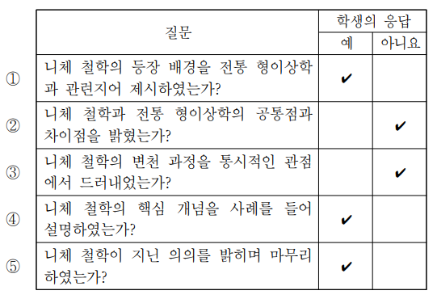

- 배치 / 역할 / 풀이 필수: `PASSAGE` / `ILLUSTRATIVE` / 아니요
- 종류 / MIME: `TABLE` / `image/png`
- 크기: 541 × 370
- 원본 URL: [열기](https://d1c00yjit06b00.cloudfront.net/dev/exams/69bbe321a9ac92778edc4fea/1774339496185-lvpt76-img0.png)
- 콘텐츠 해시: `sha256:1e78e9f3367fdfcd394591ca5ec450bceabe2e9726c2802e2512f44860060879`

### 문제

- 문항 제목: 핵심 개념의 의미 파악
- 배점: 2점
- 태그: `핵심 개념 이해`

**발문**: 니체의 입장을 고려하여 ㉠의 의미를 파악한 내용으로 가장 적절한 것은?

#### 선지

1. 개별적 삶을 바탕으로 절대적 가치가 지닌 유용성을 판단하였다.

2. 개별적 삶에 절대적 가치를 실현하여 삶이 무의미하다는 점을 밝혀내었다.

3. 절대적 가치에 부합하는 현실적 욕구들을 바탕으로 개별적 삶을 규정하였다.

4. 절대적 가치를 추구하는 것만으로는 삶을 더욱 완전하게 만들 수 없다고 보았다.

5. 가치 평가의 기준이어야 할 삶을 삶 외부의 절대적 가치를 기준으로 평가하였다.

**공식 정답: 5번 (`C5`) — 가치 평가의 기준이어야 할 삶을 삶 외부의 절대적 가치를 기준으로 평가하였다.**

### 골드 후보 전체

- 스키마: `problem-solving-gold-v2`
- 골드 상태: `candidate`
- 골드 원천: `69c08e2efa5063deffe1be35` / 고2 2023년 6월 - 교육청 모의평가 / 23번
- question / passage ID: `69c08e2efa5063deffe1be35-q23` / `69c08e2efa5063deffe1be35-passage`
- 골드 발문: 니체의 입장을 고려하여 ㉠의 의미를 파악한 내용으로 가장 적절한 것은?
- 발문 극성: `SELECT_CORRECT`
- 정답 choice ID: `C5`

#### 시나리오와 사실

없음

- 없음

#### 원문 근거 명제

- passage detail ID: `69c08e2efa5063deffe1be35-passage`

##### MP1 · P1

소크라테스 이후 전통 형이상학은 현실 세계를 불완전하고 거짓된 것으로, 현실 너머의 보편적 진리의 세계를 참된 것으로 간주했다.

- 원문 증거: “소크라테스 이후의 전통 형이상학에서는 현실 세계를 불완전하고 거짓된 세계로 간주하고, 보편적 진리로 이루어진 현실 너머의 세계를 참된 세계라고 여겼다.”
- 범위: 전통 형이상학
- 극성 / 근거 유형: `positive` / `PASSAGE_EXPLICIT`
- 조건: 없음
- 예외: 없음

##### MP2 · P1

전통 형이상학은 삶의 목적을 현실 너머의 초월적 가치 추구에 두고, 삶 외부의 절대적 가치를 토대로 삶의 의미를 찾으려 했다.

- 원문 증거: “그들은 삶의 목적이 현실 너머에 있는 초월적 가치의 추구에 있다고 보았으며, 이것은 삶의 외부에 있는 절대적 가치를 토대로 삶의 의미를 찾고자 하는 사유 방식이었다.”
- 범위: 전통 형이상학
- 극성 / 근거 유형: `positive` / `PASSAGE_EXPLICIT`
- 조건: 없음
- 예외: 없음

##### MP3 · P1

니체는 삶 외부의 절대적 가치에 근거하여 삶의 의미를 찾으려는 전통 형이상학의 사유 방식에 반기를 들었다.

- 원문 증거: “바로 이 점에 반기를 든 철학자가 니체이다.”
- 범위: 니체와 전통 형이상학의 관계
- 극성 / 근거 유형: `positive` / `PASSAGE_EXPLICIT`
- 조건: 없음
- 예외: 없음

##### MP4 · P2

니체에 따르면 삶은 삶을 둘러싼 가치들의 근원이며 가치 평가의 출발점이다.

- 원문 증거: “니체에 따르면, 삶은 삶을 둘러싼 가치들의 근원이며, 가치 평가의 출발점이다.”
- 범위: 니체의 가치론
- 극성 / 근거 유형: `positive` / `PASSAGE_EXPLICIT`
- 조건: 없음
- 예외: 없음

##### MP5 · P2

니체는 가치가 삶에 유용한지, 곧 삶을 더 강하게 만드는지에 따라 가치를 평가한다고 보았다.

- 원문 증거: “가치는 삶에 유용한가, 즉 그것이 삶을 더 강하게 만들어 주는가에 따라 평가된다.”
- 범위: 니체의 가치 평가 기준
- 극성 / 근거 유형: `positive` / `PASSAGE_EXPLICIT`
- 조건: 없음
- 예외: 없음

##### MP6 · P2

전통 형이상학은 ‘도덕적 선’이라는 절대적 가치를 삶의 궁극적 목적으로 여기고, 그에 따라 개별적 삶을 재단하려 했다.

- 원문 증거: “전통 형이상학은 ‘도덕적 선’이라는 절대적 가치를 삶의 궁극적인 목적으로 여기고, 이에 따라 개별적 삶을 재단하려 하였다.”
- 범위: 전통 형이상학
- 극성 / 근거 유형: `positive` / `PASSAGE_EXPLICIT`
- 조건: 없음
- 예외: 없음

##### MP7 · P2

전통 형이상학의 관점에서는 삶의 본능적 욕망은 억압되어야 하고 현실적 삶은 개선되어야 하는 부정적인 것으로 간주된다.

- 원문 증거: “이에 따르면 삶의 본능적 욕망은 억압되어야 하는 것이며, 현실적인 삶은 개선되어야 하는 부정적인 것이다.”
- 범위: 전통 형이상학의 삶 이해
- 극성 / 근거 유형: `positive` / `PASSAGE_EXPLICIT`
- 조건: 없음
- 예외: 없음

##### MP8 · P2

니체는 그 자체로 목적이어야 할 삶을 초월적 가치 실현의 수단으로 간주하는 사유 방식을 전도된 것으로 보고 전적으로 반대했다.

- 원문 증거: “니체는 그 자체로 목적이어야 할 삶을 초월적 가치 실현의 수단으로 간주하는 전도된 사유 방식에 전적으로 반대하였다.”
- 범위: 니체가 반대한 전도된 사유 방식
- 극성 / 근거 유형: `positive` / `PASSAGE_EXPLICIT`
- 조건: 없음
- 예외: 없음

##### MP9 · P3

니체는 ‘힘에의 의지’를 자연스러운 것으로 수용할 때 현재의 자신을 극복하고 새로운 가치를 창조할 수 있다고 보았다.

- 원문 증거: “니체는 ‘힘에의 의지’를 자연스러운 것으로 수용할 때 현재의 자신을 극복하고 새로운 가치를 창조할 수 있다고 보았다.”
- 범위: 니체의 힘에의 의지
- 극성 / 근거 유형: `positive` / `PASSAGE_EXPLICIT`
- 조건: 없음
- 예외: 없음

##### MP10 · P4

니체의 아곤은 경쟁자의 제압이 아니라 자신의 성장을 궁극적 목적으로 하며, 자신의 성장에 기여하는 타자를 존중하는 태도이다.

- 원문 증거: “아곤의 궁극적 목적은 경쟁자의 제압이 아니라 자신의 성장에 있다. 즉, 니체의 아곤은 자신의 삶을 긍정하고 자신의 성장을 위해 타자를 존중하는 태도라고 할 수 있다.”
- 범위: 니체의 아곤
- 극성 / 근거 유형: `positive` / `PASSAGE_EXPLICIT`
- 조건: 없음
- 예외: 없음

##### MP11 · P5

니체는 삶을 긍정한다는 것을 삶이 마주하는 어려움을 극복하고 성장하고자 하는 태도로 보았다.

- 원문 증거: “니체는 삶을 긍정한다는 것은 삶이 마주하는 어려움을 잘 극복하고 성장하고자 하는 태도를 의미한다고 보았다.”
- 범위: 니체의 삶 긍정
- 극성 / 근거 유형: `positive` / `PASSAGE_EXPLICIT`
- 조건: 없음
- 예외: 없음

#### 시각 자료 주장

없음

#### 문항 추론

##### INF1 · MAP_CONCEPT

㉠은 삶을 초월적 가치 실현의 수단으로 간주하는 사유 방식이므로, 개별적 삶을 바탕으로 절대적 가치의 유용성을 판단한다는 C1의 가치 평가 방향은 ㉠의 방향과 반대이다.

- 결론: ㉠은 삶을 초월적 가치 실현의 수단으로 간주하는 사유 방식이므로, 개별적 삶을 바탕으로 절대적 가치의 유용성을 판단한다는 C1의 가치 평가 방향은 ㉠의 방향과 반대이다.
- 대상 주장 / 효과: `OC1-1` / `CONTRADICTS`
- 직접 전제 refs: `MP8`
- 원문 참조: 문단 `P2` / 명제 `MP8`
- 시나리오 사실: 없음
- 시각 주장: 없음
- grounding / necessity: `SOURCE_EXPLICIT` / `REQUIRED`

##### INF2 · CHECK_JUSTIFICATION

㉠이 삶을 초월적 가치 실현의 수단으로 간주한다는 사실만으로, 개별적 삶에 절대적 가치를 실현하여 삶의 무의미함을 밝혀낸다는 C2의 설명은 도출되지 않는다.

- 결론: ㉠이 삶을 초월적 가치 실현의 수단으로 간주한다는 사실만으로, 개별적 삶에 절대적 가치를 실현하여 삶의 무의미함을 밝혀낸다는 C2의 설명은 도출되지 않는다.
- 대상 주장 / 효과: `OC2-1` / `DOES_NOT_JUSTIFY`
- 직접 전제 refs: `MP8`, `ANSWER_KEY`
- 원문 참조: 문단 `P2` / 명제 `MP8`
- 시나리오 사실: 없음
- 시각 주장: 없음
- grounding / necessity: `ANSWER_KEY_CONSTRAINED` / `REQUIRED`

##### INF3 · MAP_CONCEPT

전통 형이상학은 절대적 가치에 따라 개별적 삶을 재단하고 삶의 본능적 욕망을 억압해야 한다고 보므로, 절대적 가치에 부합하는 현실적 욕구들을 바탕으로 개별적 삶을 규정한다는 C3의 방향은 성립하지 않는다.

- 결론: 전통 형이상학은 절대적 가치에 따라 개별적 삶을 재단하고 삶의 본능적 욕망을 억압해야 한다고 보므로, 절대적 가치에 부합하는 현실적 욕구들을 바탕으로 개별적 삶을 규정한다는 C3의 방향은 성립하지 않는다.
- 대상 주장 / 효과: `OC3-1` / `CONTRADICTS`
- 직접 전제 refs: `MP6`, `MP7`
- 원문 참조: 문단 `P2` / 명제 `MP6`, `MP7`
- 시나리오 사실: 없음
- 시각 주장: 없음
- grounding / necessity: `SOURCE_EXPLICIT` / `REQUIRED`

##### INF4 · CHECK_JUSTIFICATION

㉠이 삶을 초월적 가치 실현의 수단으로 간주하는 사유 방식이라는 사실만으로, 절대적 가치를 추구하는 것만으로는 삶을 더욱 완전하게 만들 수 없다는 C4의 판단은 도출되지 않는다.

- 결론: ㉠이 삶을 초월적 가치 실현의 수단으로 간주하는 사유 방식이라는 사실만으로, 절대적 가치를 추구하는 것만으로는 삶을 더욱 완전하게 만들 수 없다는 C4의 판단은 도출되지 않는다.
- 대상 주장 / 효과: `OC4-1` / `DOES_NOT_JUSTIFY`
- 직접 전제 refs: `MP8`, `ANSWER_KEY`
- 원문 참조: 문단 `P2` / 명제 `MP8`
- 시나리오 사실: 없음
- 시각 주장: 없음
- grounding / necessity: `ANSWER_KEY_CONSTRAINED` / `REQUIRED`

##### INF5 · MAP_CONCEPT

㉠은 그 자체로 목적이어야 할 삶을 삶 외부의 초월적 가치 실현을 위한 수단으로 간주하여, 가치 평가의 기준이어야 할 삶을 외부의 절대적 가치로 평가하는 전도된 사유 방식이다.

- 결론: ㉠은 그 자체로 목적이어야 할 삶을 삶 외부의 초월적 가치 실현을 위한 수단으로 간주하여, 가치 평가의 기준이어야 할 삶을 외부의 절대적 가치로 평가하는 전도된 사유 방식이다.
- 대상 주장 / 효과: `OC5-1` / `SUPPORTS`
- 직접 전제 refs: `MP8`
- 원문 참조: 문단 `P2` / 명제 `MP8`
- 시나리오 사실: 없음
- 시각 주장: 없음
- grounding / necessity: `SOURCE_EXPLICIT` / `REQUIRED`

#### 보충 설명 추론

없음

#### 선지별 골드 판정

##### C1 · 개별적 삶을 바탕으로 절대적 가치가 지닌 유용성을 판단하였다.

- 위치 / 판정: 1 / `FALSE`
- 판정 근거: ㉠은 삶을 외부의 초월적 가치에 종속시키는 방식이지, 삶을 바탕으로 가치를 평가하는 방식이 아니다.
- 주장 IDs: `OC1-1`
- 필수 원문 참조: 문단 `P2` / 명제 `MP8`
- 필수 시나리오 사실: 없음
- 필수 시각 주장: 없음

**주장 OC1-1 (1순위)**

㉠은 개별적 삶을 바탕으로 절대적 가치가 지닌 유용성을 판단한 것이다.

- assessment / support: `CONTRADICTED` / `NONE`
- decision / basis: `REJECTED` / `SOURCE_GROUNDED`
- 결정 핵심: 예
- 의존 주장: 없음
- 문항 추론: `INF1`
- 원문 참조: 문단 `P2` / 명제 `MP8`
- 시나리오 사실: 없음
- 시각 주장: 없음
- 보충 추론: 없음
- 보충 사용 정책: 없음

##### C2 · 개별적 삶에 절대적 가치를 실현하여 삶이 무의미하다는 점을 밝혀내었다.

- 위치 / 판정: 2 / `FALSE`
- 판정 근거: 삶을 초월적 가치 실현의 수단으로 본다는 ㉠의 의미를 이 선택지의 서술 방식으로는 정당화할 수 없다.
- 주장 IDs: `OC2-1`
- 필수 원문 참조: 문단 `P2` / 명제 `MP8`
- 필수 시나리오 사실: 없음
- 필수 시각 주장: 없음

**주장 OC2-1 (1순위)**

㉠은 개별적 삶에 절대적 가치를 실현하여 삶이 무의미하다는 점을 밝혀낸 것이다.

- assessment / support: `NOT_JUSTIFIED` / `NONE`
- decision / basis: `REJECTED` / `ANSWER_KEY_CONSTRAINED`
- 결정 핵심: 예
- 의존 주장: 없음
- 문항 추론: `INF2`
- 원문 참조: 문단 `P2` / 명제 `MP8`
- 시나리오 사실: 없음
- 시각 주장: 없음
- 보충 추론: 없음
- 보충 사용 정책: 없음

##### C3 · 절대적 가치에 부합하는 현실적 욕구들을 바탕으로 개별적 삶을 규정하였다.

- 위치 / 판정: 3 / `FALSE`
- 판정 근거: 전통 형이상학은 절대적 가치로 삶을 재단하고 본능적 욕망을 억압해야 한다고 본다.
- 주장 IDs: `OC3-1`
- 필수 원문 참조: 문단 `P2` / 명제 `MP6`, `MP7`
- 필수 시나리오 사실: 없음
- 필수 시각 주장: 없음

**주장 OC3-1 (1순위)**

㉠은 절대적 가치에 부합하는 현실적 욕구들을 바탕으로 개별적 삶을 규정한 것이다.

- assessment / support: `CONTRADICTED` / `NONE`
- decision / basis: `REJECTED` / `SOURCE_GROUNDED`
- 결정 핵심: 예
- 의존 주장: 없음
- 문항 추론: `INF3`
- 원문 참조: 문단 `P2` / 명제 `MP6`, `MP7`
- 시나리오 사실: 없음
- 시각 주장: 없음
- 보충 추론: 없음
- 보충 사용 정책: 없음

##### C4 · 절대적 가치를 추구하는 것만으로는 삶을 더욱 완전하게 만들 수 없다고 보았다.

- 위치 / 판정: 4 / `FALSE`
- 판정 근거: 지문은 ㉠을 삶을 초월적 가치 실현의 수단으로 보는 방식으로 규정할 뿐, ‘삶을 더욱 완전하게’ 한다는 판단을 제시하지 않는다.
- 주장 IDs: `OC4-1`
- 필수 원문 참조: 문단 `P2` / 명제 `MP8`
- 필수 시나리오 사실: 없음
- 필수 시각 주장: 없음

**주장 OC4-1 (1순위)**

㉠은 절대적 가치를 추구하는 것만으로는 삶을 더욱 완전하게 만들 수 없다고 보는 입장이다.

- assessment / support: `NOT_JUSTIFIED` / `NONE`
- decision / basis: `REJECTED` / `ANSWER_KEY_CONSTRAINED`
- 결정 핵심: 예
- 의존 주장: 없음
- 문항 추론: `INF4`
- 원문 참조: 문단 `P2` / 명제 `MP8`
- 시나리오 사실: 없음
- 시각 주장: 없음
- 보충 추론: 없음
- 보충 사용 정책: 없음

##### C5 · 가치 평가의 기준이어야 할 삶을 삶 외부의 절대적 가치를 기준으로 평가하였다.

- 위치 / 판정: 5 / `TRUE`
- 판정 근거: ㉠은 본래 목적이어야 하는 삶을 초월적 가치 실현의 수단으로 보는 전도된 사유 방식이다.
- 주장 IDs: `OC5-1`
- 필수 원문 참조: 문단 `P2` / 명제 `MP8`
- 필수 시나리오 사실: 없음
- 필수 시각 주장: 없음

**주장 OC5-1 (1순위)**

㉠은 가치 평가의 기준이어야 할 삶을 삶 외부의 절대적 가치를 기준으로 평가한 사유 방식이다.

- assessment / support: `SUPPORTED` / `DIRECT`
- decision / basis: `ACCEPTED` / `SOURCE_GROUNDED`
- 결정 핵심: 예
- 의존 주장: 없음
- 문항 추론: `INF5`
- 원문 참조: 문단 `P2` / 명제 `MP8`
- 시나리오 사실: 없음
- 시각 주장: 없음
- 보충 추론: 없음
- 보충 사용 정책: 없음

#### 정답 도출 경로

##### STEP1

니체는 삶 자체가 목적이어야 한다고 전제한다.

- 원문 참조: 문단 `P2` / 명제 `MP8`
- 시나리오 사실: 없음
- 시각 주장: 없음
- 문항 추론: 없음
- 선지 주장: 없음

##### STEP2

㉠은 그러한 삶을 초월적 가치 실현의 수단으로 간주하는 전도된 사유 방식이다.

- 원문 참조: 문단 `P2` / 명제 `MP8`
- 시나리오 사실: 없음
- 시각 주장: 없음
- 문항 추론: `INF5`
- 선지 주장: `OC5-1`

##### STEP3

따라서 ㉠은 삶을 기준으로 가치를 평가해야 할 관계를 뒤집어, 삶 외부의 절대적 가치로 삶을 평가하는 방식이라는 C5의 설명과 일치한다.

- 원문 참조: 문단 `P2` / 명제 `MP8`
- 시나리오 사실: 없음
- 시각 주장: 없음
- 문항 추론: `INF5`
- 선지 주장: `OC5-1`

- 필수 단계: `STEP1`, `STEP2`, `STEP3`
- 결정 단계: `STEP2`
- 결론 단계: `STEP3`
- 최종 답: `C5`
- 최종 설명: ㉠은 삶 자체를 목적이 아니라 초월적·절대적 가치 실현의 수단으로 보는 전도된 사유 방식이다. 즉 삶이 가치 평가의 출발점이어야 하는 관계를 뒤집어 외부의 절대적 가치로 삶을 재단하는 것이므로 C5가 가장 적절하다.
- 최종 설명 참조 단계: `STEP2`, `STEP3`

#### 대표 오답 경로

- `WP1` 니체가 삶을 가치 평가의 출발점으로 본다는 설명과, ㉠인 전도된 사유 방식의 방향을 구별하지 못하고 두 방향을 혼동한 경우이다.
  - scope: `SELECTED_WRONG_CHOICE`
  - 선택 선지: `C1`
  - 놓친 정답: `없음`
  - 분기 층위 후보: `CONCEPT_BOUNDARY`, `CHOICE_INTERPRETATION`
- `WP2` 니체의 절대적 가치 비판이라는 일반적 태도를 ㉠의 구체적 의미와 동일시하고, 삶과 절대적 가치 사이의 평가 방향이 뒤집힌다는 핵심을 놓친 경우이다.
  - scope: `SELECTED_WRONG_CHOICE`
  - 선택 선지: `C4`
  - 놓친 정답: `없음`
  - 분기 층위 후보: `CONCEPT_BOUNDARY`, `CHOICE_INTERPRETATION`

#### 골드 자체 검수 메모

없음

### 충분 근거 조합 후보

#### 69c08e2efa5063deffe1be35-q23-C1-SGC1

- 선지 / 대상 주장: `C1` / `OC1-1`
- 제안 경로 / 연산자: `APPROVED_SUFFICIENT_GROUND_SET` / `ALL_OF`
- 필수 근거: `MP8`
- 생략 허용 근거: 없음
- 결론: ㉠은 삶을 초월적 가치 실현의 수단으로 간주하는 사유 방식이므로, 개별적 삶을 바탕으로 절대적 가치의 유용성을 판단한다는 C1의 가치 평가 방향은 ㉠의 방향과 반대이다.
- 원천 추론: `INF1`
- 생성 방식 / 상태: `AI_INFERENCE_GRAPH_DERIVED` / `candidate`
- 위험 표지: 없음

#### 69c08e2efa5063deffe1be35-q23-C2-SGC1

- 선지 / 대상 주장: `C2` / `OC2-1`
- 제안 경로 / 연산자: `APPROVED_SUFFICIENT_GROUND_SET` / `ALL_OF`
- 필수 근거: `MP8`, `ANSWER_KEY`
- 생략 허용 근거: 없음
- 결론: ㉠이 삶을 초월적 가치 실현의 수단으로 간주한다는 사실만으로, 개별적 삶에 절대적 가치를 실현하여 삶의 무의미함을 밝혀낸다는 C2의 설명은 도출되지 않는다.
- 원천 추론: `INF2`
- 생성 방식 / 상태: `AI_INFERENCE_GRAPH_DERIVED` / `candidate`
- 위험 표지: `ANSWER_KEY_CONSTRAINED`, `DOES_NOT_JUSTIFY`

#### 69c08e2efa5063deffe1be35-q23-C3-SGC1

- 선지 / 대상 주장: `C3` / `OC3-1`
- 제안 경로 / 연산자: `APPROVED_SUFFICIENT_GROUND_SET` / `ALL_OF`
- 필수 근거: `MP6`, `MP7`
- 생략 허용 근거: 없음
- 결론: 전통 형이상학은 절대적 가치에 따라 개별적 삶을 재단하고 삶의 본능적 욕망을 억압해야 한다고 보므로, 절대적 가치에 부합하는 현실적 욕구들을 바탕으로 개별적 삶을 규정한다는 C3의 방향은 성립하지 않는다.
- 원천 추론: `INF3`
- 생성 방식 / 상태: `AI_INFERENCE_GRAPH_DERIVED` / `candidate`
- 위험 표지: 없음

#### 69c08e2efa5063deffe1be35-q23-C4-SGC1

- 선지 / 대상 주장: `C4` / `OC4-1`
- 제안 경로 / 연산자: `APPROVED_SUFFICIENT_GROUND_SET` / `ALL_OF`
- 필수 근거: `MP8`, `ANSWER_KEY`
- 생략 허용 근거: 없음
- 결론: ㉠이 삶을 초월적 가치 실현의 수단으로 간주하는 사유 방식이라는 사실만으로, 절대적 가치를 추구하는 것만으로는 삶을 더욱 완전하게 만들 수 없다는 C4의 판단은 도출되지 않는다.
- 원천 추론: `INF4`
- 생성 방식 / 상태: `AI_INFERENCE_GRAPH_DERIVED` / `candidate`
- 위험 표지: `ANSWER_KEY_CONSTRAINED`, `DOES_NOT_JUSTIFY`

#### 69c08e2efa5063deffe1be35-q23-C5-SGC1

- 선지 / 대상 주장: `C5` / `OC5-1`
- 제안 경로 / 연산자: `APPROVED_SUFFICIENT_GROUND_SET` / `ALL_OF`
- 필수 근거: `MP8`
- 생략 허용 근거: 없음
- 결론: ㉠은 그 자체로 목적이어야 할 삶을 삶 외부의 초월적 가치 실현을 위한 수단으로 간주하여, 가치 평가의 기준이어야 할 삶을 외부의 절대적 가치로 평가하는 전도된 사유 방식이다.
- 원천 추론: `INF5`
- 생성 방식 / 상태: `AI_INFERENCE_GRAPH_DERIVED` / `candidate`
- 위험 표지: 없음

### 생성·검증 기록

- 원시 스키마 통과: 아니요
- 원시 오류: decisivePathStepIds: 결정적 분기와 결론 단계는 분리해야 한다.; representativeWrongPaths.0.missedAnswerChoiceId: 선택 선지 경로에는 놓친 정답을 지정하지 않는다.; representativeWrongPaths.1.missedAnswerChoiceId: 선택 선지 경로에는 놓친 정답을 지정하지 않는다.
- 자동 정규화: `SEPARATE_DECISIVE_AND_CONCLUSION_STEPS`, `REBUILD_INFERENCE_PREMISE_REFS`, `REBUILD_INFERENCE_PREMISE_REFS`, `ALIGN_WRONG_PATH_MISSED_ANSWER`, `ALIGN_WRONG_PATH_MISSED_ANSWER`
- 최종 스키마 통과: 예
- 최종 오류: 없음
- 생성 모델 / effort: `gpt-5.6-terra` / `medium`
- 프롬프트 버전: `problem-gold-generation-prompt-v2`
- 생성 시간: 65944ms

- 검수 파일 상태: `PENDING`
- 검수자 / 시각: 없음 / 없음
- 승인된 충분 근거 후보: 없음
- 검수 메모: 없음

**사람 검수 메모:**

- 판정:
- 수정 필요 사항:
- 승인할 충분 근거 후보:

[목차로 돌아가기](#빠른-목차)

---

## 22. 고2 2023년 9월 - 교육청 모의평가 · 정약용의 윤리학과 신독 36번

### 검수 상태

- case ID: `prospective-69c08dfd78128b2a9bedf040-q36`
- 분야: `HUMANITIES`
- 표본 범위: `POSITIVE_STEM`, `HUMANITIES`, `MULTI_CONDITION`
- 생산 상태: `PENDING_HUMAN_REVIEW`
- 후보 종류: 정적 검증을 통과한 후보
- 사람 검수 상태: `PENDING`
- 검수 위험도: `HIGH`
- 위험 사유: ANSWER_KEY_CONSTRAINED; DOES_NOT_JUSTIFY
- 원천 해시: `sha256:4333bb22b2a840e2ca2c94752120ec46697b0b00988e72b422f853e610578fc5`

검수 체크: [ ] 공식 정답과 선지 판정 일치 · [ ] 원문 근거 정확 · [ ] 추론 비약 없음 · [ ] 충분 근거가 최소 조합 · [ ] 시각 자료 해석 정확

### 원문

다산 정약용이 생각하기에 당대 사람들이 인정했던 최고의 진리는 유가의 경전이다. 다산은 유가의 경전을 철저하게 연구하고 재해석함으로써 시대가 당면한 어려움을 돌파하고 세상을 바꾸려고 하였다. 새로운 시대를 열기 위해 과거로 달려갔다는 점에서 다산은 전통의 충실한 계승자이지만 단순한 계승에 그치지 않고 유가 경전을 재해석하면서 새로운 사유를 전개하였다. 경전에 대한 새로운 해석을 통해 이루어진 다산 윤리학의 특징을 살펴보자.

정약용에 따르면 인간은 선천적으로 선을 좋아하고 악을 부끄러워하는 마음이 있다. 하지만 실제 행동에 있어서는 악은 행하기가 쉽고 선은 행하기가 어렵다고 보았다. 이러한 인간에게 자유의지가 선천적으로 주어져 선과 악을 자율적으로 선택할 수 있는데 자유의지에 의한 선한 행위가 공적이 될 수 있고 악한 행동이 죄가 될 수 있다고 하였다. 즉 인간은 자유의지에 의해서 선을 선택할 수도 악을 선택할 수도 있으며 그에 따른 책임을 갖는다고 본 것이다. 다산은 사회를 선하고 정의롭게 하기 위해서 선한 의지와 지혜로운 선택이 필요하며 이러한 의지와 선택을 생활 속에서 실천해야 한다고 했다.

정약용은 인간은 자유의지로써 행동하여 인(仁)을 성취할 수 있다고 보았다. 그는 인을 사람과 사람 사이에서 각자가 상대에게 마땅한 도리를 다하는 실천을 통해서 얻어지는 덕목이라고 해석하였다. 따라서 인은 다른 사람과 함께하지 않으면 성립하지 않는다. 특히 위정자로서 정약용은 백성들의 삶을 윤택하게 하여 인을 성취하고자 하였다. 다산이 유배지에서 세상에 나갈 수 없게 된 상황을 절망으로 받아들일 수밖에 없었던 이유가 바로 여기에 있다.

그렇다면 정약용이 인을 완성할 수 있는 실천 원리로 제시한 것이 무엇일까? 서(恕)이다. 정약용이 말하는 서란 사람들 간의 관계에서 자신이 원하지 않는 것을 상대에게 하지 않는 것이다. 나아가 자신이 상대에게 바라는 것을 먼저 상대에게 해 주는 것이다. 이러한 서로써 다른 사람을 대하는 것이 도리를 다하는 것이다. 다산은 『맹자』에 나오는 만물의 이치가 모두 자신에게 있다는 뜻의 ‘만물개비어아(萬物皆備於我)’에 대한 해석을 다음과 같이 한다. “내가 재물을 좋아하니 백성도 재물을 좋아함을 알 수 있다. 내가 편안함을 좋아하니 백성도 편안함을 좋아함을 안다. 내가 천대하고 업신여김을 당하기 싫어하니 백성도 그러함을 안다. 다른 사람의 감정을 묻고 안색을 살핀 다음에야 그들이 나와 같다는 것을 알 수 있는 것은 아니다.” 이러한 해석에서 보듯이 다산은 인간의 감정과 생각에 보편성이 있으므로 자기의 감정과 생각을 미루어서 다른 사람의 마음을 이해할 수 있다고 인식한다. 서는 타자에 대한 상호 평등성의 인정과 인격 존중에 기초하고 있으며 누구나 노력하면 실천할 수 있는 행위 원리이다.

다산은 서를 행할 수 있는 기본이 되는 자세를 신독(愼獨)이라고 보고 신독은 ‘두려워하고 공경하는 자세’라고 하였다. 두려움과 공경의 대상은 바로 하늘이다. 정약용은 인간에게 선과 악을 선택할 수 있는 선천성을 부여한 존재인 하늘을 두려워하고 공경해야 선을 실천하는 마음을 유지할 수 있다고 보았다. 정약용은 당시 사대부들에게 군주와 백성의 눈은 피할 수 있어도 하늘의 눈은 피할 수 없다는 점을 강조한 것이다. 정약용은 신독 공부를 남들이 모르는 일에도 생각과 행동을 조심하는 것이며, 자신이 했던 행동을 되돌아보고 성찰하면서 허물과 과오를 꾸짖는 내면의 목소리에 귀를 기울이는 것이라고 하였다. 또한 신독 공부를 평상시에도 할 것을 강조하며 이를 통해 경건한 태도를 몸에 익혀야 한다고 역설하였다. 신독 공부를 통해서 내면의 진실성을 유지하고 선과 악을 선택할 수 있는 상황에서 자기를 통제하는 내면의 공정성을 유지할 수 있다고 하였다. 다산 윤리학에서 신독은 인간관계에서 적극적인 윤리적 실천을 통해 선의 가치를 실현하도록 하는 힘이며 정신적 구심점이다.

다산 윤리학은 생활 속에서 선의 실천을 지향하는 생활 현장의 윤리이다. 실천하는 것과 평상시에 마음을 수양하는 것을 통해 타인에 대한 지극한 사랑이라는 최종 목적을 이루고자 한 것이다. 다산에게 중요한 것은 결국 상호 주관적 공동 세계인 것이다.

### 문제

- 문항 제목: '상호 주관적 공동 세계'의 의미 추론
- 배점: 2점
- 태그: `추론적-사고`

**발문**: 윗글을 통해 알 수 있는 ㉠의 의미로 가장 적절한 것은?

#### 선지

1. 선천적인 품성을 올바르게 바꿔가며 살아가는 사회를 말하는 것이겠군.

2. 자유의지로 사람들 사이에서 선을 실천하며 사는 사회를 말하는 것이겠군.

3. 생활 속에서 누구나 노력 없이 선의 가치를 실현하며 살 수 있는 정의로운 사회를 말하는 것이겠군.

4. 인간이 타자와의 관계를 의식하지 않고 자유의지를 통해 가치를 실현하는 사회를 말하는 것이겠군.

5. 실천을 하지 않아도 서로의 인격을 존중하고 타인의 마음을 이해하며 사는 사회를 말하는 것이겠군.

**공식 정답: 2번 (`C2`) — 자유의지로 사람들 사이에서 선을 실천하며 사는 사회를 말하는 것이겠군.**

### 골드 후보 전체

- 스키마: `problem-solving-gold-v2`
- 골드 상태: `candidate`
- 골드 원천: `69c08dfd78128b2a9bedf040` / 고2 2023년 9월 - 교육청 모의평가 / 36번
- question / passage ID: `69c08dfd78128b2a9bedf040-q36` / `69c08dfd78128b2a9bedf040-passage`
- 골드 발문: 윗글을 통해 알 수 있는 ㉠의 의미로 가장 적절한 것은?
- 발문 극성: `SELECT_CORRECT`
- 정답 choice ID: `C2`

#### 시나리오와 사실

없음

- 없음

#### 원문 근거 명제

- passage detail ID: `69c08dfd78128b2a9bedf040-passage`

##### MP1 · P1

정약용은 유가 경전을 재해석하여 새로운 사유를 전개하고 시대의 어려움을 돌파하며 세상을 바꾸고자 하였다.

- 원문 증거: “다산은 유가의 경전을 철저하게 연구하고 재해석함으로써 시대가 당면한 어려움을 돌파하고 세상을 바꾸려고 하였다. ... 유가 경전을 재해석하면서 새로운 사유를 전개하였다.”
- 범위: 정약용의 경전 해석과 지향
- 극성 / 근거 유형: `positive` / `PASSAGE_EXPLICIT`
- 조건: 없음
- 예외: 없음

##### MP2 · P2

인간은 선천적으로 선을 좋아하고 악을 부끄러워하는 마음을 지닌다.

- 원문 증거: “정약용에 따르면 인간은 선천적으로 선을 좋아하고 악을 부끄러워하는 마음이 있다.”
- 범위: 인간의 선천적 마음
- 극성 / 근거 유형: `positive` / `PASSAGE_EXPLICIT`
- 조건: 없음
- 예외: 없음

##### MP3 · P2

인간은 선천적으로 주어진 자유의지로 선과 악을 자율적으로 선택하며, 그 선택에 따른 책임을 진다.

- 원문 증거: “인간에게 자유의지가 선천적으로 주어져 선과 악을 자율적으로 선택할 수 있는데 ... 인간은 자유의지에 의해서 선을 선택할 수도 악을 선택할 수도 있으며 그에 따른 책임을 갖는다.”
- 범위: 인간의 자유의지와 책임
- 극성 / 근거 유형: `positive` / `PASSAGE_EXPLICIT`
- 조건: 없음
- 예외: 없음

##### MP4 · P2

사회를 선하고 정의롭게 하려면 선한 의지와 지혜로운 선택을 생활 속에서 실천해야 한다.

- 원문 증거: “다산은 사회를 선하고 정의롭게 하기 위해서 선한 의지와 지혜로운 선택이 필요하며 이러한 의지와 선택을 생활 속에서 실천해야 한다고 했다.”
- 범위: 사회적 선·정의의 실현 조건
- 극성 / 근거 유형: `positive` / `PASSAGE_EXPLICIT`
- 조건: 없음
- 예외: 없음

##### MP5 · P3

인은 사람과 사람 사이에서 각자가 상대에게 마땅한 도리를 다하는 실천을 통해 얻어지는 덕목이다.

- 원문 증거: “그는 인을 사람과 사람 사이에서 각자가 상대에게 마땅한 도리를 다하는 실천을 통해서 얻어지는 덕목이라고 해석하였다.”
- 범위: 인의 성립
- 극성 / 근거 유형: `positive` / `PASSAGE_EXPLICIT`
- 조건: 없음
- 예외: 없음

##### MP6 · P3

인은 다른 사람과 함께하지 않으면 성립하지 않는다.

- 원문 증거: “따라서 인은 다른 사람과 함께하지 않으면 성립하지 않는다.”
- 범위: 인의 관계적 조건
- 극성 / 근거 유형: `negative` / `PASSAGE_EXPLICIT`
- 조건: 다른 사람과 함께하지 않는 경우
- 예외: 없음

##### MP7 · P4

서란 사람들 간의 관계에서 자신이 원하지 않는 것을 상대에게 하지 않고, 자신이 바라는 것을 먼저 상대에게 해 주는 것이다.

- 원문 증거: “정약용이 말하는 서란 사람들 간의 관계에서 자신이 원하지 않는 것을 상대에게 하지 않는 것이다. 나아가 자신이 상대에게 바라는 것을 먼저 상대에게 해 주는 것이다.”
- 범위: 서의 실천 내용
- 극성 / 근거 유형: `positive` / `PASSAGE_EXPLICIT`
- 조건: 없음
- 예외: 없음

##### MP8 · P4

인간의 감정과 생각에는 보편성이 있으므로, 자신의 감정과 생각을 미루어 다른 사람의 마음을 이해할 수 있다.

- 원문 증거: “다산은 인간의 감정과 생각에 보편성이 있으므로 자기의 감정과 생각을 미루어서 다른 사람의 마음을 이해할 수 있다고 인식한다.”
- 범위: 타인 이해의 근거
- 극성 / 근거 유형: `positive` / `PASSAGE_EXPLICIT`
- 조건: 없음
- 예외: 없음

##### MP9 · P4

서는 타자에 대한 상호 평등성의 인정과 인격 존중에 기초하며, 누구나 노력하면 실천할 수 있는 행위 원리이다.

- 원문 증거: “서는 타자에 대한 상호 평등성의 인정과 인격 존중에 기초하고 있으며 누구나 노력하면 실천할 수 있는 행위 원리이다.”
- 범위: 서의 기초와 실천 조건
- 극성 / 근거 유형: `positive` / `PASSAGE_EXPLICIT`
- 조건: 실천을 위해 노력하는 경우
- 예외: 없음

##### MP10 · P5

신독 공부를 통해 내면의 진실성과 선악 선택 상황에서 자기를 통제하는 내면의 공정성을 유지할 수 있다.

- 원문 증거: “신독 공부를 통해서 내면의 진실성을 유지하고 선과 악을 선택할 수 있는 상황에서 자기를 통제하는 내면의 공정성을 유지할 수 있다고 하였다.”
- 범위: 신독 공부의 효과
- 극성 / 근거 유형: `positive` / `PASSAGE_EXPLICIT`
- 조건: 신독 공부를 하는 경우
- 예외: 없음

##### MP11 · P5

다산 윤리학에서 신독은 인간관계에서 적극적인 윤리적 실천을 통해 선의 가치를 실현하도록 하는 힘이자 정신적 구심점이다.

- 원문 증거: “다산 윤리학에서 신독은 인간관계에서 적극적인 윤리적 실천을 통해 선의 가치를 실현하도록 하는 힘이며 정신적 구심점이다.”
- 범위: 신독의 윤리적 역할
- 극성 / 근거 유형: `positive` / `PASSAGE_EXPLICIT`
- 조건: 없음
- 예외: 없음

##### MP12 · P6

다산 윤리학은 생활 속에서 선의 실천을 지향하며, 실천과 평상시 마음 수양을 통해 타인에 대한 지극한 사랑이라는 최종 목적을 이루고자 한다.

- 원문 증거: “다산 윤리학은 생활 속에서 선의 실천을 지향하는 생활 현장의 윤리이다. 실천하는 것과 평상시에 마음을 수양하는 것을 통해 타인에 대한 지극한 사랑이라는 최종 목적을 이루고자 한 것이다.”
- 범위: 다산 윤리학의 지향과 방법
- 극성 / 근거 유형: `positive` / `PASSAGE_EXPLICIT`
- 조건: 없음
- 예외: 없음

##### MP13 · P6

다산에게 중요한 것은 상호 주관적 공동 세계이다.

- 원문 증거: “다산에게 중요한 것은 결국 상호 주관적 공동 세계인 것이다.”
- 범위: 다산 윤리학의 궁극적 중요 대상
- 극성 / 근거 유형: `positive` / `PASSAGE_EXPLICIT`
- 조건: 없음
- 예외: 없음

#### 시각 자료 주장

없음

#### 문항 추론

##### I1 · MAP_CONCEPT

상호 주관적 공동 세계는 인간이 자유의지로 선을 선택하고, 사람들 사이에서 마땅한 도리를 실천하여 선하고 정의로운 사회를 이루는 세계를 뜻한다.

- 결론: 상호 주관적 공동 세계는 인간이 자유의지로 선을 선택하고, 사람들 사이에서 마땅한 도리를 실천하여 선하고 정의로운 사회를 이루는 세계를 뜻한다.
- 대상 주장 / 효과: `OC2-1` / `SUPPORTS`
- 직접 전제 refs: `MP3`, `MP4`, `MP5`, `MP13`
- 원문 참조: 문단 `P2` / 명제 `MP3`, `MP4`; 문단 `P3` / 명제 `MP5`; 문단 `P6` / 명제 `MP13`
- 시나리오 사실: 없음
- 시각 주장: 없음
- grounding / necessity: `SOURCE_ENTAILED` / `REQUIRED`

##### I2 · CHECK_JUSTIFICATION

인간의 선천적 품성은 선을 좋아하고 악을 부끄러워하는 마음 및 선악을 선택할 자유의지로 제시될 뿐, 상호 주관적 공동 세계가 선천적 품성을 올바르게 바꾸는 사회라는 결론은 도출되지 않는다.

- 결론: 인간의 선천적 품성은 선을 좋아하고 악을 부끄러워하는 마음 및 선악을 선택할 자유의지로 제시될 뿐, 상호 주관적 공동 세계가 선천적 품성을 올바르게 바꾸는 사회라는 결론은 도출되지 않는다.
- 대상 주장 / 효과: `OC1-1` / `DOES_NOT_JUSTIFY`
- 직접 전제 refs: `MP2`, `MP3`, `ANSWER_KEY`
- 원문 참조: 문단 `P2` / 명제 `MP2`, `MP3`
- 시나리오 사실: 없음
- 시각 주장: 없음
- grounding / necessity: `ANSWER_KEY_CONSTRAINED` / `SUPPORTING`

##### I3 · CHECK_CONDITION

서의 실천은 누구나 노력하면 가능하므로, 누구나 노력 없이 선의 가치를 실현하며 산다는 결론은 성립하지 않는다.

- 결론: 서의 실천은 누구나 노력하면 가능하므로, 누구나 노력 없이 선의 가치를 실현하며 산다는 결론은 성립하지 않는다.
- 대상 주장 / 효과: `OC3-1` / `CONTRADICTS`
- 직접 전제 refs: `MP9`
- 원문 참조: 문단 `P4` / 명제 `MP9`
- 시나리오 사실: 없음
- 시각 주장: 없음
- grounding / necessity: `SOURCE_EXPLICIT` / `SUPPORTING`

##### I4 · CHECK_CONDITION

인은 다른 사람과 함께하지 않으면 성립하지 않으므로, 타자와의 관계를 의식하지 않고 가치를 실현하는 사회라는 결론은 성립하지 않는다.

- 결론: 인은 다른 사람과 함께하지 않으면 성립하지 않으므로, 타자와의 관계를 의식하지 않고 가치를 실현하는 사회라는 결론은 성립하지 않는다.
- 대상 주장 / 효과: `OC4-1` / `CONTRADICTS`
- 직접 전제 refs: `MP6`
- 원문 참조: 문단 `P3` / 명제 `MP6`
- 시나리오 사실: 없음
- 시각 주장: 없음
- grounding / necessity: `SOURCE_EXPLICIT` / `SUPPORTING`

##### I5 · CHECK_CONDITION

다산 윤리학은 실천과 평상시 마음 수양을 통해 타인 사랑의 목적을 이루고자 하므로, 실천하지 않아도 그와 같은 공동 세계를 이룰 수 있다는 결론은 성립하지 않는다.

- 결론: 다산 윤리학은 실천과 평상시 마음 수양을 통해 타인 사랑의 목적을 이루고자 하므로, 실천하지 않아도 그와 같은 공동 세계를 이룰 수 있다는 결론은 성립하지 않는다.
- 대상 주장 / 효과: `OC5-1` / `CONTRADICTS`
- 직접 전제 refs: `MP12`
- 원문 참조: 문단 `P6` / 명제 `MP12`
- 시나리오 사실: 없음
- 시각 주장: 없음
- grounding / necessity: `SOURCE_EXPLICIT` / `SUPPORTING`

#### 보충 설명 추론

없음

#### 선지별 골드 판정

##### C1 · 선천적인 품성을 올바르게 바꿔가며 살아가는 사회를 말하는 것이겠군.

- 위치 / 판정: 1 / `FALSE`
- 판정 근거: 선천적 품성을 바꾸는 사회라는 의미는 지문에서 도출되지 않는다.
- 주장 IDs: `OC1-1`
- 필수 원문 참조: 문단 `P2` / 명제 `MP2`, `MP3`
- 필수 시나리오 사실: 없음
- 필수 시각 주장: 없음

**주장 OC1-1 (1순위)**

상호 주관적 공동 세계는 선천적인 품성을 올바르게 바꿔가며 살아가는 사회이다.

- assessment / support: `NOT_JUSTIFIED` / `NONE`
- decision / basis: `REJECTED` / `ANSWER_KEY_CONSTRAINED`
- 결정 핵심: 예
- 의존 주장: 없음
- 문항 추론: `I2`
- 원문 참조: 문단 `P2` / 명제 `MP2`, `MP3`
- 시나리오 사실: 없음
- 시각 주장: 없음
- 보충 추론: 없음
- 보충 사용 정책: 없음

##### C2 · 자유의지로 사람들 사이에서 선을 실천하며 사는 사회를 말하는 것이겠군.

- 위치 / 판정: 2 / `TRUE`
- 판정 근거: 자유의지에 따른 선의 선택과 사람들 사이에서의 도리 실천이 다산 윤리학의 공동 세계 지향을 구체화한다.
- 주장 IDs: `OC2-1`
- 필수 원문 참조: 문단 `P2` / 명제 `MP3`, `MP4`; 문단 `P3` / 명제 `MP5`; 문단 `P6` / 명제 `MP13`
- 필수 시나리오 사실: 없음
- 필수 시각 주장: 없음

**주장 OC2-1 (1순위)**

상호 주관적 공동 세계는 자유의지로 사람들 사이에서 선을 실천하며 사는 사회이다.

- assessment / support: `SUPPORTED` / `ENTAILED`
- decision / basis: `ACCEPTED` / `SOURCE_GROUNDED`
- 결정 핵심: 예
- 의존 주장: 없음
- 문항 추론: `I1`
- 원문 참조: 문단 `P2` / 명제 `MP3`, `MP4`; 문단 `P3` / 명제 `MP5`; 문단 `P6` / 명제 `MP13`
- 시나리오 사실: 없음
- 시각 주장: 없음
- 보충 추론: 없음
- 보충 사용 정책: 없음

##### C3 · 생활 속에서 누구나 노력 없이 선의 가치를 실현하며 살 수 있는 정의로운 사회를 말하는 것이겠군.

- 위치 / 판정: 3 / `FALSE`
- 판정 근거: 서는 누구나 노력하면 실천할 수 있는 원리이므로 노력 없이 실현한다는 부분이 틀리다.
- 주장 IDs: `OC3-1`
- 필수 원문 참조: 문단 `P4` / 명제 `MP9`
- 필수 시나리오 사실: 없음
- 필수 시각 주장: 없음

**주장 OC3-1 (1순위)**

상호 주관적 공동 세계에서는 누구나 노력 없이 선의 가치를 실현하며 산다.

- assessment / support: `CONTRADICTED` / `DIRECT`
- decision / basis: `REJECTED` / `SOURCE_GROUNDED`
- 결정 핵심: 예
- 의존 주장: 없음
- 문항 추론: `I3`
- 원문 참조: 문단 `P4` / 명제 `MP9`
- 시나리오 사실: 없음
- 시각 주장: 없음
- 보충 추론: 없음
- 보충 사용 정책: 없음

##### C4 · 인간이 타자와의 관계를 의식하지 않고 자유의지를 통해 가치를 실현하는 사회를 말하는 것이겠군.

- 위치 / 판정: 4 / `FALSE`
- 판정 근거: 인은 다른 사람과의 관계 속에서만 성립하므로 타자와의 관계를 의식하지 않는다는 부분이 틀리다.
- 주장 IDs: `OC4-1`
- 필수 원문 참조: 문단 `P3` / 명제 `MP6`
- 필수 시나리오 사실: 없음
- 필수 시각 주장: 없음

**주장 OC4-1 (1순위)**

상호 주관적 공동 세계는 인간이 타자와의 관계를 의식하지 않고 자유의지로 가치를 실현하는 사회이다.

- assessment / support: `CONTRADICTED` / `DIRECT`
- decision / basis: `REJECTED` / `SOURCE_GROUNDED`
- 결정 핵심: 예
- 의존 주장: 없음
- 문항 추론: `I4`
- 원문 참조: 문단 `P3` / 명제 `MP6`
- 시나리오 사실: 없음
- 시각 주장: 없음
- 보충 추론: 없음
- 보충 사용 정책: 없음

##### C5 · 실천을 하지 않아도 서로의 인격을 존중하고 타인의 마음을 이해하며 사는 사회를 말하는 것이겠군.

- 위치 / 판정: 5 / `FALSE`
- 판정 근거: 다산 윤리학은 실천과 수양을 통해 타인 사랑의 목적을 이루고자 하므로, 실천하지 않아도 된다는 부분이 틀리다.
- 주장 IDs: `OC5-1`
- 필수 원문 참조: 문단 `P6` / 명제 `MP12`
- 필수 시나리오 사실: 없음
- 필수 시각 주장: 없음

**주장 OC5-1 (1순위)**

상호 주관적 공동 세계는 실천하지 않아도 서로의 인격을 존중하고 타인의 마음을 이해하며 사는 사회이다.

- assessment / support: `CONTRADICTED` / `DIRECT`
- decision / basis: `REJECTED` / `SOURCE_GROUNDED`
- 결정 핵심: 예
- 의존 주장: 없음
- 문항 추론: `I5`
- 원문 참조: 문단 `P6` / 명제 `MP12`
- 시나리오 사실: 없음
- 시각 주장: 없음
- 보충 추론: 없음
- 보충 사용 정책: 없음

#### 정답 도출 경로

##### S1

인간은 자유의지로 선과 악을 선택하고, 사회를 선하고 정의롭게 하려면 선한 의지와 지혜로운 선택을 생활 속에서 실천해야 한다.

- 원문 참조: 문단 `P2` / 명제 `MP3`, `MP4`
- 시나리오 사실: 없음
- 시각 주장: 없음
- 문항 추론: 없음
- 선지 주장: 없음

##### S2

인은 사람과 사람 사이에서 상대에게 마땅한 도리를 다하는 실천을 통해 얻어진다.

- 원문 참조: 문단 `P3` / 명제 `MP5`
- 시나리오 사실: 없음
- 시각 주장: 없음
- 문항 추론: 없음
- 선지 주장: 없음

##### S3

따라서 상호 주관적 공동 세계는 자유의지로 사람들 사이에서 선을 실천하며 사는 사회를 뜻한다.

- 원문 참조: 문단 `P6` / 명제 `MP13`
- 시나리오 사실: 없음
- 시각 주장: 없음
- 문항 추론: `I1`
- 선지 주장: `OC2-1`

- 필수 단계: `S1`, `S2`, `S3`
- 결정 단계: `S2`
- 결론 단계: `S3`
- 최종 답: `C2`
- 최종 설명: 다산 윤리학은 자유의지에 따른 선의 선택과 인간관계 속 도리의 실천을 중시한다. 따라서 ‘상호 주관적 공동 세계’는 자유의지로 사람들 사이에서 선을 실천하며 사는 사회를 의미한다.
- 최종 설명 참조 단계: `S1`, `S2`, `S3`

#### 대표 오답 경로

- `WP1` ‘누구나 노력하면 실천할 수 있다’를 ‘노력 없이도 실천할 수 있다’로 잘못 바꾸어 해석한 경우이다.
  - scope: `SELECTED_WRONG_CHOICE`
  - 선택 선지: `C3`
  - 놓친 정답: `없음`
  - 분기 층위 후보: `CONDITION_APPLICATION`, `CHOICE_INTERPRETATION`
- `WP2` 자유의지만 주목하고 인이 타인과 함께하는 관계 속에서 성립한다는 조건을 놓친 경우이다.
  - scope: `SELECTED_WRONG_CHOICE`
  - 선택 선지: `C4`
  - 놓친 정답: `없음`
  - 분기 층위 후보: `PASSAGE_REPRESENTATION`, `CONCEPT_BOUNDARY`, `CHOICE_INTERPRETATION`

#### 골드 자체 검수 메모

없음

### 충분 근거 조합 후보

#### 69c08dfd78128b2a9bedf040-q36-C2-SGC1

- 선지 / 대상 주장: `C2` / `OC2-1`
- 제안 경로 / 연산자: `APPROVED_SUFFICIENT_GROUND_SET` / `ALL_OF`
- 필수 근거: `MP3`, `MP4`, `MP5`, `MP13`
- 생략 허용 근거: 없음
- 결론: 상호 주관적 공동 세계는 인간이 자유의지로 선을 선택하고, 사람들 사이에서 마땅한 도리를 실천하여 선하고 정의로운 사회를 이루는 세계를 뜻한다.
- 원천 추론: `I1`
- 생성 방식 / 상태: `AI_INFERENCE_GRAPH_DERIVED` / `candidate`
- 위험 표지: 없음

#### 69c08dfd78128b2a9bedf040-q36-C1-SGC1

- 선지 / 대상 주장: `C1` / `OC1-1`
- 제안 경로 / 연산자: `APPROVED_SUFFICIENT_GROUND_SET` / `ALL_OF`
- 필수 근거: `MP2`, `MP3`, `ANSWER_KEY`
- 생략 허용 근거: 없음
- 결론: 인간의 선천적 품성은 선을 좋아하고 악을 부끄러워하는 마음 및 선악을 선택할 자유의지로 제시될 뿐, 상호 주관적 공동 세계가 선천적 품성을 올바르게 바꾸는 사회라는 결론은 도출되지 않는다.
- 원천 추론: `I2`
- 생성 방식 / 상태: `AI_INFERENCE_GRAPH_DERIVED` / `candidate`
- 위험 표지: `ANSWER_KEY_CONSTRAINED`, `DOES_NOT_JUSTIFY`

#### 69c08dfd78128b2a9bedf040-q36-C3-SGC1

- 선지 / 대상 주장: `C3` / `OC3-1`
- 제안 경로 / 연산자: `APPROVED_SUFFICIENT_GROUND_SET` / `ALL_OF`
- 필수 근거: `MP9`
- 생략 허용 근거: 없음
- 결론: 서의 실천은 누구나 노력하면 가능하므로, 누구나 노력 없이 선의 가치를 실현하며 산다는 결론은 성립하지 않는다.
- 원천 추론: `I3`
- 생성 방식 / 상태: `AI_INFERENCE_GRAPH_DERIVED` / `candidate`
- 위험 표지: 없음

#### 69c08dfd78128b2a9bedf040-q36-C4-SGC1

- 선지 / 대상 주장: `C4` / `OC4-1`
- 제안 경로 / 연산자: `APPROVED_SUFFICIENT_GROUND_SET` / `ALL_OF`
- 필수 근거: `MP6`
- 생략 허용 근거: 없음
- 결론: 인은 다른 사람과 함께하지 않으면 성립하지 않으므로, 타자와의 관계를 의식하지 않고 가치를 실현하는 사회라는 결론은 성립하지 않는다.
- 원천 추론: `I4`
- 생성 방식 / 상태: `AI_INFERENCE_GRAPH_DERIVED` / `candidate`
- 위험 표지: 없음

#### 69c08dfd78128b2a9bedf040-q36-C5-SGC1

- 선지 / 대상 주장: `C5` / `OC5-1`
- 제안 경로 / 연산자: `APPROVED_SUFFICIENT_GROUND_SET` / `ALL_OF`
- 필수 근거: `MP12`
- 생략 허용 근거: 없음
- 결론: 다산 윤리학은 실천과 평상시 마음 수양을 통해 타인 사랑의 목적을 이루고자 하므로, 실천하지 않아도 그와 같은 공동 세계를 이룰 수 있다는 결론은 성립하지 않는다.
- 원천 추론: `I5`
- 생성 방식 / 상태: `AI_INFERENCE_GRAPH_DERIVED` / `candidate`
- 위험 표지: 없음

### 생성·검증 기록

- 원시 스키마 통과: 아니요
- 원시 오류: decisivePathStepIds: 결정적 분기와 결론 단계는 분리해야 한다.; representativeWrongPaths.0.missedAnswerChoiceId: 선택 선지 경로에는 놓친 정답을 지정하지 않는다.; representativeWrongPaths.1.missedAnswerChoiceId: 선택 선지 경로에는 놓친 정답을 지정하지 않는다.
- 자동 정규화: `SEPARATE_DECISIVE_AND_CONCLUSION_STEPS`, `REBUILD_INFERENCE_PREMISE_REFS`, `ALIGN_WRONG_PATH_MISSED_ANSWER`, `ALIGN_WRONG_PATH_MISSED_ANSWER`
- 최종 스키마 통과: 예
- 최종 오류: 없음
- 생성 모델 / effort: `gpt-5.6-terra` / `medium`
- 프롬프트 버전: `problem-gold-generation-prompt-v2`
- 생성 시간: 46696ms

- 검수 파일 상태: `PENDING`
- 검수자 / 시각: 없음 / 없음
- 승인된 충분 근거 후보: 없음
- 검수 메모: 없음

**사람 검수 메모:**

- 판정:
- 수정 필요 사항:
- 승인할 충분 근거 후보:

[목차로 돌아가기](#빠른-목차)

---

## 23. 고1 2025년 9월 - 교육청 모의평가 · 샤프츠베리와 듀이의 미적 경험론 16번

### 검수 상태

- case ID: `prospective-69c09494fa5063deffe1d390-q16`
- 분야: `HUMANITIES`
- 표본 범위: `POSITIVE_STEM`, `HUMANITIES`, `MULTI_CONDITION`
- 생산 상태: `PENDING_HUMAN_REVIEW`
- 후보 종류: 정적 검증을 통과한 후보
- 사람 검수 상태: `PENDING`
- 검수 위험도: `HIGH`
- 위험 사유: ANSWER_KEY_CONSTRAINED; DOES_NOT_JUSTIFY; MULTIPLE_INFERENCES
- 원천 해시: `sha256:80dcda0c7aeffaab2eb3299040043ca76823eb4fc92cc79cc81a9bef595b17a5`

검수 체크: [ ] 공식 정답과 선지 판정 일치 · [ ] 원문 근거 정확 · [ ] 추론 비약 없음 · [ ] 충분 근거가 최소 조합 · [ ] 시각 자료 해석 정확

### 원문

샤프츠베리는 근대 미학의 기초를 마련한 인물로 간주된다. 그의 미학은 초월적 신의 존재가 모든 것에 우선한다는 형이상학적 전제를 바탕으로 한다. 온 우주가 신의 피조물이라고 보았던 샤프츠베리는 우주의 속성인 질서, 균형, 조화를 지닌 대상을 아름답다고 여겼으며 그가 생각하는 미는 대상 속에 실재하는 형식적 성질로부터 기인하는 것이었다.

샤프츠베리가 가지고 있는 또 다른 형이상학적 전제는 미의 위계성이다. 그는 대상이 지닌 형성력을 기준으로 미를 3등급으로 나누었다. 모든 것을 만들 수 있는 형성력을 지닌 존재인 신을 가장 높은 등급으로 보았고, 신에 의해서 형성되어 예술품과 같은 아름다운 것도 형성할 수 있는 인간을 그다음 등급으로, 예술품과 같이 형성된 결과물에 해당하는 물질적 대상은 가장 낮은 등급으로 보았다. 그는 하위 등급은 언제나 상위 등급으로부터 기인한다고 강조하면서, 물질적 대상보다는 인간이, 인간보다는 신이 더 아름답다고 말했다.

그렇다면 샤프츠베리는 미적 경험에 있어서 인간이 어떻게 미를 감지한다고 보았을까? 샤프츠베리는 이를 설명하기 위해 인간이 신으로부터 받은 자연적 본능인 ‘취미’를 제시한다. 취미는 미를 감각하는 하나의 독립적인 내감이자 미를 판단하는 능력으로서, 감각 기관이 대상의 맛, 색깔 등을 즉각적으로 감지하는 것처럼 취미도 대상을 접하는 순간 즉각적으로 미를 판단해 낸다는 것이다. 그런데 취미는 자연적 본능임에도 문화권이나 사람에 따라 미적 판단이 달라질 수 있다. 샤프츠베리는 그 이유를 본능이 왜곡되기 때문이라고 보았다. 취미는 본능이므로 인간의 노력으로 새롭게 얻을 수는 없지만, 사회적 영향에 따라 발현되는 양상이 달라질 수 있다는 것이다. 따라서 취미가 제대로 발현되기 위해서는 교육이나 계발이 필요하다고 보았다.

한편 취미의 반응이 즉각적이라는 점은 미적 판단이 우리의 이익과 무관한 것임을 시사하는데 이와 관련하여 샤프츠베리는 무관심성이라는 개념을 제시했다. 무관심성이란 대상에 대해 무신경한 태도를 취하는 것이 아니라 사적 욕망으로부터 벗어나는 것을 의미한다. 이는 미적 경험의 주체인 인간이 대상의 도구적 가치에 주목하거나 대상에 대한 소유욕을 갖는 것에서 벗어나 대상 그 자체가 지닌 미적 성질, 즉 내재적 가치에 주목해야 대상의 아름다움을 관조할 수 있다는 점을 강조한 것이다.

존 듀이는 인간을 자연의 일부이자 환경과 긴밀하게 연결되는 유기체로 보았다. 그래서 경험의 주체인 인간은 환경과 같은 경험 대상에 적응할 뿐만 아니라 그 대상을 자신에게 적응시키는 과정을 반복하며 경험을 생성한다고 보았다.

듀이는 어떤 경험의 시작부터 의도된 목적이 달성되는 완결에 이르기까지, 경험을 이루는 행위들이 온전하게 이어지는 경험을 ‘하나의 경험’이라고 하였다. 듀이는 이렇게 경험을 이루는 각 행위가 서로 긴밀히 연결되어 경험이 완결되면 하나로 통합된 단일체가 된다고 말했다. ‘하나의 경험’이 단일체가 될 수 있는 것은 질성으로 묶여 있기 때문이다. 질성이란 경험 주체가 어떠한 경험 상황에서 직접 포착하는 것으로, 경험 상황만이 가진 고유하며 독특한 성질을 의미한다. 가령, 가족과 함께 식사를 한 후 자신이 포착한 그 식사의 지배적인 특징이 풍성함이었다면 풍성함이 그 식사의 질성이 된다. 만약 다른 가족 구성원에게는 우아함이 지배적인 특징이었다면 우아함이 그 식사의 질성이 된다. 이와 같이 질성은 경험 주체가 경험 대상과 상호 작용한 결과로 나타나기에 같은 경험에 대해서도 주체마다 상이하게 나타날 수 있다.

또한 듀이는 예술도 ‘하나의 경험’이라는 차원에서 설명하고자 했다. 그는 창작 행위가 ‘하나의 경험’이 되려면 창작자가 작품을 창작하는 과정에서 스스로가 감상자로서의 관점을 지녀야 한다고 보았다. 이는 자신의 행위가 의도한 목적을 향하여 제대로 수행되고 있는지 감상을 통해 지속적으로 판단하며, 끊임없이 행위를 선택하고 결정함으로써 작품을 완성해야 한다는 것을 의미한다. 또한 듀이는 창작자가 기술적 정교함이 아니라 자신의 작품을 통해 감상자가 어떠한 경험을 갖게 될 것인가에 더 주목해야 한다고 보았다.

한편 듀이는 감상자의 미적 경험에서 감상 행위가 ‘하나의 경험’이 되려면 감상자도 창작자가 작품을 실제로 만드는 행위에 견줄 만한 자기만의 경험을 창조해야 한다고 보았다. 창작자가 자신의 의도대로 작품을 완성하기 위해 노력한 것처럼, 감상자도 연습이나 수련을 통해 길러진 자신의 관점과 관심에 따라 작품을 감상해야 한다는 것이다. 따라서 듀이의 관점에서 예술 작품의 의미와 가치는 고정되어 있지 않고 그것을 대면하는 감상자의 문화적, 시대적 배경 등에 따라 달라질 수 있다.

### 문제

- 문항 제목: (가), (나)의 설명 방식 파악
- 배점: 2점
- 태그: `내용 전개 방식`

**발문**: (가), (나)에 대한 설명으로 가장 적절한 것은?

#### 선지

1. (가)는 미적 경험에 대한 특정 철학자의 견해가 변화해 온 과정을 시간의 흐름에 따라 설명하고 있다.

2. (나)는 특정 철학자의 견해가 비판을 받는 이유를 미적 경험에 대한 구체적 사례를 들어 설명하고 있다.

3. (가)는 (나)와 달리, 미적 경험에 대한 특정 철학자의 견해를 긍정적 측면과 부정적 측면으로 구분하여 설명하고 있다.

4. (나)는 (가)와 달리, 특정 철학자가 제시한 미적 경험에 관한 개념이 어떤 역사적 배경을 지니고 있는지 설명하고 있다.

5. (가)와 (나)는 모두, 미적 경험의 과정에 특정 철학자의 견해가 어떻게 적용되는지 설명하고 있다.

**공식 정답: 5번 (`C5`) — (가)와 (나)는 모두, 미적 경험의 과정에 특정 철학자의 견해가 어떻게 적용되는지 설명하고 있다.**

### 골드 후보 전체

- 스키마: `problem-solving-gold-v2`
- 골드 상태: `candidate`
- 골드 원천: `69c09494fa5063deffe1d390` / 고1 2025년 9월 - 교육청 모의평가 / 16번
- question / passage ID: `69c09494fa5063deffe1d390-q16` / `69c09494fa5063deffe1d390-passage`
- 골드 발문: (가), (나)에 대한 설명으로 가장 적절한 것은?
- 발문 극성: `SELECT_CORRECT`
- 정답 choice ID: `C5`

#### 시나리오와 사실

없음

- 없음

#### 원문 근거 명제

- passage detail ID: `69c09494fa5063deffe1d390-passage`

##### MP1 · P1

샤프츠베리는 초월적 신의 존재가 모든 것에 우선한다는 형이상학적 전제를 바탕으로 미학을 전개했다.

- 원문 증거: “그의 미학은 초월적 신의 존재가 모든 것에 우선한다는 형이상학적 전제를 바탕으로 한다.”
- 범위: 샤프츠베리 미학의 전제
- 극성 / 근거 유형: `positive` / `PASSAGE_EXPLICIT`
- 조건: 없음
- 예외: 없음

##### MP2 · P1

샤프츠베리는 질서·균형·조화를 지닌 대상을 아름답다고 보았고, 미는 대상 속에 실재하는 형식적 성질에서 기인한다고 보았다.

- 원문 증거: “우주의 속성인 질서, 균형, 조화를 지닌 대상을 아름답다고 여겼으며 그가 생각하는 미는 대상 속에 실재하는 형식적 성질로부터 기인하는 것이었다.”
- 범위: 샤프츠베리의 미 개념
- 극성 / 근거 유형: `positive` / `PASSAGE_EXPLICIT`
- 조건: 없음
- 예외: 없음

##### MP3 · P2

샤프츠베리는 형성력을 기준으로 신·인간·물질적 대상의 미를 세 등급으로 나누고, 하위 등급은 상위 등급에서 기인한다고 보았다.

- 원문 증거: “그는 대상이 지닌 형성력을 기준으로 미를 3등급으로 나누었다. 그는 하위 등급은 언제나 상위 등급으로부터 기인한다고 강조하면서, 물질적 대상보다는 인간이, 인간보다는 신이 더 아름답다고 말했다.”
- 범위: 샤프츠베리의 미 위계론
- 극성 / 근거 유형: `positive` / `PASSAGE_EXPLICIT`
- 조건: 없음
- 예외: 없음

##### MP4 · P3

샤프츠베리는 인간이 신으로부터 받은 자연적 본능인 취미를 통해 대상을 접하는 순간 즉각적으로 미를 판단한다고 보았다.

- 원문 증거: “취미는 미를 감각하는 하나의 독립적인 내감이자 미를 판단하는 능력으로서, 감각 기관이 대상의 맛, 색깔 등을 즉각적으로 감지하는 것처럼 취미도 대상을 접하는 순간 즉각적으로 미를 판단해 낸다는 것이다.”
- 범위: 샤프츠베리의 미적 판단 과정
- 극성 / 근거 유형: `positive` / `PASSAGE_EXPLICIT`
- 조건: 없음
- 예외: 없음

##### MP5 · P3

취미는 인간의 노력으로 새롭게 얻을 수 없지만 사회적 영향에 따라 발현 양상이 달라질 수 있으므로, 제대로 발현되려면 교육이나 계발이 필요하다.

- 원문 증거: “취미는 본능이므로 인간의 노력으로 새롭게 얻을 수는 없지만, 사회적 영향에 따라 발현되는 양상이 달라질 수 있다는 것이다. 따라서 취미가 제대로 발현되기 위해서는 교육이나 계발이 필요하다고 보았다.”
- 범위: 샤프츠베리의 취미 발현 조건
- 극성 / 근거 유형: `positive` / `PASSAGE_EXPLICIT`
- 조건: 없음
- 예외: 없음

##### MP6 · P4

샤프츠베리의 무관심성은 사적 욕망에서 벗어나 대상의 도구적 가치나 소유욕이 아니라 대상 자체의 미적 성질인 내재적 가치에 주목하는 태도이다.

- 원문 증거: “무관심성이란 대상에 대해 무신경한 태도를 취하는 것이 아니라 사적 욕망으로부터 벗어나는 것을 의미한다. ... 대상 그 자체가 지닌 미적 성질, 즉 내재적 가치에 주목해야 대상의 아름다움을 관조할 수 있다.”
- 범위: 샤프츠베리의 미적 관조 조건
- 극성 / 근거 유형: `positive` / `PASSAGE_EXPLICIT`
- 조건: 없음
- 예외: 없음

##### MP7 · P5

듀이는 인간을 자연의 일부이자 환경과 긴밀히 연결되는 유기체로 보았으며, 인간이 환경에 적응하고 환경을 자신에게 적응시키는 과정을 반복하며 경험을 생성한다고 보았다.

- 원문 증거: “인간은 환경과 같은 경험 대상에 적응할 뿐만 아니라 그 대상을 자신에게 적응시키는 과정을 반복하며 경험을 생성한다고 보았다.”
- 범위: 듀이의 경험관
- 극성 / 근거 유형: `positive` / `PASSAGE_EXPLICIT`
- 조건: 없음
- 예외: 없음

##### MP8 · P6

듀이는 시작부터 의도된 목적 달성의 완결까지 경험을 이루는 행위들이 온전하게 이어지는 경험을 '하나의 경험'이라고 보았다.

- 원문 증거: “어떤 경험의 시작부터 의도된 목적이 달성되는 완결에 이르기까지, 경험을 이루는 행위들이 온전하게 이어지는 경험을 ‘하나의 경험’이라고 하였다.”
- 범위: 듀이의 하나의 경험
- 극성 / 근거 유형: `positive` / `PASSAGE_EXPLICIT`
- 조건: 없음
- 예외: 없음

##### MP9 · P6

듀이의 질성은 경험 주체가 특정 경험 상황에서 직접 포착하는 고유하고 독특한 성질이며, 주체와 경험 대상의 상호 작용 결과이므로 같은 경험에서도 주체마다 다를 수 있다.

- 원문 증거: “질성이란 경험 주체가 어떠한 경험 상황에서 직접 포착하는 것으로, 경험 상황만이 가진 고유하며 독특한 성질을 의미한다. ... 질성은 경험 주체가 경험 대상과 상호 작용한 결과로 나타나기에 같은 경험에 대해서도 주체마다 상이하게 나타날 수 있다.”
- 범위: 듀이의 질성 개념
- 극성 / 근거 유형: `positive` / `PASSAGE_EXPLICIT`
- 조건: 없음
- 예외: 없음

##### MP10 · P7

듀이는 창작 행위가 '하나의 경험'이 되려면 창작자가 감상자 관점에서 자신의 행위가 목적을 향해 수행되는지를 판단하고 행위를 선택·결정하여 작품을 완성해야 한다고 보았다.

- 원문 증거: “창작 행위가 ‘하나의 경험’이 되려면 창작자가 작품을 창작하는 과정에서 스스로가 감상자로서의 관점을 지녀야 한다고 보았다. ... 끊임없이 행위를 선택하고 결정함으로써 작품을 완성해야 한다는 것을 의미한다.”
- 범위: 듀이의 창작 과정
- 극성 / 근거 유형: `positive` / `PASSAGE_EXPLICIT`
- 조건: 없음
- 예외: 없음

##### MP11 · P7

듀이는 창작자가 기술적 정교함보다 작품을 통해 감상자가 어떤 경험을 하게 될 것인지에 더 주목해야 한다고 보았다.

- 원문 증거: “창작자가 기술적 정교함이 아니라 자신의 작품을 통해 감상자가 어떠한 경험을 갖게 될 것인가에 더 주목해야 한다고 보았다.”
- 범위: 듀이의 창작관
- 극성 / 근거 유형: `positive` / `PASSAGE_EXPLICIT`
- 조건: 없음
- 예외: 없음

##### MP12 · P8

듀이는 감상 행위가 '하나의 경험'이 되려면 감상자가 연습이나 수련으로 길러진 자신의 관점과 관심에 따라 작품을 감상하며 자기만의 경험을 창조해야 한다고 보았다.

- 원문 증거: “감상 행위가 ‘하나의 경험’이 되려면 감상자도 창작자가 작품을 실제로 만드는 행위에 견줄 만한 자기만의 경험을 창조해야 한다고 보았다. ... 감상자도 연습이나 수련을 통해 길러진 자신의 관점과 관심에 따라 작품을 감상해야 한다는 것이다.”
- 범위: 듀이의 감상 과정
- 극성 / 근거 유형: `positive` / `PASSAGE_EXPLICIT`
- 조건: 없음
- 예외: 없음

##### MP13 · P8

듀이의 관점에서 예술 작품의 의미와 가치는 고정되어 있지 않고 감상자의 문화적·시대적 배경 등에 따라 달라질 수 있다.

- 원문 증거: “듀이의 관점에서 예술 작품의 의미와 가치는 고정되어 있지 않고 그것을 대면하는 감상자의 문화적, 시대적 배경 등에 따라 달라질 수 있다.”
- 범위: 듀이의 예술 작품 의미와 가치
- 극성 / 근거 유형: `positive` / `PASSAGE_EXPLICIT`
- 조건: 없음
- 예외: 없음

#### 시각 자료 주장

없음

#### 문항 추론

##### INF1 · CHECK_JUSTIFICATION

(가)는 샤프츠베리 미학의 전제와 미적 판단 방식을 제시할 뿐, 그의 견해가 시간의 흐름에 따라 변화해 온 과정이라는 주장이나 그 부정을 도출할 수 없으므로 해당 주장은 기본 골드에서 정당화되지 않는다.

- 결론: (가)는 샤프츠베리 미학의 전제와 미적 판단 방식을 제시할 뿐, 그의 견해가 시간의 흐름에 따라 변화해 온 과정이라는 주장이나 그 부정을 도출할 수 없으므로 해당 주장은 기본 골드에서 정당화되지 않는다.
- 대상 주장 / 효과: `OC1-1` / `DOES_NOT_JUSTIFY`
- 직접 전제 refs: `MP1`, `MP2`, `MP4`, `ANSWER_KEY`
- 원문 참조: 문단 `P1` / 명제 `MP1`, `MP2`; 문단 `P3` / 명제 `MP4`
- 시나리오 사실: 없음
- 시각 주장: 없음
- grounding / necessity: `ANSWER_KEY_CONSTRAINED` / `REQUIRED`

##### INF2 · CHECK_JUSTIFICATION

(나)는 듀이의 경험관과 감상자에 따른 예술 경험을 설명할 뿐, 듀이의 견해가 비판받는 이유를 구체적 사례로 설명한다는 주장이나 그 부정을 도출할 수 없으므로 해당 주장은 기본 골드에서 정당화되지 않는다.

- 결론: (나)는 듀이의 경험관과 감상자에 따른 예술 경험을 설명할 뿐, 듀이의 견해가 비판받는 이유를 구체적 사례로 설명한다는 주장이나 그 부정을 도출할 수 없으므로 해당 주장은 기본 골드에서 정당화되지 않는다.
- 대상 주장 / 효과: `OC2-1` / `DOES_NOT_JUSTIFY`
- 직접 전제 refs: `MP7`, `MP12`, `MP13`, `ANSWER_KEY`
- 원문 참조: 문단 `P5` / 명제 `MP7`; 문단 `P8` / 명제 `MP12`, `MP13`
- 시나리오 사실: 없음
- 시각 주장: 없음
- grounding / necessity: `ANSWER_KEY_CONSTRAINED` / `REQUIRED`

##### INF3 · CHECK_JUSTIFICATION

(가)는 샤프츠베리의 미학적 전제, 미의 위계, 취미와 무관심성을 설명할 뿐, 그의 견해를 긍정적 측면과 부정적 측면으로 구분한다는 주장이나 그 부정을 도출할 수 없으므로 해당 주장은 기본 골드에서 정당화되지 않는다.

- 결론: (가)는 샤프츠베리의 미학적 전제, 미의 위계, 취미와 무관심성을 설명할 뿐, 그의 견해를 긍정적 측면과 부정적 측면으로 구분한다는 주장이나 그 부정을 도출할 수 없으므로 해당 주장은 기본 골드에서 정당화되지 않는다.
- 대상 주장 / 효과: `OC3-1` / `DOES_NOT_JUSTIFY`
- 직접 전제 refs: `MP1`, `MP2`, `MP3`, `MP4`, `MP5`, `MP6`, `ANSWER_KEY`
- 원문 참조: 문단 `P1` / 명제 `MP1`, `MP2`; 문단 `P2` / 명제 `MP3`; 문단 `P3` / 명제 `MP4`, `MP5`; 문단 `P4` / 명제 `MP6`
- 시나리오 사실: 없음
- 시각 주장: 없음
- grounding / necessity: `ANSWER_KEY_CONSTRAINED` / `REQUIRED`

##### INF4 · CHECK_JUSTIFICATION

(나)는 듀이의 경험, 질성, 창작 및 감상에 관한 견해를 설명할 뿐, 듀이의 미적 경험 개념이 역사적 배경을 지닌다는 주장이나 그 부정을 도출할 수 없으므로 해당 주장은 기본 골드에서 정당화되지 않는다.

- 결론: (나)는 듀이의 경험, 질성, 창작 및 감상에 관한 견해를 설명할 뿐, 듀이의 미적 경험 개념이 역사적 배경을 지닌다는 주장이나 그 부정을 도출할 수 없으므로 해당 주장은 기본 골드에서 정당화되지 않는다.
- 대상 주장 / 효과: `OC4-1` / `DOES_NOT_JUSTIFY`
- 직접 전제 refs: `MP7`, `MP8`, `MP9`, `MP10`, `MP11`, `MP12`, `MP13`, `ANSWER_KEY`
- 원문 참조: 문단 `P5` / 명제 `MP7`; 문단 `P6` / 명제 `MP8`, `MP9`; 문단 `P7` / 명제 `MP10`, `MP11`; 문단 `P8` / 명제 `MP12`, `MP13`
- 시나리오 사실: 없음
- 시각 주장: 없음
- grounding / necessity: `ANSWER_KEY_CONSTRAINED` / `REQUIRED`

##### INF5 · APPLY_RULE

(가)는 취미가 대상을 접하는 순간 미를 판단하는 방식과, 사적 욕망을 벗어나 대상의 미적 성질에 주목하여 아름다움을 관조하는 조건을 설명하므로 미적 경험 과정에 샤프츠베리의 견해가 적용되는 방식을 설명한다.

- 결론: (가)는 취미가 대상을 접하는 순간 미를 판단하는 방식과, 사적 욕망을 벗어나 대상의 미적 성질에 주목하여 아름다움을 관조하는 조건을 설명하므로 미적 경험 과정에 샤프츠베리의 견해가 적용되는 방식을 설명한다.
- 대상 주장 / 효과: `OC5-1` / `SUPPORTS`
- 직접 전제 refs: `MP4`, `MP5`, `MP6`
- 원문 참조: 문단 `P3` / 명제 `MP4`, `MP5`; 문단 `P4` / 명제 `MP6`
- 시나리오 사실: 없음
- 시각 주장: 없음
- grounding / necessity: `SOURCE_ENTAILED` / `REQUIRED`

##### INF6 · APPLY_RULE

(나)는 창작자가 감상자 관점에서 행위를 판단하며 작품을 완성하는 과정과 감상자가 자신의 관점과 관심으로 경험을 창조하는 과정을 설명하므로 미적 경험 과정에 듀이의 견해가 적용되는 방식을 설명한다.

- 결론: (나)는 창작자가 감상자 관점에서 행위를 판단하며 작품을 완성하는 과정과 감상자가 자신의 관점과 관심으로 경험을 창조하는 과정을 설명하므로 미적 경험 과정에 듀이의 견해가 적용되는 방식을 설명한다.
- 대상 주장 / 효과: `OC5-2` / `SUPPORTS`
- 직접 전제 refs: `MP10`, `MP11`, `MP12`, `MP13`
- 원문 참조: 문단 `P7` / 명제 `MP10`, `MP11`; 문단 `P8` / 명제 `MP12`, `MP13`
- 시나리오 사실: 없음
- 시각 주장: 없음
- grounding / necessity: `SOURCE_ENTAILED` / `REQUIRED`

#### 보충 설명 추론

없음

#### 선지별 골드 판정

##### C1 · (가)는 미적 경험에 대한 특정 철학자의 견해가 변화해 온 과정을 시간의 흐름에 따라 설명하고 있다.

- 위치 / 판정: 1 / `FALSE`
- 판정 근거: (가)는 샤프츠베리의 미학적 전제와 취미·무관심성에 따른 미적 판단을 설명할 뿐, 견해의 시간적 변화 과정을 제시하지 않는다.
- 주장 IDs: `OC1-1`
- 필수 원문 참조: 문단 `P1` / 명제 `MP1`, `MP2`; 문단 `P3` / 명제 `MP4`
- 필수 시나리오 사실: 없음
- 필수 시각 주장: 없음

**주장 OC1-1 (1순위)**

(가)는 샤프츠베리의 미적 경험에 대한 견해가 시간의 흐름에 따라 변화해 온 과정을 설명한다.

- assessment / support: `NOT_JUSTIFIED` / `NONE`
- decision / basis: `REJECTED` / `ANSWER_KEY_CONSTRAINED`
- 결정 핵심: 예
- 의존 주장: 없음
- 문항 추론: `INF1`
- 원문 참조: 문단 `P1` / 명제 `MP1`, `MP2`; 문단 `P3` / 명제 `MP4`
- 시나리오 사실: 없음
- 시각 주장: 없음
- 보충 추론: 없음
- 보충 사용 정책: 없음

##### C2 · (나)는 특정 철학자의 견해가 비판을 받는 이유를 미적 경험에 대한 구체적 사례를 들어 설명하고 있다.

- 위치 / 판정: 2 / `FALSE`
- 판정 근거: (나)는 듀이의 경험·창작·감상 이론을 설명하며, 그의 견해에 대한 비판 이유를 제시하지 않는다.
- 주장 IDs: `OC2-1`
- 필수 원문 참조: 문단 `P5` / 명제 `MP7`; 문단 `P8` / 명제 `MP12`, `MP13`
- 필수 시나리오 사실: 없음
- 필수 시각 주장: 없음

**주장 OC2-1 (1순위)**

(나)는 듀이의 견해가 비판받는 이유를 미적 경험의 구체적 사례를 들어 설명한다.

- assessment / support: `NOT_JUSTIFIED` / `NONE`
- decision / basis: `REJECTED` / `ANSWER_KEY_CONSTRAINED`
- 결정 핵심: 예
- 의존 주장: 없음
- 문항 추론: `INF2`
- 원문 참조: 문단 `P5` / 명제 `MP7`; 문단 `P8` / 명제 `MP12`, `MP13`
- 시나리오 사실: 없음
- 시각 주장: 없음
- 보충 추론: 없음
- 보충 사용 정책: 없음

##### C3 · (가)는 (나)와 달리, 미적 경험에 대한 특정 철학자의 견해를 긍정적 측면과 부정적 측면으로 구분하여 설명하고 있다.

- 위치 / 판정: 3 / `FALSE`
- 판정 근거: (가)는 샤프츠베리의 미학적 전제와 미적 경험 관련 개념들을 설명할 뿐, 이를 긍정적 측면과 부정적 측면으로 구분하지 않는다.
- 주장 IDs: `OC3-1`
- 필수 원문 참조: 문단 `P1` / 명제 `MP1`, `MP2`; 문단 `P2` / 명제 `MP3`; 문단 `P3` / 명제 `MP4`, `MP5`; 문단 `P4` / 명제 `MP6`
- 필수 시나리오 사실: 없음
- 필수 시각 주장: 없음

**주장 OC3-1 (1순위)**

(가)는 미적 경험에 대한 샤프츠베리의 견해를 긍정적 측면과 부정적 측면으로 구분하여 설명한다.

- assessment / support: `NOT_JUSTIFIED` / `NONE`
- decision / basis: `REJECTED` / `ANSWER_KEY_CONSTRAINED`
- 결정 핵심: 예
- 의존 주장: 없음
- 문항 추론: `INF3`
- 원문 참조: 문단 `P1` / 명제 `MP1`, `MP2`; 문단 `P2` / 명제 `MP3`; 문단 `P3` / 명제 `MP4`, `MP5`; 문단 `P4` / 명제 `MP6`
- 시나리오 사실: 없음
- 시각 주장: 없음
- 보충 추론: 없음
- 보충 사용 정책: 없음

##### C4 · (나)는 (가)와 달리, 특정 철학자가 제시한 미적 경험에 관한 개념이 어떤 역사적 배경을 지니고 있는지 설명하고 있다.

- 위치 / 판정: 4 / `FALSE`
- 판정 근거: (나)는 듀이의 경험·질성·창작·감상 개념을 설명하지만, 그 개념의 역사적 배경은 제시하지 않는다.
- 주장 IDs: `OC4-1`
- 필수 원문 참조: 문단 `P5` / 명제 `MP7`; 문단 `P6` / 명제 `MP8`, `MP9`; 문단 `P7` / 명제 `MP10`, `MP11`; 문단 `P8` / 명제 `MP12`, `MP13`
- 필수 시나리오 사실: 없음
- 필수 시각 주장: 없음

**주장 OC4-1 (1순위)**

(나)는 듀이가 제시한 미적 경험 개념의 역사적 배경을 설명한다.

- assessment / support: `NOT_JUSTIFIED` / `NONE`
- decision / basis: `REJECTED` / `ANSWER_KEY_CONSTRAINED`
- 결정 핵심: 예
- 의존 주장: 없음
- 문항 추론: `INF4`
- 원문 참조: 문단 `P5` / 명제 `MP7`; 문단 `P6` / 명제 `MP8`, `MP9`; 문단 `P7` / 명제 `MP10`, `MP11`; 문단 `P8` / 명제 `MP12`, `MP13`
- 시나리오 사실: 없음
- 시각 주장: 없음
- 보충 추론: 없음
- 보충 사용 정책: 없음

##### C5 · (가)와 (나)는 모두, 미적 경험의 과정에 특정 철학자의 견해가 어떻게 적용되는지 설명하고 있다.

- 위치 / 판정: 5 / `TRUE`
- 판정 근거: (가)는 취미와 무관심성에 따른 미적 판단·관조 과정을, (나)는 창작과 감상에서 '하나의 경험'이 이루어지는 과정을 각각 설명한다.
- 주장 IDs: `OC5-1`, `OC5-2`
- 필수 원문 참조: 문단 `P3` / 명제 `MP4`, `MP5`; 문단 `P4` / 명제 `MP6`; 문단 `P7` / 명제 `MP10`, `MP11`; 문단 `P8` / 명제 `MP12`, `MP13`
- 필수 시나리오 사실: 없음
- 필수 시각 주장: 없음

**주장 OC5-1 (1순위)**

(가)는 미적 경험의 과정에 샤프츠베리의 견해가 어떻게 적용되는지 설명한다.

- assessment / support: `SUPPORTED` / `ENTAILED`
- decision / basis: `ACCEPTED` / `SOURCE_GROUNDED`
- 결정 핵심: 예
- 의존 주장: 없음
- 문항 추론: `INF5`
- 원문 참조: 문단 `P3` / 명제 `MP4`, `MP5`; 문단 `P4` / 명제 `MP6`
- 시나리오 사실: 없음
- 시각 주장: 없음
- 보충 추론: 없음
- 보충 사용 정책: 없음

**주장 OC5-2 (2순위)**

(나)는 미적 경험의 과정에 듀이의 견해가 어떻게 적용되는지 설명한다.

- assessment / support: `SUPPORTED` / `ENTAILED`
- decision / basis: `ACCEPTED` / `SOURCE_GROUNDED`
- 결정 핵심: 예
- 의존 주장: 없음
- 문항 추론: `INF6`
- 원문 참조: 문단 `P7` / 명제 `MP10`, `MP11`; 문단 `P8` / 명제 `MP12`, `MP13`
- 시나리오 사실: 없음
- 시각 주장: 없음
- 보충 추론: 없음
- 보충 사용 정책: 없음

#### 정답 도출 경로

##### S1

(가)는 취미를 통한 즉각적 미 판단과 무관심성을 통한 미적 관조의 조건을 설명한다.

- 원문 참조: 문단 `P3` / 명제 `MP4`, `MP5`; 문단 `P4` / 명제 `MP6`
- 시나리오 사실: 없음
- 시각 주장: 없음
- 문항 추론: `INF5`
- 선지 주장: `OC5-1`

##### S2

(나)는 창작자와 감상자가 각자의 행위와 관점을 통해 '하나의 경험'을 이루는 과정을 설명한다.

- 원문 참조: 문단 `P7` / 명제 `MP10`, `MP11`; 문단 `P8` / 명제 `MP12`, `MP13`
- 시나리오 사실: 없음
- 시각 주장: 없음
- 문항 추론: `INF6`
- 선지 주장: `OC5-2`

##### S3

따라서 (가)와 (나)는 모두 특정 철학자의 견해가 미적 경험 과정에 적용되는 방식을 설명한다.

- 원문 참조: 없음
- 시나리오 사실: 없음
- 시각 주장: 없음
- 문항 추론: `INF5`, `INF6`
- 선지 주장: `OC5-1`, `OC5-2`

- 필수 단계: `S1`, `S2`, `S3`
- 결정 단계: `S1`, `S2`
- 결론 단계: `S3`
- 최종 답: `C5`
- 최종 설명: (가)는 취미와 무관심성을 통해 미를 판단하고 관조하는 과정을, (나)는 창작과 감상에서 '하나의 경험'을 만드는 과정을 설명한다. 따라서 두 글의 설명 방식에 모두 부합하는 것은 ⑤이다.
- 최종 설명 참조 단계: `S1`, `S2`, `S3`

#### 대표 오답 경로

- `WP1` 샤프츠베리의 여러 미학적 개념이 제시된 것을 그의 견해가 시간에 따라 변화한 과정으로 오인한 경우이다.
  - scope: `SELECTED_WRONG_CHOICE`
  - 선택 선지: `C1`
  - 놓친 정답: `없음`
  - 분기 층위 후보: `CHOICE_INTERPRETATION`, `INFERENCE_TRANSFORMATION`
- `WP2` 듀이의 문화적·시대적 배경에 따라 감상 결과가 달라질 수 있다는 설명을 듀이 개념 자체의 역사적 배경 설명으로 오인한 경우이다.
  - scope: `SELECTED_WRONG_CHOICE`
  - 선택 선지: `C4`
  - 놓친 정답: `없음`
  - 분기 층위 후보: `CONCEPT_BOUNDARY`, `CHOICE_INTERPRETATION`

#### 골드 자체 검수 메모

없음

### 충분 근거 조합 후보

#### 69c09494fa5063deffe1d390-q16-C1-SGC1

- 선지 / 대상 주장: `C1` / `OC1-1`
- 제안 경로 / 연산자: `APPROVED_SUFFICIENT_GROUND_SET` / `ALL_OF`
- 필수 근거: `MP1`, `MP2`, `MP4`, `ANSWER_KEY`
- 생략 허용 근거: 없음
- 결론: (가)는 샤프츠베리 미학의 전제와 미적 판단 방식을 제시할 뿐, 그의 견해가 시간의 흐름에 따라 변화해 온 과정이라는 주장이나 그 부정을 도출할 수 없으므로 해당 주장은 기본 골드에서 정당화되지 않는다.
- 원천 추론: `INF1`
- 생성 방식 / 상태: `AI_INFERENCE_GRAPH_DERIVED` / `candidate`
- 위험 표지: `ANSWER_KEY_CONSTRAINED`, `DOES_NOT_JUSTIFY`

#### 69c09494fa5063deffe1d390-q16-C2-SGC1

- 선지 / 대상 주장: `C2` / `OC2-1`
- 제안 경로 / 연산자: `APPROVED_SUFFICIENT_GROUND_SET` / `ALL_OF`
- 필수 근거: `MP7`, `MP12`, `MP13`, `ANSWER_KEY`
- 생략 허용 근거: 없음
- 결론: (나)는 듀이의 경험관과 감상자에 따른 예술 경험을 설명할 뿐, 듀이의 견해가 비판받는 이유를 구체적 사례로 설명한다는 주장이나 그 부정을 도출할 수 없으므로 해당 주장은 기본 골드에서 정당화되지 않는다.
- 원천 추론: `INF2`
- 생성 방식 / 상태: `AI_INFERENCE_GRAPH_DERIVED` / `candidate`
- 위험 표지: `ANSWER_KEY_CONSTRAINED`, `DOES_NOT_JUSTIFY`

#### 69c09494fa5063deffe1d390-q16-C3-SGC1

- 선지 / 대상 주장: `C3` / `OC3-1`
- 제안 경로 / 연산자: `APPROVED_SUFFICIENT_GROUND_SET` / `ALL_OF`
- 필수 근거: `MP1`, `MP2`, `MP3`, `MP4`, `MP5`, `MP6`, `ANSWER_KEY`
- 생략 허용 근거: 없음
- 결론: (가)는 샤프츠베리의 미학적 전제, 미의 위계, 취미와 무관심성을 설명할 뿐, 그의 견해를 긍정적 측면과 부정적 측면으로 구분한다는 주장이나 그 부정을 도출할 수 없으므로 해당 주장은 기본 골드에서 정당화되지 않는다.
- 원천 추론: `INF3`
- 생성 방식 / 상태: `AI_INFERENCE_GRAPH_DERIVED` / `candidate`
- 위험 표지: `ANSWER_KEY_CONSTRAINED`, `DOES_NOT_JUSTIFY`

#### 69c09494fa5063deffe1d390-q16-C4-SGC1

- 선지 / 대상 주장: `C4` / `OC4-1`
- 제안 경로 / 연산자: `APPROVED_SUFFICIENT_GROUND_SET` / `ALL_OF`
- 필수 근거: `MP7`, `MP8`, `MP9`, `MP10`, `MP11`, `MP12`, `MP13`, `ANSWER_KEY`
- 생략 허용 근거: 없음
- 결론: (나)는 듀이의 경험, 질성, 창작 및 감상에 관한 견해를 설명할 뿐, 듀이의 미적 경험 개념이 역사적 배경을 지닌다는 주장이나 그 부정을 도출할 수 없으므로 해당 주장은 기본 골드에서 정당화되지 않는다.
- 원천 추론: `INF4`
- 생성 방식 / 상태: `AI_INFERENCE_GRAPH_DERIVED` / `candidate`
- 위험 표지: `ANSWER_KEY_CONSTRAINED`, `DOES_NOT_JUSTIFY`

#### 69c09494fa5063deffe1d390-q16-C5-SGC1

- 선지 / 대상 주장: `C5` / `OC5-1`, `OC5-2`
- 제안 경로 / 연산자: `APPROVED_SUFFICIENT_GROUND_SET` / `ALL_OF`
- 필수 근거: `MP4`, `MP5`, `MP6`, `MP10`, `MP11`, `MP12`, `MP13`
- 생략 허용 근거: 없음
- 결론: (가)는 취미가 대상을 접하는 순간 미를 판단하는 방식과, 사적 욕망을 벗어나 대상의 미적 성질에 주목하여 아름다움을 관조하는 조건을 설명하므로 미적 경험 과정에 샤프츠베리의 견해가 적용되는 방식을 설명한다. (나)는 창작자가 감상자 관점에서 행위를 판단하며 작품을 완성하는 과정과 감상자가 자신의 관점과 관심으로 경험을 창조하는 과정을 설명하므로 미적 경험 과정에 듀이의 견해가 적용되는 방식을 설명한다.
- 원천 추론: `INF5`, `INF6`
- 생성 방식 / 상태: `AI_INFERENCE_GRAPH_DERIVED` / `candidate`
- 위험 표지: `MULTIPLE_INFERENCES`

### 생성·검증 기록

- 원시 스키마 통과: 아니요
- 원시 오류: decisivePathStepIds: 결정적 분기와 결론 단계는 분리해야 한다.; representativeWrongPaths.0.missedAnswerChoiceId: 선택 선지 경로에는 놓친 정답을 지정하지 않는다.; representativeWrongPaths.1.missedAnswerChoiceId: 선택 선지 경로에는 놓친 정답을 지정하지 않는다.
- 자동 정규화: `SEPARATE_DECISIVE_AND_CONCLUSION_STEPS`, `REBUILD_INFERENCE_PREMISE_REFS`, `REBUILD_INFERENCE_PREMISE_REFS`, `REBUILD_INFERENCE_PREMISE_REFS`, `REBUILD_INFERENCE_PREMISE_REFS`, `ALIGN_WRONG_PATH_MISSED_ANSWER`, `ALIGN_WRONG_PATH_MISSED_ANSWER`
- 최종 스키마 통과: 예
- 최종 오류: 없음
- 생성 모델 / effort: `gpt-5.6-terra` / `medium`
- 프롬프트 버전: `problem-gold-generation-prompt-v2`
- 생성 시간: 65594ms

- 검수 파일 상태: `PENDING`
- 검수자 / 시각: 없음 / 없음
- 승인된 충분 근거 후보: 없음
- 검수 메모: 없음

**사람 검수 메모:**

- 판정:
- 수정 필요 사항:
- 승인할 충분 근거 후보:

[목차로 돌아가기](#빠른-목차)

---

## 24. 고3 2023년(2024학년도) 6월 - 평가원 모의평가 · 의식과 인지 과정에 대한 철학적 논의 15번

### 검수 상태

- case ID: `prospective-69c0114f78128b2a9bedd8fc-q15`
- 분야: `HUMANITIES`
- 표본 범위: `POSITIVE_STEM`, `HUMANITIES`, `MULTI_CONDITION`
- 생산 상태: `PENDING_HUMAN_REVIEW`
- 후보 종류: 정적 검증을 통과한 후보
- 사람 검수 상태: `PENDING`
- 검수 위험도: `HIGH`
- 위험 사유: ANSWER_KEY_CONSTRAINED; DOES_NOT_JUSTIFY
- 원천 해시: `sha256:7ffe81de6d410cfe8b74e58a2c604433719d76367b431b7057b2e7e2c0c27de7`

검수 체크: [ ] 공식 정답과 선지 판정 일치 · [ ] 원문 근거 정확 · [ ] 추론 비약 없음 · [ ] 충분 근거가 최소 조합 · [ ] 시각 자료 해석 정확

### 원문

심리 철학에서 동일론은 의식이 뇌의 물질적 상태와 동일하다고 본다. 이와 달리 기능주의는 의식은 기능이며, 서로 다른 물질에서 같은 기능이 구현될 수 있다고 주장한다. 이때 기능이란 어떤 입력이 주어졌을 때 특정한 출력을 내놓는 함수적 역할로 정의되며, 함수적 역할의 일치는 입력과 출력의 쌍이 일치함을 의미한다. 실리콘 칩으로 구성된 로봇이 찔림이라는 입력에 대해 고통을 출력으로 내놓는 기능을 가진다면, 로봇과 우리는 같은 의식을 가진다는 것이다. 이처럼 기능주의는 의식을 구현하는 물질이 무엇인지는 중요하지 않다고 본다.

설(Searle)은 기능주의를 반박하는 사고 실험을 제시한다. ‘중국어 방’ 안에 중국어를 모르는 한 사람만 있다고 하자. 그는 중국어로 된 입력이 들어오면 정해진 규칙에 따라 중국어로 된 출력을 내놓는다. 설에 의하면 방 안의 사람은 중국어 사용자와 함수적 역할이 같지만 중국어를 아는 것은 아니다. 기능이 같으면서 의식은 다른 사례가 있다는 것이다.

동일론, 기능주의, 설은 모두 의식에 대한 논의를 의식을 구현하는 몸의 내부로만 한정하고 있다. 하지만 의식의 하나인 ‘인지’ 즉 ‘무언가를 알게 됨’은 몸 바깥에서 일어나는 일과 맞물려 벌어진다. 기억나지 않는 정보를 노트북에 저장된 파일을 열람하여 확인하는 것이 한 예이다. 로랜즈의 확장 인지 이론은 이를 설명하는 이론이다.

그에 따르면 인지 과정은 주체에게 ‘심적 상태’가 생겨나게 하는 과정이다. 기억이나 믿음이 심적 상태의 예이다. 심적 상태는 어떤 것에도 의존함이 없이 주체에게 의미를 나타낸다. 예를 들어, 무언가를 기억하는 사람은 자기의 기억이 무엇인지 알아보기 위해 아무것에도 의존할 필요가 없다. 이와 달리 ‘파생적 상태’는 주체의 해석에 의존해서만 또는 사회적 합의에 의존해서만 의미를 나타내는 상태로 정의된다. 앞의 예에서 노트북에 저장된 정보는 전자적 신호가 나열된 상태로서 파생적 상태이다. 주체에 의해 열람된 후에도 노트북의 정보는 여전히 파생적 상태이다. 하지만 열람 후 주체에게는 기억이 생겨난다. 로랜즈에게 인지 과정은 파생적 상태가 심적 상태로 변환되는 과정이 아니라, 파생적 상태를 조작함으로써 심적 상태를 생겨나게 하는 과정이다. 심적 상태가 주체의 몸 외부로 확장되는 것이 아니라, 심적 상태를 생겨나게 하는 인지 과정이 확장되는 것이다. 이러한 확장된 인지 과정은 인지 주체의 것일 때에만, 다시 말해 환경의 변화를 탐지하고 그에 맞춰 행위를 조절하는 주체와 통합되어 있을 때에만 성립할 수 있다. 즉 로랜즈에게 주체 없는 인지란 있을 수 없다. 확장 인지 이론은 의식의 문제를 몸 안으로 한정하지 않고 바깥으로까지 넓혀 설명한다는 의의를 지닌다.

일반적으로 ‘지각’이란 몸의 감각 기관을 통해 사물에 대해 아는 것을 의미한다. 이러한 지각을 분석할 때 두 가지 사실에 직면한다. 첫째, 그 사물과 내 몸은 물질세계에 있다. 둘째, 그 사물에 대한 나의 의식은 물질세계가 아닌 다른 세계에 있다. 즉 몸으로서의 나는 사물과 같은 세계에 속하는 동시에 의식으로서의 나는 사물과 다른 세계에 속한다.

이에 대한 객관주의 철학의 입장은 두 가지로 나뉜다. 의식을 포함한 모든 것을 물질로 환원하여 의식은 물질에 불과하다고 주장하거나, 의식을 물질과 구분되는 독자적 실체로 규정함으로써 의식과 물질의 본질적 차이를 주장한다. 전자에 의하면 지각은 사물로부터의 감각 자극에 따른 주체의 물질적 반응으로 이해되며, 후자에 의하면 지각은 감각된 사물에 대한 주체 즉 의식의 판단으로 이해된다. 이처럼 양자 모두 주체와 대상의 분리를 전제하고 지각을 이해한다. 주체와 대상은 지각 이전에 이미 확정되어 각각 존재한다는 것이다.

하지만 지각은 주체와 대상이 각자로서 존재하기 이전에 나타나는 얽힘의 체험이다. 예를 들어 다른 사람과 손이 맞닿을 때 내가 누군가의 손을 만지는 동시에 나의 손 역시 누군가에 의해 만져진다. 감각하는 것이 동시에 감각되는 것이 되는 얽힘의 순간에, 나는 나와 대상을 확연히 구분한다. 지각이라는 얽힘의 작용이 있어야 주체와 대상이 분리될 수 있다. 다시 말해 주체와 대상은 지각이 일어난 이후 비로소 확정된다. 따라서 지각과 감각은 서로 구분되지 않는다.

지각은 물질적 반응이나 의식의 판단이 아니라, 내 몸의 체험이다. 지각은 나의 몸에 의해 이루어지는 것이고, 지각이 이루어지게 하는 것은 모두 나의 몸이다.

### 문제

- 문항 제목: ㉡의 이유 추론
- 배점: 2점
- 태그: `이유 추론`

**발문**: ㉡의 이유로 가장 적절한 것은?

#### 선지

1. 감각과 지각 모두 물질세계에서 이루어지기 때문에

2. 감각하는 것이 동시에 감각되는 것이 되는 얽힘의 작용이 지각이기 때문에

3. 지각은 몸에 의해 이루어지지만 감각은 몸에 의해 이루어지지 않기 때문에

4. 지각은 의식으로서의 주체가 외부의 대상을 감각하여 판단한 결과이기 때문에

5. 주체와 대상이 분리되기 이전에 감각과 지각이 분리된 채로 존재하기 때문에

**공식 정답: 2번 (`C2`) — 감각하는 것이 동시에 감각되는 것이 되는 얽힘의 작용이 지각이기 때문에**

### 골드 후보 전체

- 스키마: `problem-solving-gold-v2`
- 골드 상태: `candidate`
- 골드 원천: `69c0114f78128b2a9bedd8fc` / 고3 2023년(2024학년도) 6월 - 평가원 모의평가 / 15번
- question / passage ID: `69c0114f78128b2a9bedd8fc-q15` / `69c0114f78128b2a9bedd8fc-passage`
- 골드 발문: ㉡의 이유로 가장 적절한 것은?
- 발문 극성: `SELECT_CORRECT`
- 정답 choice ID: `C2`

#### 시나리오와 사실

없음

- 없음

#### 원문 근거 명제

- passage detail ID: `69c0114f78128b2a9bedd8fc-passage`

##### MP6-1 · P6

객관주의 철학의 두 입장은 모두 주체와 대상의 분리를 전제하며, 주체와 대상은 지각 이전에 이미 각각 존재한다고 본다.

- 원문 증거: “이처럼 양자 모두 주체와 대상의 분리를 전제하고 지각을 이해한다. 주체와 대상은 지각 이전에 이미 확정되어 각각 존재한다는 것이다.”
- 범위: 객관주의 철학의 지각 이해
- 극성 / 근거 유형: `positive` / `PASSAGE_EXPLICIT`
- 조건: 없음
- 예외: 없음

##### MP7-1 · P7

지각은 주체와 대상이 각자로서 존재하기 이전에 나타나는 얽힘의 체험이다.

- 원문 증거: “하지만 지각은 주체와 대상이 각자로서 존재하기 이전에 나타나는 얽힘의 체험이다.”
- 범위: 지각
- 극성 / 근거 유형: `positive` / `PASSAGE_EXPLICIT`
- 조건: 없음
- 예외: 없음

##### MP7-2 · P7

감각하는 것이 동시에 감각되는 것이 되는 얽힘의 순간에는 나와 대상의 구분이 생기며, 지각이라는 얽힘의 작용이 있어야 주체와 대상이 분리될 수 있다.

- 원문 증거: “감각하는 것이 동시에 감각되는 것이 되는 얽힘의 순간에, 나는 나와 대상을 확연히 구분한다. 지각이라는 얽힘의 작용이 있어야 주체와 대상이 분리될 수 있다.”
- 범위: 지각과 주체·대상의 분리
- 극성 / 근거 유형: `positive` / `PASSAGE_EXPLICIT`
- 조건: 없음
- 예외: 없음

##### MP7-3 · P7

주체와 대상은 지각이 일어난 이후에 비로소 확정되므로, 지각과 감각은 서로 구분되지 않는다.

- 원문 증거: “다시 말해 주체와 대상은 지각이 일어난 이후 비로소 확정된다. 따라서 지각과 감각은 서로 구분되지 않는다.”
- 범위: 지각과 감각의 관계
- 극성 / 근거 유형: `positive` / `PASSAGE_EXPLICIT`
- 조건: 없음
- 예외: 없음

##### MP8-1 · P8

지각은 물질적 반응이나 의식의 판단이 아니라 내 몸의 체험이며, 지각은 나의 몸에 의해 이루어진다.

- 원문 증거: “지각은 물질적 반응이나 의식의 판단이 아니라, 내 몸의 체험이다. 지각은 나의 몸에 의해 이루어지는 것이고”
- 범위: 지각의 성격
- 극성 / 근거 유형: `positive` / `PASSAGE_EXPLICIT`
- 조건: 없음
- 예외: 없음

#### 시각 자료 주장

없음

#### 문항 추론

##### INF2 · FOLLOW_CAUSAL_CHAIN

감각하는 것이 동시에 감각되는 것이 되는 얽힘의 작용이 지각이고, 이 얽힘을 통해서야 주체와 대상이 분리되어 확정되므로 지각과 감각은 서로 구분되지 않는다.

- 결론: 감각하는 것이 동시에 감각되는 것이 되는 얽힘의 작용이 지각이고, 이 얽힘을 통해서야 주체와 대상이 분리되어 확정되므로 지각과 감각은 서로 구분되지 않는다.
- 대상 주장 / 효과: `OC2-1` / `SUPPORTS`
- 직접 전제 refs: `MP7-2`, `MP7-3`
- 원문 참조: 문단 `P7` / 명제 `MP7-2`, `MP7-3`
- 시나리오 사실: 없음
- 시각 주장: 없음
- grounding / necessity: `SOURCE_EXPLICIT` / `REQUIRED`

##### INF3 · CHECK_CONDITION

지각과 감각은 서로 구분되지 않고 지각은 몸에 의해 이루어지므로, 감각은 몸에 의해 이루어지지 않는다는 지각과 감각의 대비는 성립하지 않는다.

- 결론: 지각과 감각은 서로 구분되지 않고 지각은 몸에 의해 이루어지므로, 감각은 몸에 의해 이루어지지 않는다는 지각과 감각의 대비는 성립하지 않는다.
- 대상 주장 / 효과: `OC3-1` / `CONTRADICTS`
- 직접 전제 refs: `MP7-3`
- 원문 참조: 문단 `P7` / 명제 `MP7-3`
- 시나리오 사실: 없음
- 시각 주장: 없음
- grounding / necessity: `SOURCE_ENTAILED` / `REQUIRED`

##### INF4 · CLASSIFY

지각은 의식으로서의 주체가 외부 대상을 감각하여 판단한 결과가 아니라 내 몸의 체험이므로, 선지의 지각 규정은 성립하지 않는다.

- 결론: 지각은 의식으로서의 주체가 외부 대상을 감각하여 판단한 결과가 아니라 내 몸의 체험이므로, 선지의 지각 규정은 성립하지 않는다.
- 대상 주장 / 효과: `OC4-1` / `CONTRADICTS`
- 직접 전제 refs: `MP8-1`
- 원문 참조: 문단 `P8` / 명제 `MP8-1`
- 시나리오 사실: 없음
- 시각 주장: 없음
- grounding / necessity: `SOURCE_EXPLICIT` / `REQUIRED`

##### INF5 · CHECK_CONDITION

지각은 주체와 대상이 각자로서 존재하기 이전의 얽힘이며 지각과 감각은 서로 구분되지 않으므로, 주체와 대상이 분리되기 전에 감각과 지각이 분리된 채 존재한다는 주장은 성립하지 않는다.

- 결론: 지각은 주체와 대상이 각자로서 존재하기 이전의 얽힘이며 지각과 감각은 서로 구분되지 않으므로, 주체와 대상이 분리되기 전에 감각과 지각이 분리된 채 존재한다는 주장은 성립하지 않는다.
- 대상 주장 / 효과: `OC5-1` / `CONTRADICTS`
- 직접 전제 refs: `MP7-1`, `MP7-3`
- 원문 참조: 문단 `P7` / 명제 `MP7-1`, `MP7-3`
- 시나리오 사실: 없음
- 시각 주장: 없음
- grounding / necessity: `SOURCE_EXPLICIT` / `REQUIRED`

##### INF1 · CHECK_JUSTIFICATION

지각과 감각이 서로 구분되지 않는다는 결론은 감각과 지각 모두 물질세계에서 이루어진다는 주장이나 그 부정으로부터 도출되지 않으며, 물질세계라는 선지의 이유는 기본 골드에서 정당화되지 않는다.

- 결론: 지각과 감각이 서로 구분되지 않는다는 결론은 감각과 지각 모두 물질세계에서 이루어진다는 주장이나 그 부정으로부터 도출되지 않으며, 물질세계라는 선지의 이유는 기본 골드에서 정당화되지 않는다.
- 대상 주장 / 효과: `OC1-1` / `DOES_NOT_JUSTIFY`
- 직접 전제 refs: `MP7-3`, `ANSWER_KEY`
- 원문 참조: 문단 `P7` / 명제 `MP7-3`
- 시나리오 사실: 없음
- 시각 주장: 없음
- grounding / necessity: `ANSWER_KEY_CONSTRAINED` / `REQUIRED`

#### 보충 설명 추론

없음

#### 선지별 골드 판정

##### C1 · 감각과 지각 모두 물질세계에서 이루어지기 때문에

- 위치 / 판정: 1 / `FALSE`
- 판정 근거: 지각과 감각의 비구분성은 얽힘과 주체·대상 분리의 선후 관계에서 설명되며, 두 작용이 모두 물질세계에서 이루어진다는 이유는 지문에서 정당화되지 않는다.
- 주장 IDs: `OC1-1`
- 필수 원문 참조: 문단 `P7` / 명제 `MP7-3`
- 필수 시나리오 사실: 없음
- 필수 시각 주장: 없음

**주장 OC1-1 (1순위)**

감각과 지각 모두 물질세계에서 이루어지기 때문에 지각과 감각은 서로 구분되지 않는다.

- assessment / support: `NOT_JUSTIFIED` / `NONE`
- decision / basis: `REJECTED` / `ANSWER_KEY_CONSTRAINED`
- 결정 핵심: 예
- 의존 주장: 없음
- 문항 추론: `INF1`
- 원문 참조: 문단 `P7` / 명제 `MP7-3`
- 시나리오 사실: 없음
- 시각 주장: 없음
- 보충 추론: 없음
- 보충 사용 정책: 없음

##### C2 · 감각하는 것이 동시에 감각되는 것이 되는 얽힘의 작용이 지각이기 때문에

- 위치 / 판정: 2 / `TRUE`
- 판정 근거: 지각은 감각하는 것과 감각되는 것이 얽히는 작용이며, 그 작용을 통해서야 주체와 대상이 분리되어 확정된다. 따라서 지각과 감각은 구분되지 않는다.
- 주장 IDs: `OC2-1`
- 필수 원문 참조: 문단 `P7` / 명제 `MP7-2`, `MP7-3`
- 필수 시나리오 사실: 없음
- 필수 시각 주장: 없음

**주장 OC2-1 (1순위)**

감각하는 것이 동시에 감각되는 것이 되는 얽힘의 작용이 지각이기 때문에 지각과 감각은 서로 구분되지 않는다.

- assessment / support: `SUPPORTED` / `DIRECT`
- decision / basis: `ACCEPTED` / `SOURCE_GROUNDED`
- 결정 핵심: 예
- 의존 주장: 없음
- 문항 추론: `INF2`
- 원문 참조: 문단 `P7` / 명제 `MP7-2`, `MP7-3`
- 시나리오 사실: 없음
- 시각 주장: 없음
- 보충 추론: 없음
- 보충 사용 정책: 없음

##### C3 · 지각은 몸에 의해 이루어지지만 감각은 몸에 의해 이루어지지 않기 때문에

- 위치 / 판정: 3 / `FALSE`
- 판정 근거: 지각과 감각은 서로 구분되지 않으며, 지각은 몸에 의해 이루어진다. 감각만 몸에 의해 이루어지지 않는다는 대비는 성립하지 않는다.
- 주장 IDs: `OC3-1`
- 필수 원문 참조: 문단 `P7` / 명제 `MP7-3`; 문단 `P8` / 명제 `MP8-1`
- 필수 시나리오 사실: 없음
- 필수 시각 주장: 없음

**주장 OC3-1 (1순위)**

지각은 몸에 의해 이루어지지만 감각은 몸에 의해 이루어지지 않기 때문에 지각과 감각은 서로 구분되지 않는다.

- assessment / support: `CONTRADICTED` / `ENTAILED`
- decision / basis: `REJECTED` / `SOURCE_GROUNDED`
- 결정 핵심: 예
- 의존 주장: 없음
- 문항 추론: `INF3`
- 원문 참조: 문단 `P7` / 명제 `MP7-3`; 문단 `P8` / 명제 `MP8-1`
- 시나리오 사실: 없음
- 시각 주장: 없음
- 보충 추론: 없음
- 보충 사용 정책: 없음

##### C4 · 지각은 의식으로서의 주체가 외부의 대상을 감각하여 판단한 결과이기 때문에

- 위치 / 판정: 4 / `FALSE`
- 판정 근거: 지문은 지각을 의식의 판단이 아니라 내 몸의 체험으로 규정한다.
- 주장 IDs: `OC4-1`
- 필수 원문 참조: 문단 `P8` / 명제 `MP8-1`
- 필수 시나리오 사실: 없음
- 필수 시각 주장: 없음

**주장 OC4-1 (1순위)**

지각은 의식으로서의 주체가 외부의 대상을 감각하여 판단한 결과이기 때문에 지각과 감각은 서로 구분되지 않는다.

- assessment / support: `CONTRADICTED` / `DIRECT`
- decision / basis: `REJECTED` / `SOURCE_GROUNDED`
- 결정 핵심: 예
- 의존 주장: 없음
- 문항 추론: `INF4`
- 원문 참조: 문단 `P8` / 명제 `MP8-1`
- 시나리오 사실: 없음
- 시각 주장: 없음
- 보충 추론: 없음
- 보충 사용 정책: 없음

##### C5 · 주체와 대상이 분리되기 이전에 감각과 지각이 분리된 채로 존재하기 때문에

- 위치 / 판정: 5 / `FALSE`
- 판정 근거: 지각은 주체와 대상이 분리되기 이전의 얽힘이며, 지각과 감각은 서로 구분되지 않는다.
- 주장 IDs: `OC5-1`
- 필수 원문 참조: 문단 `P7` / 명제 `MP7-1`, `MP7-3`
- 필수 시나리오 사실: 없음
- 필수 시각 주장: 없음

**주장 OC5-1 (1순위)**

주체와 대상이 분리되기 이전에 감각과 지각이 분리된 채로 존재하기 때문에 지각과 감각은 서로 구분되지 않는다.

- assessment / support: `CONTRADICTED` / `DIRECT`
- decision / basis: `REJECTED` / `SOURCE_GROUNDED`
- 결정 핵심: 예
- 의존 주장: 없음
- 문항 추론: `INF5`
- 원문 참조: 문단 `P7` / 명제 `MP7-1`, `MP7-3`
- 시나리오 사실: 없음
- 시각 주장: 없음
- 보충 추론: 없음
- 보충 사용 정책: 없음

#### 정답 도출 경로

##### STEP1

지각은 감각하는 것이 동시에 감각되는 것이 되는 얽힘의 작용이며, 이 작용을 통해 주체와 대상의 구분이 생긴다.

- 원문 참조: 문단 `P7` / 명제 `MP7-2`
- 시나리오 사실: 없음
- 시각 주장: 없음
- 문항 추론: 없음
- 선지 주장: 없음

##### STEP2

주체와 대상은 지각 이후에야 확정되므로 지각과 감각은 서로 구분되지 않는다.

- 원문 참조: 문단 `P7` / 명제 `MP7-3`
- 시나리오 사실: 없음
- 시각 주장: 없음
- 문항 추론: 없음
- 선지 주장: 없음

##### STEP3

따라서 지각과 감각이 구분되지 않는 이유를 지각의 얽힘 작용으로 제시한 C2가 적절하다.

- 원문 참조: 문단 `P7` / 명제 `MP7-2`, `MP7-3`
- 시나리오 사실: 없음
- 시각 주장: 없음
- 문항 추론: `INF2`
- 선지 주장: `OC2-1`

- 필수 단계: `STEP1`, `STEP2`, `STEP3`
- 결정 단계: `STEP2`
- 결론 단계: `STEP3`
- 최종 답: `C2`
- 최종 설명: 지각은 감각하는 것과 감각되는 것이 얽히는 작용이고, 이 작용을 통해서야 주체와 대상이 구분된다. 따라서 지각과 감각은 서로 구분되지 않으므로 ②가 적절하다.
- 최종 설명 참조 단계: `STEP1`, `STEP2`, `STEP3`

#### 대표 오답 경로

- `WP1` 객관주의의 판단 중심 지각관을 글의 최종 지각관으로 오인한 경우이다.
  - scope: `SELECTED_WRONG_CHOICE`
  - 선택 선지: `C4`
  - 놓친 정답: `없음`
  - 분기 층위 후보: `PASSAGE_REPRESENTATION`, `CONCEPT_BOUNDARY`, `CHOICE_INTERPRETATION`
- `WP2` 지각 이전에 주체와 대상이 확정된다는 관점과 글의 얽힘 관점을 혼동한 경우이다.
  - scope: `SELECTED_WRONG_CHOICE`
  - 선택 선지: `C5`
  - 놓친 정답: `없음`
  - 분기 층위 후보: `CONCEPT_BOUNDARY`, `INFERENCE_TRANSFORMATION`, `CHOICE_INTERPRETATION`

#### 골드 자체 검수 메모

없음

### 충분 근거 조합 후보

#### 69c0114f78128b2a9bedd8fc-q15-C2-SGC1

- 선지 / 대상 주장: `C2` / `OC2-1`
- 제안 경로 / 연산자: `APPROVED_SUFFICIENT_GROUND_SET` / `ALL_OF`
- 필수 근거: `MP7-2`, `MP7-3`
- 생략 허용 근거: 없음
- 결론: 감각하는 것이 동시에 감각되는 것이 되는 얽힘의 작용이 지각이고, 이 얽힘을 통해서야 주체와 대상이 분리되어 확정되므로 지각과 감각은 서로 구분되지 않는다.
- 원천 추론: `INF2`
- 생성 방식 / 상태: `AI_INFERENCE_GRAPH_DERIVED` / `candidate`
- 위험 표지: 없음

#### 69c0114f78128b2a9bedd8fc-q15-C3-SGC1

- 선지 / 대상 주장: `C3` / `OC3-1`
- 제안 경로 / 연산자: `APPROVED_SUFFICIENT_GROUND_SET` / `ALL_OF`
- 필수 근거: `MP7-3`
- 생략 허용 근거: 없음
- 결론: 지각과 감각은 서로 구분되지 않고 지각은 몸에 의해 이루어지므로, 감각은 몸에 의해 이루어지지 않는다는 지각과 감각의 대비는 성립하지 않는다.
- 원천 추론: `INF3`
- 생성 방식 / 상태: `AI_INFERENCE_GRAPH_DERIVED` / `candidate`
- 위험 표지: 없음

#### 69c0114f78128b2a9bedd8fc-q15-C4-SGC1

- 선지 / 대상 주장: `C4` / `OC4-1`
- 제안 경로 / 연산자: `APPROVED_SUFFICIENT_GROUND_SET` / `ALL_OF`
- 필수 근거: `MP8-1`
- 생략 허용 근거: 없음
- 결론: 지각은 의식으로서의 주체가 외부 대상을 감각하여 판단한 결과가 아니라 내 몸의 체험이므로, 선지의 지각 규정은 성립하지 않는다.
- 원천 추론: `INF4`
- 생성 방식 / 상태: `AI_INFERENCE_GRAPH_DERIVED` / `candidate`
- 위험 표지: 없음

#### 69c0114f78128b2a9bedd8fc-q15-C5-SGC1

- 선지 / 대상 주장: `C5` / `OC5-1`
- 제안 경로 / 연산자: `APPROVED_SUFFICIENT_GROUND_SET` / `ALL_OF`
- 필수 근거: `MP7-1`, `MP7-3`
- 생략 허용 근거: 없음
- 결론: 지각은 주체와 대상이 각자로서 존재하기 이전의 얽힘이며 지각과 감각은 서로 구분되지 않으므로, 주체와 대상이 분리되기 전에 감각과 지각이 분리된 채 존재한다는 주장은 성립하지 않는다.
- 원천 추론: `INF5`
- 생성 방식 / 상태: `AI_INFERENCE_GRAPH_DERIVED` / `candidate`
- 위험 표지: 없음

#### 69c0114f78128b2a9bedd8fc-q15-C1-SGC1

- 선지 / 대상 주장: `C1` / `OC1-1`
- 제안 경로 / 연산자: `APPROVED_SUFFICIENT_GROUND_SET` / `ALL_OF`
- 필수 근거: `MP7-3`, `ANSWER_KEY`
- 생략 허용 근거: 없음
- 결론: 지각과 감각이 서로 구분되지 않는다는 결론은 감각과 지각 모두 물질세계에서 이루어진다는 주장이나 그 부정으로부터 도출되지 않으며, 물질세계라는 선지의 이유는 기본 골드에서 정당화되지 않는다.
- 원천 추론: `INF1`
- 생성 방식 / 상태: `AI_INFERENCE_GRAPH_DERIVED` / `candidate`
- 위험 표지: `ANSWER_KEY_CONSTRAINED`, `DOES_NOT_JUSTIFY`

### 생성·검증 기록

- 원시 스키마 통과: 아니요
- 원시 오류: itemInferences.1.premiseRefs: premiseRefs는 기존 지문·보기·시각 근거와 허용된 ANSWER_KEY 전제에 정확히 일치해야 한다.; decisivePathStepIds: 결정적 분기와 결론 단계는 분리해야 한다.; representativeWrongPaths.0.missedAnswerChoiceId: 선택 선지 경로에는 놓친 정답을 지정하지 않는다.; representativeWrongPaths.1.missedAnswerChoiceId: 선택 선지 경로에는 놓친 정답을 지정하지 않는다.
- 자동 정규화: `SEPARATE_DECISIVE_AND_CONCLUSION_STEPS`, `REBUILD_INFERENCE_PREMISE_REFS`, `REBUILD_INFERENCE_PREMISE_REFS`, `ALIGN_WRONG_PATH_MISSED_ANSWER`, `ALIGN_WRONG_PATH_MISSED_ANSWER`
- 최종 스키마 통과: 예
- 최종 오류: 없음
- 생성 모델 / effort: `gpt-5.6-terra` / `medium`
- 프롬프트 버전: `problem-gold-generation-prompt-v2`
- 생성 시간: 43144ms

- 검수 파일 상태: `PENDING`
- 검수자 / 시각: 없음 / 없음
- 승인된 충분 근거 후보: 없음
- 검수 메모: 없음

**사람 검수 메모:**

- 판정:
- 수정 필요 사항:
- 승인할 충분 근거 후보:

[목차로 돌아가기](#빠른-목차)

---
