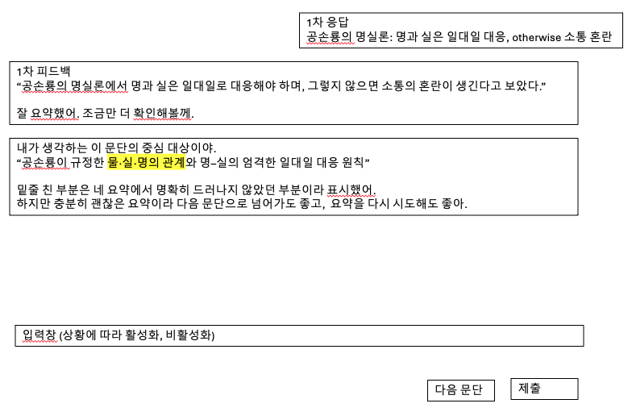
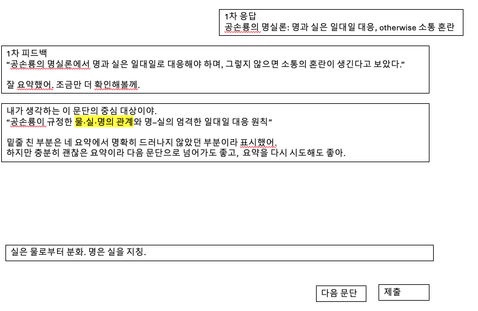
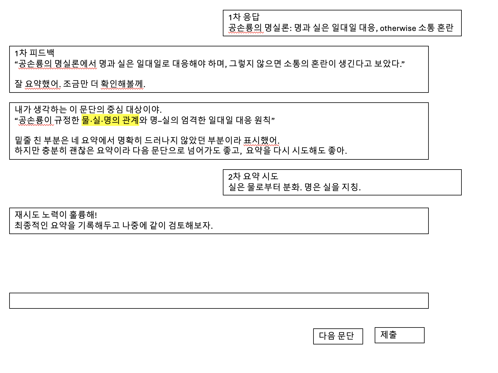
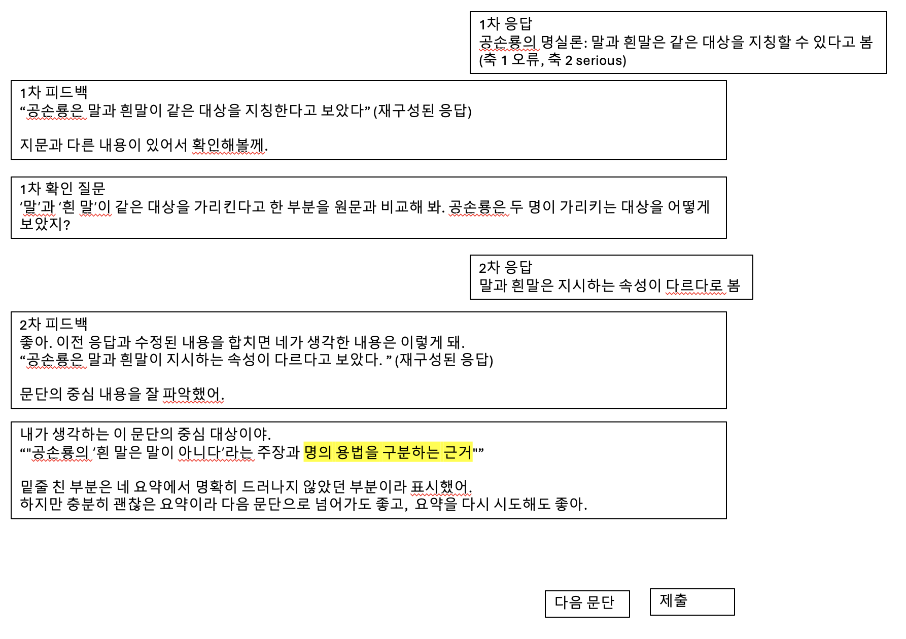
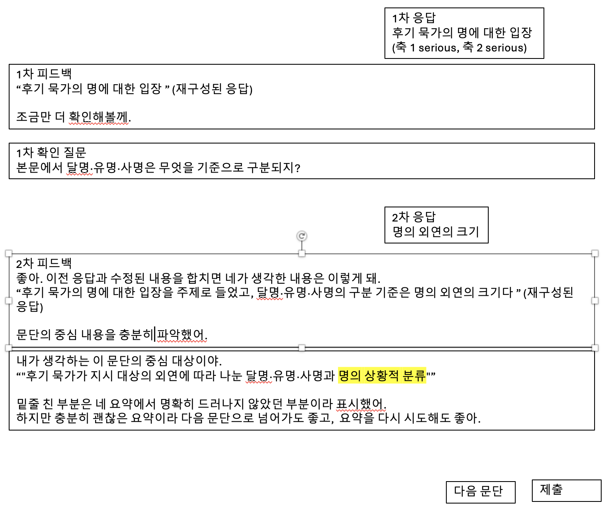
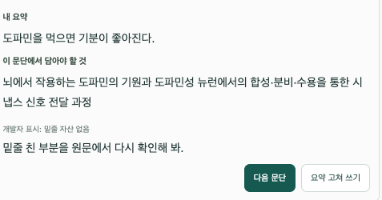
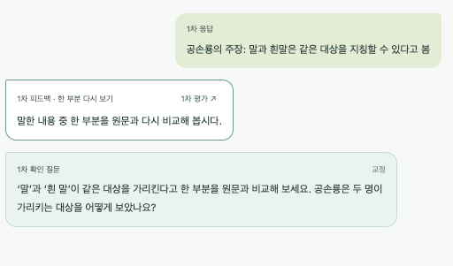

# 경계 보여 주기 개발자 모드 사용감 피드백 (2026-10-15)

- 대상: `/dialogue/dev` 판정 모드 `v4-boundary-show` ([D-0134](../../../memory/decisions/D-0134-boundary-show-dev-mode-central-object.md), [인계](../../handoffs/2026-10-15-boundary-show-dev-mode.md))
- 상태: **기록만.** 구현·결정 전. 2·7은 가능 여부 검토 항목.
- 출처: 사용자 첫 사용 후 메모(2026-10-15), 8~12번은 추가 메모

## 수정 사항

1. **표시 방식:** "이 문단에서 담아야 할 것"의 해당 구간을 밑줄이 아니라 문제 풀이 화면과 같은 미색 하이라이트로 표시.
2. **(검토) 지문 하이라이트:** 놓친 축에 해당하는 원문(지문) 부분도 미색 하이라이트할 수 있는지 검토.
3. **레이아웃:** 문제 풀이 화면과 같이 버튼 응답 영역과 대화창을 분리.
4. **고쳐 쓰기 입력:** 요약 고쳐 쓰기도 별도 입력창이 아니라 일원화된 하나의 입력창에서.
5. **보여 주기 상호작용 예시:** 아래 그림 참고.
6. **오류 응답 말투:** 오류일 때 피드백·질문 말투가 반말로 유지되지 않음(그림 참고).
7. **(검토) 오류 시 지문 하이라이트:** 오류 질문에서도 그 질문에 해당하는 지문 부분을 하이라이트할 수 있는지 검토.
8. **보여 주기 → 재시도 응답:** 고쳐 쓴 요약(2차 요약 시도)을 제출하면 판정 없이 코드로 고정된 메시지를 보여 준다. 예: "재시도 노력이 훌륭해! 최종적인 요약을 기록해두고 나중에 같이 검토해보자."(그림 참고)
9. **한 축 ERROR + 한 축 SERIOUS 흐름 예시:** 오류 질문 → 2차 응답에서 오류 해소, SERIOUS 축이 남으면 재구성된 응답을 보여 주고 칭찬한 뒤 남은 축을 보여 주기(그림 참고).
10. **두 축 모두 SERIOUS 흐름 예시:** 한 축만 질문 → 2차 응답에서 그 축 해소, 묻지 않은 축이 남으면 재구성된 응답을 보여 주고 칭찬한 뒤 남은 축을 보여 주기(그림 참고).
11. **(현재 화면 문제) 도파민 1문단:** 보여 주기 카드의 "내 요약"이 1차 응답만 보여 줘 질문에 대한 2차 답이 빠지고, 밑줄 자산이 없는 지문인데도 "밑줄 친 부분을…" 안내가 나온다(그림 참고).
12. **(검토, 보류) 무관 응답 따로 거르기:** 지문과 전혀 상관없는 응답을 짧지만 주제는 맞는 응답과 구별해 축 질문 대신 다시 시도를 안내할지 검토. 사용성 시험 후 실데이터에서 무관 응답이 관측되면 다룬다(아래 메모).

## 그림

### 5. 보여 주기 상호작용 예시

그림 내용(공손룡 2문단):

- **1차 응답(오른쪽 말풍선):** "공손룡의 명실론: 명과 실은 일대일 대응, otherwise 소통 혼란"
- **1차 피드백:** 학생 요약을 문장으로 되짚어 줌("공손룡의 명실론에서 명과 실은 일대일로 대응해야 하며, 그렇지 않으면 소통의 혼란이 생긴다고 보았다.") + "잘 요약했어. 조금만 더 확인해볼게."
- **보여 주기 말풍선:**
  - "내가 생각하는 이 문단의 중심 대상이야."
  - "공손룡이 규정한 **물·실·명의 관계**(미색 하이라이트)와 명–실의 엄격한 일대일 대응 원칙"
  - "밑줄 친 부분은 네 요약에서 명확히 드러나지 않았던 부분이라 표시했어. 하지만 충분히 괜찮은 요약이라 다음 문단으로 넘어가도 좋고, 요약을 다시 시도해도 좋아."
- **아래:** 입력창 하나(상황에 따라 활성/비활성) + [다음 문단] [제출]. 두 번째 그림은 같은 입력창에 고쳐 쓴 요약("실은 물로부터 분화. 명은 실을 지칭.")을 넣은 상태.

### 8. 보여 주기 → 재시도 응답

- 보여 주기 말풍선 뒤 학생 말풍선 **"2차 요약 시도"**: "실은 물로부터 분화. 명은 실을 지칭."
- 이어서 코드 고정 메시지 말풍선: "재시도 노력이 훌륭해! 최종적인 요약을 기록해두고 나중에 같이 검토해보자."
- 아래는 같은 단일 입력창과 [다음 문단] [제출].

### 9. 한 축 ERROR + 한 축 SERIOUS 흐름 예시 (공손룡 3문단)

- **1차 응답:** "공손룡의 명실론: 말과 흰말은 같은 대상을 지칭할 수 있다고 봄" (AX1 ERROR, AX2 SERIOUS)
- **1차 피드백:** 재구성된 응답 "공손룡은 말과 흰말이 같은 대상을 지칭한다고 보았다" + "지문과 다른 내용이 있어서 확인해볼께."
- **1차 확인 질문(반말):** "'말'과 '흰 말'이 같은 대상을 가리킨다고 한 부분을 원문과 비교해 봐. 공손룡은 두 명이 가리키는 대상을 어떻게 보았지?"
- **2차 응답:** "말과 흰말은 지시하는 속성이 다르다로 봄"
- **2차 피드백:** "좋아. 이전 응답과 수정된 내용을 합치면 네가 생각한 내용은 이렇게 돼." + 재구성된 응답 "공손룡은 말과 흰말이 지시하는 속성이 다르다고 보았다." + "문단의 중심 내용을 잘 파악했어."
- **보여 주기:** "내가 생각하는 이 문단의 중심 대상이야." + "공손룡의 '흰 말은 말이 아니다'라는 주장과 **명의 용법을 구분하는 근거**(미색 하이라이트, 남은 SERIOUS 축 AX2)" + 표시 이유와 "다음 문단으로 넘어가도 좋고, 요약을 다시 시도해도 좋아."
- 아래 [다음 문단] [제출].

### 10. 두 축 모두 SERIOUS 흐름 예시 (공손룡 5문단)

- **1차 응답:** "후기 묵가의 명에 대한 입장" (AX1 SERIOUS, AX2 SERIOUS)
- **1차 피드백:** 재구성된 응답 "후기 묵가의 명에 대한 입장" + "조금만 더 확인해볼께." (5번과 달리 "잘 요약했어" 없음)
- **1차 확인 질문(반말, AX1 대상):** "본문에서 달명·유명·사명은 무엇을 기준으로 구분되지?"
- **2차 응답:** "명의 외연의 크기"
- **2차 피드백:** "좋아. 이전 응답과 수정된 내용을 합치면 네가 생각한 내용은 이렇게 돼." + 재구성된 응답 "후기 묵가의 명에 대한 입장을 주제로 들었고, 달명·유명·사명의 구분 기준은 명의 외연의 크기다" + "문단의 중심 내용을 충분히 파악했어."
- **보여 주기:** "내가 생각하는 이 문단의 중심 대상이야." + "후기 묵가가 지시 대상의 외연에 따라 나눈 달명·유명·사명과 **명의 상황적 분류**"(미색 하이라이트, 묻지 않고 남은 AX2. `manual-v0.json`의 AX2 구간과 일치) + "밑줄 친 부분은 네 요약에서 명확히 드러나지 않았던 부분이라 표시했어. 하지만 충분히 괜찮은 요약이라 다음 문단으로 넘어가도 좋고, 요약을 다시 시도해도 좋아."
- 아래 [다음 문단] [제출].
- 현재 로직과의 관계: 질문은 판정 모델이 고른 한 축에만 하고(`central-story-gate-prompt-v4.md:120-127`), 2차 판정 후 남은 SERIOUS 축은 질문 없이 보여 준다(`boundaryShowAction`). 그림의 흐름은 이 로직과 맞다.

### 11. 도파민 1문단: 내 요약·밑줄 없음 (현재 화면)

- **1차 응답:** "도파민을 먹으면 기분이 좋아진다." (ERROR → 오류 교정 질문, 존댓말: 6번과 같은 문제)
- **2차 응답:** "외부에서 들어온 도파민은 신경전달물질로 작용할 수 없음." → 2차 판정 AX1 UNCLEAR_OK, AX2 UNCLEAR_SERIOUS → 보여 주기.
- **문제 1 — 내 요약:** 카드의 "내 요약"이 1차 응답만 보여 준다. 인계 문서(`docs/handoffs/2026-10-15-boundary-show-dev-mode.md:24`, `record.initialResponse`)와 D-0134 명세대로 구현된 것이라 버그가 아니라 설계 공백이다. 2차 답이 반영되지 않아 오류를 고친 뒤에도 틀린 요약이 "내 요약"으로 남는다. 9·10번 그림처럼 이전 응답과 합친 재구성 응답을 보여 줘야 한다(5·9·10번 재구성 응답 메모와 같은 해결).
- **문제 2 — 밑줄 없음:** 손 연결 자산 `manual-v0.json`은 공손룡·법인·표면장력 3지문(16문단)만 있어 도파민은 `assetStatus: MISSING`이다(개발자 표시 "밑줄 자산 없음"). 인계 명세대로의 동작이지만, 밑줄이 없는데 안내가 "밑줄 친 부분을 원문에서 다시 확인해 봐."로 고정돼 문구가 화면과 어긋난다.
- **함께 볼 점:** 자산 없는 문단에서 SHOW가 나오면 무엇을 보여 줄지(문구 대체, 시험 대상을 3지문으로 제한, 또는 자산 확대) 정해야 한다.

### 6. 오류 응답 말투 (현재 화면)

- **1차 응답:** "공손룡의 주장: 말과 흰말은 같은 대상을 지칭할 수 있다고 봄"
- **1차 피드백(한 부분 다시 보기):** "말한 내용 중 한 부분을 원문과 다시 비교해 봅시다."
- **1차 확인 질문(교정):** "'말'과 '흰 말'이 같은 대상을 가리킨다고 한 부분을 원문과 비교해 보세요. 공손룡은 두 명이 가리키는 대상을 어떻게 보았나요?"
- 둘 다 존댓말이며 보여 주기 화면의 반말과 섞인다.

## 구현 전에 정할 점 (Claude 메모)

- **6번 → [D-0136](../../../memory/decisions/D-0136-boundary-show-banmal-question-feedback.md)로 결정(이 모드 전용 프롬프트 변형으로 질문·피드백 반말, 운영은 시험 후).** 이전 메모: D-0134는 "기존 V4 질문·피드백 문구의 말투 변경"을 범위 밖으로 두었다. 고정 문구(코드)는 바로 바꿀 수 있지만, 질문 문장은 V4 피드백 프롬프트가 생성하므로 이 모드에서만 반말로 생성하려면 프롬프트 변형이 필요하다. 별도 결정 필요.
- **5·9·10·11번 → [D-0137](../../../memory/decisions/D-0137-boundary-show-effective-response-restatement.md)로 결정(`effectiveResponse` 사용, 그림 문구는 예시).** 이전 메모 — 5·9·10번 재구성된 응답: 1차·2차 피드백에서 학생 응답(2차는 이전 응답과 합친 것)을 문장으로 다시 보여 준다. V4 결과에 `snapshot.effectiveResponse`(화면 계약 `step.effectiveResponse`)가 있으므로 이를 쓸 수 있는지 먼저 확인. 부족하면 생성 호출이 추가된다.
- **5번 문구:** 하이라이트로 바꾸면 "밑줄 친 부분" 표현을 "표시한 부분"으로 맞춰야 한다(10번 그림 문구도 같음).
- **10번 문구:** 질문 뒤 보여 주기에는 "하지만 충분히 괜찮은 요약이라"처럼 안심시키는 문장이 붙는다. 질문 없이 바로 보여 주는 5번 문구와 나눌지(질문 횟수에 따른 고정 문구 두 벌) 정해야 한다. 1차 피드백도 5번은 "잘 요약했어. 조금만 더 확인해볼게.", 10번은 "조금만 더 확인해볼께."만 있어, 전 축 SERIOUS(질문)와 일부 SERIOUS(바로 보여 주기)의 1차 문구가 다르다.
- **2·7번:** 원문 하이라이트는 기존 `sourceGuide`(질문용 원문 구간, `ReadingText`의 `mark`)를 쓸 수 있는지, 축↔원문 구간 연결 자산이 따로 필요한지 확인 필요.
- **12번 무관 응답 거르기 (보류):**
  - 현재: 무관 응답은 모든 축 unknown → 근거 없는 축은 OK가 될 수 없어(`gate.ts:242-245`) 전체 SERIOUS → 축 질문 1회 → 보여 주기. 따로 거르는 코드는 없다.
  - "모든 축 unknown = 무관" 코드 규칙은 쓸 수 없다. 기존 로그(`.omc/logs/dialogue-experiment/`) 판정 1,985건 중 모든 축 unknown 2회는 모두 주제는 맞는 짧은 응답("후기 묵가의 명에 대한 입장", 공손룡 p5)이었고 2차에서 바로 보완됐다. 무관 응답 실사례는 0건.
  - 거른다면(Claude 권고): 호출 추가 없이 게이트 출력에 응답 종류 필드(주제 관련 / 무응답·모름 / 무관)를 두고 확실할 때만 무관 표시. 무관·모름이면 축 질문을 쓰지 않고 코드 고정 반말 문구(예: "이 문단 내용으로 다시 요약해 줄래?")로 재시도 1회, 같으면 보여 주기로 끝. 10번의 "충분히 괜찮은 요약이라" 문구가 무관 응답에 붙는 문제도 함께 해소.
  - 보류 이유: 게이트 프롬프트 변경이라 D-0132(V4 유지)에 걸려 별도 결정 필요, 빈도 근거 없음, 현재 시험 대상은 보여 주기 사용감이고 무관 응답도 질문 1회 + 보여 주기로 끝나 흐름이 깨지지 않음.
